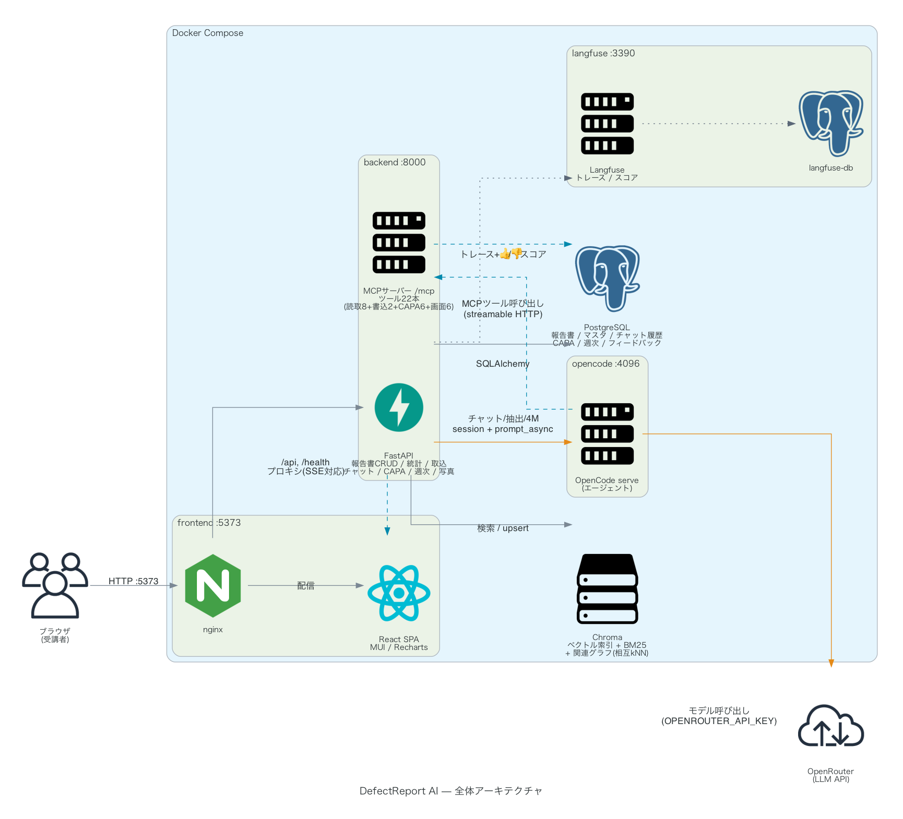

# DefectReport AI

製造業の**不適合報告書(不良報告書)を AI で構造化・分析**するローカル動作の Web アプリケーション。2026年度 AIセミナー(全10回)の前半(第3〜7回)で、受講者がステップバイステップに構築する「完成イメージアプリ」です。

不適合報告書(Excel / PDF / 画像)を取り込むと、AI が項目を構造化抽出し、4M(Man/Machine/Material/Method)に分類。蓄積した報告書には自然言語で質問でき、根拠(報告書ID)付きで回答します。チャットは OpenCode + OpenRouter を生成エンジンに、報告書データへは MCP(Model Context Protocol)経由でアクセスするエージェント型構成です。経営者向けの KPI ダッシュボード(パレート図・管理図・機械別/担当者別集計・トレンド・予兆アラート)で全体傾向も可視化します。



> システム図は `docs/diagrams/generate_diagrams.py`(mingrammer/diagrams)で再生成できます: `cd docs/diagrams && ../../.venv/bin/python generate_diagrams.py`。

---

## 主な機能

| # | 機能 | 概要 |
|---|---|---|
| ① | 帳票取り込み・AI構造化抽出 | Excel/PDF/画像をアップロード → AI が項目抽出(vision + 構造化出力)→ 確認して登録 |
| ② | RAGチャット(根拠付き回答) | 蓄積報告書をベクトル検索し、`[KZ25-XXXX]` 引用付きでストリーミング回答。生成は **OpenCode+OpenRouter**、報告書データへは **MCP**でアクセス。明示依頼で報告書の登録・更新も可能。**会話はセッション単位で保存**され、一覧・復元・削除できる(リロード後も保持) |
| ③ | 4M分析・改善提案 | 報告書を Man/Machine/Material/Method に分類し、要因推定と改善策を生成 |
| ④ | KPIダッシュボード | 不良率・直行率(FPY)・損失・パレート図・p管理図・各種集計・トレンド・予兆アラート(急増・対策後再発・連続上昇の高度ルール含む) |
| ⑤ | 類似事例サジェスト | 報告書詳細にハイブリッド検索で過去の類似報告を提示(`GET /api/reports/{id}/similar`) |
| ⑥ | 週次ダイジェスト | KPI前週比+重大不良+アラートを決定論で集計し、AI所見を添えたMarkdownレポートを生成(`/digests`) |
| ⑦ | 是正処置(CAPA)+8D | 是正・予防処置の起票〜効果確認〜完了を管理。類似事例からAIドラフト、8Dレポート生成(`/capa`) |
| ⑧ | 不良写真+AI外観アシスト | 報告書に写真を添付し、visionモデルが観察所見と現象候補を提案 |
| ⑨ | 音声入力 | チャット入力にWeb Speech API(ja-JP)のマイクボタン(対応ブラウザのみ) |
| ⑩ | 業務Ontology | 意味モデルをOpenCodeへ供給し、対象IDの解決・関係探索・指標計算・CAPA更新検証に使用。構造グラフと実データグラフを閲覧(`/analysis/ontology?view=graph`) |
| ⑪ | 報告書トリアージ(Jev+LangGraph) | 判断モデル **Jev** が現象・要因・4M・重要度と客先流出・再発のおそれを約0.3秒で判断(型付きの答え＋確率)。閾値(117件で測定)に届かない項目だけ LLM と人へ、CAPA は処置案を用意して**人の承認で止める**(LangGraph の interrupt)。新規作成では分類を提案。`JEV_ENABLED=1` で有効([docs/11](docs/11_報告書トリアージ_JevとLangGraph.md)) |

補助機能: 報告書の CRUD(一覧・検索・作成・編集・削除)、**全項目フィルタ+スマート検索(意味検索、`GET /api/reports/search`)**、各画面の期間フィルタ、マスタ管理。フィルタ状態はURLクエリが正本で、**人間のUI操作とAIの画面操作(ui_navigate)が同じ状態を共有**する。

AI 機能(チャット・帳票抽出・4M分析)はすべて **OpenCode + OpenRouter** を主エンジンとする。チャットは OpenCode 専用、帳票抽出・4M分析は `ANTHROPIC_API_KEY` があれば Anthropic 直叩きを代替として使える。

---

## 技術スタック

| 層 | 技術 |
|---|---|
| フロントエンド | React 19 + TypeScript / Vite / MUI(Material UI)/ Recharts / React Router |
| バックエンド | FastAPI(Python 3.12)/ SQLAlchemy |
| AI 生成(主) | OpenCode サーバー(`opencode serve`)+ OpenRouter モデル(既定 `anthropic/claude-sonnet-4.5`)。チャット・帳票抽出・4M分析すべてに使用 |
| データ連携 | MCP(FastMCP、`/mcp/`)で報告書データを **28ツール**公開(下表)。REST と共通ロジック(`services/report_service.py`) |
| AI 生成(代替) | Anthropic API(`anthropic` SDK、既定 `claude-sonnet-5`)。帳票抽出・4M分析のみ(チャットは非対応)。任意 |
| データストア | **RDB 二段構え**: Docker=PostgreSQL(`db` サービス)/ ローカル=SQLite(同一スキーマ)。報告書・マスタ・**チャット履歴**の正本。+ Chroma(ベクトル索引、ファイル)。検索は**ハイブリッド**(形態素BM25+e5のRRF融合+同義語展開+ファセット補正、`services/hybrid.py`) |
| 埋め込み | sentence-transformers `intfloat/multilingual-e5-small`(未導入時はキーワード検索にフォールバック) |
| 実行 | ローカル(venv + npm、SQLite)または Docker Compose 一括起動(**db / backend / opencode / frontend**、PostgreSQL) |

> 認証・Neo4j・承認ワークフロー・多言語対応はスコープ外(発展トピックは `docs/07_発展トピック.md`)。

### MCP ツール(28本 / `/mcp/`)

チャット中に OpenCode が自律的に呼び出す。既存22本にOntologyの定義・名前解決・実体取得・関係探索・集計・操作プレビューの6本を追加。書き込み・CAPA登録は「ユーザーが明示的に依頼した場合のみ」実行する。詳細は `docs/04_API設計書.md` §6.5。

| 種別 | ツール | 用途 |
|---|---|---|
| 読取 | `list_defect_reports` | 機械/工程/客先/作業者/現象/重要度/状態/4M/期間/自由語で絞り込み一覧(total+items) |
| 読取 | `search_defect_reports` | 内容が曖昧な類似検索(machine/process で追加絞り込み可) |
| 読取 | `get_defect_report` | 報告書ID指定で全項目取得 |
| 読取 | `get_statistics` | KPI・パレート・各集計・トレンド・内訳 |
| 読取 | `get_control_chart` | p 管理図(UCL/LCL) |
| 読取 | `get_active_alerts` | 予兆アラート |
| 読取 | `list_masters` | マスタ(機械名等)の正確な表記確認 |
| 書込 | `create_defect_report` | 新規登録(自動採番・`status=open` 固定) |
| 書込 | `update_defect_report` | 状態/重大度/対策/原因/要因/4M/備考/良品状態の8項目のみ更新 |
| 読取 | `get_similar_reports` | 指定報告書に似た過去事例をハイブリッド検索で取得 |
| CAPA | `list_capa_actions` / `draft_capa_actions` / `create_capa_action` / `update_capa_action` | 是正処置の一覧・AIドラフト・起票・状態更新(起票/更新は明示依頼時のみ) |
| CAPA | `generate_8d_report` | 8D(Eight Disciplines)レポートの生成 |
| 集計 | `generate_weekly_digest` | 週次ダイジェストの生成 |
| Ontology | `get_ontology_definition` / `resolve_ontology_entity` / `get_ontology_object` | 定義・対象の名前解決・現在の属性と出典 |
| Ontology | `traverse_ontology_relation` / `query_quality_ontology` / `preview_capa_update` | 実関係の探索・定義済み指標の集計・保存しない更新検証 |
| 画面 | `ui_navigate` | 「〜を画面に出して」でブラウザを指定ページへ遷移(reports は絞り込み・スマート検索付き可。digests/capa 含む全画面) |
| 画面 | `ui_open_report` / `ui_new_report` / `ui_edit_report` | 報告書の詳細/新規作成/編集画面へ遷移 |
| 画面 | `ui_run_4m_analysis` / `ui_set_theme` | 画面上での4M分析実行・ダーク/ライト切替 |

---

## ディレクトリ構成

```
example_app/
├─ README.md                 ← 本ファイル
├─ docs/                     ← 設計ドキュメント一式
│  ├─ 01_要件定義書.md
│  ├─ 02_機能仕様書.md
│  ├─ 03_データモデル設計書.md
│  ├─ 04_API設計書.md
│  ├─ 05_UI設計書.md
│  ├─ 06_AI設計書.md
│  └─ 07_発展トピック.md
├─ data/                     ← 模擬データと生成スクリプト
│  ├─ generate_mock_data.py  ← 模擬データ生成(完全架空・seed=774123)
│  ├─ defect_reports.csv     ← 不良報告 117件(ID: KZ25-XXXX)
│  ├─ forms_xlsx/            ← 帳票 Excel(全件)
│  └─ forms_pdf/             ← 帳票 PDF(先頭10件、OCRデモ用)
├─ app/                      ← 完成形アプリ(第7回の到達点)
│  ├─ docker-compose.yml
│  ├─ .env.example
│  ├─ backend/               ← FastAPI
│  │  ├─ main.py             ← アプリ + /mcp/ マウント
│  │  ├─ database.py  models.py  schemas.py
│  │  ├─ routers/            ← reports / ingest / chat / dashboard / analysis / masters
│  │  ├─ services/           ← llm / rag / stats / opencode_client / mcp_server / report_service
│  │  └─ data/               ← SQLite(defect_reports.db)/ Chroma(自動生成)
│  ├─ opencode/              ← OpenCode サーバー(Dockerfile / entrypoint.sh / opencode.json)
│  └─ frontend/              ← React + Vite
│     └─ src/                ← pages / components / api / theme.ts など
└─ steps/                    ← 各回の演習ステップ(第3〜7回)
   ├─ step01_第3回_土台
   ├─ step02_第4回_ClaudeAPI
   ├─ step03_第5回_RAG取込
   ├─ step04_第6回_KPI分析
   └─ step05_第7回_仕上げ
```

---

## セットアップ

### 1. API キーの設定(.env)

**必須キーは `OPENROUTER_API_KEY` の1本のみ**です(チャット・帳票抽出・4M分析のすべてが OpenCode 経由で動きます)。`app/.env.example` をコピーして `.env` を作成し、設定します。

| キー | 必須 | 用途 | 取得先 |
|---|---|---|---|
| `OPENROUTER_API_KEY` | **必須** | すべての AI 機能(チャット・帳票抽出・4M分析) | [OpenRouter](https://openrouter.ai/keys) |
| `ANTHROPIC_API_KEY` | 任意 | 帳票抽出・4M分析の**代替**経路(チャットには使わない) | [Anthropic Console](https://console.anthropic.com/) |
| `JEV_ENABLED` | 任意 | `1` で報告書トリアージ(判断モデル Jev)を有効にする。Jev は `OPENROUTER_API_KEY` で呼ぶ | — |
| `TYPESAFE_API_KEY` | 任意 | Jev を TypeSafe から直接呼ぶとき(あれば OpenRouter より優先) | [TypeSafe](https://console.typesafe.ai/settings/keys) |

`.env` は `example_app/.env`(リポジトリ直下)または `app/.env` のどちらに置いても Docker Compose が読み込みます(両方任意)。

```bash
cd app
cp .env.example .env
# .env を編集:
#   OPENROUTER_API_KEY=sk-or-...                       ← 必須(全AI機能)
#   OPENCODE_MODEL=anthropic/claude-sonnet-4.5         ← モデル(OpenRouter のモデルID、省略可)
#   ANTHROPIC_API_KEY=sk-ant-...                       ← 任意(抽出/4M の代替経路)
#   ANTHROPIC_MODEL=claude-sonnet-5                    ← 省略可(既定 claude-sonnet-5)
```

> キーが無くてもアプリは起動します。`OPENROUTER_API_KEY` が無いとチャットは 503。帳票抽出・4M分析は OpenCode か `ANTHROPIC_API_KEY` のいずれかがあれば動作(両方無ければ PDF/画像抽出と 4M が無効。一覧・ダッシュボード等は動作)。状態は `GET /health` の `chat_backend`(`opencode` / `none`)・`anthropic_configured`(抽出/4M の AI が設定済みか)で確認できます。

### 2A. ローカルで起動(venv + npm)

バックエンド(ポート 8000):

```bash
cd app/backend
python -m venv .venv && source .venv/bin/activate
pip install -r requirements.txt
# ベクトル検索を使う場合(任意・初回はモデルDLあり):
pip install -r requirements-embeddings.txt
uvicorn main:app --reload --port 8000
```

フロントエンド(ポート 5173、別ターミナル):

```bash
cd app/frontend
npm install
npm run dev
```

ブラウザで http://localhost:5173 を開きます(開発時、`/api` と `/health` は 8000 へプロキシされます)。

> venv + npm 起動では OpenCode サーバーは立ち上がりません。**チャットは OpenCode 専用**なので、`OPENCODE_URL` 未設定だとチャットは 503 になります。ローカルでチャットを使うには別途 `opencode serve --port 4096` を起動し、backend に `OPENCODE_URL=http://localhost:4096` と `OPENROUTER_API_KEY` を渡してください(帳票抽出・4M分析は `ANTHROPIC_API_KEY` があれば OpenCode なしでも動作)。手軽に全機能を試すなら次の Docker 一括起動を推奨します。

### 2B. Docker で一括起動

```bash
cd app
docker compose up --build
```

- フロントエンド: http://localhost:5173
- バックエンド(API): http://localhost:8000 (`GET /health` で稼働確認)
- OpenCode サーバー: `opencode` サービス(内部ポート 4096、backend が `OPENCODE_URL=http://opencode:4096` で参照)
- DB: `db` サービス(`postgres:16-alpine`、内部ポート 5432)

`docker compose up` は **db / backend / opencode / frontend の4サービス**を起動します。

- **DB は二段構え**: Docker では backend の `DATABASE_URL` が `db`(PostgreSQL)を指すため、報告書・マスタ・**チャット履歴**はすべて PostgreSQL に保存されます(`db-data` ボリュームで永続化)。Docker を使わない venv 起動では `DATABASE_URL` 未設定 → **SQLite** に自動フォールバック(同一スキーマ)。Chroma のベクトル索引はどちらでもファイル(Docker では `backend-data` ボリューム)です。
- backend の既定 `OPENCODE_URL` が `opencode` サービスを指すため、チャットは初めから OpenCode + OpenRouter で動作します(`OPENROUTER_API_KEY` が必要)。OpenCode は `opencode.json` の `mcp.defect-reports`(`http://backend:8000/mcp/`)で backend の MCP に接続します。
- 初回起動時、DB が空なら `data/defect_reports.csv` から自動でシードし、Chroma のベクトル索引を構築します。

---

## 模擬データの生成

> **注意: `data/` に同梱のデータはすべて疑似データ(プログラム生成の架空データ)です。**
> 実在の企業・人物・製品・実際の不良事例とは一切関係ありません。客先(翠峰重工業〜霞岡バルブ工業)・
> 作業者名・部品番号・不具合内容はすべて `generate_mock_data.py` がテンプレートと
> 乱数から合成したものです。

疑似の不良報告データ(117件、乱数シード固定 seed=774123 で再現可能・完全架空)と帳票ファイル(Excel 全件 / PDF 先頭10件)は次で生成します。

```bash
python data/generate_mock_data.py
```

生成物:
- `data/defect_reports.csv` — 不良報告 117件(ID: KZ25-XXXX)
- `data/forms_xlsx/KZ25-XXXX.xlsx` — 帳票 Excel(取り込みデモ用)
- `data/forms_pdf/KZ25-XXXX.pdf` — 帳票 PDF(OCR/vision デモ用、先頭10件)

自社データを持ち込む場合は、CSV のカラム名を `docs/03_データモデル設計書.md` の API フィールド名に合わせてください。

---

## セミナー対応表(第3〜7回)

前半では、下表の順に機能を積み上げて `app/`(完成形)に到達します。各ステップの成果物は `steps/` 以下にあります。

| 回 | テーマ | ステップ | 主に作るもの |
|---|---|---|---|
| 第3回 | アプリ設計と土台づくり | `steps/step01_第3回_土台` | プロジェクト雛形、データモデル、EDA、報告書の一覧・詳細表示 |
| 第4回 | Claude API の組み込み | `steps/step02_第4回_ClaudeAPI` | チャット機能(ストリーミング)、構造化出力(JSON抽出)の基礎 |
| 第5回 | データ連携・RAG・取り込み | `steps/step03_第5回_RAG取込` | 帳票(Excel/PDF/画像)取り込み、RAG による根拠付き回答 |
| 第6回 | データ分析・KPIダッシュボード | `steps/step04_第6回_KPI分析` | パレート図・p管理図・各種集計・トレンド、4M分析、予兆アラート |
| 第7回 | テスト・デバッグ・仕上げ・デプロイ | `steps/step05_第7回_仕上げ` | CRUD 完成、テスト、Docker、README/仕様書 → 完成形は `app/` |

> 後半(第8〜10回)は、受講者が各自の業務課題を題材に、ここで学んだ手法を応用します。

---

## ドキュメント一覧

| ファイル | 内容 |
|---|---|
| [`docs/01_要件定義書.md`](docs/01_要件定義書.md) | 背景・目的・対象ユーザー・機能要件(FR)・非機能要件・スコープ外 |
| [`docs/02_機能仕様書.md`](docs/02_機能仕様書.md) | 各機能の画面・操作フロー・入出力・エラー時挙動、ユースケース3本 |
| [`docs/03_データモデル設計書.md`](docs/03_データモデル設計書.md) | SQLite テーブル・Chroma コレクション・模擬データ定義(**正本**) |
| [`docs/04_API設計書.md`](docs/04_API設計書.md) | REST/SSE エンドポイント・Claude API 利用規則(**正本**) |
| [`docs/05_UI設計書.md`](docs/05_UI設計書.md) | 画面一覧・ワイヤーフレーム・画面遷移・配色・コンポーネント方針 |
| [`docs/06_AI設計書.md`](docs/06_AI設計書.md) | AI 利用3箇所(構造化抽出・RAGチャット・4M分析)の設計とプロンプト例(OpenCode+OpenRouter が主、Anthropic は代替) |
| [`docs/07_発展トピック.md`](docs/07_発展トピック.md) | Neo4j/ハイブリッドRAG・RAGAS・Langfuse・認証・ローカルLLM・OpenRouter・MCP |
| [`docs/11_報告書トリアージ_JevとLangGraph.md`](docs/11_報告書トリアージ_JevとLangGraph.md) | 判断モデル Jev と LangGraph による報告書トリアージ(考え方・質問・117件の測定と閾値・API・設定) |

## OntologyをAIエージェントで使う実装（2026-09-15）

[設計・調査資料・講義での実演手順](docs/12_Ontologyエージェント実装.md)。意味モデルは `app/backend/ontology/quality.json`。MCP Resourceとツールに加え、OpenCodeチャットのsystemへ定義を渡し、REST/MCPが同じ実行層を利用します。型構造と実データは「業務Ontology → グラフで見る」で確認できます。
