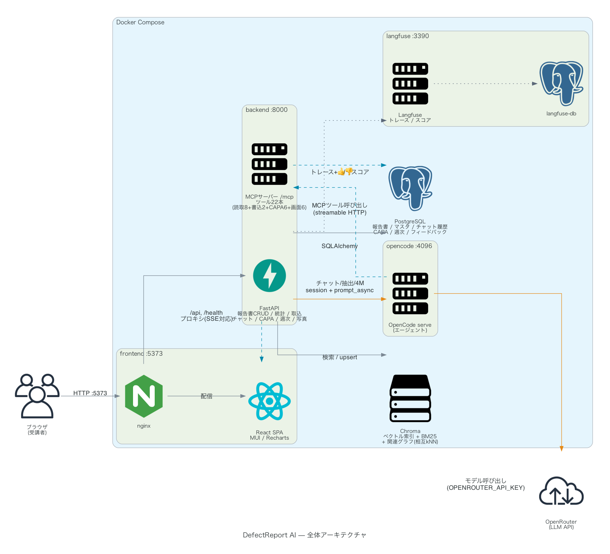
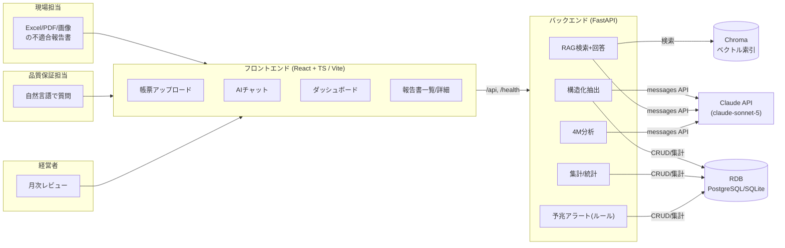

# DefectReport AI — 要件定義書

本書は、2026年度 AIセミナー(全10回)の前半(第3〜7回)で受講者がステップバイステップに構築する「完成イメージアプリ」**DefectReport AI** の要件を定義する。製造業の不適合報告書(不良報告書)を AI で構造化・分析し、根拠付きの質問応答と経営者向け KPI 可視化までを一気通貫で行うローカル動作の Web アプリケーションである。

関連文書:
- `docs/02_機能仕様書.md` — 各機能の画面・操作フロー・ユースケース
- `docs/03_データモデル設計書.md` — テーブル/ベクトル索引の定義(正本)
- `docs/04_API設計書.md` — REST/SSE エンドポイント(正本)
- `docs/05_UI設計書.md` — 画面一覧・ワイヤーフレーム・配色
- `docs/06_AI設計書.md` — Claude API 利用箇所の設計
- `docs/07_発展トピック.md` — セミナー後半・発展向けトピック

---

## 1. 背景

製造業の品質保証(QA)の現場では、不良や不具合が発生するたびに「不適合報告書(NCR: Non-Conformance Report)」を作成する。この報告書には、発生日・客先・工程・使用機械・作業者・部品・不具合内容・原因・対策・損失費用など、品質改善に直結する情報が詰まっている。しかし現実には次の課題がある。

| # | 課題 | 具体的な状況 |
|---|---|---|
| 1 | **報告書が Excel/PDF/紙のまま埋もれている** | 帳票が個人フォルダやファイルサーバに散在し、横断的な集計・検索ができない。手書き帳票は電子化すらされていない。 |
| 2 | **手入力によるデータ化の負荷** | 集計するには誰かが Excel に転記する必要があり、工数が大きく入力ミスも起きる。 |
| 3 | **過去事例を活かせない** | 「同じ機械で似た不良が過去にあったか」を調べる手段がなく、経験と記憶に依存している。 |
| 4 | **原因分析(4M)が属人的** | Man/Machine/Material/Method のどれが根本原因かの分類・改善提案が担当者のスキル頼みで、ばらつく。 |
| 5 | **経営層が全体傾向を掴めない** | 不良率の推移、損失金額、機械別・工程別の偏り、再発の兆候などが可視化されておらず、意思決定が遅れる。 |

つまり「帳票 → データ → 知見 → 意思決定」の流れが分断されている。生成 AI(Claude)と RAG・構造化抽出・データ分析を組み合わせれば、この分断を橋渡しできる。これが本アプリの狙いである。

---

## 2. 目的

DefectReport AI は次の4つを一つのアプリで実現する。

1. **帳票取り込みの自動化** — Excel/PDF/画像の不適合報告書をアップロードすると、Claude が項目を構造化抽出し、確認して登録できる。手入力工数を削減する。
2. **過去事例の即時検索(RAG)** — 自然言語で質問すると、蓄積された報告書を根拠(報告書ID)付きで引用しながら回答する。「似た不良を探す」を秒で行う。
3. **4M 分析と改善提案** — Claude が不良を Man/Machine/Material/Method に分類し、要因の推定と具体的な改善策を提案する。
4. **KPI ダッシュボードによる可視化** — 不良件数・不良率・直行率(FPY)・損失金額・パレート図・p 管理図・機械別/担当者別/顧客別集計・トレンド・予兆アラートを経営者向けに可視化する。

セミナー上の目的としては、受講者がこのアプリを題材に「React+FastAPI+Claude API+RAG+データ分析」という AI アプリ開発の一連の流れを、バイブコーディング(自然言語での指示による開発)で体得することにある。

---

## 3. 対象ユーザー

本アプリは認証を持たず(演習用)、以下の3つの利用者像(ペルソナ)を想定する。画面はロールで制限しないが、UI 構成は利用者像に沿ってグルーピングする。

| ペルソナ | 立場 | 主な関心 | 主に使う機能 |
|---|---|---|---|
| **品質保証担当(QA)** | 品質保証部門 | 不良の原因究明、類似事例の調査、対策立案、報告書の管理 | AIチャット(RAG)、4M分析、報告書 CRUD、データ分析 |
| **経営者/管理者** | 工場長・経営層 | 全体の傾向、損失金額、改善の進捗、リスクの早期把握 | KPIダッシュボード、予兆アラート、トレンド |
| **現場担当** | 製造現場・検査 | 発生した不良を素早く記録・報告する | 帳票アップロード、新規報告書作成 |

---

## 4. システム全体像

Docker Compose の4サービス(db / backend / opencode / frontend)+ OpenRouter と、backend⇄OpenCode 間の MCP ループを含む全体アーキテクチャ:

> 画像は `docs/diagrams/generate_diagrams.py`(mingrammer/diagrams)で生成。次の Mermaid はユーザー像・機能・データストアの論理ビュー(参考)。

技術スタック(簡略版):

| 層 | 技術 |
|---|---|
| フロントエンド | React + TypeScript / Vite / MUI(Material UI)/ Recharts |
| バックエンド | FastAPI(Python 3.12)/ SQLAlchemy |
| AI | OpenCode + OpenRouter(主。既定 `anthropic/claude-sonnet-4.5`)/ Anthropic API(抽出・4M の代替)/ MCP(FastMCP) |
| データストア | RDB(Docker=PostgreSQL / ローカル=SQLite、同一スキーマ)= 報告書・マスタ・チャット履歴の正本。Chroma(ベクトル索引) |
| 埋め込み | sentence-transformers `intfloat/multilingual-e5-small` |
| 実行 | ローカル(venv + npm、SQLite)/ Docker Compose 一括起動(db / backend / opencode / frontend、PostgreSQL) |

---

## 5. 機能要件(FR)

要件は `FR-<機能グループ>-<番号>` 形式で識別する。実装の詳細は `docs/04_API設計書.md` に対応する。

### 5.1 帳票取り込み・AI構造化抽出(FR-IN)

| ID | 要件 | 対応API |
|---|---|---|
| FR-IN-01 | 利用者は不適合報告書ファイル(.xlsx / .pdf / .png / .jpg)をアップロードできる | `POST /api/ingest/upload` |
| FR-IN-02 | .xlsx は openpyxl でセル抽出し、AI(OpenCode 優先/Anthropic 代替)で構造化補正して報告書フィールドに整形する | 〃 |
| FR-IN-03 | .pdf / 画像は AI の vision + 構造化出力で項目抽出する | 〃 |
| FR-IN-04 | 抽出結果は保存せず、確信度(`high`/`medium`/`low`)と警告一覧とともに確認画面へ返す | 〃 |
| FR-IN-05 | 利用者は抽出結果を画面で編集・修正できる | (フロント) |
| FR-IN-06 | 確認後の内容を報告書として保存する(新規作成と同処理)。保存時に Chroma へ索引登録する | `POST /api/ingest/confirm` |
| FR-IN-07 | AI バックエンド未設定(`OPENCODE_URL` と `ANTHROPIC_API_KEY` の両方が未設定)時、pdf/画像は 503 を返し、xlsx はセル抽出のみ(confidence: medium + 警告)で返す | 〃 |

### 5.2 報告書管理(CRUD)(FR-CR)

| ID | 要件 | 対応API |
|---|---|---|
| FR-CR-01 | 報告書を一覧表示できる(検索語・状態・重大度・機械・工程・4M分類・期間で絞り込み、ソート、ページング) | `GET /api/reports` |
| FR-CR-02 | 報告書を新規作成できる。`defect_id` 未指定時は `KZ25-<連番>` を自動採番する | `POST /api/reports` |
| FR-CR-03 | 報告書の詳細を表示できる(不良率 `defect_rate` を含む) | `GET /api/reports/{defect_id}` |
| FR-CR-04 | 報告書を部分更新できる(渡されたフィールドのみ更新、Chroma 再索引) | `PUT /api/reports/{defect_id}` |
| FR-CR-05 | 報告書を削除できる(Chroma からも削除) | `DELETE /api/reports/{defect_id}` |
| FR-CR-06 | 保存時、費用合計 `total_cost` が未指定なら各費用欄をサーバ側で合算する | (サーバ) |

### 5.3 RAG チャット(根拠付き回答)(FR-CH)

チャットの生成エンジンは **OpenCode + OpenRouter**、報告書データへは **MCP(9ツール)**でアクセスするエージェント型構成(`docs/04` §6・§6.5)。

| ID | 要件 | 対応API |
|---|---|---|
| FR-CH-01 | 利用者は自然言語で質問し、蓄積報告書に基づく回答を受け取れる | `POST /api/chat/stream` |
| FR-CH-02 | 回答はストリーミング(SSE)で逐次表示する。本文 `token` に加え、推論 `thinking`・MCP ツール実行状況 `tool` も配信する | 〃 |
| FR-CH-03 | 回答の前に参照した報告書(defect_id・部品名・現象・抜粋・スコア)を提示する | 〃(`sources` イベント) |
| FR-CH-04 | 回答本文は参照報告書を `[KZ25-XXXX]` 形式で引用する | 〃 |
| FR-CH-05 | 集計・傾向の質問には集計データを踏まえて回答する(backend の KPI サマリ + MCP の `get_statistics` / `get_control_chart` / `get_active_alerts`) | (サーバ / MCP) |
| FR-CH-06 | 会話履歴を踏まえて回答する。履歴はサーバーが DB から直近20件をロードする(クライアントは履歴を送らない) | 〃 |
| FR-CH-07 | 埋め込みモデルが使えない環境ではキーワード検索にフォールバックする(結果に `search_mode: keyword` を明示) | 〃 |
| FR-CH-08 | 利用者が**明示的に依頼した場合のみ**、チャットから報告書を登録・更新できる(MCP `create_defect_report` / `update_defect_report`)。登録は自動採番・`status=open` 固定、更新は状態/重大度/対策/原因/要因/4M/備考/良品状態の8項目のみ。実行後に対象 `defect_id` と変更内容を報告する | (MCP、`report_service` 共通) |
| FR-CH-09 | 会話を**セッション単位で永続化**し、一覧表示・復元・削除できる(リロード後も保持)。新規送信時にセッションを自動作成(タイトル=先頭メッセージの先頭30文字)し、SSE 先頭で `session` イベントを返す。assistant メッセージは参照ソース・ツール実行・推論も保存する | `GET/DELETE /api/chat/sessions[/{id}]`、`POST /api/chat/stream` |

### 5.4 4M 分析・改善提案(FR-AN)

| ID | 要件 | 対応API |
|---|---|---|
| FR-AN-01 | 指定した報告書について、Claude が 4M(Man/Machine/Material/Method)分類・要因推定・改善提案を生成する | `POST /api/analysis/4m/{defect_id}` |
| FR-AN-02 | 分析結果を報告書の `category_4m` / `factor` / `ai_improvement` に保存する | 〃 |
| FR-AN-03 | 4M 分類は構造化出力で受け取り、画面に理由(reasoning)と改善案一覧を表示する | 〃 |

### 5.5 KPI ダッシュボード(FR-DB)

| ID | 要件 | 対応API |
|---|---|---|
| FR-DB-01 | KPI サマリー(総件数・総不良数・総加工数・不良率・直行率 FPY・総損失・再発率・未対応件数)を期間指定で表示する | `GET /api/dashboard/statistics` |
| FR-DB-02 | 月次トレンド(件数・不良数・加工数・不良率)を折れ線で表示する | 〃 |
| FR-DB-03 | 現象別パレート図(件数・比率・累積比率)を表示する | 〃 |
| FR-DB-04 | 機械別・作業者別・工程別・顧客別の集計を表示する | 〃 |
| FR-DB-05 | 4M 別・重大度別の内訳を表示する | 〃 |
| FR-DB-06 | 不良率の p 管理図(UCL/LCL 付き)を表示する | `GET /api/dashboard/control-chart` |

### 5.6 予兆アラート(FR-AL)

| ID | 要件 | 対応API |
|---|---|---|
| FR-AL-01 | ルールベースで予兆アラートを算出し、レベル(critical/warning/info)とメッセージを表示する | `GET /api/analysis/alerts` |
| FR-AL-02 | ルール例: 直近30日の不良率が全期間平均の1.5倍超の機械 / 同一現象×同一機械が直近60日に3件以上 / 直近30日に再発フラグ発生 | 〃 |

### 5.7 共通・横断(FR-SYS)

| ID | 要件 | 対応API |
|---|---|---|
| FR-SYS-01 | ヘルスチェックで稼働状態・報告書件数・API キー設定有無・ベクトル検索モードを返す | `GET /health` |
| FR-SYS-02 | 初回起動時、DB が空なら模擬データ(`data/defect_reports.csv`)から自動シードし、Chroma 索引を構築する | (サーバ) |

### 5.8 マスタ管理(FR-MA)

ドロップダウン選択肢(客先 / 発生工程 / 使用機械 / 作業者 / 現象分類 / 要因 の6カテゴリ)を DB マスタ化して管理する。`severity` / `status` / `category_4m` は固定列挙のためマスタ対象外。

| ID | 要件 | 対応API |
|---|---|---|
| FR-MA-01 | 6カテゴリのマスタを一覧・カテゴリ別に取得できる(各項目の使用件数を含む) | `GET /api/masters`, `GET /api/masters/{category}` |
| FR-MA-02 | マスタに新しい選択肢を登録できる。同一カテゴリ内の名称重複は拒否する(409) | `POST /api/masters/{category}` |
| FR-MA-03 | マスタの名称を変更でき、変更は該当カテゴリの列を持つ既存報告書の値へ伝播更新される(更新件数を返す) | `PUT /api/masters/{category}/{item_id}` |
| FR-MA-04 | マスタを無効化(is_active=false)でき、無効値は新規入力の候補から除外される(既存報告書・集計には影響しない) | `PUT /api/masters/{category}/{item_id}` |
| FR-MA-05 | 未使用のマスタを削除できる。使用中(1件以上で参照)のマスタは削除不可とする(409、無効化を促す) | `DELETE /api/masters/{category}/{item_id}` |
| FR-MA-06 | 報告書の保存時、マスタ未登録の選択肢値を自動登録する(現場での新しい機械・客先等をその場で追加できる) | `POST/PUT /api/reports` |

---

## 6. 非機能要件(NFR)

| ID | 分類 | 要件 |
|---|---|---|
| NFR-01 | 動作環境 | 受講者のノート PC 上でローカル動作すること。外部の LLM は OpenRouter(OpenCode 経由)を主とし、任意で Anthropic API も利用できる。 |
| NFR-02 | セットアップ | **必須キーは `OPENROUTER_API_KEY` の1本のみ**(チャット・帳票抽出・4M分析のすべてが OpenCode 経由で動く)。`ANTHROPIC_API_KEY` は任意(帳票抽出・4M分析の代替経路として設定できるが、チャットには使わない)。いずれも `.env`(`example_app/.env` または `app/.env`)に設定する。 |
| NFR-03 | 一括起動 | `docker compose up` でフロント・バック・OpenCode を一括起動できること(ローカルは venv + npm も可。その場合 OpenCode は別途 `opencode serve` を起動)。 |
| NFR-04 | 応答時間の目安 | 一覧/詳細/統計などの通常 API は概ね 1 秒以内。RAG チャットは最初のトークンまで数秒を目安とし、以降はストリーミング表示。帳票抽出・4M 分析は LLM 呼び出しを含むため 5〜15 秒程度を許容。 |
| NFR-05 | データ規模 | 模擬データ 100 件規模を前提とする(自社データ持ち込みも想定)。一覧は既定 50 件・最大 500 件。 |
| NFR-06 | 再現性 | 模擬データ生成は乱数シード固定(seed=42)で再現可能であること。 |
| NFR-07 | 堅牢性 | API キー未設定・埋め込みモデル不在でも、機能を縮退(フォールバック)して起動・動作すること(FR-IN-07、FR-CH-07)。 |
| NFR-08 | 可読性 | AI が生成したコードを受講者が理解できるよう、シンプルな構成・命名とすること。過度な抽象化を避ける。 |
| NFR-09 | 移植性 | ローカル(venv)では SQLite / Chroma とローカルファイルのみで動き、専用インフラを必須としないこと。Docker では `db`(PostgreSQL)を使い、報告書・マスタ・チャット履歴を保存する(`DATABASE_URL` 未設定なら SQLite に自動フォールバック。同一スキーマ)。GPU は必須としない。 |
| NFR-10 | 言語 | UI・データ・AI応答は日本語を基本とする。 |

---

## 7. スコープ外(本アプリでは実装しない)

以下はセミナー前半の完成イメージアプリの範囲外とする。理由と代替の位置づけを併記する。

| 項目 | 扱い |
|---|---|
| **認証・認可(ログイン、JWT、ロール制御)** | ローカル演習のため実装しない。発展トピック(`docs/07`)で JWT 認証の実装例を参照として紹介。 |
| **ナレッジグラフ(Neo4j)・ハイブリッド RAG(text-to-Cypher)** | ベクトル RAG に単純化。Neo4j は発展トピック扱い(docs/07 参照)。 |
| **承認ワークフロー(報告書の申請・承認・差戻し)** | ステータスは `open`/`in_progress`/`completed` の単純遷移のみ。ワークフローエンジンは持たない。 |
| **多言語対応(i18n)** | 日本語のみ。 |
| **本番デプロイ・スケーリング(クラウド、K8s、CI/CD)** | ローカル + Docker Compose まで。クラウドデプロイは各社持ち帰り課題。 |
| **RAGAS 評価・Langfuse 可観測性・ローカル LLM(Ollama)・OpenRouter** | いずれも発展トピック(`docs/07`)で紹介。 |
| **リアルタイム通知・メール送信・帳票の PDF 出力** | 本アプリの対象外。 |

---

## 8. セミナー各回とのマッピング

前半(第3〜7回)で、本要件を段階的に満たしていく。各ステップの成果物は `steps/` 以下に置かれ、完成形は `app/` を参照する。

| 回 | ステップ | 主に満たす要件 |
|---|---|---|
| 第3回 アプリ設計と土台づくり | `steps/step01_第3回_土台` | FR-SYS-01/02、FR-CR-01/03(一覧・詳細表示)、データモデル設計、EDA |
| 第4回 Claude API の組み込み | `steps/step02_第4回_ClaudeAPI` | FR-CH-01〜06(チャット)、FR-IN(構造化出力の基礎) |
| 第5回 データ連携・RAG・取り込み | `steps/step03_第5回_RAG取込` | FR-IN-01〜07(帳票取り込み)、FR-CH-03/04/07(RAG根拠付き) |
| 第6回 データ分析・KPI ダッシュボード | `steps/step04_第6回_KPI分析` | FR-DB-01〜06、FR-AN-01〜03(4M)、FR-AL(アラート) |
| 第7回 テスト・デバッグ・仕上げ・デプロイ | `steps/step05_第7回_仕上げ` | FR-CR-02/04/05(CRUD完成)、NFR-03(Docker)、テスト・README |

> 後半(第8〜10回)は、受講者が各自の業務課題を題材に、本アプリで学んだ手法を応用する(本要件の対象外)。
