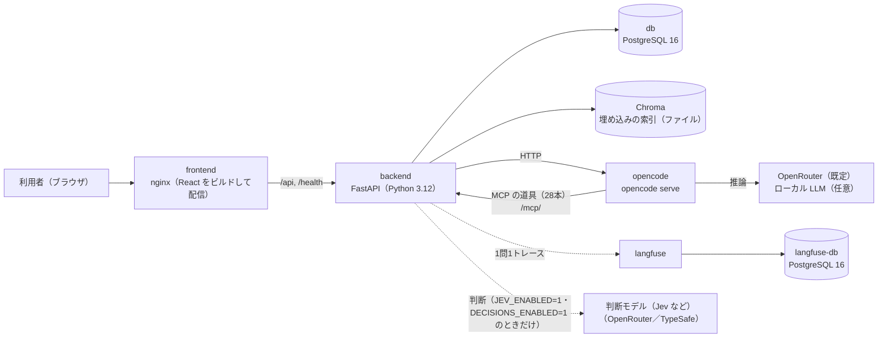

# DefectReport AI — 要件定義書

> 仕様書 v5.0（第6回(完成形＝例アプリ)）。前の版から変わったところは `変更点.md`。

本書は、製造業の不適合報告書（不良報告書）を扱う Web アプリ **DefectReport AI** の要件を定義する。講座（全6回）の第2回から第6回で、同じアプリを回ごとに育てる。本書の各版は、その回の時点のアプリの姿を書く（版と回の対応は §10）。

関連文書:
- `00_帳票の調査.md` — 元の帳票（Excel 110件）の様式・項目とセル・表記の揺れ・欠損・件数
- `02_機能仕様書.md` — 機能ごとの画面・操作の流れ・入出力・エラー時の動き、ユースケース
- `03_データモデル設計書.md` — 表と列の定義（正本）、用語表と関係図
- `04_API設計書.md` — REST と SSE の入出力（正本）
- `05_UI設計書.md` — 画面一覧・画面遷移・各画面の状態
- `06_AI設計書.md` — AI の使い方（OpenCode、MCP の道具、プロンプトとガードレール、検索と引用、帳票の抽出、4M 分析、評価）
- `07_試験・運用仕様書.md` — 受け入れ条件（AC）と確かめ方、AI の回答の評価、試験、運用

---

## 1. 背景

製造業の品質保証（QA）の現場では、不良や不具合が起きるたびに不適合報告書（NCR: Non-Conformance Report）を作る。報告書には、発生日・客先・工程・機械・作業者・部品・数量・不具合の内容・原因・対策・損失の費用など、品質改善に直結する情報がある。しかし、次の課題がある。

| # | 課題 | 具体的な状況 |
|---|---|---|
| 1 | 報告書が Excel のまま埋もれている | 1件1ファイルの帳票が個人のフォルダやファイルサーバーに散らばり、横断して集計・検索できない |
| 2 | データにする手間 | 集計するには誰かが Excel から転記する必要があり、手間がかかり、写し間違いも起きる |
| 3 | 過去の事例を活かせない | 「同じ機械で似た不良が前にあったか」を調べる手段がなく、人の記憶に頼っている |
| 4 | 原因の分析（4M）が人によって違う | Man／Machine／Material／Method のどれが原因かの分類と改善の案が、担当者の経験でばらつく |
| 5 | 経営層が全体の傾向をつかめない | 不良率の推移、損失の金額、機械や工程の偏り、再発の兆しが見えず、判断が遅れる |

「帳票 → データ → 知見 → 判断」の流れが途中で切れている。本アプリは、この流れを段階的につなぐ。

---

## 2. 目的

DefectReport AI は、この版で次のことを実現する。

1. **報告書をデータにして探せるようにする** — 帳票（Excel）110件の内容を DB に入れ、一覧と詳細で、条件を組み合わせて探せるようにする。
2. **報告書を根拠に答える** — AI アシスタントが道具（MCP）で報告書を取りに行き、報告書番号を示して答える。会話は保存し、あとから開き直せる。AI は画面の移動もできる。
3. **帳票を取り込み、根拠を引用する** — Excel・PDF・画像の帳票から AI が項目を取り出し、人が原本と照合してから保存する。検索はキーワード（BM25）と意味（埋め込み）を合わせ、AI の回答は報告書番号を引用する。
4. **数字で傾向をつかむ** — KPI（不良率・損失など）、パレート図・p 管理図、4M 分析、予兆アラートを出す。AI の回答は固定の評価セットで採点する。
5. **確かめられる・任せられる形に仕上げる** — 報告書の登録・編集・削除を仕上げ、試験・Docker Compose・運用の手順で、別の人が起動して確かめられるようにする。完成形の追加機能（CAPA／8D、週次ダイジェスト、報告書トリアージ、判断モデルによる強化など）も持つ。

講座の目的としては、受講者がこのアプリを題材に「仕様書を先に書く → AI（Claude Code）に作らせる → 確かめる → 見つかった穴を仕様書に戻す」流れを、回ごとに繰り返して身につけることにある。

---

## 3. 対象ユーザー

本アプリはログインを持たない（演習用）。次の3つの利用者像を想定する。画面は利用者像で制限しない。

| 利用者像 | 立場 | 主な関心 | この版で主に使う機能 |
|---|---|---|---|
| 品質保証担当（QA） | 品質保証部門 | 不良の原因の究明、過去の事例の調査、対策の立案、是正処置の管理 | 報告書の一覧・詳細・編集、AI アシスタント、4M 分析、データ分析、CAPA／8D、報告書トリアージ |
| 経営者・管理者 | 工場長・経営層 | 全体の傾向、損失の金額、改善の進み具合、リスクの早い把握 | KPI ダッシュボード、予兆アラート、時系列、週次ダイジェスト |
| 現場担当 | 製造・検査 | 起きた不良を早く記録する | 帳票の取込と確認、手入力の登録、写真の添付、AI アシスタントへの音声入力 |

---

## 4. システム全体像

Docker Compose で6つのサービスを一度に起動する。手元の PC で個別に起動することもできる（そのときの DB は SQLite）。

技術スタック:

| 層 | 技術 |
|---|---|
| フロントエンド | React 19 + TypeScript（Vite）・MUI・React Router・react-markdown・Recharts。絞り込みの状態は URL クエリに持つ（人の操作と AI の画面操作が同じ URL を見る） |
| バックエンド | FastAPI（Python 3.12）・SQLAlchemy・Pydantic。報告書トリアージは LangGraph |
| AI | OpenCode（`opencode serve` の HTTP API）＋ OpenRouter（既定のモデル `anthropic/claude-sonnet-4.5`）。ローカル LLM（Ollama など）は環境変数で切り替える（任意）。帳票の抽出・4M 分析・写真の所見は Anthropic API への直接の接続も使える（任意）。報告書トリアージと、検索・チャット・取込の確かめは判断モデル（OpenRouter の Decisions API。Jev・pplx-decider・d1-ultra、任意） |
| 道具（MCP） | FastMCP を FastAPI に同居（`/mcp/`、名前 `defect-reports`）。道具は28本（本筋21本＋完成形の追加7本） |
| 検索 | BM25（SudachiPy。無ければ文字の bigram）＋ 埋め込み（`intfloat/multilingual-e5-small`、Chroma）を RRF（k=60）で合わせるハイブリッド検索 |
| データ | Docker では PostgreSQL 16、手元の個別起動では SQLite（表は同じ）＋ Chroma（ファイル） |
| 観測 | Langfuse v2（Compose の `langfuse`・`langfuse-db`。SDK は 2.x） |
| 実行 | Docker Compose（db・backend・opencode・frontend・langfuse-db・langfuse の6サービス）。手元の PC での個別起動もできる |

---

## 5. 機能要件（FR）

要件は `FR-<グループ>-<番号>` で識別する。入出力の正確な形は `04_API設計書.md` に書く。

### 5.1 共通（FR-SYS）

| ID | 要件 | 対応 API |
|---|---|---|
| FR-SYS-01 | `GET /health` で稼働状態（`status`）・報告書の件数（`reports`）・AI アシスタントの接続先（`chat_backend`：`opencode`／`none`）・帳票の抽出に使う AI の有無（`anthropic_configured`）・検索の方式（`vector_search`：`e5`／`keyword`）を返す | `GET /health` |
| FR-SYS-02 | 起動したとき報告書の表が空なら、模擬データ（`data/defect_reports.csv`、110件）を自動で入れる（シード）。続けて、マスタが空ならマスタを作る（FR-MA-01）。埋め込みの索引（Chroma）が空なら、起動を止めずに裏で全件の索引を作る。索引は DB の写しで、DB と索引の件数と ID を突き合わせて確かめる（方法は `03_データモデル設計書.md`）。データを入れ替えたら索引を作り直す。例アプリは索引が空のときだけ作るため、件数と ID の自動の突き合わせは**例アプリには未実装** | （サーバー） |

### 5.2 報告書（FR-CR）

| ID | 要件 | 対応 API |
|---|---|---|
| FR-CR-01 | 報告書の一覧を表示できる。キーワード（報告書番号・部品番号・部品名・不具合内容の部分一致）・状態・重大度・機械・工程・客先・作業者・現象・4M・期間（発生日）で絞り込み、並べ替え（既定は発生日の新しい順）、ページ送り（既定50件・最大500件）ができる | `GET /api/reports` |
| FR-CR-02 | 報告書を新規に登録できる。`defect_id` が無ければ `KZ25-<連番>`（いまの最大の番号＋1、4桁）を振る。同じ番号が既にあれば 409 | `POST /api/reports` |
| FR-CR-03 | 報告書の詳細を表示できる。全項目と不良率 `defect_rate`（不適合数 ÷ 加工数）を出す。無い番号は 404 | `GET /api/reports/{defect_id}` |
| FR-CR-04 | 報告書を部分更新できる（渡した項目だけ変える）。検索の索引も直す | `PUT /api/reports/{defect_id}` |
| FR-CR-05 | 報告書を削除できる（204）。検索の索引からも消す | `DELETE /api/reports/{defect_id}` |
| FR-CR-06 | 新規登録で損失合計 `total_cost` が無ければ、4つの費目（材料費・社内加工費・外注加工費・その他）の和をサーバーで入れる | （サーバー） |
| FR-CR-07 | 数量の検査：新規登録（FR-CR-02）と更新（FR-CR-04）で 0 ≦ 不適合数 ≦ 加工数 を確かめる。違反は 422 と日本語の理由を返し、保存しない（件数は増えない）。**例アプリには未実装**（第6回の演習で入れる） | `POST`・`PUT /api/reports` |

一覧の決まり:
- 絞り込みの条件は AND で組み合わせる（OR にしない）。
- 期間は発生日を date 型で比べ、両端の日を含む。形の不正な日付（例 `2025-13-01`）や `date_from` > `date_to` は 422 と理由を返す。**例アプリには未実装**（例アプリは形の不正な日付を無視して絞り込まず、`date_from` > `date_to` は 200 で0件を返す）。
- 該当が0件のときは「0件」を表示する（空白にしない）。
- 読み込みに失敗したときは、表と件数を消し、原因と「再試行」を出す。0件の表示と区別する。**例アプリには未実装**（例アプリは原因を出すが、表と「条件に一致する報告書がありません」も残り、「再試行」は無い）。
- 絞り込みの選択肢（機械・工程・客先・作業者・現象）は、画面に書き込まずマスタ（FR-MA-01）から作る。
- キーワードの一覧のほかに、自然文で意味の近い報告書を探す「スマート検索」（`GET /api/reports/search`）を持つ（FR-CH-07 と同じハイブリッド検索）。
- 詳細には「似ている報告書」（`GET /api/reports/{defect_id}/similar`、自分を除く上位3件と当時の原因・対策）を出す。

### 5.3 マスタ（FR-MA）

絞り込みと入力の選択肢は、DB のマスタ（`masters` 表）に持つ。種類は客先（customer）・工程（process）・機械（machine）・作業者（operator）・現象（phenomenon）・要因（factor）の6つ。重大度・状態・4M は決まった値なのでマスタにしない。

| ID | 要件 | 対応 API |
|---|---|---|
| FR-MA-01 | マスタ6種を持ち、全種類または種類ごとに返す（各値の使用件数つき）。初回の起動で、取り込んだデータの値から作る。用語は用語表（`03_データモデル設計書.md`）を正本にする。例アプリはデータの値に加えて既定の語の一覧（`masters.py` の `DEFAULT_VOCAB`）も入れるため、データに無い語（工程の「旋盤」「フライス」、要因の古い名前、機械の「GENOS M560-V」「MX-520」など。使用件数0）が候補に残る（既知の問題） | `GET /api/masters`、`GET /api/masters/{category}` |
| FR-MA-02 | マスタに新しい値を足せる。同じ種類の中の同じ名前（前後の空白と大文字・小文字を無視）は 409 | `POST /api/masters/{category}` |
| FR-MA-03 | マスタの名前を変えられる。同じ値を持つ既存の報告書も新しい名前に書き換え、書き換えた件数を返す。変えた先の名前が既にあれば 409 | `PUT /api/masters/{category}/{item_id}` |
| FR-MA-04 | マスタを無効にできる（`is_active=false`）。無効の値は新しい入力の候補から外れる。既存の報告書と集計は変わらない | `PUT /api/masters/{category}/{item_id}` |
| FR-MA-05 | 使われていないマスタを削除できる（204）。使用中（1件以上）は 409 で断り、無効化を促す | `DELETE /api/masters/{category}/{item_id}` |
| FR-MA-06 | 報告書の保存（登録・更新）で、マスタに無い値は自動で足す（現場で新しい機械・客先をその場で入れられる） | `POST`・`PUT /api/reports` |

### 5.4 AI アシスタント（FR-CH）

AI アシスタントは OpenCode を通して LLM（既定は OpenRouter）で答える。報告書のデータには MCP の道具で触れる。

| ID | 要件 | 対応 API |
|---|---|---|
| FR-CH-01 | 利用者は自然文で質問し、報告書を根拠にした回答を受け取れる。AI は道具（MCP）で報告書を取りに行き、そのターンで道具から取った値だけで答える | `POST /api/chat/stream` |
| FR-CH-02 | 回答を SSE で逐次表示する。イベントは `session`（先頭）・`sources`（参照した報告書）・`thinking`（推論）・`tool`（道具の実行の進み具合）・`token`（本文）・`done`・`error`。空の応答・残高切れ（402）・`finish_reason=length`（出力の上限で切れた）は成功にせず、`error` で理由を出す（`finish_reason=length` の見分けは**例アプリには未実装**） | 〃 |
| FR-CH-03 | 回答の前に、参照した報告書（`sources`：番号・部品名・現象・抜粋・スコア、最大5件）を出す | 〃（`sources`） |
| FR-CH-04 | 回答の本文で、参照した報告書を `[KZ25-XXXX]` の形で引用する | 〃 |
| FR-CH-05 | 件数・率の質問は、検索の上位の件数で数えず、集計の道具（`list_defect_reports` の `total`、`get_statistics`、`query_quality_ontology` など）で数える | （MCP） |
| FR-CH-06 | 会話の履歴は、サーバーが DB から直近20件を読んで AI に渡す（ブラウザは履歴を送らない） | 〃 |
| FR-CH-07 | 埋め込みが使えない環境では BM25 に、それも失敗したらキーワード検索に縮退し、どの方式で探したか（`search_mode`：`hybrid`／`bm25`／`keyword`）を結果に出す。判断モデルで並べ替えたときは `+rerank` が付く（FR-DM-01） | （サーバー） |
| FR-CH-08 | 利用者がはっきり頼んだときだけ、会話から報告書を登録・更新する（`create_defect_report`：番号は自動・状態は `open` に固定。`update_defect_report`：状態・重大度・対策・原因・要因・4M・備考・良品状態の8項目だけ）。実行したら、番号と変えた項目を報告する | （MCP） |
| FR-CH-09 | 会話をセッションごとに保存し、一覧・復元・削除できる（再読込しても残る）。最初の送信でセッションを作り、題は最初の質問の先頭30文字にする | `GET`・`DELETE /api/chat/sessions[/{id}]` |
| FR-CH-10 | AI は画面を操作できる（`ui_navigate`：全ページと絞り込み・期間／`ui_open_report`：詳細を開く／`ui_new_report`：値を入れた登録画面を開く／`ui_edit_report`：詳細を編集モードで開く／`ui_run_4m_analysis`：詳細で 4M 分析を実行／`ui_set_theme`：ライト・ダーク）。入力と保存は人が行う。画面の状態の正本は URL クエリで、人の操作と AI の操作が同じ URL を見る。操作は画面の移動と表示だけで、データは変えない。画面を操作したと答える前に、必ず `ui_*` を呼ぶ（前のターンで同じ操作をしていても毎回呼ぶ。ターンごとに独立） | `GET /api/ui/events`（SSE） |
| FR-CH-11 | 用語表を機械が読める形にした業務 Ontology（`app/backend/ontology/quality.json`）を、道具で引ける（定義・名前の解決・対象・関係・条件別の集計）。「工程別の件数」のような条件別の件数・損失はサーバーが数える。対象や期間を解決できないときは、範囲を黙って広げずに誤りと理由を返す | （MCP） |

- 例アプリの AI の道具（MCP）は28本（本筋21本＝v4 の20本と `ui_edit_report`。完成形の追加7本＝`list_capa_actions`・`draft_capa_actions`・`create_capa_action`・`update_capa_action`・`generate_8d_report`・`generate_weekly_digest`・`preview_capa_update`）。
- 道具の一覧と引数は `06_AI設計書.md` に書く。

### 5.5 帳票の取込（FR-IN）

| ID | 要件 | 対応 API |
|---|---|---|
| FR-IN-01 | 利用者は帳票のファイル（.xlsx・.pdf・.png・.jpg）を1件アップロードできる | `POST /api/ingest/upload` |
| FR-IN-02 | .xlsx はセル（ラベルの右隣など）を読んで項目を取り出し、AI が使えるときは表記を整える（構造化の補正） | 〃 |
| FR-IN-03 | .pdf・画像は、AI の vision と構造化出力（JSON Schema）で項目を取り出す。ファイルは OpenCode にファイルの部品（data URL）として渡し、プロンプトの本文に貼らない | 〃 |
| FR-IN-04 | 取り出した結果は保存せず、確信度（`high`／`medium`／`low`）と警告の一覧を付けて確認画面へ返す。確信度は AI の自己申告を使わず、サーバーの決まりで決める（例アプリの決まり：.xlsx はセルだけなら `medium`、AI の補正が成功したら `high`。.pdf・画像は AI の抽出が成功したら `high`。判断モデルで読み取りを確かめたとき（FR-DM-04）は、合わない項目の数で `high`・`medium`・`low` を決める。判断モデルを使わないときは `low` は使っていない。必須項目の欠けや数量の矛盾は、確信度にも警告にも入らない） | 〃 |
| FR-IN-05 | 利用者は確認画面で、取り出した値を直せる | （画面） |
| FR-IN-06 | 利用者が「保存」を押したときだけ報告書として登録する。番号（`KZ25-<連番>`）を振り、損失合計を入れ、検索の索引にも入れる | `POST /api/ingest/confirm` |
| FR-IN-07 | AI が使えないとき（`OPENCODE_URL` も `ANTHROPIC_API_KEY` も無い）は、.pdf・画像は 503 を返し、.xlsx はセルの値だけで返す（`medium` と警告） | 〃 |

### 5.6 KPI とデータ分析（FR-DB）

| ID | 要件 | 対応 API |
|---|---|---|
| FR-DB-01 | KPI（総報告件数・総不適合数・総加工数・不良率・直行率 FPY・総損失・再発率・未対応件数）を、期間（発生日、両端を含む）を指定して出す。未対応件数は `status=open` だけを数え、対応中（`in_progress`）は別に数える。画面のカードの名前と定義を合わせる（対応中の件数と、カードの名前の合わせは**例アプリには未実装**） | `GET /api/dashboard/statistics` |
| FR-DB-02 | 月次トレンド（件数・不適合数・加工数・不良率）を出す | 〃 |
| FR-DB-03 | 現象別のパレート図（件数・比率・累積比率）を出す | 〃 |
| FR-DB-04 | 機械別・作業者別・工程別・客先別の集計（件数・不適合数・不良率・損失）を出す | 〃 |
| FR-DB-05 | 4M 別・重大度別の内訳を出す | 〃 |
| FR-DB-06 | 不良率の p 管理図（月ごとの p、中心線 p̄、UCL／LCL）を、直近の月数（既定12、1〜36）で出す | `GET /api/dashboard/control-chart` |

KPI は分子・分母・期間・単位（件／個／円）を決めて出す（定義の表は `02_機能仕様書.md` の F5）。不良率は Σ不適合数 ÷ Σ加工数 で、報告書ごとの率の平均ではない。データに列が無い指標（OEE・MTBF・MTTR）は計算できない。

### 5.7 4M 分析（FR-AN）

| ID | 要件 | 対応 API |
|---|---|---|
| FR-AN-01 | 報告書1件について、AI が 4M（Man／Machine／Material／Method）の分類・要因・理由・改善の案を作る | `POST /api/analysis/4m/{defect_id}` |
| FR-AN-02 | 結果は構造化出力で受け取る（`category_4m` は4つの値の enum、`factor`、`reasoning`、`improvements[]`）。4つの値以外は失敗にする | 〃 |
| FR-AN-03 | 事実と仮説を分けて見せ、人が採否を決めてから報告書（`category_4m`・`factor`・`ai_improvement`）に保存する。**例アプリには未実装**（例アプリは分析の結果をすぐ報告書に保存する。採否を決める画面は無い） | 〃 |

### 5.8 予兆アラート（FR-AL）

| ID | 要件 | 対応 API |
|---|---|---|
| FR-AL-01 | ルールで予兆アラートを出し、レベル（`critical`／`warning`／`info`）・題・説明・関連（機械・現象）を返す | `GET /api/analysis/alerts` |
| FR-AL-02 | ルール：①直近30日の不良率が、全報告書の不良率の1.5倍を超える機械（`warning`）②同じ機械×同じ現象が直近60日に3件以上（`critical`）③直近30日に再発フラグの報告書がある（`info`）。「直近」の基準日はデータの最新の発生日（今日ではない。模擬データでは 2026-03-15） | 〃 |
| FR-AL-03 | 先行指標のルール：④機械×現象の急増（直近30日に3件以上、かつ前の30日の2倍以上、`warning`）⑤対策後の再発の兆し（同じ機械×現象で、完了した報告書の発生日から30日以内に未完了の報告書が出た、`critical`）⑥月次の不良率が3か月続けて上がった（ランルール、`warning`） | 〃 |

### 5.9 完成形の追加機能

第6回の本筋（登録・編集・削除、試験、Docker、運用）のほかに、例アプリ（完成形）が持つ機能。

| ID | 要件 | 対応 API |
|---|---|---|
| FR-CA-01 | 報告書に是正・予防処置（CAPA）を起票できる。番号は `CA-<連番>`（4桁）、種類は `corrective`（是正）／`preventive`（予防）、題・詳細・担当・期限を持つ | `POST /api/capa` |
| FR-CA-02 | CAPA の状態は `open`（起票）→ `in_progress`（対応中）→ `effect_check`（効果確認）→ `closed`（完了）の順に進める（サーバーは4つの値かどうかだけを検査し、順番は検査しない）。`closed` には効果確認メモ（`effect_note`）が要り、無ければ 409 | `PUT /api/capa/{capa_id}` |
| FR-CA-03 | CAPA を状態・報告書・期限切れで絞り込んで一覧できる（期限切れは今日の日付で判定する） | `GET /api/capa` |
| FR-CA-04 | AI が、似ている報告書の当時の対策をもとに処置の案（下書き）を作る。下書きは保存しない。人が採用したもの、または利用者がはっきり頼んだものだけを登録する。AI が使えないときは、似ている報告書の対策をそのまま案にする | `POST /api/capa/draft/{defect_id}` |
| FR-CA-05 | 報告書・CAPA・似ている報告書から、8D レポート（D1〜D8、Markdown）を作って保存する。AI が使えないときは、事実を D1〜D8 の型に入れた下書きにする | `POST`・`GET /api/capa/eight_d/{defect_id}` |
| FR-DG-01 | 週次ダイジェスト：基準日（データの最新の発生日）までの直近7日（`days` で1〜90）について、KPI と前の期間との差・重大（`critical`）の案件・未対応の案件・アラート・回答の評価（👍/👎）を決まった形で必ず出し、AI が使えるときだけ「AI所見」と「推奨アクション」を足す。保存して一覧で見られる | `POST /api/digests/generate`、`GET /api/digests[/{id}]` |
| FR-PH-01 | 報告書に写真を付けられる（.jpg・.jpeg・.png・.webp、8MB まで。ファイル名を検査する）。一覧・表示・削除ができる | `GET`・`POST /api/reports/{defect_id}/photos`、`GET`・`DELETE …/photos/{name}` |
| FR-PH-02 | 写真を AI に見せ、見えることだけを所見（観察・現象の候補）として返す。保存しない。AI が使えなければ 503 | `POST /api/reports/{defect_id}/photos/{name}/analyze` |
| FR-VO-01 | AI アシスタントの入力欄に、音声入力のマイクのボタン（ブラウザの Web Speech API、日本語）を置く。使えないブラウザではボタンを出さない | （画面） |
| FR-GR-01 | 関連マップ：全報告書を点、内容の近い組を線にした図を出す（埋め込みの相互 kNN を強い線、片方向を弱い線。埋め込みが無いときは語の重なり） | `GET /api/graph`（画面 `/analysis/graph`） |
| FR-ON-01 | 業務 Ontology の画面：対象の名前の解決、条件別の指標（件数・記録上の不適合率・損失・関連する CAPA）、関係のたどり、定義、グラフを見られる。画面と AI の道具は同じ計算を使う | `/api/ontology/*`（画面 `/analysis/ontology`） |
| FR-ON-02 | CAPA の変更を、保存せずに検証できる（変更の前後と、業務の決まりに合うか）。実行は利用者がはっきり頼んだときだけ別に行う | `POST /api/ontology/actions/capa/preview`（道具 `preview_capa_update`） |
| FR-FB-01 | AI の回答ごとに 👍/👎（と任意のコメント）を付けられる。`chat_feedback` 表に保存し、Langfuse のトレースにスコア（`user-feedback`）として送る。評価の値は +1／−1 だけ（ほかは 422） | `POST`・`GET /api/chat/feedback` |
| FR-TR-01 | 報告書トリアージ：判断モデル Jev が、現象・要因・4M・重大度と、客先への流出・仕組みの原因・記述の不足を判断する。確かな項目だけ採用し、届かない項目は LLM と人に回す。CAPA が要るときは処置の案を用意し、人の承認で止める（LangGraph） | `POST`・`GET /api/triage/reports/{defect_id}`、`POST /api/triage/runs/{run_id}/resume` |
| FR-TR-02 | 新規作成の画面で、不具合内容と原因から分類を提案する（保存しない） | `POST /api/triage/preview` |
| FR-TR-03 | トリアージは `JEV_ENABLED=1` と判断モデルのキー（`OPENROUTER_API_KEY` か `TYPESAFE_API_KEY`）があるときだけ動く。無いときは 503 を返し、画面にも出さない。詳しくは `11_報告書トリアージ_JevとLangGraph.md` | `GET /api/triage/status` |
| FR-DM-01 | 検索の並べ替え：検索（`rag.search`）の候補（30件）を、判断モデルが「質問に当てはまる確率」で並べ直し、上位を返す。`search_mode` は並べ替える前の方式に `+rerank` を付けたもの（通常は `hybrid+rerank`）。スマート検索の応答だけ、各件に当てはまる確率（`relevance`）を付ける。同じ検索を使うチャットの事前の検索・道具・似ている報告書・CAPA の下書きの類似事例も、並びが変わる | `GET /api/reports/search`・`GET /api/reports/{defect_id}/similar`、チャットの事前の検索、道具 `search_defect_reports`・`get_similar_reports` |
| FR-DM-02 | 質問の振り分け：チャットの質問の種類（1件・条件で絞る・件数・似た事例を探す・画面の操作・その他）を判断モデルが決め、1位の確率が0.6以上のときだけ、その種類の道具の使い方の注意をプロンプトに足す。事前の検索と同時に走らせる | `POST /api/chat/stream`（event `route`）・`POST /api/chat`（`route`） |
| FR-DM-03 | 引用の確かめ：回答の文ごとに、引用した報告書がその文を支えるかを判断モデルで確かめる（確率0.5以上で根拠あり）。無い番号は否定の文（「存在しません」など）の中だけを正しいとし、崩れた番号（例 `KZ2判-0039`）は形で見つける。Langfuse にスコア `citation_support` を送る | event `citations`・`POST /api/chat`（`citations`） |
| FR-DM-04 | 読み取りの確かめ：PDF・画像の取込で、読み取った値が画像の欄と合うかを判断モデルで確かめる（PDF は1ページ目を画像にする）。合わない項目は警告に出し、欄の位置（枠）も返す。確信度はこの結果で決める（合わない項目が0なら high、1〜2なら medium、3以上なら low。確かめられなければ medium） | `POST /api/ingest/upload`（`field_checks`・`verification`） |
| FR-DM-05 | 判断モデルによる強化は `DECISIONS_ENABLED=1` と判断モデルのキー（`OPENROUTER_API_KEY` か `TYPESAFE_API_KEY`）があるときだけ動き、機能ごとに止められる。使えない・失敗したときは、どの機能も今までの動き（並べ替える前の検索の順・注意なし・確かめなし）に戻る。既定はデータを残さない経路（ZDR）だけを使う。詳しくは `14_判断モデルによる強化.md` | （環境変数） |

---

## 6. 業務の決まり

要件と画面・AI の答えが、同じ数え方をするための決まり。用語は `03_データモデル設計書.md` の用語表に合わせる。

- 「報告1件」と「不良品1個」を分ける。件数の単位は「件」、不適合数・加工数の単位は「個」。
- 期間は発生日（`occurrence_date`）で数え、両端の日を含む（報告日では数えない）。
- 報告書1件の不良率 `defect_rate` は 不適合数 ÷ 加工数。加工数が0なら null（画面は「—」）。
- 数量の決まり：0 ≦ 不適合数 ≦ 加工数。AI が取り出した値の検査に使い、報告書の登録・更新でも確かめる（FR-CR-07。**例アプリには未実装**）。例アプリでは、業務 Ontology の集計（`query_quality_ontology`）が、この決まりに合わない報告書を数え、合わないものがあれば率を出さない。
- 集計の不良率は Σ不適合数 ÷ Σ加工数。報告書ごとの率の平均ではない（全期間では 17.49%。行ごとの率の単純平均なら 24.15% になる）。報告書に記録されたロットの率であり、工場全体の不良率とは呼ばない。
- 分母が0の率は null にする（0% と書かない）。例アプリでは、報告書の `defect_rate` と業務 Ontology の集計は null を返すが、KPI の集計（`GET /api/dashboard/statistics`）は 0 を返す（**例アプリには未実装**）。
- 「直近」の基準日は、データの最新の発生日（模擬データでは 2026-03-15）。今日の日付ではない。

---

## 7. 非機能要件（NFR）

| ID | 分類 | 要件 |
|---|---|---|
| NFR-01 | 動作環境 | 受講者のノート PC で動くこと。外部のサービスは LLM（OpenCode 経由の OpenRouter）と、初回の埋め込みモデルの取得だけ。ローカル LLM（Ollama など）への切替は任意で、接続先は環境変数で決める |
| NFR-02 | 設定 | 必須のキーは `OPENROUTER_API_KEY` の1本。`ANTHROPIC_API_KEY`（帳票の抽出・4M 分析・写真の所見の代わりの経路）、`JEV_ENABLED`・`TYPESAFE_API_KEY`（報告書トリアージ）、`DECISIONS_ENABLED`（判断モデルによる強化）は任意。キーは `.env`（`example_app/.env` か `app/.env`）に置き、ブラウザのコード・ログ・画面に出さない |
| NFR-03 | 一括起動と運用 | `docker compose up` で6サービス（db＝PostgreSQL 16・backend・opencode・frontend＝nginx・langfuse-db・langfuse）を起動できる。db・backend・opencode・langfuse-db は healthcheck を持つ。公開するポートは環境変数（`BACKEND_PORT` 既定 8000・`FRONTEND_PORT` 既定 5173・`LANGFUSE_PORT` 既定 3390）で変えられる。起動・停止・復旧の手順を書く（`docker compose down` はデータを残す。`down -v` はボリュームごと消し、次の起動で110件を入れ直す）。README だけで別の人が起動できる（手順は `07_試験・運用仕様書.md`） |
| NFR-04 | 応答時間の目安 | 一覧・詳細・統計などの通常の API はおおむね1秒以内。AI アシスタントは最初の文字まで数秒を目安とし、以降は逐次表示。帳票の抽出・4M 分析は LLM を呼ぶため 5〜15 秒程度を許す |
| NFR-05 | データの規模 | 模擬データ110件（KZ25-0001〜KZ25-0110、発生日 2025-04-07〜2026-03-15）を前提とする。一覧は既定50件・最大500件 |
| NFR-06 | 再現性 | 模擬データは乱数を固定して生成する（`data/generate_mock_data.py`）。受け入れ条件の期待値は、この CSV から数えた値にする |
| NFR-07 | 堅牢性 | キーや埋め込みが無くても、縮退して起動・動作する。AI が無ければ AI アシスタントは理由を返し（FR-CH-02）、帳票の .pdf・画像は 503、.xlsx はセルの値だけ（FR-IN-07）。埋め込みが無ければ BM25、それも失敗したらキーワード検索（FR-CH-07）。Langfuse が無くても動く。一覧・KPI・予兆は AI 無しで動く |
| NFR-08 | 読みやすさ | AI が作ったコードを受講者が読んで直せるよう、簡単な構成と名前にする。過度な抽象化をしない |
| NFR-09 | 移植性 | Docker では PostgreSQL（`db` サービス）に報告書・マスタ・会話を保存する。`DATABASE_URL` が無い手元の起動では SQLite に切り替わる（表は同じ）。Chroma の索引はどちらもファイル。GPU は要らない |
| NFR-10 | 言語 | 画面・データ・AI の回答は日本語 |
| NFR-11 | 観測 | 1問を1トレースとして Langfuse に送る（Compose では最初から有効。無くても動く）。`done` イベントの `trace_id` で画面の回答と照合できる。残す範囲：質問（全文）、参照した報告書の番号とスコア、使った道具の名前、回答（先頭4,000字）、エラーの理由、👍/👎 のスコア。計っていない区間：道具ごとの引数・結果・時間、OpenCode の中の推論の段階。使ったトークンも残す決まりだが、**例アプリには未実装**（AI アシスタントのトレースのトークンの数は0のまま） |
| NFR-12 | 評価 | AI の回答は固定の評価セット（`eval/dataset.json`、100問：事実30・集計22・画面操作15・検索12・複数ターン11・捏造10）で採点する（`eval/run_eval.py`）。答えの正しさ・道具の正しさ・引用の妥当性を分けて数え、失敗は取込・検索・生成・道具の選択・引数・採点器のどこかに分類する。直す前と後を同じ問いで比べる。採点器は、日付の和表記（「2025年9月13日」）を正答にし、否定の文の中の番号（「KZ25-9999 は存在しません」）を捏造に数えず、「表示しました」のような操作の主張を見落とさない |
| NFR-13 | 画面の幅 | 画面の幅 375〜1680px で崩れない（375・768・1280・1680px で確かめる）。375px ではメニューと AI パネルを重ねて出す |
| NFR-14 | 試験 | pytest（単体・結合。LLM は差し替え、一時 SQLite を使い、API キーなしで通る）と Playwright（E2E。役割と名前で要素を探し、sleep ではなく状態を待つ。保存は再読込と API でも照合する）。結果は件数・日付・コマンドを組で書く。差分は `/code-review`・`/security-review` で点検し、Claude Code の Hooks で原本（帳票）への書き込みを止め、backend の変更のたびに pytest を回す（Hooks は**例アプリのリポジトリには無い**。第6回の演習で設定する）。試験の決まりは `07_試験・運用仕様書.md` |

---

## 8. 受け入れ条件（AC）

受け入れ条件の全体（操作・期待値・確かめ方）は `07_試験・運用仕様書.md` に、版ごとの番号（`AC-v10-01` など）で書く。ここには要件ごとの主な期待値を書く。期待値は元データ（`data/defect_reports.csv`、110件）から数えた値にする。

期待値は元データから数えて書く。計画や AI が示した数字は、元データで検算してから使う。「例アプリには未実装」と書いた条件は、完成形の例アプリでも満たしていない（演習で直す対象）。

| 要件 | 主な期待値 | `07` の番号 |
|---|---|---|
| FR-SYS-01・02 | 空の DB で起動すると `/health` の `reports=110` | AC-v10-01 |
| FR-CR-01 | 機械 a61nx は3件（KZ25-0019・KZ25-0043・KZ25-0056）。2025年9月は7件（KZ25-0042〜KZ25-0048）。a61nx かつ 2025年9月は KZ25-0043 の1件だけ（AND で絞る）。a61nx かつ 2025年10月は0件で、画面は0件を表示する | AC-v10-03〜06 |
| FR-CR-03 | KZ25-0043：発生日 2025-09-13、客先 翠峰重工業、工程 マシニング、機械 a61nx、部品 補機マウントリブ、加工数12・不適合数3、`defect_rate=0.25`（画面 25.00%）、現象 表面キズ、損失合計 60,581円。KZ25-9999 は 404 | AC-v10-07・08 |
| FR-CR-01（期間） | `date_from=2025-13-01` と `date_from` > `date_to` は 422 と理由（**例アプリには未実装**。例アプリは前者が200で110件、後者が200で0件）。`date_from=date_to=2025-09-17` は2件（両端の日を含む） | AC-v11-01〜03 |
| FR-CR-01（失敗の表示） | 読み込みに失敗したら表と件数を消し、原因と「再試行」を出す（**例アプリには未実装**） | AC-v11-04 |
| FR-MA-01 | 6種を返し、データの値がすべて入る（客先10・工程8・機械10・作業者29・現象12・要因10）。例アプリは既定の語も入るため、初回の起動で97件（客先10・工程14・機械12・作業者29・現象12・要因20） | AC-v11-05・06 |
| FR-CH-01 | 「KZ25-0043 の内容を教えて」→ `get_defect_report` を呼び、回答に a61nx が入る。「KZ25-9999」→ 無いと答える。「表面キズは何件？」→ 38件（集計の道具で数える） | AC-v20-01〜03 |
| FR-CH-09 | 再読込しても会話が残り、開き直せる | AC-v20-04 |
| FR-CH-02 | 先頭が `session`、最後が `done`（`trace_id`）か `error` のどちらか1つ | AC-v20-07 |
| FR-CH-10 | 「KZ25-0043 を画面で開いて」→ `ui_open_report` を呼び、画面が `/reports/KZ25-0043` に移る | AC-v20-14・15 |
| FR-CH-10 | 2ターン続けて画面を開かせても、毎回 `ui_open_report` を呼ぶ | AC-v21-01 |
| FR-CH-02 | 空の応答・残高切れ（402）・`finish_reason=length` は `done` ではなく `error`（`finish_reason=length` は**例アプリには未実装**） | AC-v21-02〜04 |
| NFR-11 | トレースの入力に質問が入り、使ったトークンが0より大きい（トークンは**例アプリには未実装**） | AC-v21-05 |
| 数量の決まり | （加工数, 不適合数）＝（100, 5）（100, 100）（100, 0）は通し、（10, 25）（10, −5）は通さない。元データの110件はすべて決まりを満たす | AC-v21-06 |
| FR-CH-03・04・07 | 固定5問（`07` に質問と正解）で、`sources` が本文より先に届き、引用した番号は実在し、その本文が主張を支える。`search_mode` は `hybrid`／`bm25`／`keyword` | AC-v30-01〜03 |
| FR-IN-01〜07 | 帳票の改訂B と改訂C を1件ずつ原本と照合し、「保存」を押すまで件数は110のまま。AI が無いときは .pdf が 503、.xlsx は `medium` と警告 | AC-v30-04〜07 |
| FR-CR-03（似ている報告書） | 3件で、自分を含まない | AC-v30-09 |
| FR-CH-05 | 「表面キズは何件？」は38件、「バリ残りは何件？」は14件。検索の上位の件数で答えない | AC-v31-01 |
| FR-IN-03・04 | 確信度はサーバーが決める。.pdf・画像は data URL のファイルとして渡す | AC-v31-03・04 |
| FR-SYS-02（索引） | DB 110件・索引110件・共通110件。データを入れ替えたら索引を作り直してから確かめる | AC-v31-05・06 |
| FR-DB-01 | 全期間：110件・不適合数1,829個・加工数10,460個・不良率17.49%・FPY 82.51%・損失36,445,731円・再発率8.2%（9/110）・未対応4件（pandas と一致） | AC-v40-01・02 |
| FR-DB-01（期間） | 2025-10-01〜2025-12-31 は38件（発生日で数える。報告日で数えると33件） | AC-v40-06 |
| FR-DB-03 | パレート図の上位3つは 表面キズ38件・バリ残り14件・穴位置ずれ12件（累積 58.2%） | AC-v40-04 |
| FR-DB-06 | 12か月、p̄＝0.1749 | AC-v40-07 |
| FR-AN-01〜03 | `category_4m` は4つの値のどれかで、`reasoning` と `improvements` がある。AI が無ければ 503 | AC-v40-09 |
| FR-AL-02 | 基準日 2026-03-15 で、①WT-150II（直近30日 1個中1個＝100%）が `warning`、VARIAXIS i-800 NEO（23.74%）は出ない。②汎用フライス×バリ残り（直近60日に3件）が `critical`。③直近30日に再発フラグは無く、出ない | AC-v41-02 |
| NFR-12 | 評価セットのカテゴリごとに、答え・道具・引用の率を分けて出す | AC-v40-11 |
| 分母0の率 | 報告の無い期間は件数0で、不良率・FPY・再発率は null（**例アプリには未実装**。例アプリは 0） | AC-v41-01 |
| FR-DB-01（カード） | 「未対応」は open の4件、「対応中」は in_progress の16件を別に出す（**例アプリには未実装**） | AC-v41-03 |
| NFR-12（採点器） | 日付の和表記を正答、否定の文の中の番号を捏造にしない、「表示しました」を操作の主張として見つける | AC-v41-04 |
| FR-CR-07 | 加工数10・不適合数25 は 422 と日本語の理由で、件数は110のまま。100個中5個・100個中100個・100個中0個は 201（**例アプリには未実装**。例アプリは 201 で保存し、不良率が 2.5 になる） | AC-v50-01・07 |
| FR-CR-02・04〜06 | 番号なしの登録は `KZ25-0111`、`total_cost` は4費目の和。`PUT` は渡した項目だけ変える。`DELETE` は 204 で、その後は 404、検索にも出ない | AC-v50-02〜05 |
| FR-AL-03 | ④は出ない。⑤は4件（KZ25-0017・0028・0090・0099）、⑥は 2025-11 → 2025-12 → 2026-01。①②と合わせて7件 | AC-v40-08 |
| NFR-03 | 6サービスが動き、healthcheck のあるものは healthy。`/health` の `reports=110`。README だけで別の人が起動できる | AC-v50-10〜12 |
| NFR-11・FR-FB-01 | 1問で1トレース。👍/👎 は同じトレースのスコア `user-feedback`（+1／−1、ほかは 422） | AC-v50-13 |
| NFR-13 | 幅 375・768・1280・1680px で横にはみ出さない | AC-v50-14 |
| FR-DM-01〜05 | `DECISIONS_ENABLED=0` では検索・チャット・取込の応答が今までと同じ（`route`・`citations`・`relevance`・`field_checks` なし）。有効にすると、並べ替え・振り分けの採否・引用の確かめ・確信度が決まりどおりになり、判断モデルが失敗しても今までの動きで答える | AC-v50-15 |
| FR-MA-05・FR-CA-02・FR-PH-01・FR-TR-03 | 使用中のマスタの削除は 409。効果確認メモの無い `closed` は 409。8MB を超える写真は 413、.gif は 415。`JEV_ENABLED=0` のトリアージは 503 | — |

---

## 9. スコープ外（本アプリでは実装しない）

| 項目 | 扱い |
|---|---|
| 認証・認可（ログイン、ロール） | ローカルの演習用のため実装しない |
| 承認のワークフロー（報告書の申請・承認・差し戻し） | 状態は `open`／`in_progress`／`completed` の3つだけ |
| 多言語 | 日本語だけ |
| 本番への配置（クラウド、Kubernetes、CI/CD） | 手元の PC と Docker Compose まで。クラウドへの配置は各社の持ち帰りの課題 |
| 通知・メールの送信・帳票の PDF 出力 | 対象外 |
| ナレッジグラフ（Neo4j）と text-to-Cypher | 検索は BM25 と埋め込み（Chroma）に絞る。関連マップと業務 Ontology はグラフ DB を使わない |
| RAGAS などの評価ライブラリ | 評価は固定の評価セットと自前の採点規則（`eval/run_eval.py`）で行う |
| OEE・MTBF・MTTR などの指標 | 稼働時間・故障の記録の列がデータに無いため計算できない |

---

## 10. 講座の回と仕様書の版

仕様書は1つの正本から、講座の回ごとに版を書き出す。x.0 はその回で足すことを先に書いた版、x.1 は作って確かめ、見つかった穴を戻した版（x.1 で新しい機能は足さない）。

| 版 | 講座 | その版の中身 | 主に足した要件 |
|---|---|---|---|
| v0.1 | 第1回 | 目的メモ（`作りたいアプリ.md`。困りごと・使う人・データ・最初にできること）。本書の外に置く | — |
| v1.0 | 第2回 前半 | 帳票の Excel（110件）を調べて書いた最初の仕様書。作る前 | FR-SYS-01・02、FR-CR-01・03、NFR-01・05・06・08・09・10・13（AC-v10-*） |
| v1.1 | 第2回 終わり | 土台を作って確かめ、見つかった穴を戻した版 | 期間の 422、0件と失敗の区別、FR-MA-01（AC-v11-*） |
| v2.0 | 第3回 前半 | AI アシスタント（OpenCode＋MCP）を足す | FR-CH-01・02・06・08〜11、NFR-02・11（AC-v20-*） |
| v2.1 | 第3回 終わり | 確かめて見つかったずれを戻した版 | 画面の操作は毎回 `ui_*`、空の応答などを成功にしない、数量の決まり、トレースの入力とトークン（AC-v21-*） |
| v3.0 | 第4回 前半 | 帳票の取込・ハイブリッド検索・引用 | FR-IN-01〜07、FR-CH-03・04・07（AC-v30-*） |
| v3.1 | 第4回 終わり | 確かめて戻した版 | FR-CH-05、確信度はサーバーの決まり、ファイルは data URL で渡す、DB と索引の突き合わせ（AC-v31-*） |
| v4.0 | 第5回 前半 | KPI・4M 分析・予兆・評価 | FR-DB-01〜06、FR-AN-01〜03、FR-AL-01・02、NFR-12（AC-v40-*） |
| v4.1 | 第5回 終わり | 確かめて戻した版 | 分母0の率は null、「直近」の基準日、KPI カードの名前と定義、採点器の穴（AC-v41-*） |
| v5.0 | 第6回 | 登録・編集・削除の完成、試験、Docker、運用、完成形の追加機能。例アプリと同じ | FR-CR-02・04〜07、FR-MA-02〜06、FR-AL-03、FR-CA・DG・PH・VO・GR・ON・FB・TR・DM、NFR-03・04・07・13・14（AC-v50-*） |
