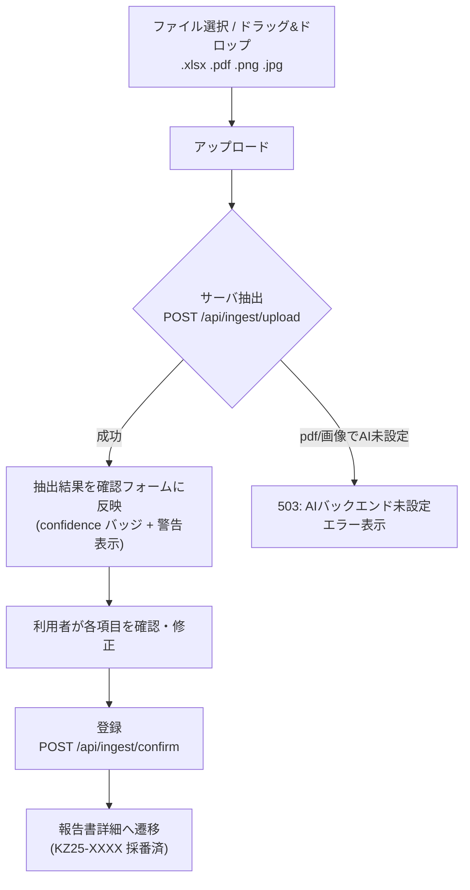
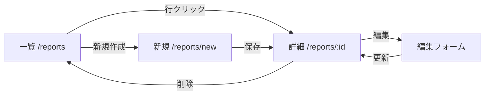
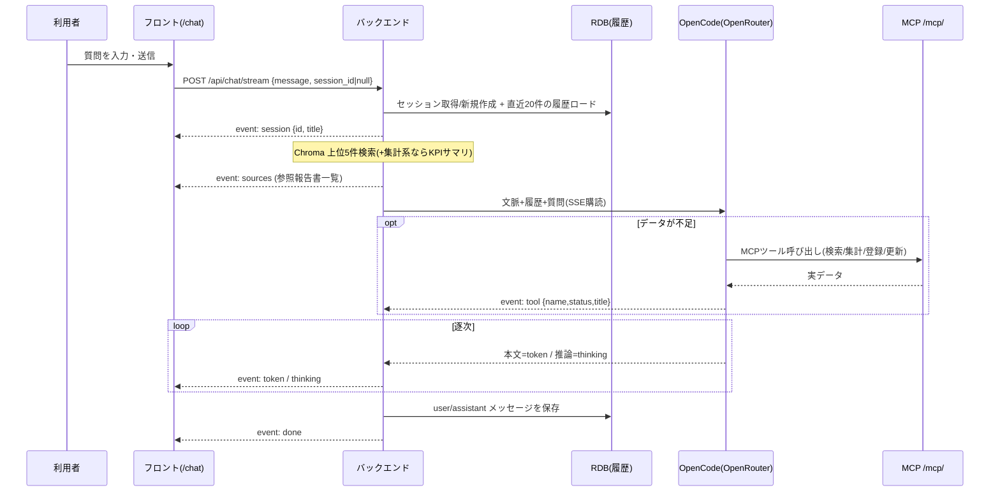
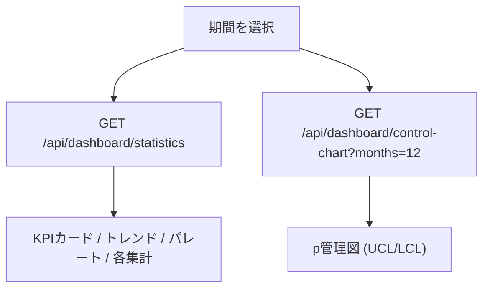
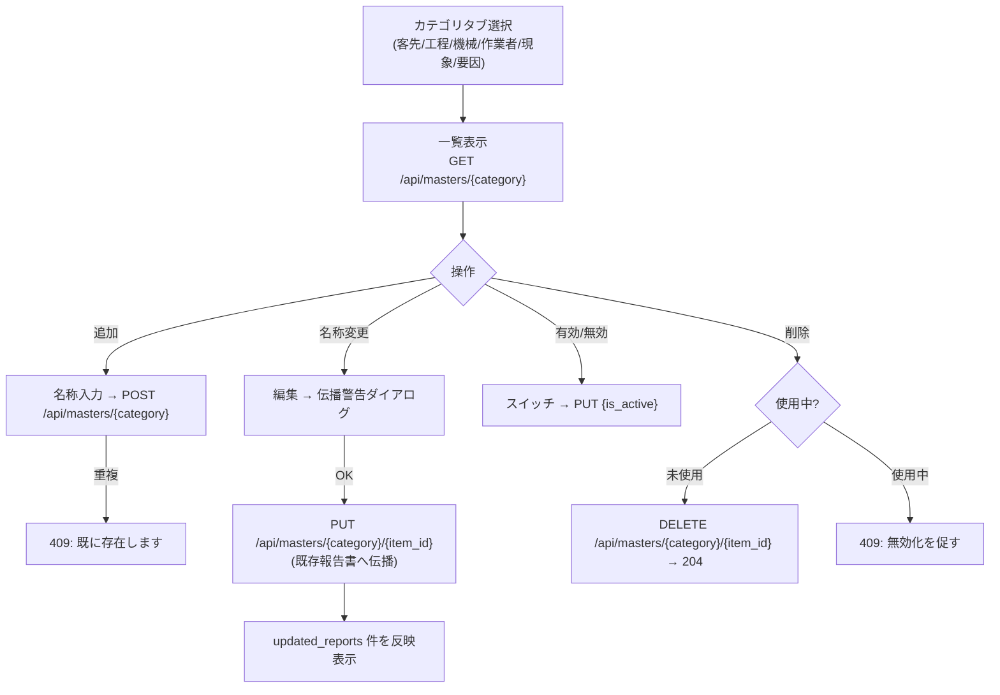

# DefectReport AI — 機能仕様書

本書は各機能の詳細仕様(画面・操作フロー・入出力・エラー時挙動)と、代表的なユースケースシナリオを定義する。API の正確な入出力は `docs/04_API設計書.md`、フィールド定義は `docs/03_データモデル設計書.md`、画面レイアウトは `docs/05_UI設計書.md` を正とする。

機能一覧:

| # | 機能 | 主画面 | 中核API |
|---|---|---|---|
| F1 | 帳票取り込み・AI構造化抽出 | 新規作成(取り込み) | `/api/ingest/*` |
| F2 | 報告書管理(CRUD) | 一覧 / 詳細 / 新規作成 | `/api/reports` |
| F3 | RAGチャット(根拠付き回答) | AIチャット | `/api/chat/stream` |
| F4 | 4M分析・改善提案 | 報告書詳細 | `/api/analysis/4m/{id}` |
| F5 | KPIダッシュボード | サマリー / データ分析 | `/api/dashboard/*` |
| F6 | 予兆アラート | 予測アラート | `/api/analysis/alerts` |
| F7 | マスタ管理 | 設定 > マスタ管理 | `/api/masters` |

---

## F1. 帳票取り込み・AI構造化抽出

### 画面と操作フロー

「不適合報告書 > 新規作成(`/reports/new`)」画面上部の「ファイルから取り込む」領域で行う。



### 入出力

- **入力**: ファイル 1 件(multipart/form-data の `file`)。対応拡張子 `.xlsx / .pdf / .png / .jpg`。
- **抽出処理**(生成エンジンは **OpenCode 優先 / Anthropic 代替**。`docs/04` §3・§7):
  - `.xlsx` → openpyxl でラベルセルを走査して抽出 → AI バックエンドがあれば報告書フィールドへ構造化補正。
  - `.pdf / 画像` → AI バックエンドで vision(OpenCode は FilePartInput 添付、Anthropic は document/image ブロック)+ 構造化出力で項目抽出。
- **出力**(確認画面用、この時点では**保存しない**):

```json
{
  "extracted": { "occurrence_date": "2025-06-12", "customer": "蒼井田機器工業", "process": "マシニング",
                 "machine_name": "GENOS M560-V", "part_name": "ブラケット", "defect_count": 3,
                 "production_count": 50, "phenomenon": "寸法不良", "defect_description": "..." },
  "confidence": "high",
  "warnings": ["費用欄が読み取れませんでした"],
  "source_filename": "KZ25-sample.pdf"
}
```

- **確信度(confidence)の意味**: `high` = 主要必須項目がすべて明瞭に読めた / `medium` = 一部が曖昧・欠落(xlsx セル抽出のみもここ)/ `low` = 画質不良等で多くが不確実。フロントは色バッジで表示し、`low`/`medium` は「必ず内容を確認してください」の注意を出す。
- **確認・登録**: 利用者がフォームで修正した Report フィールド群を `POST /api/ingest/confirm` へ送ると、`POST /api/reports` と同処理で保存(採番・費用合算・Chroma 索引)される。

### エラー時挙動

| 状況 | 挙動 |
|---|---|
| 非対応拡張子 | フロントで弾く。誤って送られた場合サーバは 400。 |
| pdf/画像で AI バックエンド未設定(`OPENCODE_URL` も `ANTHROPIC_API_KEY` も無し) | 503 `{"detail":"AIバックエンドが設定されていません(OPENCODE_URL / OPENROUTER_API_KEY)"}`。画面は「AI抽出は利用できません。手入力で作成してください」を表示し、空フォームへ切替可能にする。 |
| xlsx で AI 未設定 | セル抽出のみで返す(confidence: `medium` + 警告)。AI 補正はスキップ。 |
| 抽出はできたが必須項目欠落 | `warnings` に列挙。確認フォーム上で該当項目を必須ハイライトし、未入力なら登録ボタンを無効化。 |
| AI 呼び出しタイムアウト/失敗 | エラートーストを出し、再試行または手入力を促す。 |

---

## F2. 報告書管理(CRUD)

### 画面と操作フロー

- **一覧(`/reports`)**: 検索バー(`q`)+ フィルタ(状態・重大度・機械・工程・4M分類・期間)+ ソート(既定 `-occurrence_date`)+ ページング。行クリックで詳細へ。
- **詳細(`/reports/:id`)**: 全項目の表示、`defect_rate` 表示、編集・削除・4M分析ボタン。
- **新規作成(`/reports/new`)**: F1 の取り込み or 手入力フォーム。



### 入出力

- **一覧**: `GET /api/reports?q=&status=&severity=&machine=&process=&category_4m=&date_from=&date_to=&limit=&offset=&sort=` → `{"total": int, "items": [Report]}`。
- **詳細**: `GET /api/reports/{defect_id}` → Report(全カラム + `defect_rate`)。
- **作成**: `POST /api/reports`(body = Report フィールド群、`defect_id` 省略時は自動採番)→ 201 + Report。
- **更新**: `PUT /api/reports/{defect_id}`(部分更新)。
- **削除**: `DELETE /api/reports/{defect_id}` → 204。

### バリデーションとエラー時挙動

| 項目 | ルール | 違反時 |
|---|---|---|
| 必須項目(occurrence_date, customer, process, machine_name, operator_name, part_number, part_name, production_count, defect_count, defect_description, phenomenon, severity, status) | 空不可(`docs/03` の必須列に準拠) | フォームで赤表示、保存不可 |
| defect_count ≤ production_count | 不良数は加工数以下 | フォームで警告、保存不可 |
| severity | `critical`/`high`/`medium`/`low` のいずれか | セレクト固定で防止 |
| status | `open`/`in_progress`/`completed`(既定 `open`) | セレクト固定 |
| 存在しない defect_id の詳細/更新/削除 | — | 404 → 画面は「報告書が見つかりません」 |
| defect_rate | サーバ計算。production_count=0 は null | 画面は「-」表示 |

---

## F3. RAGチャット(根拠付き回答)

### 画面と操作フロー

「AI > チャット(`/chat`)」。**左に会話セッション一覧、右に対話**の2カラム。質問を送ると、まず参照ソースが表示され、続いて(必要ならツール実行・思考を挟みつつ)回答がストリーミングで流れる。生成エンジンは **OpenCode + OpenRouter**、報告書データへは **MCP(9ツール)**でアクセスする(`docs/04` §6・§6.5)。会話はセッション単位で DB に保存され、リロード後も残る(`docs/03` §2.6)。



### 入出力

- **入力**: `POST /api/chat/stream` body `{"message": str, "session_id": int | null}`。`session_id=null` なら新規セッション作成。履歴はサーバーが DB から直近20件をロードする(クライアントは履歴を送らない)。
- **出力(SSE)**: `session`(`{id, title}`、先頭)→ `sources`(参照報告書 `[{defect_id, part_name, phenomenon, snippet, score}]`)→ `token`(本文の逐次デルタ)/ `thinking`(推論デルタ)/ `tool`(`{name, status, title}` MCP ツール実行の進捗)→ `done`。異常時 `error`。
- **回答規約**: 本文中で参照報告書を `[KZ25-XXXX]` 形式で引用する(例:「同様の寸法不良が [KZ25-0032] [KZ25-0057] で報告されています」)。

### 会話履歴(セッション)の操作

| 操作 | UI | API |
|---|---|---|
| 新しいチャット | 左カラムの「＋ 新しいチャット」。以降の送信で `session_id=null` を送り新規作成 | `POST /api/chat/stream`(session_id なし) |
| セッション一覧 | 左カラムに更新降順で表示(タイトル+メッセージ数)。リロード後も保持 | `GET /api/chat/sessions` |
| 復元(選択) | 一覧の項目をクリック → そのセッションのメッセージ列(sources/tools/thinking 含む)を復元表示。以降 `session_id` を付けて継続 | `GET /api/chat/sessions/{id}` |
| 削除 | 項目ホバーで削除アイコン → 確認ダイアログ → 削除 | `DELETE /api/chat/sessions/{id}`(204) |

### 対話での登録・更新(MCP 書き込みツール)

チャットから報告書の**登録・更新**も依頼できる。system prompt で「ユーザーが明示的に依頼した場合のみ」実行すると規定されており、雑談や参照質問では書き込まない。

- **登録**: 例「以下の内容で報告書を登録して: 発生日…、機械 GENOS M560-V…」→ `create_defect_report`(自動採番・`status=open` 固定)。実行後、採番された `defect_id` を回答で報告する。
- **更新**: 例「KZ25-0100 を completed にして」「KZ25-0100 の対策を…に更新して」→ `update_defect_report`(status/severity/対策/原因/要因/4M/備考/良品状態の8項目のみ変更可)。実行後、変更項目を報告する。
- 書き込みは REST と共通ロジック(`services/report_service.py`)を通るため、自動採番・費用合算・Chroma 索引など CRUD と同じ副作用が働く。

### エラー時挙動

| 状況 | 挙動 |
|---|---|
| `OPENCODE_URL` 未設定(`chat_backend="none"`) | `error` イベント(または送信前に `GET /health` で検知)→「AIバックエンドが設定されていません(OPENCODE_URL / OPENROUTER_API_KEY)」を表示。 |
| モデル/OpenCode エラー | `error` イベントで詳細を通知(OpenCode の `info.error` を検知)。再送ボタンを提示。 |
| 埋め込みモデル利用不可 | キーワード検索へフォールバック(`search_mode: keyword`)。UI に「キーワード検索で回答」の注記。 |
| 検索ヒット 0 件 | 「該当する報告書が見つかりませんでした」と、一般的な助言 + ソース無しで回答。 |
| ストリーム途中の切断 | 受信済み分を保持し、再送ボタンを提示。 |
| 書き込みの明示依頼なし | 参照・回答のみ行い、登録/更新はしない。 |

---

## F4. 4M分析・改善提案

### 画面と操作フロー

報告書詳細(`/reports/:id`)の「4M分析」ボタンから実行。生成後、結果カード(4M分類・要因・理由・改善案一覧)が表示され、報告書にも保存される。生成エンジンは帳票抽出と共通(**OpenCode 優先 / Anthropic 代替**。`docs/04` §5・§7)。

### 入出力

- **入力**: `POST /api/analysis/4m/{defect_id}`(対象は既存報告書)。
- **出力**(構造化): `{"category_4m": "Man|Machine|Material|Method", "factor": str, "reasoning": str, "improvements": [str]}`。`category_4m` は4値に検証。
- **保存**: 結果を `category_4m` / `factor` / `ai_improvement`(改善案を整形して格納)に反映。

### エラー時挙動

| 状況 | 挙動 |
|---|---|
| AI バックエンド未設定 | 503「AIバックエンドが設定されていません(OPENCODE_URL / OPENROUTER_API_KEY)」。ボタンを無効化し理由を表示。 |
| 生成失敗 | エラートースト + 再試行。既存の保存値は保持。 |
| 既に分析済み | 再実行で上書き。実行前に確認ダイアログ。 |

---

## F5. KPIダッシュボード

### 画面と操作フロー

- **サマリー(`/dashboard`, 経営者向け)**: KPI カード + 月次トレンド + パレート図 + 重大度/4M 内訳 + p 管理図。上部で期間(`date_from`/`date_to`)を指定。
- **データ分析(機械別/担当者別/顧客別/時系列)**: 集計対象を切り替えて表示。



### 入出力

- **統計**: `GET /api/dashboard/statistics?date_from=&date_to=` → `kpi` / `monthly_trend` / `pareto_phenomenon` / `by_machine` / `by_operator` / `by_process` / `by_customer` / `by_4m` / `by_severity`(構造は `docs/04` §4)。
- **管理図**: `GET /api/dashboard/control-chart?months=12` → `{items:[{period,n,defects,p,ucl,lcl}], p_bar}`。UCL/LCL = p̄ ± 3√(p̄(1−p̄)/n)、LCL は 0 で下限クリップ。

主要 KPI の意味:

| KPI | 定義 |
|---|---|
| 不良率 defect_rate | 総不良数 / 総加工数 |
| 直行率 FPY | 1 − 不良率(概算) |
| 再発率 | 再発フラグ件数 / 総件数 |
| 総損失 total_cost | 費用欄の合計 |
| 未対応 open_count | status = open の件数 |

### エラー時挙動

| 状況 | 挙動 |
|---|---|
| データ 0 件 | 各グラフに「データがありません」を表示(エラーにしない)。 |
| 期間で該当なし | KPI を 0 / null 表示。 |
| n=0 の月(管理図) | その期間の p は表示せず、UCL/LCL 計算から除外。 |

---

## F6. 予兆アラート

### 画面と操作フロー

「経営者向け > 予測アラート(`/alerts`)」。ページを開くと現時点のアラート一覧をレベル順(critical → warning → info)に表示。ダッシュボードにも要約バッジを出す。

### 入出力

- **入力**: `GET /api/analysis/alerts`。
- **出力**: `{"items":[{"level":"critical|warning|info","title","message","related":{"machine"?,"phenomenon"?}}]}`。
- **ルール(例)**:
  1. 直近30日の不良率が全期間平均の 1.5 倍超の機械 → warning/critical。
  2. 同一現象 × 同一機械が直近60日に 3 件以上 → warning。
  3. 直近30日に再発フラグ付きが発生 → info/warning。

### エラー時挙動

| 状況 | 挙動 |
|---|---|
| 該当アラートなし | 「現在、注意すべき兆候はありません」を表示。 |
| データ不足(期間が浅い) | 判定可能なルールのみ評価し、その旨を注記。 |

---

## F7. マスタ管理

ドロップダウン選択肢(客先 / 発生工程 / 使用機械 / 作業者 / 現象分類 / 要因 の6カテゴリ)を DB マスタ化して管理する。`severity` / `status` / `4M分類` は固定列挙のため対象外。

### 画面と操作フロー

「設定 > マスタ管理(`/settings/masters`)」。カテゴリタブで6カテゴリを切り替え、各カテゴリの選択肢を一覧・追加・編集・無効化・削除する。



### 入出力

- **一覧(カテゴリ別)**: `GET /api/masters/{category}?active_only=` → **素の配列** `[{id, category, name, sort_order, is_active, usage_count}]`(オブジェクトでラップしない)。
- **全カテゴリ一覧**: `GET /api/masters` → カテゴリ別にグルーピングし、各項目に `usage_count`(使用件数)を付与。
- **追加**: `POST /api/masters/{category}` body `{name}` のみ(`category` はパス、`sort_order` はサーバー側で 500 固定・クライアント指定不可)→ 201 + Master。
- **更新(リネーム/有効切替)**: `PUT /api/masters/{category}/{item_id}` body `{name?, is_active?}`。名称変更時は既存報告書へ伝播し `updated_reports` を返す。
- **削除**: `DELETE /api/masters/{category}/{item_id}` → 204(未使用時)。

### 新規作成フォームとの連携

報告書の新規作成フォーム(`/reports/new`)の6カテゴリのドロップダウンは、**freeSolo な Autocomplete**(その場で新しい値を入力可能)とする。候補は該当カテゴリの有効(is_active=true)マスタ。マスタに無い値を入力して保存すると、報告書保存時にマスタへ自動登録される(FR-MA-06)。

### エラー時挙動

| 状況 | 挙動 |
|---|---|
| 名称の重複追加 | 409。フォームに「同じ名称が既に存在します」を表示。 |
| リネーム実行前 | 「この名称を使用している N 件の報告書も更新されます」の**伝播警告ダイアログ**で確認。OK で実行。 |
| リネーム先が既存名と衝突 | 409。「変更後の名称が既に存在します」を表示。 |
| 使用中マスタの削除 | 409。「N 件で使用中のため削除できません。無効化してください」を表示し、無効化スイッチへ誘導。 |
| 未使用マスタの削除 | 204。一覧から除去。 |
| 無効化した値 | 新規入力の候補から外れる。既存報告書の値・集計は変化しない。 |

**要件充足**: FR-MA-01〜06。

---

## ユースケースシナリオ

### UC-1. 現場担当:帳票アップロード → 確認 → 登録

> 現場の検査担当・田中さんは、マシニングセンタ GENOS M560-V で加工したブラケットに寸法不良を 3 個発見。紙で書いた不適合報告書をスマホで撮影して PNG にした。

1. 田中さんは「新規作成(`/reports/new`)」を開き、写真ファイルをドラッグ&ドロップする。
2. サーバが Claude vision で項目を抽出。数秒後、フォームに発生日・機械名・部品名・不良数などが自動入力され、確信度バッジ「medium」と警告「費用欄が読み取れませんでした」が出る。
3. 田中さんは読み取り漏れの費用欄と、曖昧だった作業者名を修正する。
4. 「登録」を押すと `KZ25-0101` が採番されて保存され、詳細画面へ遷移。同時に Chroma に索引され、以後チャットの検索対象になる。

**要件充足**: FR-IN-01/03/04/05/06、FR-CR-02。

### UC-2. 品質保証担当:チャットで類似不良を調査 → 4M分析

> QA の鈴木さんは、最近 GENOS M560-V の寸法不良が増えている気がしている。過去の類似事例と原因を知りたい。

1. 鈴木さんは「AIチャット(`/chat`)」で「GENOS M560-V の寸法不良について、過去の似た事例と考えられる原因を教えて」と質問。
2. 回答前に参照ソースカード(`[KZ25-0032]` `[KZ25-0057]` `[KZ25-0088]` …)が表示され、続いて「同様の寸法不良が [KZ25-0032] [KZ25-0057] で報告されており、いずれも工具摩耗が要因と記録されています…」とストリーミングで回答が流れる。
3. 鈴木さんはソースカードの `[KZ25-0088]` をクリックし、報告書詳細へ移動。
4. 詳細画面で「4M分析」を実行。Claude が `category_4m: Machine` / `factor: 工具摩耗` / 改善案(「工具寿命管理の閾値見直し」「摩耗センサの導入検討」等)を返し、報告書に保存される。

**要件充足**: FR-CH-01〜06、FR-AN-01〜03。

### UC-3. 経営者:ダッシュボードで月次レビュー → アラート確認

> 工場長の佐藤さんは、月初に前月の品質状況をレビューする。

1. 佐藤さんは「サマリー(`/dashboard`)」を開き、期間を前月に設定。KPI カードで不良率・総損失・未対応件数・再発率を確認する。
2. パレート図から不良の上位現象(寸法不良・バリ・キズ)が全体の約6割を占めることを把握。月次トレンドの折れ線で不良率が微増していることに気づく。
3. p 管理図を見ると、直近の月が UCL に接近している点を発見。
4. 「予測アラート(`/alerts`)」へ移動すると、critical「GENOS M560-V の直近30日不良率が全期間平均の1.9倍」と warning「寸法不良×GENOS M560-V が60日で4件」が出ている。佐藤さんは QA に工具管理の見直しを指示する。

**要件充足**: FR-DB-01〜06、FR-AL-01/02。
