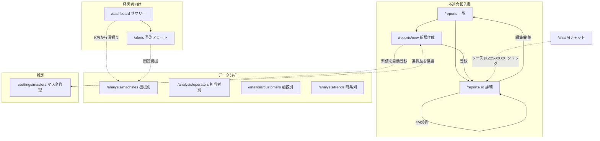

# DefectReport AI — UI設計書

本書はフロントエンド(React + TypeScript / Vite)の画面構成・レイアウト・遷移・配色・コンポーネント方針を定義する。API は `docs/04_API設計書.md`、機能の詳細は `docs/02_機能仕様書.md` を参照。

---

## 1. 全体レイアウト

左サイドバー(固定ナビ、幅 264px)+ 右メインエリアの2ペイン構成。テーマは「CNCコックピット」(計器盤風)でライト/ダーク両対応(§5)。サイドバーは**両モードとも暗色**(共通アイデンティティ)で、利用者像(経営者向け / 不適合報告書 / データ分析 / AI / 設定)でグルーピングし、下部にテーマ切替トグルを置く。

```
┌──────────────┬─────────────────────────────────────────────┐
│  SIDEBAR     │  TOPBAR (期間フィルタ / ヘルス状態バッジ)     │
│  (264px,暗色) ├─────────────────────────────────────────────┤
│  DefectReport│                                             │
│      AI      │   MAIN CONTENT (ルーティングで切替)          │
│  [経営者向け] │                                             │
│  [不適合報告] │                                             │
│  [データ分析] │                                             │
│  [AI]        │                                             │
│  [設定]      │                                             │
│  ─────────   │                                             │
│  [☀/🌙 切替] │                                             │
└──────────────┴─────────────────────────────────────────────┘
```

---

## 2. 画面一覧

| # | 画面 | パス | サイドバー分類 | 主API | 主コンポーネント |
|---|---|---|---|---|---|
| S1 | サマリー(ダッシュボード) | `/dashboard` | 経営者向け | `/api/dashboard/statistics`, `/control-chart` | KPIカード, LineChart, パレート, p管理図 |
| S2 | 予測アラート | `/alerts` | 経営者向け | `/api/analysis/alerts` | アラートリスト |
| S3 | 不適合報告書 一覧 | `/reports` | 不適合報告書 | `GET /api/reports` | 検索/フィルタ, Table |
| S4 | 新規作成(取り込み/手入力) | `/reports/new` | 不適合報告書 | `/api/ingest/*`, `POST /api/reports`, `GET /api/masters/:category` | ドロップゾーン, 入力フォーム, freeSolo Autocomplete |
| S5 | 報告書 詳細 | `/reports/:id` | 不適合報告書(一覧から) | `GET/PUT/DELETE /api/reports/:id`, `/api/analysis/4m/:id` | 詳細ビュー, 4M分析カード |
| S6 | データ分析 機械別 | `/analysis/machines` | データ分析 | `/api/dashboard/statistics` | BarChart(by_machine) |
| S7 | データ分析 担当者別 | `/analysis/operators` | データ分析 | 〃(by_operator) | BarChart |
| S8 | データ分析 顧客別 | `/analysis/customers` | データ分析 | 〃(by_customer) | BarChart |
| S9 | データ分析 時系列 | `/analysis/trends` | データ分析 | 〃(monthly_trend), `/control-chart` | LineChart, p管理図 |
| S10 | AIチャット | `/chat` | AI | `POST /api/chat/stream` | チャット, ソースカード |
| S11 | マスタ管理 | `/settings/masters` | 設定 | `/api/masters`, `/api/masters/:category` | カテゴリタブ, 一覧表, 追加フォーム, 伝播警告ダイアログ |

サイドバー構成(グループ → 項目):

```
経営者向け
  ├─ サマリー           → /dashboard
  └─ 予測アラート        → /alerts
不適合報告書
  ├─ 一覧               → /reports
  └─ 新規作成           → /reports/new
データ分析
  ├─ 機械別             → /analysis/machines
  ├─ 担当者別           → /analysis/operators
  ├─ 顧客別             → /analysis/customers
  └─ 時系列             → /analysis/trends
AI
  └─ チャット           → /chat
設定
  └─ マスタ管理         → /settings/masters
```

---

## 3. ワイヤーフレーム(ASCII)

### S1. サマリー(`/dashboard`)

```
┌ TOPBAR ───────────────────────────────────────────────────────┐
│ サマリー          期間 [2025-04-01]〜[2026-03-31]  ● API:OK e5 │
├───────────────────────────────────────────────────────────────┤
│ ┌KPI──┐ ┌KPI──┐ ┌KPI──┐ ┌KPI──┐ ┌KPI──┐ ┌KPI──┐             │
│ │総件数││不良率││直行率││総損失││再発率││未対応│             │
│ │ 100 ││2.3% ││97.7%││¥1.2M││ 15% ││  22 │             │
│ └─────┘ └─────┘ └─────┘ └─────┘ └─────┘ └─────┘             │
│ ┌─ 月次トレンド(不良率) ────────┐ ┌─ 現象別パレート ───────┐ │
│ │      ╱╲      ╱                 │ │ ██ ██ ██ ▁▁ ▁▁  —累積%  │ │
│ │   ╱╲╱  ╲╱╲╱                    │ │ 寸法 バリ キズ ...      │ │
│ └───────────────────────────────┘ └─────────────────────────┘ │
│ ┌─ 重大度内訳 ─┐ ┌─ 4M内訳 ─┐ ┌─ p管理図 (UCL/LCL) ────────┐ │
│ │ ● critical  │ │ Man 30   │ │  ·····UCL·············       │ │
│ │ ● high ...  │ │ Machine..│ │   •   •  •   • ← p            │ │
│ └─────────────┘ └──────────┘ └─────────────────────────────┘ │
└───────────────────────────────────────────────────────────────┘
```

### S3. 不適合報告書 一覧(`/reports`)

```
┌───────────────────────────────────────────────────────────────┐
│ 不適合報告書 一覧                             [＋ 新規作成]      │
├───────────────────────────────────────────────────────────────┤
│ [🔍 検索 q............] 状態▼ 重大度▼ 機械▼ 工程▼ 4M▼ 期間▼   │
├───────────────────────────────────────────────────────────────┤
│ KZ25-ID   │発生日   │客先│工程    │機械   │現象    │重大度│状態  │
│ KZ25-0100 │2026-03..│蒼井田機器工業 │マシニング│GENOS M560-V│寸法不良│high │open  │
│ KZ25-0099 │2026-03..│翠峰重工業 │旋盤    │QUICK TURN 250MSY│バリ   │medium│済    │
│ ...                                                            │
├───────────────────────────────────────────────────────────────┤
│                                       全100件  ◀ 1 2 3 ▶       │
└───────────────────────────────────────────────────────────────┘
```

### S4. 新規作成(`/reports/new`)

```
┌───────────────────────────────────────────────────────────────┐
│ 新規作成                                                        │
├─ ファイルから取り込む ────────────────────────────────────────┤
│ ┌───────────────────────────────────────────────────────────┐ │
│ │   ⬆  .xlsx / .pdf / .png / .jpg をドロップ、または選択      │ │
│ └───────────────────────────────────────────────────────────┘ │
│  抽出結果: 確信度 [ medium ]  ⚠ 費用欄が読み取れませんでした    │
├─ 報告書フォーム(抽出結果を反映・編集可)─────────────────────┤
│ 発生日* [2025-06-12] 客先* [蒼井田機器工業▼] 工程* [マシニング▼]          │
│ 機械*  [GENOS M560-V]      作業者*[____]  部品番号*[1234-567890-11]  │
│ 加工数*[50] 不良数*[3] 現象*[寸法不良▼] 重大度*[high▼]        │
│ 不具合内容* [__________________________________________]       │
│ 原因 [__________]  対策 [__________]  費用欄 [___]             │
│                                        [キャンセル] [登録]      │
└───────────────────────────────────────────────────────────────┘
```

### S5. 報告書 詳細(`/reports/:id`)

```
┌───────────────────────────────────────────────────────────────┐
│ KZ25-0100  寸法不良  [high]  [open]        [4M分析][編集][削除]   │
├───────────────────────────────────────────────────────────────┤
│ 発生日 2026-03-15 / 客先 蒼井田機器工業 / 工程 マシニング / 機械 GENOS M560-V    │
│ 作業者 山田 / 部品 ブラケット(1234-567890-11)                 │
│ 加工数 50 / 不良数 3 / 不良率 6.0%                             │
│ 不具合内容: 穴径が公差上限を超過...                            │
│ 原因: 工具摩耗の見落とし  対策: 工具交換基準の見直し           │
│ 損失: 材料¥.. 加工¥.. 外注¥.. 合計¥..                        │
├─ 4M分析結果 ──────────────────────────────────────────────────┤
│ 分類: Machine  要因: 工具摩耗                                  │
│ 理由: ...                                                      │
│ 改善提案: ・工具寿命管理の閾値見直し ・摩耗センサ導入検討       │
└───────────────────────────────────────────────────────────────┘
```

### S10. AIチャット(`/chat`)

左に会話セッション一覧、右に対話の2カラム。セッションは DB 保存され、リロード後も残る。

```
┌──────────────────┬────────────────────────────────────────────┐
│ [＋ 新しいチャット] │ AIチャット                      ● 検索: e5  │
├──────────────────┼────────────────────────────────────────────┤
│ 会話履歴          │  🙂 GENOS M560-V の寸法不良の傾向と原因は?        │
│ ▸ GENOS M560-Vの寸法.. 4│  ┌ 参照 ──────────────────────────────┐    │
│   バリ不良の対策 2│  │ [KZ25-0032] ブラケット/寸法不良 0.89  │    │
│   月次レビュー   6│  │ [KZ25-0057] シャフト/寸法不良  0.85   │    │
│   …            🗑 │  └─────────────────────────────────────┘    │
│ (ホバーで🗑削除   │  🔧 list_defect_reports … completed         │
│  →確認ダイアログ) │  🤖 同様の寸法不良が [KZ25-0032][KZ25-0057] で.. ▌│
│                  ├────────────────────────────────────────────┤
│                  │ [ メッセージを入力................ ] [送信] │
└──────────────────┴────────────────────────────────────────────┘
```

- 左カラム: 「＋ 新しいチャット」+ セッション一覧(タイトル+メッセージ数、更新降順)。選択で右に会話を復元。項目ホバーで削除アイコン → 確認ダイアログ。
- 右カラム: 対話。SSE の `session`(先頭)/`sources`/`token`/`thinking`/`tool` を反映。`tool` はツール実行の進捗チップ、`thinking` は折りたたみ表示。復元時は保存済みの sources/tools/thinking も再表示。

### S6-S9. データ分析(機械別 / 担当者別 / 顧客別 / 時系列)

```
┌───────────────────────────────────────────────────────────────┐
│ データ分析 — 機械別        期間 [____]〜[____]                  │
├───────────────────────────────────────────────────────────────┤
│ 機械      件数  不良率  損失                                    │
│ GENOS M560-V    ████████ 32   6.0%  ¥..                              │
│ QUICK TURN 250MSY    █████ 21      3.1%  ¥..                              │
│ VARIAXIS i-800 NEO  ███ 12        2.4%  ¥..                              │
│ ...(BarChart / 表 切替)                                        │
└───────────────────────────────────────────────────────────────┘
```
時系列(S9)は月次トレンドの LineChart と p 管理図を並べる。

### S11. マスタ管理(`/settings/masters`)

```
┌───────────────────────────────────────────────────────────────┐
│ マスタ管理                                                      │
├───────────────────────────────────────────────────────────────┤
│ [ 客先 ][ 工程 ][ 機械 ][ 作業者 ][ 現象 ][ 要因 ]  ←カテゴリタブ│
├─ 機械マスタ ──────────────────────────────────────────────────┤
│ 名称          使用件数   有効        操作                       │
│ GENOS M560-V          32      [●有効]   [編集] [削除]                │
│ QUICK TURN 250MSY          21      [●有効]   [編集] [削除]                │
│ VARIAXIS i-800 NEO        12      [●有効]   [編集] [削除]                │
│ TSL-550(旧)          0      [ 無効 ]  [編集] [削除]                │
├─ 追加 ────────────────────────────────────────────────────────┤
│ 名称 [__________________]                        [＋ 追加]      │
└───────────────────────────────────────────────────────────────┘

  ┌─ 名称変更の確認(伝播警告)──────────────────────────┐
  │ 「GENOS M560-V」→「CMX-800」に変更します。                  │
  │ この名称を使用している 32 件の報告書も更新されます。  │
  │                              [キャンセル] [変更する]  │
  └───────────────────────────────────────────────────────┘
```

削除操作で使用件数 > 0 のときは「N 件で使用中のため削除できません。無効化してください」を表示し、有効スイッチへ誘導する。

---

## 4. 画面遷移図



---

## 5. 配色・テーマ(CNCコックピット)

テーマは「**CNCコックピット**」―― 艶消しグラファイトの面にスパークアンバーが灯る計器盤。**ライト(昼版)/ダーク(夜版)の両モード**に対応する。実装は `app/frontend/src/theme.ts`(`createAppTheme(mode)`)が正で、色は MUI palette(`app` / `sidebar` / `chart` のカスタムキー)に集約し各コンポーネントは `useTheme()` 経由で参照する。

### モード切替と永続化

- サイドバー下部のトグルで切替(`ColorModeContext` の `toggle`)。
- 初期モード: `localStorage("theme-mode")` の保存値 → OS の `prefers-color-scheme: light` → いずれも無ければ `dark`(`colorMode.ts` の `initialColorMode`)。
- 切替時に `localStorage("theme-mode")` へ永続化(リロード後も保持)。
- **サイドバーは両モードとも暗色**トーン(共通アイデンティティ「操作盤」)。

### 設計原則

- 純黒を避け、艶消しグラファイト/明るいグレーの面で構成する。エレベーション(base→paper→elevated)は等間隔の明度差でスタックする。
- 彩度の高い色は**アンバー1色**に限定(アクセント)。それ以外は控えめな色相。
- カードは影ではなく**ヘアライン境界**(1px)で仕上げる(`MuiCard` は `elevation:0` + border)。
- KPI 数値などは**等幅フォント**(`MONO_FONT`)で計器風に表示。
- チャート系列色は dataviz バリデータで各モードのサーフェス上で検証済み、テキスト/バッジは WCAG AA(4.5:1)を満たす。

### トークン表(実装値 `theme.ts`)

| トークン | Light(昼) | Dark(夜) |
|---|---|---|
| app.base / paper / elevated | `#F5F6F8` / `#FFFFFF` / `#EDEFF2` | `#0E1116` / `#161B22` / `#1D242E` |
| app.hairline(罫線) | `#DCE0E6` | `#2A3340` |
| chart.grid(グリッド) | `#E6E9EE` | `#1F2630` |
| text primary / secondary / disabled | `#1A222E` / `#5B6878` / `#9AA6B4` | `#E8EDF4` / `#94A3B4` / `#5B6878` |
| primary(アクセント amber)/ hover | `#E58A17` / `#C97710` | `#FFA028` / `#FFB44D` |
| secondary(cyan) | `#0089AD` | `#009DC2` |
| sidebar.bg(両モード暗色) | `#141922` | `#0A0D11` |
| chart.series(5色・categorical) | `#BD7900`,`#0089AD`,`#6E55B1`,`#008B5E`,`#A44477` | `#C88300`,`#009DC2`,`#7A66B8`,`#239168`,`#A64F7C` |
| severity critical/high/medium/low | `#BE1B24`/`#9A3412`/`#854D0E`/`#166534` | `#FF5C5C`/`#FF9F45`/`#FFD166`/`#6EE7A0` |
| status open/in_progress/completed | `#9A3412`/`#0369A1`/`#166534` | `#FF9F45`/`#4CC3E8`/`#34D399` |

- MUI マッピング: `primary=amber`、`secondary=cyan`、`error=severity.critical`、`warning=severity.high`、`info=status.in_progress`、`success=status.completed`、`divider=hairline`。`shape.borderRadius=10`。
- 重大度バッジ: `critical`/`high`/`medium`/`low` は上表 severity。状態バッジ: `open`/`in_progress`/`completed` は上表 status。いずれも色+ラベルの Chip。
- グラフ配色(Recharts): カテゴリカルは `chart.series`(5色・固定順)。パレート図は棒(series[0]=amber系)+ 累積線(cyan)、p 管理図は実測点(amber系)+ UCL/LCL(`chart.danger`)+ 中心線 p̄(`chart.neutral`)。軸は `chart.axis`、グリッドは `chart.grid`。

---

## 6. コンポーネント方針

- **UI ライブラリ**: MUI(Material UI)。レイアウトは `Box`/`Grid`/`Stack`、ナビは `Drawer` + `List`(`components/Layout.tsx`)、一覧は `Table`、フォームは `TextField`/`Select`/`Autocomplete`、バッジは `Chip`、通知は `Snackbar`。
- **テーマ**: `createAppTheme(mode)`(`theme.ts`)+ `ColorModeContext`。色は palette 経由(`useTheme()`)で参照し、ハードコードしない。グラフの既定色は `components/chartDefaults.tsx` 経由でテーマから供給。
- **グラフ**: Recharts(`LineChart` トレンド、`BarChart` 機械別など、`ComposedChart` パレート図の棒+累積線、p 管理図は `LineChart` + `ReferenceLine` で UCL/LCL)。色は `chart.*` トークン(§5)。
- **ルーティング**: React Router。サイドバー項目と `path` を一元管理し、アクティブ項目をハイライト。
- **API 通信**: `fetch`。チャットのみ SSE を `fetch` ストリームで受け、`session`→`sources`→`token`/`thinking`/`tool`→`done` を逐次描画(`pages/Chat.tsx`)。
- **状態管理**: 画面ローカル state 中心(過度な抽象化を避ける方針、NFR-08)。期間フィルタ・テーマモードなど横断値は Context/上位で保持。
- **共通コンポーネント**: `KpiCard`(等幅の計器風数値)、`SeverityChip`/`StatusChip`(`components/Chips.tsx`)、`ConfidenceBadge`(high/medium/low)、`SourceCard`(チャットの参照報告書)、`EmptyState`(データ0件)、テーマ切替トグル(サイドバー下部)。
- **レスポンシブ**: PC(1人1台のノート PC)前提。最小幅は 1280px 目安。
- **アクセシビリティ/一貫性**: 色だけに依存せずラベル併記(重大度・状態はテキスト付き Chip)、ライト/ダーク両モードで WCAG AA。ローディングはスケルトン/スピナー、エラーは Snackbar + 画面内メッセージ。


## 追補(2026-09): 全画面フィルタとスマート検索

- 一覧・検索: ステータス/重要度/機械/工程/客先/担当者/現象/4M/並び順の9フィルタ+期間(PeriodFilter)。検索モード切替(キーワード/スマート検索)。スマート検索は自然文+Enterで実行し、類似度スコア・抜粋付きの結果テーブルを表示(機械・工程のみ後段絞り込み可)
- サマリー/機械別/担当者別/顧客別/時系列: PeriodFilter(全期間/直近3・6・12ヶ月プリセット+開始/終了日。時系列は管理図の月数も)
- フィルタ状態はURLクエリが正本。AI(ui_navigate)の操作もURL経由なので、AIが設定した条件をそのまま人間が引き継いで調整できる

## 追補(2026-09): A/B強化機能のUI

- 週次レポート `/digests`(ナビ: 経営者向け): 生成済みダイジェストの一覧+Markdown表示、「今すぐ生成」ボタン
- 是正処置 `/capa`(ナビ: 不適合報告書): CAPA 一覧(状態・期限・担当)。URLパラメータ status/overdue で絞り込み(AIと共有)。行内で状態変更、closed 時は効果確認メモを必須入力
- 報告書詳細: 写真ギャラリー(アップロード・AI外観分析)/ 類似事例カード / CAPA セクション(起票ダイアログ・AIドラフト採用・8Dダイアログ)を追加
- チャット入力: マイクボタン(Web Speech API ja-JP、対応ブラウザのみ表示)
