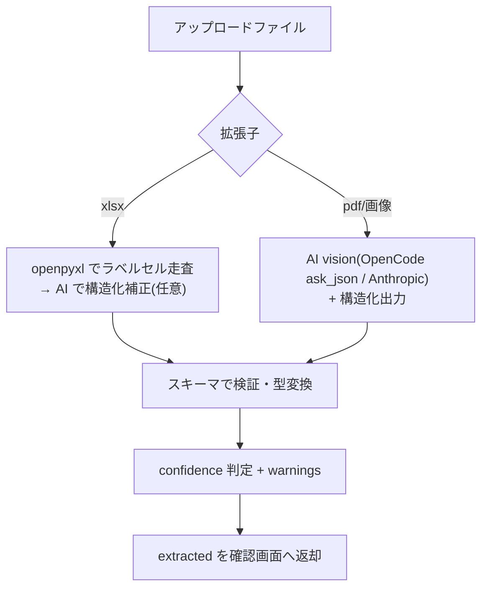
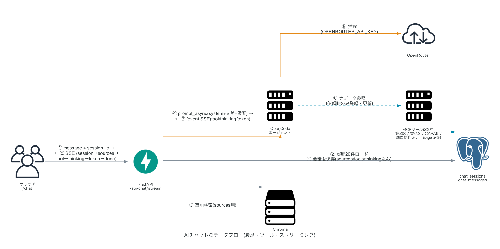
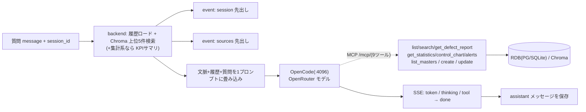

# DefectReport AI — AI設計書

本書は AI を利用する3箇所 ―― (a) 帳票の構造化抽出、(b) RAG チャット、(c) 4M 分析・改善提案 ―― の設計と実際のプロンプトを定義する。利用規約は `docs/04_API設計書.md` §7 と整合させる。フィールド定義は `docs/03_データモデル設計書.md` を正とする。

**生成エンジンの構成(すべて OpenCode + OpenRouter が主)**:
- **(b) RAG チャット** … **OpenCode 専用**。OpenCode サーバー経由の OpenRouter モデルで生成し、報告書データへは **MCP**(`/mcp/`、9ツール)でアクセスする。`OPENCODE_URL` 未設定時は 503(フォールバックなし)。
- **(a) 帳票抽出・(c) 4M分析** … **OpenCode を優先**(`opencode_client.ask_json`、全ツール無効の純生成)。`ANTHROPIC_API_KEY` があれば **Anthropic 直叩きを代替**として使える。
- バックエンド判定: 抽出/4M は `services/llm.ai_backend()`(opencode → anthropic → none)、チャットは `routers/chat.chat_backend()`(opencode → none)。`GET /health` の `anthropic_configured`(=抽出/4M の AI が設定済みか)・`chat_backend` で確認できる。

---

## 0. 共通: AI 利用規則(OpenCode 主 / Anthropic 代替)

### OpenCode / OpenRouter 経路(主)

| 項目 | 規則 |
|---|---|
| サーバー | OpenCode(`opencode serve --port 4096`)。接続先は env `OPENCODE_URL`。クライアントは `services/opencode_client`。 |
| プロバイダ/モデル | env `OPENCODE_PROVIDER`(既定 `openrouter`)/ `OPENCODE_MODEL`(既定 `anthropic/claude-sonnet-4.5`、OpenRouter のモデル名前空間)。**コードにハードコードせず env で切替**。 |
| 認証 | `OPENROUTER_API_KEY`(entrypoint が `~/.local/share/opencode/auth.json` を生成)。 |
| チャット | `opencode_client.stream()`(SSE 購読、`token`/`thinking`/`tool` を yield)/ 非ストリーミングは `ask()`。MCP ツール有効・コーディング系ツール無効。 |
| 構造化生成 | `opencode_client.ask_json(system, prompt, files?)`。**全ツール無効の純生成**でスキーマをプロンプトに埋め込み、応答を JSON パース。失敗時は「JSON のみで返答」と1回再依頼。 |
| vision | `files=[{mime, filename, b64}]` を FilePartInput `{"type":"file","mime","filename","url":"data:<mime>;base64,<b64>"}` として message に添付。 |
| モデルエラー | HTTP 200 の `info.error` に入る。`opencode_client` が検知して `RuntimeError` にする。 |

### Anthropic 経路(抽出・4M分析の代替のみ。チャットは非対応)

| 項目 | 規則 |
|---|---|
| SDK / モデル | `anthropic`(Python)。env `ANTHROPIC_MODEL`(既定 `claude-sonnet-5`)。 |
| 送らないパラメータ | `temperature` / `top_p` / `top_k` / `budget_tokens` は**送らない**(Sonnet 5 では 400)。`thinking` は省略(既定 adaptive)。 |
| 構造化出力 | `output_config={"format": {"type": "json_schema", "schema": ...}}`。 |
| vision | 画像 = `{"type":"image","source":{"type":"base64",...}}`、PDF = `{"type":"document","source":{"type":"base64","media_type":"application/pdf",...}}`。 |
| max_tokens | 抽出 4096 / 4M分析 2048。 |

> 未設定時の縮退: 抽出/4M は OpenCode も Anthropic も無ければ 503(pdf/画像)/ xlsx はセル抽出のみ。チャットは OpenCode が無ければ 503。判定は `GET /health`(`anthropic_configured` / `chat_backend`)。

---

## (a) 帳票構造化抽出

### 目的とフロー

不適合報告書(.xlsx / .pdf / 画像)から `defect_reports` のサブセットを構造化して取り出す。保存はせず確認画面へ返す(`docs/04` §3、`docs/02` F1)。



### 抽出スキーマ(JSON Schema)

抽出対象は報告書の主要フィールドに絞る(`id`/`created_at` 等サーバ付与項目は含めない)。実装(`services/llm.py` の `_extraction_schema()`)は**全フィールドを nullable**(`{"type": [<型>, "null"]}`)にし、`required` に全キー・`additionalProperties: false` を指定する(読み取れない項目は `null`)。enum は使わず、正規化はプロンプト側の指示で行う(process/phenomenon の候補列挙は system プロンプトで案内)。

```python
def _extraction_schema():
    def s(*types):               # 各フィールドは nullable
        return {"type": [*types, "null"]}
    props = {
        "occurrence_date": s("string"), "report_date": s("string"),
        "customer": s("string"), "discoverer": s("string"),
        "process": s("string"), "machine_name": s("string"), "operator_name": s("string"),
        "part_number": s("string"), "part_name": s("string"),
        "production_count": s("integer"), "defect_count": s("integer"),
        "defect_description": s("string"), "good_condition": s("string"),
        "phenomenon": s("string"), "cause": s("string"), "factor": s("string"),
        "severity": s("string"), "countermeasure": s("string"),
        "material_cost": s("number"), "processing_cost": s("number"),
        "outsourcing_cost": s("number"), "other_cost": s("number"),
        "is_recurrence": s("boolean"), "has_procedure": s("boolean"), "notes": s("string"),
    }
    return {"type": "object", "properties": props,
            "required": list(props.keys()), "additionalProperties": False}
```

### プロンプト例(pdf/画像 vision 抽出)

system プロンプト:

```
あなたは製造業の不適合報告書(NCR)を読み取り、構造化する専門アシスタントです。
与えられた帳票の画像/PDFから、指定スキーマの項目を正確に抽出してください。

厳守事項:
- 帳票に明記された値のみを使う。読み取れない項目は出力に含めない(推測で埋めない)。
- 日付は YYYY-MM-DD に正規化する。和暦や「6/12」等は西暦/ゼロ埋めに直す。
- 数値(加工数・不良数・費用)は数字のみにする(「50個」→50、「¥1,200」→1200)。
- 現象(phenomenon)・工程(process)は、意味が最も近い候補にマッピングする。
- 不良数は加工数以下になるはずである。矛盾する場合はそのまま抽出しつつ、判断に注意する。
```

呼び出し ―― **OpenCode 経路(主)**: スキーマをプロンプトに埋め込み、PDF/画像は FilePartInput として添付して純生成し、応答を JSON パースする。

```python
b64 = base64.standard_b64encode(file_bytes).decode()
extracted = opencode_client.ask_json(
    system=SYSTEM_EXTRACT,
    prompt=schema_prompt(EXTRACTION_SCHEMA),   # "次のJSONスキーマに厳密に従ったJSONのみを返す" + schema
    files=[{"mime": media_type, "filename": filename, "b64": b64}],  # data:<mime>;base64,<b64> で添付
)  # ask_json は全ツール無効・JSONパース失敗時は1回再依頼
```

**Anthropic 経路(代替、`ANTHROPIC_API_KEY` がある場合)**: 構造化出力で同じスキーマを使う。

```python
source_block = {"type": "document",  # 画像なら "image"
                "source": {"type": "base64", "media_type": media_type, "data": b64}}
message = client.messages.create(
    model=MODEL, max_tokens=4096,
    messages=[{"role": "user", "content": [source_block, {"type": "text", "text": SYSTEM_EXTRACT}]}],
    output_config={"format": {"type": "json_schema", "schema": EXTRACTION_SCHEMA}},
)
extracted = json.loads(message.content[0].text)
```

### xlsx セル抽出の構造化補正

xlsx は openpyxl でラベルセルを走査して抽出(ラベルの右隣を値、費用ブロックは真下のセル)。AI バックエンドがあればセルダンプを整形補正(OpenCode は `ask_json`、Anthropic は構造化出力。system は SYSTEM_EXTRACT を流用)、無ければ補正をスキップしてセル抽出結果をそのまま返す(confidence: `medium`)。

```python
extracted, cell_dump = parse_xlsx(file_bytes)   # ラベルセル走査
if ai_backend() != "none":
    normalized = normalize_cells(cell_dump)      # OpenCode ask_json or Anthropic
    extracted.update({k: v for k, v in normalized.items() if v})
    confidence = "high"
```

### confidence 判定と warnings

Claude に確信度そのものを出させず、**サーバ側の後処理**で決める(再現性のため)。

```python
def judge_confidence(extracted: dict, source: str) -> tuple[str, list[str]]:
    warnings = []
    required = EXTRACTION_SCHEMA["required"]
    missing = [k for k in required if not extracted.get(k)]
    if missing:
        warnings.append(f"必須項目が読み取れませんでした: {', '.join(missing)}")
    if extracted.get("defect_count") and extracted.get("production_count"):
        if extracted["defect_count"] > extracted["production_count"]:
            warnings.append("不良数が加工数を超えています。確認してください。")
    if not any(extracted.get(k) for k in ["material_cost","processing_cost","outsourcing_cost","other_cost"]):
        warnings.append("費用欄が読み取れませんでした")

    if source == "xlsx_cells_only":      # AI補正なし(キー未設定)
        return "medium", warnings
    if missing:
        return "low", warnings
    if warnings:
        return "medium", warnings
    return "high", warnings
```

返却(`docs/04` §3 に一致):`{"extracted":{...}, "confidence":"high|medium|low", "warnings":[...], "source_filename": ...}`。

---

## (b) RAG チャット

### 目的と構成(OpenCode 専用)

蓄積された報告書を根拠に、根拠付き(`[KZ25-XXXX]` 引用)で回答する。`docs/04` §6・§6.5。**チャットは OpenCode のみ**(`chat_backend` = `opencode` / `none`)。

AIチャットのデータフロー(①履歴ロード〜⑨保存、事前検索・prompt_async・MCP・SSE を含む):



> 画像は `docs/diagrams/generate_diagrams.py`(mingrammer/diagrams)で生成。次の Mermaid は同じ流れの簡易版。



- backend が OpenCode サーバー(`opencode serve --port 4096`)へ問い合わせる。OpenCode は OpenRouter のモデル(`OPENCODE_PROVIDER`/`OPENCODE_MODEL`、既定 `openrouter` / `anthropic/claude-sonnet-4.5`)で推論する。認証は `OPENROUTER_API_KEY`。
- backend は検索文脈(RAG 上位5件+集計系質問時の KPI サマリ)+履歴+質問を1つのプロンプトに畳み込んで渡す。OpenCode はそれで不足する場合に **MCP ツール(9本)**を追加で自律呼び出しする(下記)。
- 回答前の `sources` は backend の Chroma 検索結果。OpenCode は本文 `token`・推論 `thinking`・ツール実行状況 `tool` を SSE で逐次送出する。`OPENCODE_URL` 未設定時は 503(stream は `error`)。

### 埋め込みとプレフィックス規約

`intfloat/multilingual-e5-small` は非対称検索モデル。**文書側は `passage: `、クエリ側は `query: ` プレフィックス**を必ず付ける(`docs/03` §3)。

```python
# 索引時(登録・更新時)
doc = f"passage: {defect_description}\n原因: {cause}\n対策: {countermeasure}"
# 検索時
query_emb = model.encode(f"query: {user_message}")
results = collection.query(query_embeddings=[query_emb], n_results=5)
```

### 検索 → 文脈組立

```python
def build_context(hits) -> str:
    blocks = []
    for h in hits:  # metadata: defect_id, machine_name, process, phenomenon, severity, part_name, customer
        m = h["metadata"]
        blocks.append(
            f"[{m['defect_id']}] {m['part_name']} / {m['process']} / {m['machine_name']} / "
            f"現象:{m['phenomenon']} / 重大度:{m['severity']}\n{h['document']}"
        )
    return "\n\n".join(blocks)
```

この `build_context`(RAG 上位5件)と、下記の集計追記は backend 側で行い、プロンプトへ畳み込む。加えて、OpenCode はモデルが MCP ツール(`list_defect_reports` / `search_defect_reports` / `get_statistics` 等)で不足データを追加取得できる。

質問が集計系(「件数」「合計」「平均」「集計」「ランキング」「最多」「トップ」「何件」「割合」「率」等のキーワードを含む)なら、KPI サマリ(総件数・総不適合数・不良率・FPY・合計損失・再発率・未対応)を文脈に追記する:

```python
if any(k in message for k in AGG_KEYWORDS):
    kpi = statistics(db)["kpi"]
    context += "\n\n# 全体集計\n" + format_kpi(kpi)  # 総件数/不良率/FPY/損失/再発率/未対応 など
```

### MCPツール設計(9本)

backend は FastMCP で `/mcp/`(Streamable HTTP、`main.py` で `app.mount("/mcp", mcp_app)`)を公開し、**読み取り7本+書き込み2本**を提供する。全ツールの引数・返り値は `docs/04` §6.5 の表を正とする。OpenCode は `opencode.json` の `mcp.defect-reports`(type: remote, url `http://backend:8000/mcp/`)で接続し、OpenCode 上のツール名は `defect-reports_<名前>`。

- 読み取り: `list_defect_reports`(条件明確な絞り込み一覧)/ `search_defect_reports`(曖昧な類似検索)/ `get_defect_report` / `get_statistics` / `get_control_chart` / `get_active_alerts` / `list_masters`(正確な表記確認)。
- 書き込み: `create_defect_report`(自動採番・`status="open"` 固定)/ `update_defect_report`(status/severity/対策/原因/要因/4M/備考/良品状態の8項目のみ変更可)。
- **作成・更新は REST と共通ロジック(`services/report_service.py`)を使う**(`create_report_core` / `update_report_core` / `build_report_query`)。ツールの docstring に「いつ使うか」を明示し、エージェントのツール選択精度を上げている。

```python
from fastmcp import FastMCP
from services.report_service import build_report_query, create_report_core, update_report_core
mcp = FastMCP("defect-reports", instructions="…登録・更新はユーザーが明示的に依頼した場合のみ行うこと。")

@mcp.tool
def list_defect_reports(machine=None, process=None, ..., limit=20, offset=0, sort="-occurrence_date") -> dict:
    """条件で絞り込んで一覧を取得する。機械名・工程・期間など条件が明確な質問でまず使う。"""
    q = build_report_query(db, machine=machine, process=process, ...)
    return {"total": q.count(), "items": [summary(r) for r in q.offset(offset).limit(min(limit,100))]}

@mcp.tool
def create_defect_report(occurrence_date, customer, ...) -> dict:
    """報告書を新規登録する。ユーザーが明示的に依頼した場合のみ使う。defect_id は自動採番。"""
    r = create_report_core(db, {..., "status": "open"})
    return {"created": True, "defect_id": r.defect_id}
```

### プロンプト例(チャット)

OpenCode のみ。system prompt は**4節構成**(データ概要 / ツール選択の手順6項 / 書き込み規約 / 回答規約)で、ツール選択精度を上げるよう最適化してある(`routers/chat.py` の `_OPENCODE_SYSTEM`):

```
あなたは製造品質保証の専門AIアシスタントです。日本語で回答してください。

# データ
不適合報告書 約100件(期間: 2025-04〜2026-03)。各報告書は defect_id(KZ25-XXXX)・発生日・
客先・工程・機械・作業者・部品・加工数/不適合数・不具合内容・現象・原因・対策・4M分類・
重要度(critical/high/medium/low)・状態(open/in_progress/completed)・費用を持つ。

# ツール選択の手順(defect-reports)
1. 固有名詞の表記に確信が無ければ、まず list_masters で正確な表記を確認(例: 「CMX-800」→ "GENOS M560-V")。
2. 条件が明確(機械・工程・客先・期間・重要度・状態・現象)→ list_defect_reports(完全一致)。
   0件なら条件を1つ外す/表記を確認して引き直す。
3. 内容が曖昧な類似事例探し → search_defect_reports(意味検索)。
4. 個別の深掘り(全文・対策・費用)→ get_defect_report。
5. 集計・傾向・ランキング → get_statistics / 管理状態 → get_control_chart / 兆候 → get_active_alerts。
6. 同じツールを同じ引数で繰り返さない。多くの質問は2〜3回のツール呼び出しで足りる。

# 書き込み(要注意)
create_defect_report / update_defect_report は、ユーザーが「登録して」「更新して」「〜にして」と
明示的に依頼した場合のみ実行し、実行後に defect_id と変更内容を必ず報告する。頼まれていない書き込みはしない。

# 回答規約
- 参照した報告書IDは必ず [KZ25-XXXX] 形式で引用(画面ではリンクになる)。
- 冒頭に結論、その後に根拠(件数・該当例・傾向)。簡潔に、必要なら箇条書き。
- データに無いことは推測せず「データからは確認できない」と述べる。
- プロンプト内の「参考: 関連する不適合報告書」は事前検索の粗い候補にすぎない。合わなければ無視しツールで引き直す。
```

補足:
- OpenCode はプロジェクト常設の指示ファイル **`app/opencode/AGENTS.md`**(OpenCode がプロジェクト指示として読み込む)も併用する。ツール利用の原則・書き込みの安全規則・出力方針を簡潔に記し、system prompt と役割を補完する。
- MCP ツールの docstring(`services/mcp_server.py`)は、いつ使うか・引数の**使用例**・列挙値・**0件時の戦略**(条件を1つ外す等)まで書いてあり、エージェントのツール選択精度を高めている。

OpenCode は1問1答のため、backend は検索文脈・会話履歴・質問を1つのプロンプト本文に畳み込んで渡す(概念):

```python
prompt = f"# 参考: 関連する不適合報告書\n{context}\n\n# これまでの会話\n{format_history(history[-20:])}\n\n# 質問\n{message}"
```

### 呼び出しとストリーミング

SSE 順序: `sources`(backend の Chroma 検索直後に1回)→ 本文 `token`・推論 `thinking`・ツール状況 `tool`(逐次)→ `done`、異常時 `error`。

```python
# opencode_client.stream(): GET /event を購読 → POST /session/{id}/prompt_async
# message.part.delta を種別(text/reasoning)で振り分け、tool/thinking/token を逐次 yield する
for ev in opencode_client.stream(SYSTEM_OPENCODE, prompt):
    # ev["type"] は "tool"(name/status/title)| "thinking"(text)| "token"(text)
    yield sse(ev["type"], {k: v for k, v in ev.items() if k != "type"})
yield sse("done", {})
```

- チャットでは OpenCode 標準のコーディング系ツール(bash/edit/write/patch/read/glob/grep/list/webfetch/todowrite/todoread/task)を `tools={name: False}` で無効化し、MCP の `defect-reports` ツールのみ有効化する。
- デルタが取れない環境では、完了メッセージ(`GET /session/{id}/message`)から全文を回収して `token` を1回送出する保険を持つ。
- 非ストリーミング `POST /api/chat` は `opencode_client.ask()`(ブロッキング `POST /session/{id}/message`)で全文を返す。
- `OPENCODE_URL` が無い場合はチャットを 503 とし、送信前に `GET /health` の `chat_backend == "none"` で検知して UI に案内する(`docs/04` §6)。

### キーワード検索フォールバック

sentence-transformers が使えない環境では、SQLite の LIKE 検索に切り替える。結果メタに `search_mode: "keyword"` を明示し、ヘルスチェックの `vector_search` も `"keyword"` を返す(`docs/03` §3、`docs/04` §1)。

```python
def search(message: str):
    if embedder_available():
        return vector_search(message), "e5"
    like = f"%{extract_keywords(message)}%"
    rows = db.execute(
        "SELECT * FROM defect_reports WHERE defect_description LIKE ? OR cause LIKE ? "
        "OR part_name LIKE ? LIMIT 5", (like, like, like)).fetchall()
    return rows, "keyword"
```

---

## (c) 4M 分析・改善提案

### 目的

指定報告書を Man / Machine / Material / Method に分類し、要因の推定・理由・具体的な改善提案を返す。構造化出力を使う。結果は `category_4m` / `factor` / `ai_improvement` に保存(`docs/04` §5)。

### 出力スキーマ

```python
ANALYSIS_SCHEMA = {
    "type": "object",
    "properties": {
        "category_4m": {"type": "string", "enum": ["Man","Machine","Material","Method"]},
        "factor":      {"type": "string"},   # enum は付けない(要因は自由記述)
        "reasoning":   {"type": "string"},
        "improvements":{"type": "array", "items": {"type": "string"}},
    },
    "required": ["category_4m","factor","reasoning","improvements"],
    "additionalProperties": False,
}
```
(enum を付けるのは `category_4m` のみ。`factor` は素の string。サーバ側で `category_4m` を Man/Machine/Material/Method の4値に検証する。)

### プロンプト例(4M分析)

system プロンプト:

```
あなたは製造現場の品質改善(QC/4M分析)の専門家です。
与えられた不適合報告書を分析し、根本原因を 4M(Man/Machine/Material/Method)のいずれかに分類してください。

観点:
- Man=人(確認不足・知識/経験不足・手順逸脱・連絡不足など)
- Machine=設備・工具(工具摩耗・機械故障など)
- Material=材料(材料不良など)
- Method=方法・手順・プログラム(手順の問題・プログラム誤り・図面誤読など)

要件:
- factor は指定候補から最も適切なものを1つ選ぶ。
- reasoning では、報告書のどの記述から判断したかを簡潔に述べる。
- improvements は、現場ですぐ着手できる具体的・実行可能な改善策を3件程度、再発防止の観点で挙げる。
```

user プロンプト:

```python
report = get_report(defect_id)
user_text = (
    f"# 不適合報告書 {report['defect_id']}\n"
    f"工程:{report['process']} / 機械:{report['machine_name']} / 部品:{report['part_name']}\n"
    f"現象:{report['phenomenon']}\n"
    f"不具合内容:{report['defect_description']}\n"
    f"原因:{report.get('cause','')}\n"
    f"対策:{report.get('countermeasure','')}\n"
    f"再発:{report.get('is_recurrence')} / 手順書:{report.get('has_procedure')}"
)

呼び出し ―― 抽出と同じく **OpenCode 優先 → Anthropic 代替**。OpenCode 経路は `ask_json`(全ツール無効の純生成)にスキーマを埋め込む:

```python
if ai_backend() == "opencode":
    result = opencode_client.ask_json(
        system="あなたは製造品質保証の専門AIです。日本語で回答してください。",
        prompt=f"{SYSTEM_4M}\n\n{user_text}\n\n{schema_prompt(ANALYSIS_SCHEMA)}",
    )
else:  # Anthropic 代替
    resp = client.messages.create(
        model=MODEL, max_tokens=2048,
        messages=[{"role": "user", "content": f"{SYSTEM_4M}\n\n{user_text}"}],
        output_config={"format": {"type": "json_schema", "schema": ANALYSIS_SCHEMA}},
    )
    result = json.loads(resp.content[0].text)

# category_4m を Man/Machine/Material/Method の4値に検証してから保存
update_report(defect_id, category_4m=result["category_4m"], factor=result["factor"],
              ai_improvement="\n".join(f"- {s}" for s in result["improvements"]))
```

返却(`docs/04` §5):`{"category_4m","factor","reasoning","improvements":[...]}`。

---

## まとめ: 利用箇所とエンジンの対応

| 箇所 | エンジン | 呼び出し | 構造化 | ストリーム |
|---|---|---|---|---|
| (a) 帳票抽出 | OpenCode 優先 / Anthropic 代替 | `ask_json`(FilePartInput 添付)/ `messages.create` | プロンプト埋め込み / JSON Schema | — |
| (b) チャット | **OpenCode 専用** | `opencode_client.stream`(SSE購読、MCP 9ツール併用) | — | ○(token/thinking/tool 実デルタ) |
| (c) 4M分析 | OpenCode 優先 / Anthropic 代替 | `ask_json` / `messages.create` | プロンプト埋め込み / JSON Schema | — |

- 主エンジンは OpenCode + OpenRouter(`OPENCODE_PROVIDER`/`OPENCODE_MODEL`、既定 `openrouter` / `anthropic/claude-sonnet-4.5`、認証 `OPENROUTER_API_KEY`)。チャットの報告書アクセスは MCP(`/mcp/`、9ツール)経由。
- Anthropic 代替(a・c のみ)は `temperature` 等を送らず、モデルは `ANTHROPIC_MODEL`(既定 `claude-sonnet-5`)。抽出/4M のバックエンドは `services/llm.ai_backend()`、チャットは `chat_backend()`、いずれも `GET /health`(`anthropic_configured` / `chat_backend`)で確認できる(`docs/04` §1・§6・§6.5・§7)。
