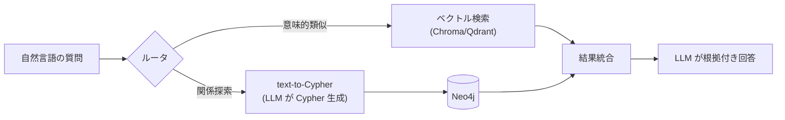

# DefectReport AI — 発展トピック

本書は、完成イメージアプリ(セミナー版 `app/`)のスコープ外だが、実務やセミナー後半(第8〜10回の自社課題)で有用な発展トピックをまとめる。各トピックには、着手の入り口になる**主要ライブラリと実装のヒント**を示す。

> **OpenCode + OpenRouter と MCP は、本セミナー版アプリ(`app/`)に既に実装済み**である(チャットの生成エンジン+MCP。帳票抽出・4M分析も OpenCode 優先/Anthropic 代替)。当初は発展トピックだったが本編に取り込まれたため、本書では `app/` 内の実装パスを示す(トピック6・7)。設計は `docs/04` §6・§6.5・§7、`docs/06` を参照。

発展トピック一覧:

| # | トピック | 目的 | 主要ライブラリ/キーワード |
|---|---|---|---|
| 1 | Neo4j ナレッジグラフ + ハイブリッド RAG(text-to-Cypher) | 関係性を辿る検索・多ホップ質問 | neo4j, langchain-neo4j, Cypher |
| 2 | RAGAS による RAG 品質評価 | 回答の忠実性・関連性を定量評価 | ragas, datasets |
| 3 | Langfuse による可観測性 | LLM 呼び出しのトレース・コスト可視化 | langfuse |
| 4 | 認証(JWT) | ユーザー管理・ロール制御 | fastapi.security, python-jose, passlib |
| 5 | ローカル LLM(Ollama)切替 | オフライン・機密データ・コスト | ollama, OpenAI 互換 API |
| 6 | **OpenCode + OpenRouter(複数モデルゲートウェイ)** ※本編実装済み | モデル比較・フォールバック・エージェント型チャット | 本セミナー版 `app/opencode/`, `app/backend/services/opencode_client.py` |
| 7 | **Tool use / MCP による外部連携** ※本編実装済み | 関数・DB・SaaS 呼び出し | 本セミナー版 `app/backend/services/mcp_server.py`(fastmcp) |

---

## 1. Neo4j ナレッジグラフ + ハイブリッド RAG(text-to-Cypher)

### 狙い

ベクトル RAG は「意味が近い文書」を探すのは得意だが、「機械 X で発生した不良の対策を担当した作業者が、別の機械で起こした不良は?」のような**関係を多段に辿る質問**は苦手。不適合報告書を「報告書 ―(発生)→ 機械」「報告書 ―(担当)→ 作業者」「報告書 ―(現象)→ 現象分類」といったグラフにすると、こうした質問に答えられる。

ハイブリッド RAG は、①ベクトル検索(意味的類似)と ②グラフ検索(Cypher による関係探索)を組み合わせ、質問に応じて使い分け/統合する。**text-to-Cypher** は、自然言語の質問を LLM に Cypher クエリへ変換させる手法。



### 実装のヒント

- グラフDB: `neo4j`(公式 Python ドライバ)+ Docker イメージ `neo4j:5-community`。
- text-to-Cypher: グラフスキーマ(ノード/リレーション種別)を system prompt に渡し、few-shot 例(質問→Cypher)を数個添えると精度が上がる。生成した Cypher は読み取り専用トランザクションで実行する。
- ルーティング: 質問を「意味検索/関係探索/集計」に分類する小さな LLM 呼び出しを前段に置く(structured outputs で分類させる)。

### セミナー版への発展のさせ方

`docker-compose.yml` に `neo4j` サービスを追加し、報告書登録時に RDB への保存に加えてグラフのノード/エッジも upsert する。チャットのルータで「関係を辿る質問」を判定し、text-to-Cypher 経路を追加する。まずは text-to-Cypher の生成部分だけを試作するのが入りやすい。

---

## 2. RAGAS による RAG 品質評価

### 狙い

RAG の回答品質を主観でなく指標で測る。RAGAS は Faithfulness(忠実性:回答が根拠に基づくか)、Answer Relevancy(質問との関連性)、Context Precision/Recall(検索文脈の的確さ)などを LLM を使って自動採点する。プロンプトやチャンク設計を変えた際の A/B 比較に使える。

### 実装のヒント

- `pip install ragas`。評価用データセットは {question, answer, contexts, ground_truth} の形で用意する。
- 採点用の LLM・埋め込みモデルは差し替え可能(OpenRouter 経由でも可)。
- スコアは乱数性があるため、同一条件で複数回まわして平均を見る。

### セミナー版への発展のさせ方

質問と期待根拠(defect_id)のペアを 10〜20 件用意し、`/api/chat`(非ストリーミング版)の `answer` と `sources` を RAGAS に渡して採点する。埋め込みモデルやプロンプト変更前後でスコアを比較する。

---

## 3. Langfuse による可観測性

### 狙い

LLM アプリは「なぜこの回答になったか」「どのくらいトークン/コストがかかったか」が見えにくい。Langfuse は各 LLM 呼び出しをトレースとして記録し、入力/出力/レイテンシ/コスト/評価をダッシュボードで可視化する。本番運用・デバッグで有用。

### 実装のヒント

- `pip install langfuse`。`@observe()` デコレータで関数単位のトレースが最も手軽。
- セルフホスト(docker compose)とクラウド版があり、ローカル学習にはセルフホストが向く。
- セッションID・ユーザーIDをトレースに付与すると会話単位の分析ができる。

### セミナー版への発展のさせ方

チャット/抽出/4M の各呼び出し(`services/llm.py`・`services/opencode_client.py`)を `@observe()` で包む。API キーは `.env` に追加。

---

## 4. 認証(JWT)

### 狙い

セミナー版は認証なし(ローカル演習)。実務で複数ユーザー・ロール(経営者/QA/現場)を分けるには認証が要る。JWT(JSON Web Token)ベースのステートレス認証が定番。

### 実装のヒント

- FastAPI 公式ドキュメントの「OAuth2 with Password (and hashing), Bearer with JWT tokens」がそのまま雛形になる。
- ライブラリ: `python-jose[cryptography]`(JWT)+ `passlib[bcrypt]`(パスワードハッシュ)。
- 保護ルートは `Depends(get_current_user)` を付けるだけ。ロールは JWT の claim に載せる。

### セミナー版への発展のさせ方

`POST /api/auth/login` で JWT を発行し、保護したいルートに依存性を付ける。ロール(claim)で経営者向け画面を制限。UI 設計書のサイドバー分類(経営者向け/現場)がそのままロール設計の下地になる。

---

## 5. ローカル LLM(Ollama)切替

### 狙い

機密データを外部に出せない/オフラインで動かしたい/トークン課金を避けたい場合、Ollama 等でローカルモデル(Llama・Qwen・Gemma 等)を使う。多くが OpenAI 互換エンドポイント(`localhost:11434`)を提供する。埋め込み(例 `mxbai-embed-large`)もローカル実行できる。

### 実装のヒント

- `ollama pull <model>` → OpenAI 互換クライアントで `base_url="http://localhost:11434/v1"` を指すだけ。
- OpenCode は Ollama プロバイダにも対応しており、`opencode.json` の provider 設定で切り替えられる(本セミナー版の構成をほぼそのまま流用できる)。
  既定の `app/opencode/opencode.json` は OpenRouter だけにしてある(2026-09-27)。Ollama を使うときは、次の provider を足し、接続先は環境変数で渡す(IP をファイルに書かない)。

  ```json
  "ollama": {
    "npm": "@ai-sdk/openai-compatible",
    "name": "Ollama",
    "options": { "baseURL": "{env:OLLAMA_BASE_URL}/v1" },
    "models": { "gemma4:26b": { "tool_call": true, "limit": { "context": 131072, "output": 8000 } } }
  }
  ```

  `.env` に `OLLAMA_BASE_URL=http://<Ollama のホスト>:11434` と `OPENCODE_MODEL=ollama/gemma4:26b` を書き、opencode のイメージを作り直す。
- 実用速度には GPU/Apple Silicon 等の資源が要る。品質は RAGAS(トピック2)で定量比較するとよい。

### セミナー版への発展のさせ方

`OPENCODE_MODEL` をローカルモデルに向ける(または OpenAI 互換クライアントの分岐を追加する)。「同じアプリを別モデルに載せ替える」発展演習として、クラウド版とローカル版の品質・速度を比較する。

---

## 6. OpenRouter(複数モデルゲートウェイ)

### 狙い

1 つの API キーで Anthropic・OpenAI・Google・Meta・DeepSeek 等を切り替えて呼べる LLM ゲートウェイ。OpenAI 互換なので base URL を `https://openrouter.ai/api/v1` に変えるだけ。モデル比較・プロバイダ障害時のフォールバック・予算一元管理に向く。埋め込みは別途(ローカル等)が必要。

### セミナー版への発展のさせ方

本セミナー版のチャットは**既に OpenRouter(OpenCode 経由)で動いており**、`OPENCODE_MODEL`(例 `anthropic/claude-sonnet-4.5`、`openai/gpt-...` 等)を env で切り替えるだけでプロバイダ/モデルを変更できる。さらなる発展としては、帳票抽出・4M分析(現在は OpenCode 優先/Anthropic 代替)も OpenAI 互換クライアントでゲートウェイ経由に統一する、モデル自動選択やフォールバックを組む、といった方向がある。

> 注意: データが外部を経由するため、機密情報の取り扱いは要検討(ローカル LLM との使い分けが実務的)。

---

## 7. Tool use / MCP による外部連携

### 狙い

Tool use(function calling)で、LLM に「SQL 集計を実行する」「報告書を検索する」等の関数を呼ばせ、より正確な集計回答やアクションを実現する。MCP(Model Context Protocol)は、社内 API・DB・SaaS を「コネクタ」として標準化された形で LLM から呼び出す仕組み。

### 実装参照(本セミナー版に実装済み)

- `app/backend/services/mcp_server.py` — fastmcp による MCP サーバー(ツール9本、`/mcp/` にマウント)。
- `app/opencode/opencode.json` — OpenCode 側の MCP 接続設定(`type: remote`)。
- 設計: `docs/04` §6.5、`docs/06`。

### セミナー版への発展のさせ方

MCP は Claude Code / Claude デスクトップからも接続でき、開発時の DB 参照にも使える。自社課題では「自社の DB・社内 API を MCP ツール化して LLM から呼ばせる」形にすると、本セミナー版の構成をそのまま流用できる。

---

## 発展トピックとセミナー後半の関係

第8〜10回では受講者が自社課題に取り組む。上記トピックは「どこまで作り込むか」の選択肢として使える。目安:

| 課題の性質 | 相性の良いトピック |
|---|---|
| 機密データを扱う | 5(ローカル LLM)、4(認証) |
| 関係性・つながりが重要(人・組織・部品の連鎖) | 1(ナレッジグラフ) |
| 回答品質を上げたい/評価したい | 2(RAGAS)、7(Tool use) |
| 運用・コスト管理まで見据える | 3(Langfuse)、6(OpenRouter) |
| 社内システムと連携したい | 7(MCP)、6(ゲートウェイ) |
