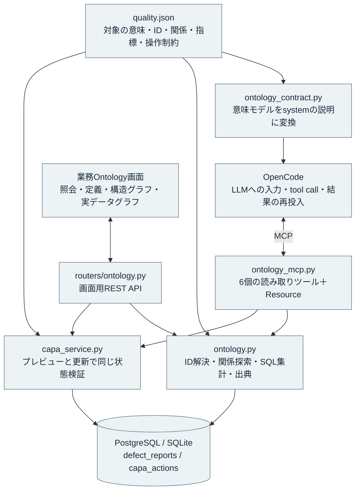
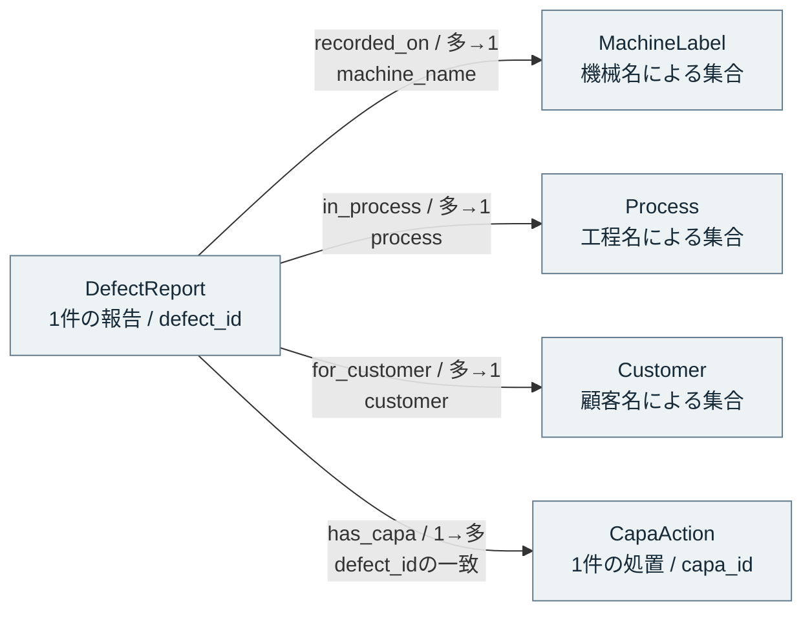
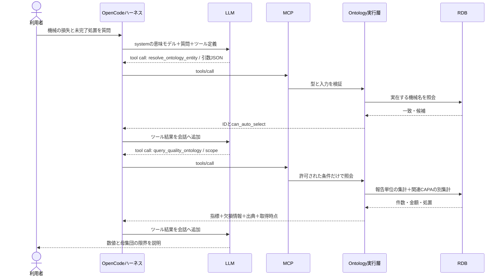

# OntologyをAIエージェントで利用する実装

更新日：2026-09-15。対象：このリポジトリの `example_app`。既存のOpenCode、FastMCP、SQLAlchemy、Reactに実装を追加した。

## 1. MCPツールを作るだけでよいのか

MCPは、エージェントが外部の情報・機能へアクセスするための接続規約である。業務上の「機械」「報告」「処置」が何を指すか、どの関係が実データで成立するか、指標をどう計算するかは、MCP自体では定義されない。

Palantirの公式構成では、Ontologyに設定したObject types、Action types、Query functionsをMCPで公開し、外部エージェントが利用する。書き込みは定義済みのActionとして公開できる。本実装は、この対象・関係・問い合わせ・操作の分離を参考にしている。Palantirそのものや、その互換実装を導入したものではない。[公式：Ontology MCPの構成](https://www.palantir.com/docs/foundry/ontology-mcp/sample-architecture)

さらにAIP Chatbot Studioは、毎回取得するコンテキストとしてOntologyのオブジェクトや、独自検索関数による情報をLLMに渡せる。したがって、Ontologyの利用は「LLMが選ぶツール」だけに限定されない。本アプリでは、型・関係・計算式・制約の要約を毎回systemに渡し、現在の実データはツールで取得する構成にした。[公式：Retrieval context](https://www.palantir.com/docs/foundry/chatbot-studio/retrieval-context)

MCPのToolsは呼び出せる機能、ResourcesはURIで参照する情報である。Resourceを公開しても、接続クライアントが必ず自動読込するとは限らない。このため同じ定義を、Resource、定義取得ツール、チャットsystemの3経路で提供する。[公式：Tools](https://modelcontextprotocol.io/specification/2025-11-25/server/tools)、[公式：Resources](https://modelcontextprotocol.io/specification/2025-11-25/server/resources)

## 2. 実装した構成



追加のグラフDBは必須にしていない。既存のRDBに実データを保持し、意味モデルとアダプターを介してグラフとして参照する。`quality.json` はこのアプリ固有の定義形式であり、OWL/RDF文書やOpenCodeの設定ファイルではない。OWL推論、SPARQL、SHACL検証エンジンは搭載していない。

定義のうち、関係の対応フィールドは探索のアダプターに使い、CAPAの状態一覧・必須属性は実行時検証に使う。指標の計算式は説明用定義と対応するPython/SQL実装を持つ。JSON内の式を任意コードとして実行する仕組みではない。式を変えた場合はSQL実装と受け入れテストも変更する。

## 3. 何をOntologyとして定義したか

| 型 | 実データ | 同一性と注意点 |
|---|---|---|
| DefectReport | 不適合報告書 | `defect_id`で識別。1報告と不適合品1個を区別する |
| MachineLabel | 報告に記録された機械名 | 機械名が同じ報告の集合。設備個体やシリアル番号ではない |
| Process | 報告に記録された工程名 | 名前による集合。工程の順序や作業手順は含まない |
| Customer | 報告に記録された顧客名 | 名前による集合。法人番号・企業グループの同一性は未管理 |
| CapaAction | 是正・予防処置 | `capa_id`で識別。対象報告との関係は`defect_id`で照合 |

名称に基づく3種類のIDは、型名と元の文字列のUTF-8/Base64URL表現から決定的に生成する。表示名とIDを分けるが、名称変更時に同じ設備や法人を追跡できるIDではない。存在するDB値に対応するIDだけを受け付ける。実設備を扱う場合は設備台帳の`asset_id`、設置工場、シリアル番号、名称の有効期間を別途導入し、この部分の対応付けを置き換える。



逆方向の関係も提供する。機械・工程・顧客の`reports`から報告書へ、CAPAの`for_report`から対象報告へ戻れる。全て現在のDBを使った関係であり、文章の類似性から作った関係ではない。

## 4. エージェントが利用する手順

例：「a61nxの報告件数、不適合率、損失、未クローズCAPAを調べて」

1. OpenCodeのsystemには、`MachineLabel`の意味、型の関係、計算式、欠損時の扱い、CAPAの制約が入る。
2. LLMが`resolve_ontology_entity(object_type="MachineLabel", query="a61nx")`を選ぶ。実行結果から型付きIDを受け取る。
3. 完全一致、または一意な文字の正規化一致のみ自動選択可能。部分一致の候補が1つでも確認を求める。別の機械名に勝手に読み替えない。
4. LLMが`query_quality_ontology(scope={"machine_id": "取得したID"})`を選ぶ。サーバーが条件を検証し、SQLで計算する。
5. 必要なら報告IDから`traverse_ontology_relation(..., relation="has_capa")`を呼び、処置の内容を調べる。
6. 戻り値の`metrics`、`quality`、`source`、`provenance`に基づいて回答する。報告書ごとの引用は`[KZ25-XXXX]`を使用する。



LLMのtool callは、関数名と構造化した引数を選んだ出力である。LLMがDBを直接書き換えるものではない。ハーネスが呼び出しを実行し、サーバーが実データと業務制約を評価する。

既存RAGは説明文から似た不具合を発見するために利用する。RAGの上位数件を集計の母集団にせず、候補の報告IDをOntologyへ接続して確かめる。条件付きの質問へ無条件の全体KPIを自動追加する旧処理は取り除いた。

## 5. 計算方法とデータ品質

| 指標 | 実装での扱い |
|---|---|
| 報告件数 | 該当報告を数える。CAPAが複数あっても報告を重複計上しない |
| 記録不適合数・記録加工数 | 報告の個数をそれぞれ合計する。重複ロットの排除は未実装 |
| 記録上の不適合率 | 不適合数の合計÷加工数の合計。報告ごとの率の単純平均は使わない |
| 率が不明な場合 | 0件・分母0・個数の欠損や矛盾では`null`を返す |
| 既知の損失額 | 既知の値だけ合計し、未入力報告数を併記。全額不明なら`null`。0件なら0 |
| 未クローズCAPA | 該当報告に関連し、状態が`closed`以外の処置を数える |
| 期限超過CAPA | 上記のうち`due_date < as_of_date`。基準日はサーバーの当日として戻り値に明示 |

金額はSQLの数値型で集計し、結果を10進文字列で返す。画面表示時の数値変換とは区別する。加工数は不適合報告に記録された範囲の値であるため、「工場全体の不良率」と呼ぶことはできない。

`has_open_capa`による報告の抽出には`EXISTS`を使う。CAPAを報告にJOINしてから損失をSUMすると、1報告に複数処置がある場合に金額が増えてしまうためである。集計は全該当報告、`objects`はページ内の根拠例。対象が100グループを超える場合はグループ表示の省略を明示する。

不正な日付、存在しないID、別の型のID、未定義の絞り込みキー、任意SQLはエラーにする。無効な条件を無視して全件を返す動作にはしない。

## 6. 操作として活用する

`preview_capa_update`は変更前後を返すだけで保存しない。`update_capa_action`および既存REST更新は、同じ`validate_update`で更新後の状態全体を検証する。

- 対象報告書が存在すること。
- 状態と処置種別が定義済みの値であること。
- `closed`の場合は空白以外の効果確認メモがあること。
- 状態を省略してメモだけ消す更新でも、上の条件を満たすこと。
- 日付が有効であること。

プレビューに成功しても、後続実行が自動承認されるわけではない。実行時にも現在の状態で再検証する。メモがあるだけで効果が実証されたと判定する仕組みでもない。

このアプリでは既存の状態変更の互換性を保ち、必須の遷移順序は課していない。`open → in_progress → effect_check → closed`の順序を強制したい場合は、許可遷移表と例外承認を業務ルールとして追加する必要がある。

利用者ごとの行権限、承認者の識別、更新競合の検出、改ざん防止監査は未実装。現在の「明示依頼時のみ更新」はエージェント指示であり、認証・認可の代わりにはならない。実業務へ拡張する場合は、REST/MCP双方で検証済みの利用者情報を共通サービスへ渡し、対象行の認可、許可Action、承認記録、バージョン一致、監査イベントを実行境界に追加する。

## 7. グラフで確認する

ローカルDocker環境：<http://localhost:5373/analysis/ontology?view=graph>

「業務Ontology → グラフで見る」で2種類を切り替える。

| 表示 | ノード | 線 | クリック時 |
|---|---|---|---|
| 構造（型と関係） | 5種類の型 | 定義された4種類の関係・方向・多重度 | 対象の意味、ID、属性定義、接続関係 |
| 実データの関係 | 選択した報告と、実在する機械名・工程・顧客・CAPA | DB値・報告書IDで確認した関係 | 現在の属性、出典、関係成立のキー、元の報告書へのリンク |

実データグラフは1報告を中心とする部分グラフ。全件を一度に描く機能ではない。報告書の候補は「実データを調べる」の現在のページから選ぶ。別の対象を見る場合は照会条件やページを変更する。CAPA未登録時は4ノードであり、説明のための架空CAPAを補わない。CAPAは先頭50件まで表示し、省略がある場合は全件数を示す。

ノードはマウスとキーボードで選択できる。拡大・縮小・リセット・図のスクロールに対応。青灰色の同一系統で描画し、色にリスクや重要度の意味を持たせていない。既存の「関連マップ」は報告書間の類似性を表す別画面である。

チャットで「Ontologyのグラフを表示して」と依頼した場合は、`ui_navigate(page="ontology_graph")`で画面を開ける。

## 8. APIとファイル

| 入口 | 用途 |
|---|---|
| `GET /api/ontology/definition` | 意味モデル |
| `GET /api/ontology/resolve?object_type=MachineLabel&query=a61nx` | 名前から候補とIDを取得 |
| `GET /api/ontology/objects/{type}/{id}` | 現在の対象属性 |
| `GET /api/ontology/objects/{type}/{id}/relations/{relation}` | 実関係をたどる |
| `POST /api/ontology/query` | 型付きのscopeを検証して指標と報告を取得 |
| `GET /api/ontology/graph/{defect_id}` | 報告中心の実データグラフと関係の根拠 |
| `POST /api/ontology/actions/capa/preview` | 保存しない更新検証 |
| `ontology://quality/definition` | MCP Resourceとしての意味モデル |

定義の正本は`app/backend/ontology/quality.json`。REST/MCPで同じサービスを利用するため、画面とエージェントで計算や制約を別々に実装していない。チャット用systemは`services/ontology_contract.py`から生成する。変更後はバックエンドを再起動する。

実行層：`app/backend/services/ontology.py`、MCPアダプター：`ontology_mcp.py`、操作：`capa_service.py`。画面：`pages/Ontology.tsx`、図：`components/OntologyGraph.tsx`。

## 9. 検証と講義での実演

一時DBで、複数CAPAを持つ報告、個数の異なる報告、損失未入力、ゼロ分母、孤立CAPAを作って検証する。実アプリのDBに検証用CAPAは追加しない。

```bash
# example_appで実行。既存DBとLLMを使わないバックエンド検証
env -u DATABASE_URL .venv/bin/python -m pytest app/backend/tests -q

# 起動中のアプリの画面をPlaywrightで確認
.venv/bin/python app/e2e/check_ontology.py

# 実OpenCode・MCPで読み取り質問を確認（設定済みLLMを使用）
.venv/bin/python app/e2e/check_ontology_agent.py
```

2026-09-15の実OpenCode検証では、`resolve_ontology_entity`、`query_quality_ontology`の順に呼び出した。a61nxについて報告4件・記録上の不適合率約12.08%・既知損失841,072円・未クローズCAPA0件を回答し、SQL結果と一致した。回答は工場全体の不良率に読み替えていない。実行時点の結果であり、データの更新後は変わり得る。使用ツール・質問・期待値・実際の回答は`docs/validation/ontology_20260915/live_agent.json`に保存している。

講義では、まず構造グラフで「型と実体の違い」を説明し、実データグラフで1件をたどる。次に機械名を指定して集計し、実際のOpenCodeのツール選択を見る。最後に、複数CAPAでも損失が増えないテストと、メモなしではクローズできないテストを示す。この順序で、Ontologyが図や用語集だけでなく、探索・計算・操作の共通ルールとして動くことを確認できる。

## 10. 他分野へ拡張する際の対応

| 分野 | 先に定める同一性 | 関係と指標の例 | 実行Actionの例 |
|---|---|---|---|
| 金融 | 契約・口座・法人・ポジションIDと有効時点 | 契約主体、通貨、評価日、評価額の換算規則 | 審査依頼を作成。権限・承認・監査を必須化 |
| 企業内 | 従業員・組織・文書ID、所属の有効期間 | 文書の所有者、版、閲覧可能な範囲 | 承認申請。本人や代理者の権限を検証 |
| 物流 | 荷物・出荷・拠点・輸送イベントID | 現在位置と観測時点、予定対実績、遅延 | 再配送を提案し、確定前に費用と権限を確認 |
| 製造 | 設備・工場・ロット・検査・計測ID | どの設備でどのロットを加工し、どの検査で観測したか | 是正処置や点検依頼を登録し、担当と効果確認を管理 |

この表は拡張設計の提案であり、今回のアプリに金融・物流の実データやActionを実装したという意味ではない。各分野とも、業務質問→対象ID→関係→計算規則→許可操作→検証ケースを先に定め、そのサービスをMCPに公開する。

## 11. ローカルLLMによる実測ベンチマーク

2026-09-15に、研究室の Ollama サーバーのツール対応20タグを調査し、会話APIに応答した18タグで24問ずつ、計432問を測定した。RAGの回答6問、初回ツール選択・引数8問、Ontology Q&A 10問を分けて採点している。データは当時の117報告(2026-09-27 に110件へ減らす前)の固定コピーと、複数CAPA・金額欠損・ゼロ分母を含む専用fixtureを隔離SQLiteに置いた。

[日本語レポート（HTML）](../eval/local_llm/reports/20260915/report.html)に、モデル別の正解率・応答時間、検索方式の比較、各問の回答・実ツール履歴、OpenCode経由の追加15問をまとめた。根拠付きQ&Aと規定手順への完全一致は別指標であり、同等のツール経路を不適切な回答と混同しないようにしている。主比較とOpenCode確認は設定が異なるため、別々に解釈する。

[再実行手順と採点方法](../eval/local_llm/README.md)、[全モデルの集計CSV](../eval/local_llm/reports/20260915/model_summary.csv)、[講義で見せる質問・失敗例](../eval/local_llm/findings.md)も保存した。各問1試行の小規模なアプリ固有の評価であり、一般的なモデル順位や本番の成功率を保証するものではない。

## 12. 軽量モデルの全件評価と、講義で分けて示す指標

追加の[軽量モデル全件レポート](../eval/local_llm/light_20260915/report/report.html)では、保存20GB以下の全31タグを対象にした。ツール対応の申告だけで除外せず、通常会話とnative tool APIを実際に確認し、生成23・埋め込み7・OCR専用1に用途を分けた。2026-09-15に通常APIで生成21タグ×50ケース、会話API未対応のMTP版はraw API＋JSON補助ハーネスで別途50ケースを実測した。Llama 3.2 Visionは両APIでモデル読込エラー。埋め込み7タグ×24問×2回＝336件、OCR専用タグの画像3枚も実行済み。[最終検証記録](../eval/local_llm/light_20260915/report/validation.json)に再採点・検索順位の再計算・DBとモデルの同一性・表示の確認を保存している。

主比較から、講義で比較しやすい例を抜粋する。RAGは固定資料12問、ツールは最初の選択・引数8問、Ontologyは実MCPで根拠取得と指定JSON回答まで成功した基本10問の数。一般的なモデル順位ではない。

| タグ | RAG回答 | ツール選択・引数 | Ontology実行 | Ontology待ち時間の中央値 |
|---|---:|---:|---:|---:|
| qwen3.5:4b | 12/12 | 8/8 | 6/10 | 2.46秒 |
| gemma4:26b-a4b | 12/12 | 7/8 | 10/10 | 3.21秒 |
| gemma4:31b | 12/12 | 8/8 | 10/10 | 13.34秒 |

例えばQwen3.5:9bのOntologyは主測定2/10だが、「JSON指定は最終回答だけで、先に必要なツールを実行する」と明記した事後診断では6/10だった。プロンプトを変えた別条件であり主表は置き換えない。検索ではJina nanoのdense検索がHit@1=21/24、Hit@5=24/24。EmbeddingGemmaはRRF追加によりHit@1が21→22/24となる一方、Hit@5は24→23/24となった。検索・資料読解・自律実行と、最上位精度・候補の取りこぼしを分けて評価する実例になる。[実際のプロンプトと成功・失敗の9例](../eval/local_llm/light_20260915/lecture_examples.md)も利用できる。

講義では次の区別を示す。

1. **検索できるか**：同じ(当時の)117報告をBM25・各埋め込みモデル・RRFで探す。Hit@1、Hit@5、MRR@10を比較する。RRFで必ず精度が上がるとは仮定しない。
2. **資料を読めるか**：固定検索結果から正しい報告ID・機械名・工程を回答する。資料に答えがない場合や、似た別部品の事例も含める。
3. **Ontologyの返却値を読めるか**：ホストが実MCPから取得した資料をモデルへ渡す。金額・件数・NULL・不適合率を正しく読み取るか確認する。
4. **自分で根拠を取得できるか**：同じ業務質問を、資料を渡さずMCPを利用する形で解かせる。正しい対象ID、期間、CAPAとの関係、集計scope、事前検証を最後まで維持する必要がある。
5. **ツール入力が実際に受理されるか**：ツール名・公開JSON Schemaの検証と、サービス内部の業務制約による検証を区別する。余分な引用符や未定義の集計単位は、JSONが成立していても実行に失敗し得る。

ツール非対応のモデルは、`{"tool_call":{"name":"...","arguments":{...}}}` を出力させる明示的なJSON補助ハーネスで測定する。ホストが型と実行許可を検証してMCPを呼び、結果を履歴へ戻す。これは自作ハーネスの例であり、モデルがnative tool APIに対応していることとは区別する。通常のnative評価では、モデル本文に書かれたツール風JSONを勝手に実行しない。

元の失敗ログを保持した上で、Gemma 3の簡潔な指示＋API形式制約、サービスツールの追加実行監査も別枠に記録する。最終出力の形式に失敗したことと、根拠の値自体を誤ったことを分けるためである。[評価仕様・コード入口](../eval/local_llm/light_20260915/README.md)から全て再確認できる。これらはアプリ固有の小規模回帰評価であり、一般的なモデル順位やOpenCode本番アプリ全体のE2E成績ではない。
