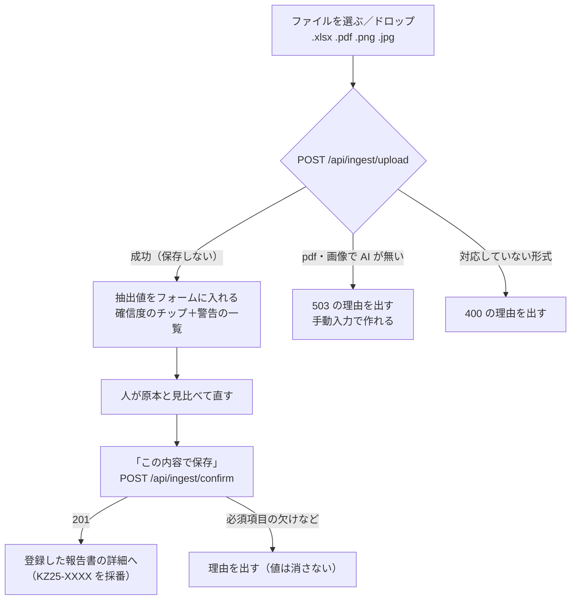
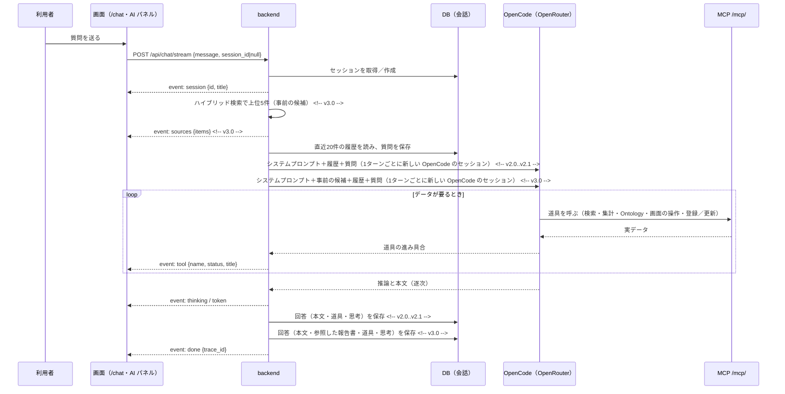
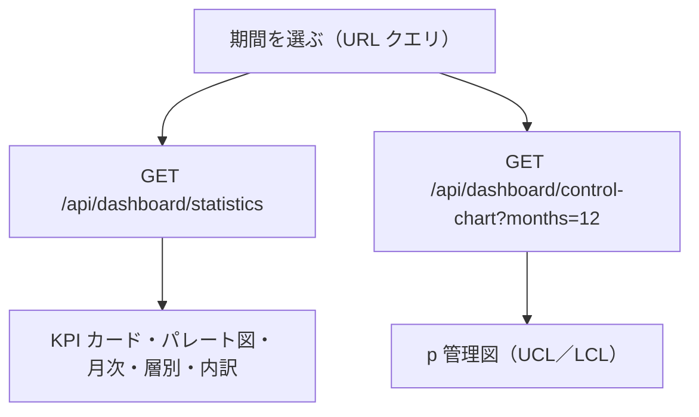
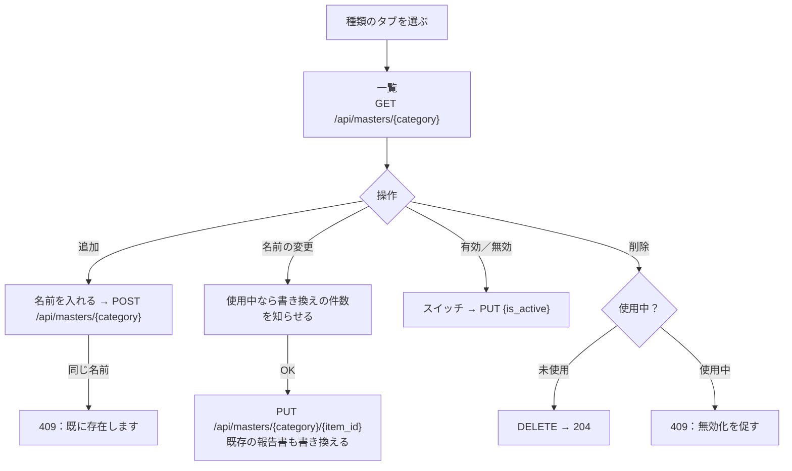

# DefectReport AI — 機能仕様書

本書は、機能ごとの画面・操作の流れ・入出力・エラー時の動きと、代表的なユースケースを定める。要件の番号（FR-・NFR-）は `01_要件定義書.md`、受け入れ条件の番号（AC-）は `07_試験・運用仕様書.md`、API の正確な入出力は `04_API設計書.md`、列の定義は `03_データモデル設計書.md`、画面の配置は `05_UI設計書.md` を正とする。

機能一覧:

| # | 機能 | 主な画面 | 中核の API |
|---|---|---|---|
| F1 | 帳票の取込と AI の抽出 | 新規作成（`/reports/new`） | `/api/ingest/*` | <!-- v3.0 -->
| F2 | 報告書の一覧・詳細 | 一覧（`/reports`）・詳細（`/reports/:defectId`） | `/api/reports` | <!-- v1.0..v2.1 -->
| F2 | 報告書の一覧・スマート検索・詳細 | 一覧（`/reports`）・詳細（`/reports/:defectId`） | `/api/reports` | <!-- v3.0..v4.1 -->
| F2 | 報告書の一覧・詳細・登録・編集・削除 | 一覧（`/reports`）・詳細（`/reports/:defectId`）・新規作成（`/reports/new`） | `/api/reports` | <!-- v5.0 -->
| F3 | AI アシスタント | AI チャット（`/chat`）・全ページの AI パネル | `/api/chat/*`、`/mcp/`、`/api/ui/events` | <!-- v2.0 -->
| F4 | 4M 分析 | 詳細 | `/api/analysis/4m/{defect_id}` | <!-- v4.0 -->
| F5 | KPI ダッシュボードとデータ分析 | サマリー（`/dashboard`）・機械別／担当者別／顧客別（`/analysis/*`）・時系列（`/analysis/trends`） | `/api/dashboard/*` | <!-- v4.0 -->
| F6 | 予兆アラート | 予測アラート（`/alerts`） | `/api/analysis/alerts` | <!-- v4.0 -->
| F7 | マスタ（選択肢） | 一覧の絞り込み | `GET /api/masters` | <!-- v1.1..v2.1 -->
| F7 | マスタ（選択肢） | 一覧の絞り込み・新規作成のフォーム | `GET /api/masters` | <!-- v3.0..v4.1 -->
| F7 | マスタ（選択肢）と管理 | マスタ管理（`/settings/masters`） | `/api/masters` | <!-- v5.0 -->
| F8 | 是正・予防処置（CAPA）と 8D | 是正処置（`/capa`）・詳細 | `/api/capa` | <!-- v5.0 -->
| F9 | 週次ダイジェスト | 週次レポート（`/digests`） | `/api/digests` | <!-- v5.0 -->
| F10 | 写真と外観の所見 | 詳細 | `/api/reports/{defect_id}/photos` | <!-- v5.0 -->
| F11 | 音声入力 | AI チャット・AI パネル | （ブラウザ） | <!-- v5.0 -->
| F12 | 関連マップ | 関連マップ（`/analysis/graph`） | `GET /api/graph` | <!-- v5.0 -->
| F13 | 業務 Ontology の画面 | 業務Ontology（`/analysis/ontology`） | `/api/ontology/*` | <!-- v5.0 -->
| F14 | 回答の評価（👍/👎） | AI チャット・AI パネル | `/api/chat/feedback` | <!-- v5.0 -->
| F15 | 報告書トリアージ | 詳細・新規作成 | `/api/triage/*` | <!-- v5.0 -->
| F16 | 判断モデルによる強化 | 一覧のスマート検索・AI チャット・AI パネル・新規作成 | `/api/reports/search`・`/api/chat/*`・`/api/ingest/upload` | <!-- v5.0 -->

---

<!-- v3.0 -->
## F1. 帳票の取込と AI の抽出

### 画面と操作の流れ

新規作成（`/reports/new`）の「ファイルから作成 (AI抽出)」タブで行う。取り出した値は保存せずにフォームへ入れ、人が原本と照合して直してから「この内容で保存」を押す。「手動入力」タブでは、同じフォームに手で入れて登録する。



- AI の `ui_new_report` は、聞き取った項目を URL クエリに入れて「手動入力」タブを開く。登録は人が押す（FR-CH-10）。

### 入出力

- 入力：ファイル1件（multipart/form-data の `file`）。拡張子 `.xlsx`・`.pdf`・`.png`・`.jpg`（`.jpeg`）。
- 取り出し方（AI の経路は OpenCode を優先し、無ければ `ANTHROPIC_API_KEY` の Anthropic API）：
  - `.xlsx`：openpyxl でセルを読み、ラベルの右隣（費用はラベルの真下）の値を項目にする。AI が使えれば、セルの一覧を AI に渡して表記を整える（構造化の補正）。
  - `.pdf`・画像：AI の vision と構造化出力（JSON Schema。読めない項目は null）で取り出す。 <!-- v3.0..v3.0 -->
  - `.pdf`・画像：AI の vision と構造化出力（JSON Schema。読めない項目は null）で取り出す。ファイルは OpenCode にファイルの部品（`data:<mime>;base64,…` の data URL）として渡し、プロンプトの本文には貼らない。 <!-- v3.1 -->
- 出力（確認画面用。この時点では保存しない）：

```json
{
  "extracted": { "occurrence_date": "2025-09-13", "customer": "翠峰重工業", "process": "マシニング",
                 "machine_name": "a61nx", "part_name": "補機マウントリブ", "production_count": 12,
                 "defect_count": 3, "phenomenon": "表面キズ", "defect_description": "…" },
  "confidence": "high",
  "warnings": [],
  "source_filename": "KZ25-0043.xlsx"
}
```

- 確信度：`high`（主な項目を読めた）／`medium`（一部があいまい、または AI の補正なし）／`low`（多くが不確か）。画面は色のチップ（high 緑・medium 黄・low 赤）で出し、どの確信度でも人が原本と照合してから保存する。 <!-- v3.0..v3.0 -->
- 確信度はサーバーの決まりで決め、AI の自己申告を使わない。例アプリの決まり：`.xlsx` はセルだけなら `medium`、AI の補正が成功したら `high`。`.pdf`・画像は AI の抽出が成功したら `high`。`low` は使っていない。必須項目の欠けや数量の矛盾は確信度にも警告にも入らないため、どの確信度でも人が原本と照合してから保存する。画面は色のチップ（high 緑・medium 黄・low 赤）で出す。 <!-- v3.1..v4.1 -->
- 確信度はサーバーの決まりで決め、AI の自己申告を使わない。例アプリの決まり：`.xlsx` はセルだけなら `medium`、AI の補正が成功したら `high`。`.pdf`・画像は AI の抽出が成功したら `high`。判断モデルで読み取りを確かめたとき（F16）は、合わない項目の数で `high`・`medium`・`low` を決める。判断モデルを使わないときは `low` は使っていない。必須項目の欠けや数量の矛盾は確信度にも警告にも入らないため、どの確信度でも人が原本と照合してから保存する。画面は色のチップ（high 緑・medium 黄・low 赤）で出す。 <!-- v5.0 -->
- 保存：「この内容で保存」で、直した項目を `POST /api/ingest/confirm` に送る。番号（`KZ25-<連番>`、いまの最大の番号＋1）を振り、損失合計が無ければ4費目の和を入れ、検索の索引にも入れて 201 と報告書を返す。 <!-- v3.0..v4.1 -->
- 保存：「この内容で保存」で、直した項目を `POST /api/ingest/confirm` に送る。`POST /api/reports`（F2）と同じ処理で登録する（番号・損失合計・マスタ・索引）。 <!-- v5.0 -->

### エラー時の動き

| 状況 | 動き |
|---|---|
| 対応していない拡張子 | 画面の選択で .xlsx・.pdf・.png・.jpg だけを出す。送られたときは 400（「対応していないファイル形式です(.xlsx / .pdf / .png / .jpg)」） |
| .pdf・画像で AI が無い（`OPENCODE_URL` も `ANTHROPIC_API_KEY` も無い） | 503（「AIバックエンドが設定されていません(OPENCODE_URL / OPENROUTER_API_KEY)」）。画面は理由を出し、「手動入力」タブで作れる |
| .xlsx で AI が無い | セルの値だけで返す（`medium`、警告「AIバックエンド未設定のため、セル抽出のみで返しています(構造化補正なし)。」） |
| .xlsx の AI の補正が失敗 | セルの値だけで返す（`medium`、警告に失敗の理由） |
| .pdf・画像の AI の抽出が失敗 | 理由を出す（例アプリは 500 を返す） |
| 保存で必須項目が欠けている | 422。画面は理由を出し、入力した値は消さない |
| 帳票の様式による読み違い（配布した Excel の改訂B で機械が空、改訂C で現象がチェックボックスの文字列のまま、など） | AI の補正が無いと起きる。確認画面で原本と照合して直す（`07_試験・運用仕様書.md` の AC-v30-04・05） |

---

<!-- /v -->


## F2. 報告書の一覧・詳細 <!-- v1.0..v2.1 -->
## F2. 報告書の一覧・スマート検索・詳細 <!-- v3.0..v4.1 -->
## F2. 報告書の一覧・詳細・登録・編集・削除 <!-- v5.0 -->

### 画面と操作の流れ

- **一覧（`/reports`）**：キーワード（報告書番号・部品番号・部品名・不具合内容）と絞り込み（状態・重大度・機械・工程・4M・期間）で探し、並べ替えとページ送り（1ページ 10・25・50件、既定25）をする。行を押すと詳細へ移る。 <!-- v1.0..v1.1 -->
- **一覧（`/reports`）**：キーワード（報告書番号・部品番号・部品名・不具合内容）と絞り込み（状態・重大度・機械・工程・客先・担当者・現象・4M・期間）で探し、並べ替えとページ送り（1ページ 10・25・50件、既定25）をする。行を押すと詳細へ移る。 <!-- v2.0 -->
  - 絞り込み・並べ替えの状態は URL クエリに持つ。同じ URL を開けば同じ一覧になる。
  - 「新規作成」で `/reports/new`（F1）へ移る。 <!-- v3.0..v4.1 -->
  - 「新規作成」で `/reports/new` へ移る。 <!-- v5.0 -->
  - 列：報告書ID・発生日・部品名・現象・機械・重要度・ステータス・不良率（小数2桁の %）。
  - 並べ替え：新しい順（既定）・古い順・損失額が大きい順・不良数が多い順。「不良数が多い順」は API の並べ替えの対象に不適合数が無く、例アプリでは新しい順と同じになる（例アプリの既知の問題）。
  - 読込中は「読み込み中…」、0件は「条件に一致する報告書がありません」を出す。失敗は理由を出す。 <!-- v1.0..v1.0 -->
  - 読込中は「読み込み中…」、0件は「条件に一致する報告書がありません」を出す。失敗したときは表と件数を消し、原因と「再試行」を出して、0件の表示と分ける（**例アプリには未実装**。例アプリは理由の下に表と「条件に一致する報告書がありません」も出し、「再試行」は無い）。 <!-- v1.1 -->
  - 機械・工程の選択肢は、画面の定数ファイル1か所にまとめる。 <!-- v1.0..v1.0 -->
  - 機械・工程の選択肢はマスタ（`GET /api/masters`、F7）から作る。 <!-- v1.1..v1.1 -->
  - 機械・工程・客先・担当者・現象の選択肢はマスタ（`GET /api/masters`、F7）から作る。 <!-- v2.0 -->
- **スマート検索**：一覧の「キーワード｜スマート検索」で切り替える（URL に `mode=smart`）。自然文を入れて Enter か「検索」で、意味の近い報告書を上位15件まで出す（類似度と抜粋つき）。機械・工程だけ絞り込める。並べ替えとページ送りは無い。 <!-- v3.0 -->
- **詳細（`/reports/:defectId`）**：全項目を「基本情報」「不具合内容」「原因・4M分析」「対策」「費用」に分けて出し、不良率（小数2桁の %）を出す。値の無い項目は「—」。
- 詳細の下に「類似事例と当時の対策」（似ている報告書3件と、その対策）を出す。 <!-- v3.0..v4.1 -->
- 詳細の見出しに「AIで4M分析」（F4）。 <!-- v4.0..v4.1 -->
- 詳細の見出しに「AIで4M分析」（F4）・「編集」・「削除」。詳細の下に、写真（F10）・AI トリアージ（F15）・「類似事例と当時の対策」（似ている報告書3件と、その対策）・CAPA（F8）を出す。 <!-- v5.0 -->
<!-- v5.0 -->
- **登録**：新規作成（`/reports/new`）の「手動入力」タブ。発生日（今日）・重要度（中）・状態（未対応）・加工数1・不適合数1 を初めに入れておく。「登録する」で必須の欠けを確かめてから `POST /api/reports`。成功したら詳細へ移る。
- **編集**：詳細の「編集」で、同じ画面（URL は `/reports/:defectId` のまま）を編集モードにする。編集用の別の URL は持たない。「保存」で `PUT /api/reports/{defect_id}`、成功したら表示に戻る。AI の `ui_edit_report` もこの画面を開いて編集モードにする（入力と保存は人）。
- **削除**：詳細の「削除」で確認（「{番号}（{部品名}）を削除します。この操作は取り消せません。」）を出し、「削除する」で `DELETE /api/reports/{defect_id}`。成功したら一覧へ戻る。
- 保存・削除に失敗したときは、理由を押したボタンの近くに出し、入力した値は消さない（例アプリ：詳細の編集は見出しのボタンのすぐ下に出す。新規作成の手動入力はフォームの上に出す）。
- 選択式の欄（客先・工程・機械・作業者・現象・要因）は、有効なマスタの値を候補に出し、候補に無い値も入れられる（F7）。
<!-- /v -->

```mermaid
flowchart LR
    L["一覧 /reports"] -->|"行を押す"| D["詳細 /reports/:defectId"]
    D -->|"一覧へ戻る"| L
    L -->|"mode=smart"| S["スマート検索の結果"] <!-- v3.0 -->
    S -->|"行を押す"| D <!-- v3.0 -->
    D -->|"類似事例の番号"| D <!-- v3.0 -->
    L -->|"新規作成"| N["新規作成 /reports/new"] <!-- v5.0 -->
    N -->|"登録"| D <!-- v5.0 -->
    D -->|"編集 → 保存"| D <!-- v5.0 -->
    D -->|"削除"| L <!-- v5.0 -->
```

### 入出力

- 一覧：`GET /api/reports?q=&status=&severity=&machine=&process=&category_4m=&date_from=&date_to=&limit=&offset=&sort=` → `{"total": int, "items": [Report]}`。`limit` 既定50・最大500、`sort` 既定 `-occurrence_date`（先頭の `-` で降順。対象は発生日・報告日・報告書番号・重大度・登録日時・損失合計）。 <!-- v1.0..v1.1 -->
- 一覧：`GET /api/reports?q=&status=&severity=&machine=&process=&customer=&operator=&phenomenon=&category_4m=&date_from=&date_to=&limit=&offset=&sort=` → `{"total": int, "items": [Report]}`。`limit` 既定50・最大500、`sort` 既定 `-occurrence_date`（先頭の `-` で降順。対象は発生日・報告日・報告書番号・重大度・登録日時・損失合計）。 <!-- v2.0 -->
- 詳細：`GET /api/reports/{defect_id}` → Report（全列＋`defect_rate`）。
- スマート検索：`GET /api/reports/search?q=&top_k=&machine=&process=` → `{"items": [{defect_id, part_name, machine_name, process, phenomenon, snippet, score, search_mode}], "search_mode": "hybrid|bm25|keyword"}`。`q` は必須、`top_k` 既定10・最大40。機械・工程は検索のあとで絞る。 <!-- v3.0..v4.1 -->
- スマート検索：`GET /api/reports/search?q=&top_k=&machine=&process=` → `{"items": [{defect_id, part_name, machine_name, process, phenomenon, snippet, score, search_mode, relevance}], "search_mode": "hybrid|bm25|keyword"}`。判断モデルで並べ替えたときは `search_mode` に `+rerank` が付き、`relevance` に当てはまる確率が入る（F16）。`q` は必須、`top_k` 既定10・最大40。機械・工程は検索のあとで絞る。 <!-- v5.0 -->
- 似ている報告書：`GET /api/reports/{defect_id}/similar?top_k=` → `{"defect_id", "items": [{defect_id, occurrence_date, part_name, machine_name, process, phenomenon, cause, countermeasure, score}]}`。本文・現象・原因で検索し、自分を除く。`top_k` 既定3・最大10。原因は160字、対策は240字まで。 <!-- v3.0 -->
- 登録：`POST /api/reports`（Report の項目。`defect_id` を省くと採番）→ 201 と Report。 <!-- v5.0 -->
- 更新：`PUT /api/reports/{defect_id}`（渡した項目だけ変える）→ 200 と Report。 <!-- v5.0 -->
- 削除：`DELETE /api/reports/{defect_id}` → 204。 <!-- v5.0 -->

### 入力の決まりとエラー時の動き

| 項目・状況 | 決まり | 違反・失敗のとき |
|---|---|---|
| 存在しない番号の詳細 | — | 404（「報告書が見つかりません」）。画面は理由を出す | <!-- v1.0..v4.1 -->
| 存在しない番号の詳細・更新・削除 | — | 404（「報告書が見つかりません」）。画面は理由を出す | <!-- v5.0 -->
| 期間（`date_from`・`date_to`） | 発生日で比べ、両端の日を含む | — | <!-- v1.0..v1.0 -->
| 期間（`date_from`・`date_to`） | 発生日を date 型で比べ、両端の日を含む | 形の不正な日付や `date_from` > `date_to` は 422 と理由。**例アプリには未実装**（形の不正な日付は無視し、逆向きの期間は0件） | <!-- v1.1 -->
| 該当0件 | — | 「条件に一致する報告書がありません」（エラーにしない） |
| 不良率 `defect_rate` | サーバーで計算（不適合数 ÷ 加工数）。保存しない | 加工数が0なら null、画面は「—」 |
| スマート検索の該当なし | — | 「似た内容の報告書が見つかりませんでした」 | <!-- v3.0 -->
| 必須項目（発生日・客先・工程・機械・作業者・部品番号・部品名・加工数・不適合数・不具合内容・現象・重大度） | 空にできない | 422。手動入力は送る前に8項目（発生日・客先・発生工程・使用機械・作業者名・部品名称・現象分類・不具合内容）の空きを「必須項目が未入力です: …」で知らせる（部品番号の空きは送ってから 422 になる） | <!-- v5.0 -->
| 数量（加工数・不適合数） | 0 ≦ 不適合数 ≦ 加工数（FR-CR-07） | 422 と日本語の理由（例「不適合数（25）が加工数（10）を超えています」）を返し、保存しない。**例アプリには未実装**（例アプリは 201 で保存し、不良率が 2.5 になる） | <!-- v5.0 -->
| 同じ `defect_id` での登録 | 番号は一意 | 409（「defect_id が既に存在します」） | <!-- v5.0 -->
| 重大度・状態 | `critical`/`high`/`medium`/`low`、`open`/`in_progress`/`completed`（既定 `open`） | 画面は選択式で防ぐ（API は値の種類を検査しない） | <!-- v5.0 -->
| 損失合計 `total_cost` | 登録で無ければ4費目の和をサーバーで入れる（FR-CR-06） | — | <!-- v5.0 -->

---

<!-- v2.0 -->
## F3. AI アシスタント

### 画面と操作の流れ

AI チャット（`/chat`）と、全ページに置く AI パネルで使う。パネルは同じ部品の小さい版で、閉じても画面を移っても消えない（AI が画面を動かしても、会話と逐次表示が切れない）。`/chat` では左に会話の一覧、右に対話を出す。

- 質問を送ると、道具の実行（名前と状態）・思考（折りたたみ）・本文を届いた順に出す。本文は Markdown（react-markdown・remark-gfm）で出し、本文の報告書番号（`KZ25-XXXX`・`[KZ25-XXXX]`）は詳細へのリンクにする。 <!-- v2.0..v2.1 -->
- 質問を送ると、まず参照した報告書（sources）をチップで出し、続けて道具の実行（名前と状態）・思考（折りたたみ）・本文を届いた順に出す。本文は Markdown（react-markdown・remark-gfm）で出し、本文の `[KZ25-XXXX]` は詳細へのリンクにする。 <!-- v3.0 -->
- 回答が届いているあいだは送信を止める。失敗は入力欄の上に理由を出す。
- 画面上部の状態表示に、件数と AI の設定（「AI: OpenCode」か「AI 未設定」）を出す。
- 回答ごとに 👍／👎（F14）、入力欄にマイク（F11）。 <!-- v5.0 -->



### 入出力

- 入力：`POST /api/chat/stream`、body `{"message": str, "session_id": int | null}`。`session_id` が null なら新しいセッションを作る（題は質問の先頭30文字）。履歴はサーバーが DB から直近20件を読む（ブラウザは送らない）。
- 出力（SSE）：`session`（`{id, title}`、先頭）→ `thinking`（`{text}`）／`tool`（`{name, status, title}`、`status` は pending・running・completed・error）／`token`（`{text}`）→ `done`（`{trace_id}`。Langfuse が無ければ null）。失敗は `error`（`{detail}`）。 <!-- v2.0..v2.1 -->
- 出力（SSE）：`session`（`{id, title}`、先頭）→ `sources`（`{items: [{defect_id, part_name, phenomenon, snippet, score}]}`、最大5件）→ `thinking`（`{text}`）／`tool`（`{name, status, title}`、`status` は pending・running・completed・error）／`token`（`{text}`）→ `done`（`{trace_id}`。Langfuse が無ければ null）。失敗は `error`（`{detail}`）。 <!-- v3.0 -->
- AI への指示（`app/opencode/AGENTS.md` とシステムプロンプト）：そのターンで道具から取った値だけで答える／存在しない番号を作らない（似た名前に読み替えない）／していない操作を「しました」と言わない／空の応答やエラーを成功にしない。OpenCode に元からあるコーディング用の道具（bash・edit など）は使わせない。
- 本文で参照した報告書は `[KZ25-XXXX]` の形で引用する（例「同じ現象が [KZ25-0024] [KZ25-0035] でも出ている」）。事前の候補（sources）は粗い候補で、質問に合わなければ使わず、道具で引き直す。 <!-- v3.0 -->
- 件数・率を聞かれたら、検索の上位の件数で数えず、集計の道具（`list_defect_reports` の `total`、`get_statistics`、`query_quality_ontology`）で数える（FR-CH-05）。 <!-- v3.1 -->

### 道具（MCP）

FastAPI に同居する MCP サーバー（`/mcp/`、名前 `defect-reports`）の道具を、OpenCode が自分で選んで呼ぶ。道具は DB を直接読み、報告書の登録・更新は REST と同じ処理（`services/report_service.py`）を通る。

| 種類 | 道具 |
|---|---|
| 読み取り | `list_defect_reports`（条件で絞り込み、完全一致）・`search_defect_reports`（内容の検索）・`get_defect_report`・`get_statistics`・`list_masters` |
| 読み取り | `get_similar_reports`（似ている報告書と当時の対策） | <!-- v3.0 -->
| 読み取り | `get_control_chart`・`get_active_alerts` | <!-- v4.0 -->
| 書き込み | `create_defect_report`・`update_defect_report`（はっきり頼まれたときだけ） |
| 画面の操作 | `ui_navigate`・`ui_open_report`・`ui_set_theme` |
| 画面の操作 | `ui_new_report` | <!-- v3.0 -->
| 画面の操作 | `ui_run_4m_analysis` | <!-- v4.0 -->
| 画面の操作 | `ui_edit_report` | <!-- v5.0 -->
| 業務 Ontology | `get_ontology_definition`・`resolve_ontology_entity`・`get_ontology_object`・`traverse_ontology_relation`・`query_quality_ontology` |
| CAPA・ダイジェスト | `list_capa_actions`・`draft_capa_actions`・`create_capa_action`・`update_capa_action`・`generate_8d_report`・`generate_weekly_digest`・`preview_capa_update` | <!-- v5.0 -->

- 合計15本。`search_defect_reports` はこの版ではキーワードの検索。 <!-- v2.0..v2.1 -->
- 合計17本。`search_defect_reports` はハイブリッド検索（F2 のスマート検索と同じ）。 <!-- v3.0..v3.1 -->
- 合計20本。 <!-- v4.0..v4.1 -->
- 合計28本（本筋21本＋完成形の追加7本）。 <!-- v5.0 -->
- OpenCode 上の道具の名前は `defect-reports_<道具の名前>`。道具を変えたら opencode を起動し直す（道具の一覧は起動のときに読む）。
- 引数と返り値は `06_AI設計書.md` に書く。

### 対話での登録・更新

- 登録：例「次の内容で報告書を登録して：発生日…、機械 a61nx…」→ `create_defect_report`（番号は自動、状態は `open` に固定）。実行したら振った番号を答える。
- 更新：例「KZ25-0099 を completed にして」→ `update_defect_report`（状態・重大度・対策・原因・要因・4M・備考・良品状態の8項目だけ）。実行したら変えた項目を答える。
- 画面のスイッチは作らない。「はっきり頼んだときだけ」は AGENTS.md と道具の説明で守り、書き込みの道具が呼ばれたことは画面の道具の表示と DB の記録で確かめる。

### 画面の操作（WebMCP）

- AI の `ui_*` は、backend の `GET /api/ui/events`（SSE。`event: ui`、`data: {action, path, reason}`。15秒ごとに接続を保つ空の行）に操作を流す。画面の `UiControlBridge` がこれを受けて React Router で移動し、「AIアシスタントが画面を操作しました: …」と知らせる。
- 移動できるのはアプリの中のパスだけ。操作は画面の移動と表示だけで、データは変えない。テーマ（ライト・ダーク）はブラウザ（localStorage）に残す。
- 画面の状態の正本は URL クエリ。人が絞り込んだ一覧を AI が読み、AI が開いた一覧を人がそのまま続けて操作できる。
- ブラウザが接続していないときは、道具が「ブラウザ画面が接続されていません(アプリを開いてもらってください)」を返す。AI はそれを成功と言わない。
- 画面を操作したと答える前に、必ず `ui_*` を呼ぶ。前のターンで同じ操作をしていても、毎回呼ぶ（ターンごとに独立）。 <!-- v2.1 -->

### 業務 Ontology の使い方

- 用語表を機械が読める形にした `app/backend/ontology/quality.json`（対象・関係・指標・制約）を、チャットのシステムプロンプトにも渡す。
- 機械・工程・客先の名前は `resolve_ontology_entity` で実データの ID に解決する。候補を自分で選べないとき（`can_auto_select=false`）は、利用者に確かめる。
- 条件別の件数・不適合数・記録上の不適合率・損失は `query_quality_ontology` で、サーバーが全件を数える。記録上の不適合率は報告書に記録されたロットの率で、工場全体の不良率と呼ばない。

### 会話（セッション）の操作

| 操作 | 画面 | API |
|---|---|---|
| 新しいチャット | 「＋ 新しいチャット」。次の送信で `session_id=null` を送る | `POST /api/chat/stream` |
| 一覧 | `/chat` の左の列（パネルは「履歴」メニュー）。更新の新しい順に、題とメッセージ数 | `GET /api/chat/sessions` |
| 復元 | 一覧から選ぶと、発言と回答（道具の記録・思考も）を戻す。以後は同じ `session_id` で続ける | `GET /api/chat/sessions/{id}` |
| 削除 | 確認してから消す（メッセージも消す）→ 204 | `DELETE /api/chat/sessions/{id}` |

### エラー時の動き

| 状況 | 動き |
|---|---|
| AI の設定が無い（`OPENCODE_URL` が無い、`/health` の `chat_backend="none"`） | `session` のあと `error`（「AIバックエンドが設定されていません(OPENCODE_URL / OPENROUTER_API_KEY)」）。質問は保存する | <!-- v2.0..v2.1 -->
| AI の設定が無い（`OPENCODE_URL` が無い、`/health` の `chat_backend="none"`） | `session`・`sources` のあと `error`（「AIバックエンドが設定されていません(OPENCODE_URL / OPENROUTER_API_KEY)」）。質問は保存する | <!-- v3.0 -->
| モデルのエラー（OpenCode の `info.error`、セッションのエラー） | `error` で理由を出す |
| 空の応答 | 完了したメッセージから本文を回収し、それでも空なら `error`（「OpenCodeが空応答を返しました(モデル未応答)。もう一度お試しください」）。空の回答を成功として保存しない | <!-- v2.1 -->
| 残高切れ（OpenRouter の 402） | モデルのエラーか空の応答として `error` で理由を出す（道具が実行されないまま終わる） | <!-- v2.1 -->
| 出力の上限で切れた（`finish_reason=length`） | 成功にせず `error` で理由を出す。**例アプリには未実装**（例アプリは途中までの本文を成功として保存する。出力の上限は `opencode.json` で 8,000） | <!-- v2.1 -->
| 埋め込みが使えない | BM25 に、それも失敗したらキーワード検索に縮退し、結果の `search_mode` に出す | <!-- v3.0 -->
| 事前の検索が0件 | `sources` は空。AI は道具で確かめ、無ければ「データからは確認できない」と答える | <!-- v3.0 -->
| 通信が途中で切れた | 届いた分を出したまま、理由を出す |
| 書き込みをはっきり頼まれていない | 読んで答えるだけで、登録・更新はしない |
| ブラウザが接続していない状態で画面の操作を頼まれた | 道具が失敗を返し、AI は操作できなかったと答える |

---

<!-- /v -->


<!-- v4.0 -->
## F4. 4M 分析

### 画面と操作の流れ

詳細の「AIで4M分析」で実行する。押すと「AI分析中…」になり、結果（4M・要因・判断の理由・改善の案の箇条書き）を見出しの下に出す。AI の `ui_run_4m_analysis` は、詳細を開いてこのボタンを押したのと同じ動きをする。

- 事実（報告書に書いてあること）と仮説（AI の推定）を分けて見せ、人が「採用」したときだけ報告書に保存する（FR-AN-03）。**例アプリには未実装**：例アプリは結果をすぐ報告書に保存し、詳細を読み直す（「採用」のボタンは無い）。

### 入出力

- 入力：`POST /api/analysis/4m/{defect_id}`（既存の報告書）。AI には、工程・機械・部品・現象・不具合内容・良品状態・原因・要因・対策・再発・手順書を渡す。
- 出力（構造化出力）：`{"category_4m": "Man|Machine|Material|Method", "factor": str, "reasoning": str, "improvements": [str]}`。`category_4m` は4つの値のどれかでなければ失敗にする。
- 保存先：`category_4m`・`factor`・`ai_improvement`（改善の案を「- 」付きの行にしてつなぐ）。
- AI の経路は帳票の抽出と同じ（OpenCode を優先し、無ければ Anthropic API）。

### エラー時の動き

| 状況 | 動き |
|---|---|
| AI が無い | 503（「AIバックエンドが設定されていません(OPENCODE_URL / OPENROUTER_API_KEY)」）。画面は理由を出す |
| 存在しない番号 | 404 |
| 4つの値以外が返った・生成に失敗した | 失敗の理由を出す（例アプリは 500）。報告書は変えない |
| もう一度実行 | 新しい結果を出す（例アプリは前の保存値を上書きする） |

---

<!-- /v -->


<!-- v4.0 -->
## F5. KPI ダッシュボードとデータ分析

### 画面と操作の流れ

- **サマリー（`/dashboard`）**：KPI のカード、現象別のパレート図、重要度の内訳、月次トレンド、4M の内訳。上で期間を選ぶ。
- **機械別・担当者別・顧客別（`/analysis/machines`・`operators`・`customers`）**：不良率の高い順の棒グラフ（上位15件）と、並べ替えできる表（名前・件数・不適合数・不良率・損失）。
- **時系列（`/analysis/trends`）**：月次トレンドと p 管理図（月数を選ぶ。UCL を超えた点は赤）。
- 期間の欄（開始日・終了日と、全期間・直近3・6・12か月のボタン）は各画面で同じ部品。値の正本は URL クエリ（`date_from`・`date_to`、時系列は `months` も）で、AI の `ui_navigate` も同じクエリを書く。
- 期間のボタン「直近Nか月」も、データの最新の発生日から数える（**例アプリには未実装**。例アプリは今日の日付から数えるため、模擬データの最新（2026-03-15）から離れるほど件数が減る）。 <!-- v4.1 -->
- KPI のカードは、名前と定義を合わせる。「未対応」は `open` の件数（4件）、「対応中」は `in_progress` の件数（16件）を別に出す（**例アプリには未実装**。例アプリのカードは「対応中件数」の名で `open` の件数を出し、補足に「未完了(open/in_progress)」と書いている）。 <!-- v4.1 -->



### KPI の定義

期間は発生日で数え、両端を含む（報告日では数えない。2025年10〜12月は発生日で38件、報告日で数えると33件）。

| KPI | 分子 | 分母 | 単位 | 全期間の値 |
|---|---|---|---|---|
| 総報告件数 | 報告書の件数 | — | 件 | 110件 |
| 総不適合数 | Σ不適合数 | — | 個 | 1,829個 |
| 総加工数 | Σ加工数 | — | 個 | 10,460個 |
| 不良率 | Σ不適合数 | Σ加工数 | % | 17.49% |
| 直行率 FPY | Σ加工数 − Σ不適合数 | Σ加工数 | % | 82.51% |
| 総損失 | Σ損失合計（材料費＋社内加工費＋外注加工費＋その他） | — | 円 | 36,445,731円 |
| 再発率 | 再発フラグの件数 | 報告書の件数 | % | 8.2%（9/110） |
| 未対応件数 | `status=open` の件数 | — | 件 | 4件 |
| 対応中件数 | `status=in_progress` の件数 | — | 件 | 16件（例アプリの API は返さない） | <!-- v4.1 -->

- 不良率は合計してから割る。報告書ごとの率の平均（24.15%）を使わない。報告書に記録されたロットの率で、工場全体の不良率とは呼ばない。
- FPY は手直しを区別しない概算。
- OEE・MTBF・MTTR は、稼働時間・故障の記録の列が無いため計算できない。
- 分母が0の率は null にする（0% と書かない）。**例アプリには未実装**（例アプリは不良率・FPY・再発率に 0 を返す）。 <!-- v4.1 -->

### 入出力

- 統計：`GET /api/dashboard/statistics?date_from=&date_to=` → `kpi`（上の表）・`monthly_trend`・`pareto_phenomenon`（件数・比率・累積比率）・`by_machine`・`by_operator`・`by_process`・`by_customer`（件数・不適合数・不良率・損失）・`by_4m`（4M が空なら「未分類」）・`by_severity`（形は `04_API設計書.md`）。
- 管理図：`GET /api/dashboard/control-chart?months=12`（1〜36）→ `{"items": [{period, n, defects, p, ucl, lcl}], "p_bar": float}`。n は月の加工数、p̄ は対象の月の Σ不適合数 ÷ Σ加工数、UCL／LCL ＝ p̄ ± 3√(p̄(1−p̄)/n)、LCL は0で切る。n＝0 の月は除く（例アプリは除いていない。模擬データに n＝0 の月は無い）。
- 全期間の値：パレート図の上位3つは 表面キズ38件・バリ残り14件・穴位置ずれ12件（累積 58.18%）。管理図（12か月）は p̄＝0.1749、2025-07 は p＝0.4571 で UCL 0.2104 を超える。

### エラー時の動き

| 状況 | 動き |
|---|---|
| 期間に報告書が無い | エラーにせず、件数0を出す。率は null（例アプリは 0） |
| 読み込みに失敗した | 理由を出す |

---

<!-- /v -->


<!-- v4.0 -->
## F6. 予兆アラート

### 画面と操作の流れ

予測アラート（`/alerts`）を開くと、いまのアラートを並べて出す（レベルの色・題・説明・関連する機械と現象のチップ）。無いときは「現在アラートはありません」。

### 入出力

- `GET /api/analysis/alerts` → `{"items": [{"level": "critical|warning|info", "title", "message", "related": {"machine"?, "phenomenon"?}}]}`。LLM は使わない。
- ルール（FR-AL-02）：
  1. 直近30日の不良率が、全報告書の不良率（17.49%）の1.5倍（26.23%）を超える機械 → `warning`。
  2. 同じ機械×同じ現象が直近60日に3件以上 → `critical`。
  3. 直近30日に再発フラグの報告書がある → `info`（1件ごと）。
- 「直近」の基準日はデータの最新の発生日（模擬データでは 2026-03-15。直近30日は 2026-02-13 から、直近60日は 2026-01-14 から）。今日の日付ではない。 <!-- v4.1 -->
- 先行指標のルール（FR-AL-03）： <!-- v5.0 -->
  4. 機械×現象の急増：直近30日に3件以上、かつ前の30日の2倍以上 → `warning`。 <!-- v5.0 -->
  5. 対策後の再発の兆し：同じ機械×現象で、完了した報告書の発生日から30日以内に未完了の報告書が出た → `critical`。 <!-- v5.0 -->
  6. 月次の不良率が3か月続けて上がった（ランルール）→ `warning`。 <!-- v5.0 -->

<!-- v4.1 -->
発火する例・しない例（元データ、基準日 2026-03-15）：

| ルール | 発火する | 発火しない |
|---|---|---|
| ① | WT-150II（直近30日 1個中1個＝100%） | VARIAXIS i-800 NEO（直近30日 23.74%。26.23% 以下） |
| ② | 汎用フライス×バリ残り（直近60日に3件） | YZ-8WR×穴位置ずれ（直近60日に2件） |
| ③ | — | 直近30日に再発フラグは無い（最後の再発は 2025-12-27 の KZ25-0085） |
| ④ | — | 直近30日に3件以上の機械×現象は無い | <!-- v5.0 -->
| ⑤ | YZ-8WR×バリ残り（KZ25-0017）、WT-150II×表面キズ（KZ25-0028）、TSL-550×表面キズ（KZ25-0090）、汎用フライス×バリ残り（KZ25-0099）の4件 | — | <!-- v5.0 -->
| ⑥ | 2025-11 → 2025-12 → 2026-01（10.13% → 14.51% → 23.12%） | — | <!-- v5.0 -->

期待する結果：ルール①・②の2件。 <!-- v4.1..v4.1 -->
期待する結果：ルール①・②・⑤・⑥の7件（例アプリで確かめた）。 <!-- v5.0 -->
<!-- /v -->

### エラー時の動き

| 状況 | 動き |
|---|---|
| アラートが無い | 「現在アラートはありません」 |
| 報告書が0件 | 空の一覧を返す（エラーにしない） |
| 読み込みに失敗した | 理由を出す |

---

<!-- /v -->


<!-- v1.1 -->
## F7. マスタ（選択肢） <!-- v1.1..v4.1 -->
## F7. マスタ（選択肢）と管理 <!-- v5.0 -->

絞り込みの選択肢を、DB のマスタに持つ。種類は客先（customer）・工程（process）・機械（machine）・作業者（operator）・現象（phenomenon）・要因（factor）の6つ。重大度・状態・4M は決まった値なのでマスタにしない。 <!-- v1.1..v2.1 -->
絞り込みと入力の選択肢を、DB のマスタに持つ。種類は客先（customer）・工程（process）・機械（machine）・作業者（operator）・現象（phenomenon）・要因（factor）の6つ。重大度・状態・4M は決まった値なのでマスタにしない。 <!-- v3.0 -->

### 作り方と使い方

- 初回の起動で、報告書のシードのあとにマスタが空なら、データの値（種類ごとの DISTINCT）から作る。データの値は 客先10・工程8・機械10・作業者29・現象12・要因10。 <!-- v1.1..v4.1 -->
- 初回の起動で、報告書のシードのあとにマスタが空なら作る。例アプリは既定の語の一覧（`masters.py` の `DEFAULT_VOCAB`）を先に入れ、データの値（種類ごとの DISTINCT）のうち無いものを足す。このため97件（客先10・工程14・機械12・作業者29・現象12・要因20）になり、データに無い語（工程の「旋盤」「フライス」、要因の古い名前、機械の「GENOS M560-V」「MX-520」など。使用件数0）が候補に残る（既知の問題）。 <!-- v5.0 -->
- 一覧の絞り込み（機械・工程）の選択肢は `GET /api/masters` から作る。 <!-- v1.1..v4.1 -->
- 取込の確認と手動入力のフォームの選択式の欄（客先・工程・機械・作業者・現象・要因）も、マスタの値を候補に出す。候補に無い値も入れられる。 <!-- v3.0..v4.1 -->
- 一覧の絞り込み（機械・工程・客先・担当者・現象）の選択肢は `GET /api/masters` から作る。無効にした機械は「（無効）」を付けて残す（過去の報告書を探せるように）。 <!-- v5.0 -->
- AI は `list_masters` で正確な表記を確かめる（有効な値だけ）。 <!-- v2.0 -->
- 報告書の入力フォームの6つの欄は、有効なマスタの値を候補に出し、候補に無い値も入れられる（freeSolo の Autocomplete）。候補に無い値で保存すると、報告書の保存のときにマスタにも足す（FR-MA-06）。 <!-- v5.0 -->

### 入出力

- 全種類：`GET /api/masters` → `{"customer": [Master], "process": [Master], …}`。Master は `{id, category, name, sort_order, is_active, usage_count}`。並びは `sort_order`、次に名前。
- 種類ごと：`GET /api/masters/{category}?active_only=` → Master の配列（包まない）。不正な種類は 404。 <!-- v5.0 -->

<!-- v5.0 -->
### マスタ管理の画面と操作の流れ

「設定 > マスタ管理（`/settings/masters`）」。6つのタブで種類を切り替え、値の追加・名前の変更・有効／無効・削除をする。



- 追加：`POST /api/masters/{category}`、body `{name}` だけ（並び順はサーバーが 500 に決める）→ 201 と Master。
- 名前の変更・有効／無効：`PUT /api/masters/{category}/{item_id}`、body `{name?, is_active?}` → Master と `updated_reports`（書き換えた報告書の件数）。検索の索引に入っている種類（客先・工程・機械・現象）は、書き換えた報告書の索引も直す。
- 削除：`DELETE /api/masters/{category}/{item_id}` → 204（未使用のときだけ）。

| 状況 | 動き |
|---|---|
| 同じ名前の追加（前後の空白と大文字・小文字を無視） | 409（「その名称は既に存在します」） |
| 空の名前 | 400 |
| 名前の変更の前 | 「使用中の報告書 N 件の表記も新しい名称へ書き換わります」と出して確かめる |
| 変えた先の名前が既にある | 409 |
| 使用中の値の削除 | 409（「使用中のため削除できません。無効化してください。」）。無効化へ案内する |
| 無効にした値 | 新しい入力の候補から外れる。既存の報告書の値と集計は変わらない |
<!-- /v -->

---

<!-- /v -->


<!-- v5.0 -->
## F8. 是正・予防処置（CAPA）と 8D

### 画面と操作の流れ

- 詳細の「是正・予防処置(CAPA)」：その報告書の処置の一覧（期限切れは赤いチップ）。「起票」はダイアログ（処置の要約（必須）・詳細・種別（是正／予防）・担当・期限）。「AIドラフト」は処置の案を出すだけで保存せず、案ごとの「採用」を押したものだけ登録する。「8Dレポート生成」は D1〜D8 の Markdown を出し、コピーできる。
- 是正処置（`/capa`）：全報告書の処置の一覧（状態・期限で絞り込み。条件は URL クエリの `status`・`overdue`・`defect_id` で、AI の `ui_navigate` も同じ）。行の中で状態を変える。
- 状態を `closed` にするときは効果確認メモを聞く。例アプリの画面は、メモを空のまま進めると「効果確認済み」を入れて送る（既知の問題。サーバーの検査は通ってしまう）。

### 入出力

- 一覧：`GET /api/capa?status=&defect_id=&overdue=&limit=` → `{"total", "items": [{capa_id, defect_id, action_type, title, description, owner, due_date, status, effect_note, overdue, created_at, updated_at}]}`。`overdue` は期限が今日より前で `closed` でないもの。
- 起票：`POST /api/capa`、body `{defect_id, title, action_type?, description?, owner?, due_date?}` → 201。番号は `CA-<連番>`、状態は `open`。
- 更新：`PUT /api/capa/{capa_id}`、body は題・詳細・担当・期限・状態・効果確認メモ・種類のうち変えるもの。更新したあとの状態全体を検査する。
- 下書き：`POST /api/capa/draft/{defect_id}` → `{defect_id, actions: [{action_type, title, description, based_on}], similar, ai_backend}`。保存しない。AI があれば是正2件と予防1件ほど、無ければ似ている報告書（3件）の対策を最大3件の案にする（`ai_backend="none"`）。
- 8D：`POST /api/capa/eight_d/{defect_id}` → 201 `{id, defect_id, content_md, ai_backend, created_at}`、`GET /api/capa/eight_d/{defect_id}` → 最新10件。事実に無いことは「(要確認)」と書く。
- AI の道具：`list_capa_actions`・`draft_capa_actions`・`create_capa_action`・`update_capa_action`・`generate_8d_report`・`preview_capa_update`。登録と状態の変更は、利用者がはっきり頼んだときだけ。

### エラー時の動き

| 状況 | 動き |
|---|---|
| 存在しない報告書への起票・下書き・8D | 409（「報告書 … が見つかりません」） |
| 題が空 | 409 |
| 種類・状態が決まった値でない | 409 |
| 効果確認メモ無しで `closed` | 409（「closed には effect_note(効果確認メモ)が必要です」） |
| 期限の形が不正 | 409 |
| AI が無い・失敗した | 下書きと 8D は決まった形の下書きにする（`ai_backend="none"`） |

---

## F9. 週次ダイジェスト

### 画面と操作の流れ

週次レポート（`/digests`）で、作ったダイジェストの一覧と Markdown の本文を見る。「今すぐ生成」で作る。AI の所見が付いたものには「AI所見つき」のチップを出す。AI の `generate_weekly_digest` でも作れる。

### 入出力

- 生成：`POST /api/digests/generate?days=7`（1〜90）→ 201。基準日はデータの最新の発生日、期間は基準日までの `days` 日、比べる前の期間も同じ長さ。
- 決まった形（AI が止まっても必ず出る）：今週の KPI（報告書数・不適合数・不良率・損失）と前の期間との差、回答の評価（👍/👎 の数。評価があるときだけ）、重大（`critical`）の案件（最大5件）、未対応（`open`）の案件（最大5件）、アラート（最大6件）。
- AI があるときだけ、本文のあとに「## AI所見」と「## 推奨アクション」を足す（`ai_backend="opencode"`。無ければ `none`）。
- 一覧：`GET /api/digests?limit=`（既定20）、1件：`GET /api/digests/{id}`（無ければ 404）。

---

## F10. 写真と外観の所見

### 画面と操作の流れ

詳細の「現場写真」で写真を足し、写真ごとに「AI外観アシスト」（所見を出す）と削除を押せる。所見は画面に出すだけで、報告書は変えない。

### 入出力

- 一覧・追加：`GET`・`POST /api/reports/{defect_id}/photos`（multipart の `file`）。追加は 201。
- 表示・削除：`GET`・`DELETE /api/reports/{defect_id}/photos/{name}`（削除は 204）。
- 所見：`POST /api/reports/{defect_id}/photos/{name}/analyze` → `{"observation", "phenomenon_candidates": [str], "notes"}`。写真から判断できないことは「写真からは判断できません」と書かせる。

### エラー時の動き

| 状況 | 動き |
|---|---|
| 許していない拡張子（.jpg・.jpeg・.png・.webp 以外） | 415 |
| 8MB を超える | 413（「8MB以下にしてください」） |
| 不正なファイル名・報告書番号 | 400 |
| 報告書・写真が無い | 404 |
| AI が無い | 503 |

---

## F11. 音声入力

- AI チャットと AI パネルの入力欄の横に、マイクのボタンを置く（ブラウザの Web Speech API、日本語）。話した文を入力欄に足す。送るのは人。
- Web Speech API が使えないブラウザでは、ボタンを出さない。回答が届いているあいだは押せない。

---

## F12. 関連マップ

### 画面と操作の流れ

関連マップ（`/analysis/graph`）で、全報告書を点、内容の近い組を線にした図を見る。点の色は現象、大きさは損失額（対数）。強い線は濃く、弱い線は薄く描く。点を押すと詳細へ移り、つまんで動かせる。

### 入出力

- `GET /api/graph` → `{"mode", "nodes", "links"}`。各点から近い順に5本の候補を張り、両方から選ばれた組（相互 kNN）を強い線、片方向だけを弱い線にする。埋め込み（Chroma に保存済みのもの）のコサインが 0.80 未満の組は線にしない。埋め込みが無いときは語の重なり（Jaccard 0.18 以上）で作る。
- 報告書の登録・更新・削除で作り直す。

---

## F13. 業務 Ontology の画面

### 画面と操作の流れ

業務Ontology（`/analysis/ontology`）の3つのタブ：

- 「実データを調べる」：対象の種類（機械・工程・客先など）と名前で「名前を確認」し、候補から対象を選んで、期間・未完了の CAPA の有無で照会する。件数・記録上の不適合率・損失・関連する CAPA と、根拠の報告書、データの注意（個数の矛盾・損失の欠けなど）を出す。関係をたどれる。
- 「定義と計算方法」（URL に `view=definition`）：対象・関係・指標の式・操作の決まり。
- 「グラフで見る」（URL に `view=graph`）：型の構造と実データのグラフ。AI の `ui_navigate`（`ontology`・`ontology_graph`）でも開ける。

### 入出力

- `GET /api/ontology/definition`、`GET /api/ontology/resolve?object_type=&query=&limit=`、`GET /api/ontology/objects/{object_type}/{object_id}`、`GET …/relations/{relation}`、`POST /api/ontology/query`、`GET /api/ontology/graph/{defect_id}`、`POST /api/ontology/actions/capa/preview`。画面と AI の道具は同じ計算（`services/ontology.py`）を使う。
- 記録上の不適合率は、個数の矛盾（0 ≦ 不適合数 ≦ 加工数 に合わない、または欠け）のある報告書があれば出さず、理由を `quality` に書く。
- CAPA の変更のプレビューは、変更の前後と業務の決まりに合うか（`valid`）を返し、保存しない（`saved=false`）。
- 解決できない対象・不正な条件は 422 と理由（範囲を黙って広げない）。

---

## F14. 回答の評価（👍/👎）

- AI の回答ごとに 👍／👎 を出す。👍 はすぐ送り、👎 は任意のコメントを書いて送る。送ったら表示をお礼に替える。
- `POST /api/chat/feedback`、body `{session_id?, message_index?, rating, trace_id?, comment?, answer_excerpt?, question_excerpt?}` → 201。`rating` は +1／−1 だけ（ほかは 422）。回答の先頭500字、質問の先頭300字を残す。
- `trace_id`（`done` イベントの値）があれば、Langfuse のトレースにスコア（`user-feedback`）として送る。
- `GET /api/chat/feedback` → `{up, down, items}`。週次ダイジェスト（F9）の KPI の表にも数を載せる。

---

## F15. 報告書トリアージ

`JEV_ENABLED=1` と判断モデルのキー（`OPENROUTER_API_KEY` か `TYPESAFE_API_KEY`）があるときだけ動く。無いときは API が 503 を返し、画面には出さない。考え方・質問・測定・閾値は `11_報告書トリアージ_JevとLangGraph.md` に書く。

### 画面と操作の流れ

- 詳細の「AI トリアージ」：「判定する」で1件をグラフに通し、通った段、項目ごとの判断と確からしさ（1位の確率と2位との差）、登録値との食い違い、CAPA の処置の案を出す。CAPA が要るときは「承認待ち」で止まり、人が案を選んで承認するか、却下する。承認すると CAPA を登録する。
- 新規作成の「AI で分類を提案」：不具合内容と原因を書いて「提案する」。確かな提案だけを「確かな提案を入れる」でまとめて入れ、迷う項目は候補（確率つき）を押して選ぶ。重大度は参考の表示だけ。何も保存しない。

### 入出力

- `GET /api/triage/status` → 使えるか・判断モデル・閾値など。
- `POST /api/triage/preview`、body `{defect_description, cause?, countermeasure?, process?, machine_name?, part_name?}` → 判断だけ（保存しない）。
- `POST /api/triage/reports/{defect_id}` → 結果（`status` は `completed` か `waiting_approval`）。`GET` で最新の結果。
- `POST /api/triage/runs/{run_id}/resume`、body `{approved, selected, note?}` → 承認・却下のあとの結果。
- `GET /api/triage/metrics` → 最新の判定と、いまの登録値（人が確かめた値）の一致率。

### エラー時の動き

| 状況 | 動き |
|---|---|
| 無効（`JEV_ENABLED` が1でない、キーが無い） | 503（「トリアージは無効です(JEV_ENABLED=1 と判断モデルのキーが必要)」） |
| 報告書が無い | 404 |
| まだ判定していない（`GET`） | 404（「まだ判定していません」） |
| 判断モデルの失敗 | 502 |
| 承認待ちでない判定の再開 | 409 |

---

## F16. 判断モデルによる強化

`DECISIONS_ENABLED=1` と判断モデルのキー（`OPENROUTER_API_KEY` か `TYPESAFE_API_KEY`）があるときだけ動く。LLM は文章を作り、判断モデルは型の決まった判断と確率だけを返す。採るかどうかの閾値はコードに置く。考え方・選んだモデル・測定は `14_判断モデルによる強化.md` に書く。報告書トリアージ（F15）とは別の機能。

### 画面と操作の流れ

- 一覧のスマート検索：結果の列「類似度」が「当てはまる確率」（小数2桁。0.5以上は緑）に替わる。並びはこの確率の順。
- AI チャット・AI パネル：判断モデルが質問の種類を決めて採ったときは、回答の上に「質問の種類: 件数を数える 0.97」のチップを出す。回答の下に「引用の確かめ:」と、番号ごとに「根拠あり」「要確認」「番号が崩れている」のチップ（確率つき）を出す。
- 新規作成（PDF・画像）：抽出結果に「読み取りの確かめ」を出す。項目ごとに「合っている／要確認」と確率。画像のときは、合わない欄の位置に枠を重ねる。確信度のチップはこの結果で決まる。

### 入出力

- `GET /api/reports/search` の各件に `relevance`（0〜1）。`search_mode` は並べ替える前の方式に `+rerank` を付けたもの（通常は `hybrid+rerank`）。同じ検索を使う似ている報告書・CAPA の下書きの類似事例・チャットの事前の検索・道具も並びが変わる（`relevance` を返すのはスマート検索だけ）。
- `POST /api/chat/stream` の SSE に `route`（`sources` のあと）と `citations`（回答のあと、`done` の前）を足す。`POST /api/chat` の応答にも `route`・`citations`。形は `04_API設計書.md` §6。
- `POST /api/ingest/upload` の応答に `field_checks`（項目ごとの確率・合うか・枠）と `verification`（モデル・費用・合わない項目）。

### エラー時の動き

| 状況 | 動き |
|---|---|
| 無効（`DECISIONS_ENABLED` が1でない、キーが無い） | 今までの動き。`route`・`citations` は送らず、`relevance`・`field_checks` は付けない |
| 判断モデルの失敗（検索） | 並べ替える前の順と方式のまま返す（例：`hybrid`） |
| 判断モデルの失敗（チャット） | 振り分けの注意なし・確かめなしで回答を続ける |
| 判断モデルの失敗（取込） | 読み取りの結果は返し、警告「読み取りの確かめ(判断モデル)に失敗しました」と確信度 medium |
| PDF を画像にできない（pypdfium2 が無い） | 確かめずに、警告と確信度 medium |

---

<!-- /v -->


## ユースケース

### UC-1. 品質保証担当：条件で報告書を探す

> QA の担当者は、機械 a61nx で2025年9月に出た不良を確かめたい。

1. 一覧（`/reports`）で、機械に「a61nx」、期間に 2025-09-01〜2025-09-30 を入れる。URL は `/reports?machine=a61nx&date_from=2025-09-01&date_to=2025-09-30` になる。
2. KZ25-0043 の1件だけが出る（機械 a61nx は全部で3件、2025年9月は全部で7件。AND で絞る）。
3. 行を押して詳細を開く。部品は補機マウントリブ、現象は表面キズ、加工数12・不適合数3 で不良率 25.00%、損失合計は ¥60,581。
4. 期間を 2025-10-01〜2025-10-31 に変えると0件になり、「条件に一致する報告書がありません」が出る。

**要件**：FR-CR-01・03（AC-v10-03〜07）。

<!-- v2.0 -->
### UC-2. 品質保証担当：AI アシスタントに聞いて調べる

> QA の担当者は、汎用フライスのバリ残りが続いている気がしている。件数と、これまでの対策を知りたい。

1. AI パネルで「汎用フライスのバリ残りは何件？これまでの対策は？」と聞く。
2. AI は `list_defect_reports`（機械「汎用フライス」、現象「バリ残り」）を呼ぶ。道具は7件（KZ25-0024・0035・0050・0073・0094・0096・0099）を返し、AI は「7件」と答える。
3. 対策を述べるために、AI は `get_defect_report` で報告書を読み、そのターンで取った値だけで答える。 <!-- v2.0..v2.1 -->
3. 回答の上に参照した報告書のチップが出る。AI は `get_defect_report` で報告書を読み、対策を `[KZ25-XXXX]` で引用して答える。件数は検索の候補の数ではなく、道具の `total` で数える。 <!-- v3.0 -->
4. 「KZ25-0099 を開いて」と頼むと、AI は `ui_open_report` を呼び、画面が `/reports/KZ25-0099` に移る。会話はパネルに残る。
5. 再読込しても、会話は一覧に残っていて開き直せる。 <!-- v2.0..v3.1 -->
5. 詳細で「AIで4M分析」を押し、4M・要因・改善の案を見る（F4）。 <!-- v4.0 -->
6. 再読込しても、会話は一覧に残っていて開き直せる。 <!-- v4.0 -->

**要件**：FR-CH-01・02・06・09・10（AC-v20-01〜04・14）。 <!-- v2.0..v2.1 -->
**要件**：FR-CH-01〜04・06・09・10（AC-v20-01〜04・14、AC-v30-03）。 <!-- v3.0..v3.0 -->
**要件**：FR-CH-01〜06・09・10（AC-v20-01〜04・14、AC-v30-03、AC-v31-01）。 <!-- v3.1..v3.1 -->
**要件**：FR-CH-01〜06・09・10、FR-AN-01〜03（AC-v20-01〜04・14、AC-v30-03、AC-v31-01、AC-v40-09）。 <!-- v4.0 -->
<!-- /v -->

<!-- v3.0 -->
### UC-3. 現場担当：帳票を取り込んで登録する

> 検査の担当者は、手書きの不適合報告書を撮った画像（PNG）から報告書を作りたい。

1. 新規作成（`/reports/new`）の「ファイルから作成 (AI抽出)」に画像をドロップする。
2. AI が項目を取り出し、フォームに発生日・機械・部品・数量などが入る。確信度のチップと警告が出る。この時点では保存しない。
3. 担当者は画像と見比べ、読み違いと空欄（費用・作業者など）を直す。
4. 「この内容で保存」で登録すると、番号 KZ25-0111（いまの最大 KZ25-0110 の次）が振られ、詳細へ移る。検索の索引にも入り、以後はスマート検索と AI アシスタントの検索に出る。

**要件**：FR-IN-01・03〜06（AC-v30-04〜06）。
<!-- /v -->

<!-- v4.0 -->
### UC-4. 経営者：サマリーで月次の振り返りをする

> 工場長は、全体の品質の状況と、注意すべき兆しを確かめたい。

1. サマリー（`/dashboard`）を全期間で開く。110件、不適合数1,829個、不良率17.49%、FPY 82.51%、総損失 ¥36,445,731、再発率8.2% を見る。
2. パレート図で、表面キズ・バリ残り・穴位置ずれの3つで58.18% を占めることを知る。
3. 期間を 2025-10-01〜2025-12-31 にすると38件になる（発生日で数える）。
4. 時系列（`/analysis/trends`）の p 管理図で、2025-07 が UCL を超えていることを見る。
5. 予測アラート（`/alerts`）を開き、出ているアラートと、関連する機械・現象を確かめる。 <!-- v4.0..v4.0 -->
5. 予測アラート（`/alerts`）を開く。WT-150II の不良率の上昇（`warning`）と、汎用フライスのバリ残りの多発（`critical`）が出ている。 <!-- v4.1..v4.1 -->
5. 予測アラート（`/alerts`）を開く。WT-150II の不良率の上昇（`warning`）、汎用フライスのバリ残りの多発（`critical`）、対策後の再発の兆し4件（`critical`）、3か月続けての上昇（`warning`）が出ている。 <!-- v5.0 -->
6. 工場長は QA に、汎用フライスのバリ残りの対策を見直すよう指示する。 <!-- v4.1 -->

**要件**：FR-DB-01〜06、FR-AL-01・02（AC-v40-01・04・06〜08）。 <!-- v4.0..v4.0 -->
**要件**：FR-DB-01〜06、FR-AL-01・02（AC-v40-01・04・06〜08、AC-v41-02）。 <!-- v4.1..v4.1 -->
**要件**：FR-DB-01〜06、FR-AL-01〜03（AC-v40-01・04・06〜08、AC-v41-02）。 <!-- v5.0 -->
<!-- /v -->

<!-- v5.0 -->
### UC-5. 品質保証担当：是正処置を起票して閉じる

> QA の担当者は、汎用フライスのバリ残り（KZ25-0099、対応中）に是正処置を立て、効果を確かめて閉じたい。

1. KZ25-0099 の詳細を開き、「類似事例と当時の対策」で似ている報告書と、その対策を見る。
2. CAPA の「AIドラフト」で処置の案を出す（保存しない）。案を読み、使うものだけ「採用」を押して登録する（`CA-0001` などの番号が振られ、状態は `open`）。
3. 対応が進んだら状態を `in_progress`、`effect_check` に変える。期限を過ぎると一覧に「期限超過」が出る。
4. 効果を確かめたら、効果確認メモを書いて `closed` にする（メモが無いとサーバーは 409 を返す）。
5. 「8Dレポート生成」で D1〜D8 の Markdown を作り、コピーして客先への報告に使う。

**要件**：FR-CA-01〜05。
<!-- /v -->
