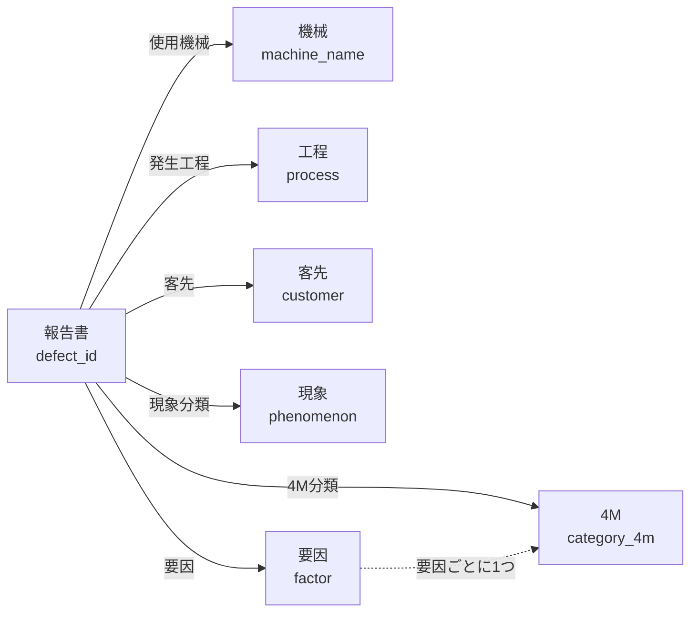

# DefectReport AI — データモデル設計書

本書は DefectReport AI が持つデータ（表・索引・ファイル）と、業務の言葉（用語表）を定める。バックエンド・画面・模擬データは、本書の列名と値に従う。API の入出力は `04_API設計書.md`、帳票のセル番地との対応は `00_帳票の調査.md` に書く。
<!-- v2.0 -->
AI アシスタントの道具と指示は `06_AI設計書.md` に書く。
<!-- /v -->

## 1. 保存先

| 保存先 | 用途 | 実体 |
|---|---|---|
| SQLite | 全データの正本 | `app/backend/data/defect_reports.db`（環境変数 `DB_PATH` で変えられる） | <!-- v1.0..v4.1 -->
| PostgreSQL 16 | 全データの正本（Docker Compose で動かすとき） | Compose の `db` サービス（`postgres:16-alpine`）。`DATABASE_URL=postgresql+psycopg://app:app@db:5432/defectreport` | <!-- v5.0 -->
| SQLite | 全データの正本（`DATABASE_URL` が無いとき。Docker を使わずに手元で動かす場合） | `app/backend/data/defect_reports.db`（`DB_PATH` で変えられる） | <!-- v5.0 -->
| JSON ファイル | 業務 Ontology の定義（用語表を機械が読める形にしたもの） | `app/backend/ontology/quality.json` | <!-- v2.0 -->
| Chroma（PersistentClient） | 検索用のベクトル索引（DB の写し） | `app/backend/data/chroma/`（`CHROMA_PATH` で変えられる） | <!-- v3.0 -->
| JSON ファイル | 検索の同義語辞書 | `app/backend/services/synonyms.json` | <!-- v3.0 -->
| ファイル | 報告書に付けた写真 | `app/backend/data/photos/{defect_id}/`（`PHOTOS_DIR` で変えられる） | <!-- v5.0 -->
| SQLite（別ファイル） | 報告書トリアージの途中の状態（LangGraph のチェックポイント） | `app/backend/data/triage_checkpoints.db`（`TRIAGE_CHECKPOINT_DB` で変えられる） | <!-- v5.0 -->

- DB への接続は `app/backend/database.py` の1か所で作る。SQLite は FastAPI の複数のスレッドから使うため `check_same_thread=False` で開く。 <!-- v1.0..v4.1 -->
- DB への接続は `app/backend/database.py` の1か所で作る。`DATABASE_URL` があればその DB（`pool_pre_ping=True`）、無ければ SQLite（`check_same_thread=False`）に接続する。表の定義（SQLAlchemy のモデル `app/backend/models.py`）は両方で同じ。 <!-- v5.0 -->
- 期間の絞り込みは、発生日を date 型で比べる（文字列で比べない）。 <!-- v1.1..v4.1 -->
- 期間の絞り込みは、発生日を date 型で比べる（文字列で比べない。PostgreSQL は date と文字列を比べられず、SQLite では通ってしまうため試験で気付きにくい）。 <!-- v5.0 -->
- Docker Compose では backend の `/app/data` を名前付きボリューム `backend-data` に置く（Chroma・写真・トリアージのチェックポイント）。PostgreSQL のデータは `db-data`、Langfuse の DB は `langfuse-db-data` に置く。 <!-- v5.0 -->
- `docker compose down` はボリュームを残す。`docker compose down -v` はボリュームごと消すため、次の起動で報告書は CSV から入れ直され、会話・CAPA・ダイジェスト・写真・Langfuse の記録は消える。 <!-- v5.0 -->
- グラフ DB（Neo4j など）や、別のサーバーで動くベクトル DB（Qdrant など）は使わない。 <!-- v3.0 -->

### 1.1 表の一覧

| 表 | 中身 | 1行の単位 |
|---|---|---|
| `defect_reports` | 不適合報告書 | 報告1件 |
| `masters` | 絞り込みと入力の選択肢（6種類） | 選択肢1つ | <!-- v1.1 -->
| `chat_sessions` | AI アシスタントとの会話 | 会話1つ | <!-- v2.0 -->
| `chat_messages` | 会話の発言 | 発言1つ | <!-- v2.0 -->
| `capa_actions` | 是正・予防処置（CAPA） | 処置1つ | <!-- v5.0 -->
| `eight_d_reports` | 8D レポート | 生成1回 | <!-- v5.0 -->
| `weekly_digests` | 週次の品質ダイジェスト | 生成1回 | <!-- v5.0 -->
| `chat_feedback` | AI の回答への 👍/👎 | 評価1つ | <!-- v5.0 -->
| `triage_runs` | 報告書トリアージの結果 | 判定1回 | <!-- v5.0 -->

- 表は1つ。 <!-- v1.0..v1.0 -->
- 表は2つ。 <!-- v1.1..v1.1 -->
- 表は4つ。 <!-- v2.0..v4.1 -->
- 表は9つ。写真は表を持たず、フォルダの中身を正とする（10.6）。 <!-- v5.0 -->

### 1.2 起動時の処理

1. 表が無ければ作る（`Base.metadata.create_all`）。既にある表に列は足さないため、列を足したときは開発用の DB ファイルを消して起動し直す（報告書は CSV から入れ直される）。 <!-- v1.0..v4.1 -->
1. 表が無ければ作る（`Base.metadata.create_all`）。既にある表に列は足さないため、列を足したときは開発用の DB を作り直す（報告書は CSV から入れ直される）。 <!-- v5.0 -->
2. `defect_reports` が空なら、模擬データ（`DATA_CSV`。既定は `data/defect_reports.csv`）を入れる。CSV が無ければ警告を出し、空のまま起動する。空でなければ何もしない（同じ報告書を二重に入れない）。
3. `masters` が空なら、選択肢を作る（6.）。 <!-- v1.1 -->
4. Chroma の索引が空なら、裏のスレッドで全件を索引に入れる（起動を待たせない）。索引が空でなければ何もしない。 <!-- v3.0 -->

## 2. 関係図（ER 図）

```mermaid
erDiagram
    defect_reports {
        int id PK "内部の番号"
        string defect_id UK "報告書番号 KZ25-0001"
        date occurrence_date "発生日"
        string customer "客先"
        string process "発生工程"
        string machine_name "使用機械"
        string operator_name "作業者"
        int production_count "加工数"
        int defect_count "不適合数"
        string phenomenon "現象"
        string factor "要因"
        string category_4m "4M"
        string severity "重大度"
        string status "状態"
        decimal total_cost "損失合計"
        text ai_improvement "4M分析の改善提案" <!-- v4.0 -->
    }
<!-- v1.1 -->
    masters {
        int id PK
        string category "6種類"
        string name "選択肢の名前"
        int sort_order "表示順"
        bool is_active "有効"
    }
    masters ||..o{ defect_reports : "category と name で列の値に対応"
<!-- /v -->
<!-- v2.0 -->
    chat_sessions {
        int id PK
        string title "先頭の質問の30文字"
        datetime updated_at "一覧の並び順"
    }
    chat_messages {
        int id PK
        int session_id FK
        string role "user または assistant"
        text content "本文"
        text sources_json "参照した報告書" <!-- v3.0 -->
        text tools_json "使った道具"
    }
    chat_sessions ||--o{ chat_messages : "session_id 会話と一緒に消える"
<!-- /v -->
<!-- v5.0 -->
    capa_actions {
        int id PK
        string capa_id UK "CA-0001"
        string defect_id "対象の報告書"
        string action_type "corrective または preventive"
        string status "open から closed まで"
        date due_date "期限"
    }
    eight_d_reports {
        int id PK
        string defect_id "対象の報告書"
        text content_md "D1からD8"
    }
    weekly_digests {
        int id PK
        date period_start "集計の初日"
        date period_end "集計の最終日"
        text content_md "本文"
    }
    chat_feedback {
        int id PK
        int session_id "会話"
        int rating "1 または -1"
        string trace_id "Langfuse のトレース"
    }
    triage_runs {
        int id PK
        string run_id UK "tr-で始まる"
        string defect_id "対象の報告書"
        string status "判定の状態"
    }
    defect_reports ||..o{ capa_actions : "defect_id"
    defect_reports ||..o{ eight_d_reports : "defect_id"
    defect_reports ||..o{ triage_runs : "defect_id"
    chat_sessions ||..o{ chat_feedback : "session_id"
<!-- /v -->
```

- 点線は値で対応させる関係（外部キーは張らない）。`masters` と報告書は、種類ごとの列の値と `name` が一致するもの同士が対応する。 <!-- v1.1..v1.1 -->
- 実線は外部キー（`chat_messages.session_id` だけ）、点線は値で対応させる関係（外部キーは張らない）。`masters` と報告書は、種類ごとの列の値と `name` が一致するもの同士が対応する。 <!-- v2.0 -->
- 報告書を削除しても、値で対応する CAPA・8D・トリアージの記録と写真は残る。 <!-- v5.0 -->

## 3. 用語表と関係図

帳票の言葉と、データの列名・値を1対1に対応させる。画面の選択肢・試験の語・AI への指示は、この用語表の言葉を使う。
<!-- v1.1 -->
選択肢の正本はこの用語表とし、`masters` 表（6.）はデータの値から作る。
<!-- /v -->
<!-- v2.0 -->
この用語表を機械が読める形にしたものが、業務 Ontology（8.）。
<!-- /v -->

### 3.1 対象と関係

| 対象 | 意味 | 列 | 110件での種類 |
|---|---|---|---|
| 報告書 | 不適合を記録した報告1件。不良品1個や製造ロット1つではない | `defect_id`（KZ25-0001〜KZ25-0110） | 110件 |
| 機械 | 報告書に書かれた使用機械の名前。設備の個体（号機・製造番号）は区別しない | `machine_name` | 10種 |
| 工程 | 報告書に書かれた発生工程の名前。工程の順序は表さない | `process` | 8種 |
| 客先 | 報告書に書かれた客先の名前（架空の会社） | `customer` | 10社 |
| 現象 | 何が起きたかの分類 | `phenomenon` | 12種 |
| 要因 | なぜ起きたかの分類 | `factor` | 10種 |

- 報告書1件は、機械・工程・客先・現象・要因をそれぞれ1つ持つ（多対1）。110件で要因が空の報告書は無い。
- 機械と工程は決まった組ではない（例：汎用フライスは フライス加工・組付・仕上げ・最終検査・溶接・研削 の6工程に出る）。
- 作業者（`operator_name`、29名）と発見者（`discoverer`、29名）は人の姓で、報告書の項目として持つ。対象としては扱わない。



### 3.2 選択肢の値（110件、多い順）

| 種類 | 列 | 値（件数） |
|---|---|---|
| 現象（12種） | `phenomenon` | 表面キズ（38）・バリ残り（14）・穴位置ずれ（12）・寸法公差外れ（10）・加工段差（9）・面粗さ不良（6）・NCプログラム誤り（6）・工具破損（6）・ひずみ変形（4）・取付方向誤り（2）・刻印・表示誤り（2）・角部欠け（1） |
| 要因（10種） | `factor` | 変更連絡の不達（16）・図面の読み違い（16）・初品確認漏れ（14）・NCデータ設定誤り（13）・加工条件の理解不足（12）・工具寿命超過（12）・習熟不足（11）・設備不調（6）・素材欠陥（6）・標準手順の省略（4） |
| 工程（8種） | `process` | フライス加工（43）・旋削（29）・仕上げ（13）・組付（7）・マシニング（7）・最終検査（4）・研削（4）・溶接（3） |
| 機械（10種） | `machine_name` | 汎用フライス（46）・YZ-8WR（22）・QUICK TURN 250MSY（18）・TSL-550（8）・MEGATURN NEXUS 900（6）・WT-150II（3）・a61nx（3）・VARIAXIS i-800 NEO（2）・DMU 65 monoBLOCK（1）・GENOS M660-V（1） |
| 客先（10社） | `customer` | 翠峰重工業（32）・蒼井田機器工業（21）・汐峰造機（18）・六花電機工業（9）・霞岡バルブ工業（9）・綿鍋機工（7）・深名電子工業（5）・遠原精密工業（4）・楠里ポンプ工業（3）・鷹森航空部品（2） |

- 値は元データの表記のまま使う。似た名前への読み替え（例：a61nx を別の機械名にする）はしない。
- 現象の上位3種（表面キズ・バリ残り・穴位置ずれ）で64件（58.2%）。

### 3.3 4M

4M は不適合の要因を 人・機械・材料・方法 の4つに分ける考え方。データには英語のコード値で保存し、画面と帳票では日本語で表す。

| コード値 | 帳票の表記 | 件数 | その4M になる要因（110件） |
|---|---|---|---|
| `Man` | 人 | 50 | 初品確認漏れ・加工条件の理解不足・図面の読み違い・習熟不足 |
| `Machine` | 機械 | 16 | 工具寿命超過・設備不調 |
| `Material` | 材料 | 6 | 素材欠陥 |
| `Method` | 方法 | 32 | NCデータ設定誤り・変更連絡の不達・標準手順の省略 |
| （空） | — | 6 | 4M が空欄の報告書（要因は入っている） |

- 110件では、4M が入っている104件すべてで、要因から4M が1つに決まる。
- 4M が空欄の6件は、集計では「未分類」として数える。 <!-- v4.0 -->

### 3.4 重大度と状態

| 列 | コード値（帳票の表記、件数） |
|---|---|
| `severity`（重大度） | `critical`（重大、7）・`high`（高、43）・`medium`（中、30）・`low`（低、30） |
| `status`（状態） | `open`（未対応、4）・`in_progress`（対応中、16）・`completed`（完了、90） |

重大度・状態・4M は決まった値だけを使う（選択肢のマスタには入れない）。

### 3.5 数え方の決まり

- 「件」は報告書の数、「個」は加工数・不適合数の合計。「表面キズは38件」は報告書の数で、不良品の数ではない。
- 報告書1件の不良率 `defect_rate` は 不適合数 ÷ 加工数。保存せず、読み出すときに計算する。
- 期間は発生日（`occurrence_date`）で数え、両端の日を含む。報告日では数えない。
- 期間や対象をまとめた不良率は Σ不適合数 ÷ Σ加工数 とし、報告書ごとの率の平均は使わない（110件で 1,829 ÷ 10,460 ＝ 17.49%。報告書ごとの率の平均なら 24.15% になる）。 <!-- v4.0 -->
- 分母が0になる率は null とし、0% と書かない。 <!-- v4.1 -->
- 例アプリでは、報告書の `defect_rate` と業務 Ontology の `recorded_defect_rate` は null を返すが、KPI（`GET /api/dashboard/statistics`）の率は分母0で 0.0 を返す（KPI を null にするのは例アプリには未実装）。 <!-- v5.0 -->

## 4. 表 defect_reports

不適合報告書の正本。SQLAlchemy のモデル `DefectReport`。API の JSON の項目名も列名と同じにする。

| 列 | 型 | 必須 | 既定 | 帳票の項目（改訂C／改訂B） | 説明 |
|---|---|---|---|---|---|
| id | Integer（主キー、自動採番） | ○ | | — | 内部の番号 |
| defect_id | String（一意、索引） | ○ | | 報告書番号／管理No. | 報告書の番号。`KZ25-` と4桁 |
| occurrence_date | Date | ○ | | 発生日 | 発生日。期間の絞り込みと集計はこの日で行う |
| report_date | Date | | | 報告日／発行日 | 報告日（110件では発生日の0〜57日後） |
| customer | String | ○ | | 客先 | 客先 |
| discoverer | String | | | 発見者 | 発見者の姓 |
| process | String | ○ | | 発生工程／工程 | 発生工程 |
| machine_name | String | ○ | | 使用機械／設備 | 使用機械 |
| operator_name | String | ○ | | 作業者 | 作業者の姓 |
| part_number | String | ○ | | 部品番号／図番 | 部品番号 |
| part_name | String | ○ | | 部品名称／品名 | 部品名称 |
| production_count | Integer | ○ | | 加工数／数量の後ろの数 | 加工数（個） |
| defect_count | Integer | ○ | | 不適合数／数量の前の数 | 不適合数（個） |
| defect_description | Text | ○ | | 不具合内容／内容 | 不具合の内容（自由記述） |
| good_condition | Text | | | 良品状態／あるべき姿 | あるべき状態 |
| phenomenon | String | ○ | | 現象 | 現象の分類 |
| cause | Text | | | 原因 | 原因（自由記述） |
| factor | String | | | 要因 | 要因の分類 |
| category_4m | String | | | 4M分類／4M | `Man`・`Machine`・`Material`・`Method` |
| severity | String | ○ | | 重要度／重大度 | `critical`・`high`・`medium`・`low` |
| status | String | ○ | `open` | 状態／処置状況 | `open`・`in_progress`・`completed` |
| countermeasure | Text | | | 対策 | 対策（自由記述） |
| material_cost | Numeric | | | 材料費 | 材料費（円） |
| processing_cost | Numeric | | | 加工費／社内加工費 | 社内加工費（円） |
| outsourcing_cost | Numeric | | | 外注費／外注加工費 | 外注加工費（円） |
| other_cost | Numeric | | | その他費用／その他 | その他の費用（円） |
| total_cost | Numeric | | | 損失合計／合計 | 損失の合計（円）。保存する |
| is_recurrence | Boolean | | false | 再発 | 再発か |
| has_procedure | Boolean | | true | 手順書有無／手順書 | 手順書があるか |
| notes | Text | | | 備考・暫定処置／備考 | 備考 |
| ai_improvement | Text | | | — | 4M 分析の改善提案（「- 」で始まる行の並び） | <!-- v4.0 -->
| created_at | DateTime | ○ | サーバーの現在時刻 | — | 登録日時 |
| updated_at | DateTime | | 更新した時刻 | — | 更新日時 |

- 必須（○）は DB で NULL を許さない列。
- 費用の列は DB では Numeric、API では数値（小数）で返す。

### 4.1 派生値

- `defect_rate` ＝ `defect_count` ÷ `production_count`。保存しない。加工数が0か空なら null。
- 例：KZ25-0043 は 加工数12・不適合数3 で `defect_rate` ＝ 0.25。

### 4.2 値の決まり

- `defect_id` は `KZ25-` と4桁の数字。110件は KZ25-0001〜KZ25-0110 で重複しない。
- 番号の無い報告書を登録するときは、`KZ25-` の番号の最大に1を足して4桁で付ける（110件の次は KZ25-0111）。同じ番号の報告書があれば登録しない。 <!-- v2.0 -->
- `total_cost` は保存する。110件はすべて、4費目（材料費・加工費・外注費・その他）の和と一致する。帳票の合計欄の値には頼らず、4費目の和と照合する。
- 報告書を登録するとき `total_cost` が空なら、サーバーが4費目の和を入れる（4費目もすべて空なら空のまま）。 <!-- v5.0 -->
- 数量の決まり：0 ≦ `defect_count` ≦ `production_count`。110件はすべて満たす（加工数 1〜1,399個、不適合数 1〜366個。加工数が0の報告書は無い）。 <!-- v2.1 -->
- 数量の決まりは、帳票から取り出した値（構造化出力）の検査に使う。業務 Ontology の集計（MCP の `query_quality_ontology`。`04_API設計書.md`）は、決まりに合わない報告書を `invalid_quantity_reports` に数え、不適合率を出さない（null）。登録のときにこの決まりで拒否する検査は持たない。 <!-- v2.1..v4.1 -->
- 数量の決まりは、帳票から取り出した値（構造化出力）の検査に使う。業務 Ontology の集計（MCP の `query_quality_ontology`。`04_API設計書.md`）は、決まりに合わない報告書を `invalid_quantity_reports` に数え、不適合率を出さない（null）。 <!-- v5.0 -->
- 登録（POST）と更新（PUT）で数量の決まりに合わない値は、422 と日本語の理由を返して保存しない。例アプリには未実装（第6回の演習で入れる）。 <!-- v5.0 -->

## 5. 模擬データ

- 元データは `data/defect_reports.csv`（110行×29列）。配布の Excel 帳票110件（1件1ファイル。改訂B 48件・改訂C 62件）と同じ内容を、1件1行に書き写したもの。
- 列名は `defect_reports` の列名と同じ。`id`・`created_at`・`updated_at`・`ai_improvement` は含まない。
- すべて架空のデータ（架空の株式会社霧沢精機 霧沢工場。客先・人名・部品番号・金額も架空）。
- 生成は `data/generate_mock_data.py`。乱数の種を `SEED = 8091417` で固定し、何度実行しても同じ出力になる。乱数の系列は `N_ROWS` の件数で作り、発生日の順に先頭 `N_KEEP = 110` 件だけを残す（`N_ROWS` を変えると全件の中身が変わる）。
- 取込の試しに使う帳票：`data/forms_xlsx/`（110件、1件1ファイル）、`data/forms_pdf/`（先頭10件）。 <!-- v3.0 -->

### 5.1 110件の事実（pandas で数えた値）

| 項目 | 値 |
|---|---|
| 件数 | 110件（KZ25-0001〜KZ25-0110） |
| 発生日 | 2025-04-07〜2026-03-15（最新の発生日は 2026-03-15） |
| 報告日 | 2025-04-09〜2026-03-31 |
| 様式 | 改訂B（発生日が2025年9月以前）48件、改訂C（2025年10月以降）62件 |
| 月別の件数（発生日） | 2025年 4月2・5月8・6月14・7月11・8月6・9月7・10月1・11月23・12月14、2026年 1月8・2月8・3月8 |
| 加工数・不適合数の合計 | 10,460個・1,829個 |
| 損失の合計 | 36,445,731円（材料費 10,744,297・加工費 20,411,485・外注費 3,792,926・その他 1,497,023） |
| 状態 | 完了 90件・対応中 16件・未対応 4件 |
| 重大度 | critical 7件・high 43件・medium 30件・low 30件 |
| 再発・手順書 | 再発 9件、手順書あり 88件 |
| 空欄 | 4M 6件、備考 31件。ほかの列に空欄は無い |
| 不良率（全体） | 17.49%（1,829 ÷ 10,460）。直行率 FPY 82.51% | <!-- v4.0 -->

### 5.2 受け入れ条件で使う値

- 機械 a61nx は3件（KZ25-0019・KZ25-0043・KZ25-0056）。
- 2025年9月（発生日）は7件。a61nx かつ 2025年9月は KZ25-0043 の1件。a61nx かつ 2025年10月は0件。
- KZ25-0043：発生日 2025-09-13、客先 翠峰重工業、工程 マシニング、機械 a61nx、作業者 荻原、部品 補機マウントリブ、加工数12・不適合数3（不良率25%）、現象 表面キズ、要因 習熟不足、4M Man、重大度 medium、状態 completed、損失 60,581円。
- 現象「表面キズ」は38件（AI アシスタントに件数を聞く受け入れ条件）。 <!-- v2.0 -->
- 全期間の件数・不適合数・不良率・損失は 110件・1,829個・17.49%・36,445,731円（KPI の受け入れ条件）。 <!-- v4.0 -->

<!-- v1.1 -->
## 6. 表 masters

絞り込みと入力の選択肢のマスタ。SQLAlchemy のモデル `MasterItem`。

| 列 | 型 | 必須 | 既定 | 説明 |
|---|---|---|---|---|
| id | Integer（主キー、自動採番） | ○ | | 内部の番号 |
| category | String（索引） | ○ | | 種類（下の表の6種類） |
| name | String | ○ | | 選択肢の名前 |
| sort_order | Integer | ○ | 0 | 表示順（小さいほど上） |
| is_active | Boolean | ○ | true | 有効か（false の値は選択肢に出さない） | <!-- v1.1..v4.1 -->
| is_active | Boolean | ○ | true | 有効か。false は新しく入力するときの候補から外す | <!-- v5.0 -->
| created_at | DateTime | ○ | サーバーの現在時刻 | 登録日時 |

- 制約：`UNIQUE(category, name)`（同じ種類の中で名前は1つ）。同じ名前かどうかは、前後の空白と大文字・小文字を無視して比べる。
- 重大度・状態・4M は決まった値（3.3・3.4）なので、マスタに入れない。

| category | 報告書の列 | 帳票の項目 | 110件の値の数 |
|---|---|---|---|
| `customer` | `customer` | 客先 | 10 |
| `process` | `process` | 発生工程 | 8 |
| `machine` | `machine_name` | 使用機械 | 10 |
| `operator` | `operator_name` | 作業者 | 29 |
| `phenomenon` | `phenomenon` | 現象 | 12 |
| `factor` | `factor` | 要因 | 10 |

- 作り方：起動時に `masters` が空なら、報告書の6列の値（重複を除く）から作る。110件で79行になる。 <!-- v1.1..v4.1 -->
- 作り方：起動時に `masters` が空なら、コードに持つ既定の語彙（`routers/masters.py` の `DEFAULT_VOCAB`）を先に入れ、報告書の6列にしか無い値を足す。既定の語彙は、客先・現象はデータと同じだが、工程・機械・要因は元データに無い名前を含む。このため110件では97行（客先10・工程14・機械12・作業者29・現象12・要因20）になり、そのうち18行（工程「旋盤」「フライス」「研磨」「組立」「検査」「バリ取り」、機械「GENOS M560-V」「MX-520」、要因「確認不足」など旧い名前の10）は使用件数が0のまま、有効な候補として残る（既知の問題。用語表と合わない）。 <!-- v5.0 -->
- 表示順：既定の語彙はリストの順に0から、データにしか無い値は名前の順に900から、あとから足した値は500。 <!-- v5.0 -->
- 使用件数（`usage_count`）は保存しない。読み出すときに、対応する報告書の列で数える。
- 報告書を登録・更新したとき、6列の値がマスタに無ければ、その種類に足す（`is_active=true`）。 <!-- v2.0 -->
- 名前の変更は、対応する列を持つ既存の報告書の値も書き換える。客先・工程・機械・現象は検索の索引の属性にも入っているため、書き換えた報告書を索引に入れ直す。 <!-- v5.0 -->
- 無効にした名前（`is_active=false`）は、新しく入力するときの候補から外す。既存の報告書の値と集計は変えない。 <!-- v5.0 -->
- 削除できるのは使用件数が0の行だけ。使われている行は無効にする。 <!-- v5.0 -->
<!-- /v -->

<!-- v2.0 -->
## 7. 表 chat_sessions・chat_messages

AI アシスタントの会話を、会話（セッション）と発言の2つの表で保存する。会話の正本はこの DB で、OpenCode のセッションは1問ごとに作って捨てる。

### 7.1 chat_sessions

SQLAlchemy のモデル `ChatSession`。

| 列 | 型 | 必須 | 既定 | 説明 |
|---|---|---|---|---|
| id | Integer（主キー、自動採番） | ○ | | 会話の番号 |
| title | String | | | 題名。最初の質問の先頭30文字（空なら「新しい会話」） |
| created_at | DateTime | ○ | サーバーの現在時刻 | 作った日時 |
| updated_at | DateTime | ○ | サーバーの現在時刻 | 発言を足すたびに更新する。会話の一覧はこの新しい順 |

### 7.2 chat_messages

SQLAlchemy のモデル `ChatMessage`。

| 列 | 型 | 必須 | 既定 | 説明 |
|---|---|---|---|---|
| id | Integer（主キー、自動採番） | ○ | | 発言の番号 |
| session_id | Integer（外部キー → chat_sessions.id、ON DELETE CASCADE、索引） | ○ | | どの会話か |
| role | String | ○ | | `user` か `assistant` |
| content | Text | ○ | | 本文 |
| sources_json | Text | | | 回答の前に示した参照の報告書（`sources` と同じ形の JSON 配列を文字列で。assistant だけ） | <!-- v3.0 -->
| tools_json | Text | | | 使った道具の最後の状態（`[{name, status, title}]` の JSON を文字列で。assistant だけ） |
| thinking | Text | | | 推論の文（assistant だけ） |
| created_at | DateTime | ○ | サーバーの現在時刻 | 発言の日時。並びは created_at、同じなら id の順 |

- 回答を作るとき、サーバーがこの表から直近20件の発言を読んでプロンプトに入れる。ブラウザは履歴を送らない。
- 質問（user）は、回答に失敗しても保存する。
- 会話を消すと、その会話の発言も消す。
- API で返すときは、`sources_json` と `tools_json` を JSON に戻して `sources`・`tools` として返す。 <!-- v3.0 -->
- API で返すときは、`tools_json` を JSON に戻して `tools` として返す。 <!-- v2.0..v2.1 -->

## 8. 業務 Ontology（ontology/quality.json）

用語表（3.）を、プログラムと AI が読める形にした意味のモデル（id `manufacturing-quality`、version 1.0.0）。DB の表とは別のファイルで、報告書の中身は持たない。`services/ontology_contract.py` が読み込み、AI への指示（システムプロンプト）と MCP の道具が同じ定義を使う。 <!-- v2.0..v4.1 -->
用語表（3.）を、プログラムと AI が読める形にした意味のモデル（id `manufacturing-quality`、version 1.0.0）。DB の表とは別のファイルで、報告書の中身は持たない。`services/ontology_contract.py` が読み込み、AI への指示（システムプロンプト）・MCP の道具・REST（`/api/ontology`）・画面が同じ定義を使う。 <!-- v5.0 -->

### 8.1 対象（objects）

| 対象 | 名前 | 意味 | 識別子 | 元 |
|---|---|---|---|---|
| DefectReport | 不適合報告書 | 報告1件。不適合品1個や製造ロット1つとは違う | `defect_id` | `defect_reports` |
| MachineLabel | 機械名 | 報告書に書かれた機械名による集まり。設備の個体・工場は区別しない | 型名と元の文字列から作る ID（例 `MachineLabel:YTYxbng` ＝ a61nx）。名前が変われば別の ID | `defect_reports.machine_name` の値 |
| Process | 工程名 | 報告書に書かれた工程名による集まり。工程の順序は表さない | 型名と元の文字列から作る ID | `defect_reports.process` の値 |
| Customer | 顧客名 | 報告書に書かれた顧客名による集まり。法人としての同一性は管理しない | 型名と元の文字列から作る ID | `defect_reports.customer` の値 |
| CapaAction | 是正・予防処置 | 1件の報告書に対する処置。1件の報告書に複数持てる | `capa_id` | `capa_actions` | <!-- v5.0 -->

- MachineLabel・Process・Customer の ID は「型名:元の名前の base64url（末尾の = は付けない）」。似た名前への読み替えはしない。

### 8.2 関係（relations）

| 関係 | から → へ | 多重度 | 逆向きの名前 | 対応する列 |
|---|---|---|---|---|
| `recorded_on` | DefectReport → MachineLabel | 多対1 | `reports` | `machine_name` |
| `in_process` | DefectReport → Process | 多対1 | `reports` | `process` |
| `for_customer` | DefectReport → Customer | 多対1 | `reports` | `customer` |
| `has_capa` | DefectReport → CapaAction | 1対多 | `for_report` | `defect_id`（類似検索で推し量った関係ではない） | <!-- v5.0 -->

### 8.3 指標（metrics）

| 指標 | 名前 | 単位 | 式 | 決まり |
|---|---|---|---|---|
| `report_count` | 報告件数 | 件 | COUNT(DefectReport) | 条件に合う報告書の件数 |
| `defect_units` | 記録不適合数 | 個 | SUM(defect_count) | 報告書に書かれた不適合数の合計 |
| `recorded_production_units` | 記録加工数 | 個 | SUM(production_count) | 対象の報告書に書かれた加工数。工場の総生産数ではない |
| `recorded_defect_rate` | 記録上の不適合率 | 比 | SUM(defect_count) ÷ SUM(production_count) | 報告書ごとの率の平均は使わない。分母0・件数0・数量の異常があれば null。工場全体の不良率とは呼ばない |
| `known_loss_jpy` | 既知の損失額 | 円 | SUM(total_cost の空でない値) | 未入力の件数を並べて返す。金額は10進の文字列で返す |
| `open_capa_count` | 未クローズの CAPA | 件 | 対象の報告書に関連する、status が closed でない CAPA の数 | 未対応の報告書の数とは違う | <!-- v5.0 -->
| `overdue_capa_count` | 期限超過の CAPA | 件 | 上のうち due_date が基準日より前のもの | 基準日はサーバーの当日で、結果に書く | <!-- v5.0 -->

<!-- v5.0 -->
### 8.4 操作の決まり（actions）

- `update_capa_action`：状態は open・in_progress・effect_check・closed、種類は corrective・preventive。closed には空白でない効果確認メモ（`effect_note`）が要る。変更の前に `preview_capa_update` で検証し（保存も承認もしない）、実行のときに同じ決まりでもう一度検証する。利用者がはっきり頼んだときだけ実行する。
<!-- /v -->

### 8.5 限界（limitations） <!-- v5.0 -->
### 8.4 限界（limitations） <!-- v2.0..v4.1 -->

- 利用者ごとの権限・承認の流れ・改ざん防止の監査・更新の競合の検出は持たない。
- 機械の個体 ID・工場 ID・ロット ID・正常品を含む母集団・故障や因果関係は、元データに無い。推論で補わない。
- 取得した時点の DB を読む。過去の時点の状態や、複数の道具の間で同じ時点をそろえることは保証しない。
<!-- /v -->

<!-- v3.0 -->
## 9. 検索の索引（Chroma）

DB が正本、Chroma は写し。報告書の登録・更新・削除のたびに索引も直す。

| 項目 | 値 |
|---|---|
| コレクション名 | `defect_reports`（距離は cosine） |
| id | `defect_id` |
| 文書 | `"{defect_description}\n原因: {cause}\n対策: {countermeasure}"` |
| 属性（metadata） | `defect_id`・`occurrence_date`・`machine_name`・`process`・`phenomenon`・`severity`・`part_name`・`customer`（空は空文字） |
| 埋め込み | `intfloat/multilingual-e5-small`（sentence-transformers）。文書は `"passage: "`、質問は `"query: "` を先頭に付け、長さ1にそろえる |

- BM25 の索引はファイルに保存しない。プロセスの中に持ち、報告書が変わったら次の検索で作り直す。語の区切りは SudachiPy（短い単位）、使えなければ文字の2文字ずつ（bigram）と英数字の語。
- 同義語辞書 `services/synonyms.json` は23組（例：表面キズ・キズ・傷・疵・擦り傷・すり傷・スクラッチ）。質問を同義語で広げてから BM25 で探す。
- `scripts/build_synonyms.py --apply` で作る `services/synonyms_generated.json` があれば、手書きの辞書と一緒に読む。 <!-- v5.0 -->
- 埋め込みが使えない（sentence-transformers が無い、または `EMBEDDINGS=off`）ときは、Chroma に書かない。検索は BM25 だけで動き、それも使えなければキーワードの部分一致になる。どれで検索したかは `search_mode`（hybrid／bm25／keyword）で返す。 <!-- v1.0..v4.1 -->
- 埋め込みが使えない（sentence-transformers が無い、または `EMBEDDINGS=off`）ときは、Chroma に書かない。検索は BM25 だけで動き、それも使えなければキーワードの部分一致になる。どれで検索したかは `search_mode`（hybrid／bm25／keyword）で返す。判断モデルで並べ替えたときは `+rerank` が付く（例：`hybrid+rerank`）。 <!-- v5.0 -->

<!-- v3.1 -->
### 9.1 DB と索引の突き合わせ

起動時の索引づくりは、索引が空のときだけ動く。このため、DB の中身を入れ替えても、前の番号が索引に残る（古い索引）。DB と索引の件数と ID は、次の方法で突き合わせる。

```bash
cd app/backend   # Docker では docker compose exec backend python -c "…" で同じ内容を実行する
python -c "
from database import SessionLocal
from models import DefectReport
from services import rag
db = SessionLocal()
a = {d for (d,) in db.query(DefectReport.defect_id)}
b = set(rag._get_collection().get(include=[])['ids'])
print('DB', len(a), '索引', len(b), '共通', len(a & b))
print('DBだけ', sorted(a - b)[:10], '索引だけ', sorted(b - a)[:10])
"
```

- 期待値：DB 110件・索引 110件・共通 110件、DB だけ・索引だけは空。
- データを入れ替えたら、索引を作り直す。backend を止めて索引のフォルダ（`app/backend/data/chroma/`、Docker では backend の `/app/data/chroma/`）を消し、起動し直す（起動時に全件を入れ直す）。全件を入れ直すだけでは、DB から消えた番号は索引に残るため、フォルダごと消す。
- 埋め込みが使えない環境では Chroma を使わないため、突き合わせは要らない（BM25 は毎回 DB から作る）。
<!-- /v -->
<!-- /v -->

<!-- v5.0 -->
## 10. 完成形で足す表とファイル

どれも報告書とは `defect_id`（または会話とは `session_id`）の値で対応させ、外部キーは張らない。

### 10.1 capa_actions（是正・予防処置）

SQLAlchemy のモデル `CapaAction`。

| 列 | 型 | 必須 | 既定 | 説明 |
|---|---|---|---|---|
| id | Integer（主キー） | ○ | | 内部の番号 |
| capa_id | String（一意、索引） | ○ | | `CA-` と4桁（最大の番号＋1） |
| defect_id | String（索引） | ○ | | 対象の報告書 |
| action_type | String | ○ | `corrective` | `corrective`（是正）・`preventive`（予防） |
| title | String | ○ | | 処置の要約 |
| description | Text | | | 処置の中身 |
| owner | String | | | 担当者 |
| due_date | Date | | | 期限 |
| status | String | ○ | `open` | `open`・`in_progress`・`effect_check`・`closed` |
| effect_note | Text | | | 効果確認メモ。closed には空白でない値が要る |
| created_at・updated_at | DateTime | ○ | サーバーの現在時刻 | 登録・更新の日時 |

- 期限超過（`overdue`）は保存しない。期限がサーバーの当日より前で、closed でないものを期限超過とする。
- AI の下書き（案）は保存しない。人が採用したもの、または利用者がはっきり頼んだものだけを登録する。

### 10.2 eight_d_reports（8D レポート）

SQLAlchemy のモデル `EightDReport`。列は id・defect_id（索引）・content_md（D1〜D8 の Markdown）・ai_backend（`opencode` か `none`）・created_at。報告書・CAPA・似ている報告書から作り、作るたびに1行足す。

### 10.3 weekly_digests（週次ダイジェスト）

SQLAlchemy のモデル `WeeklyDigest`。

| 列 | 型 | 必須 | 説明 |
|---|---|---|---|
| id | Integer（主キー） | ○ | 内部の番号 |
| period_start | Date | ○ | 集計の初日 |
| period_end | Date | ○ | 集計の最終日（この日を含む） |
| content_md | Text | ○ | 本文（Markdown） |
| ai_backend | String | | `opencode`（AI の所見あり）か `none`（決まった集計だけ） |
| created_at | DateTime | ○ | 作った日時 |

- 集計の最終日はデータの最新の発生日（110件では 2026-03-15）。今日ではない。

### 10.4 chat_feedback（回答への 👍/👎）

SQLAlchemy のモデル `ChatFeedback`。

| 列 | 型 | 必須 | 説明 |
|---|---|---|---|
| id | Integer（主キー） | ○ | 内部の番号 |
| session_id | Integer（索引） | | 会話 |
| message_index | Integer | | 会話の中の何番目の発言への評価か |
| rating | Integer | ○ | `1`（役に立った）か `-1`（問題あり） |
| trace_id | String | | Langfuse のトレース ID（スコアを付けるため） |
| comment | Text | | 自由記述 |
| answer_excerpt | Text | | 評価した回答の先頭（500文字まで） |
| question_excerpt | Text | | 質問の先頭（300文字まで） |
| created_at | DateTime | ○ | 評価した日時 |

### 10.5 triage_runs（報告書トリアージ）

SQLAlchemy のモデル `TriageRun`。報告書トリアージ（判断モデル Jev＋LangGraph。`JEV_ENABLED=1` のときだけ動く）の1回分の最新の結果を置く。途中の状態は LangGraph のチェックポイント（`data/triage_checkpoints.db`）にある。詳しくは `11_報告書トリアージ_JevとLangGraph.md`。

| 列 | 型 | 必須 | 既定 | 説明 |
|---|---|---|---|---|
| id | Integer（主キー） | ○ | | 内部の番号 |
| run_id | String（一意、索引） | ○ | | `tr-` で始まる番号（グラフの thread_id） |
| defect_id | String（索引） | ○ | | 対象の報告書 |
| status | String | ○ | `completed` | `completed`・`waiting_approval`・`approved`・`rejected` |
| result_json | Text | | | 判断・通ったノード・CAPA の案など（JSON） |
| created_at・updated_at | DateTime | ○ | サーバーの現在時刻 | 登録・更新の日時 |

### 10.6 写真（ファイル）

- 表は持たない。`data/photos/{defect_id}/` の中のファイルを正とする。
- ファイル名は32桁の16進数（uuid）と拡張子（`.jpg`・`.jpeg`・`.png`・`.webp`）。1枚8MB まで。
- 報告書を削除しても写真は消えない。
<!-- /v -->
