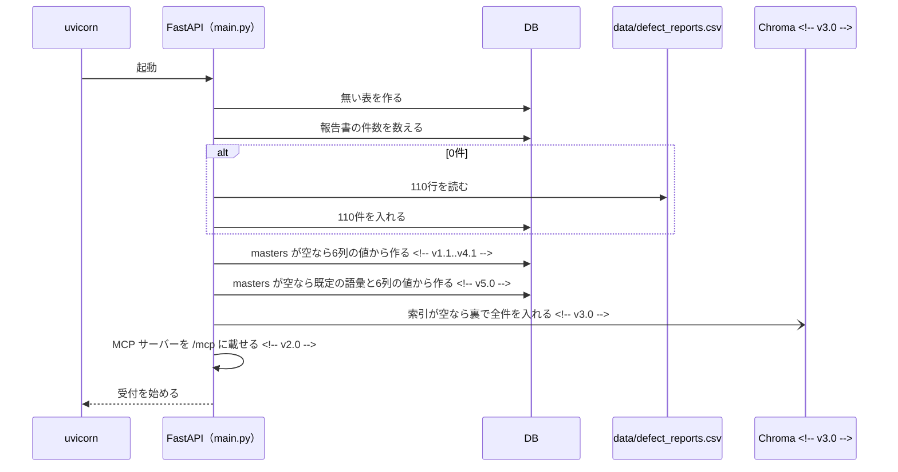
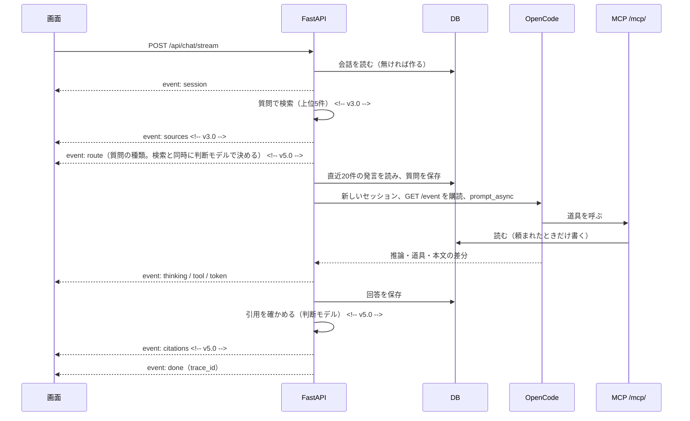

# DefectReport AI — API設計書

FastAPI のバックエンド（`app/backend`、ポート 8000）が出す REST API を定める。 <!-- v1.0..v1.1 -->
FastAPI のバックエンド（`app/backend`、ポート 8000）が出す REST API と、同じプロセスに載せた MCP サーバー（`/mcp/`）を定める。 <!-- v2.0 -->
開発のときは、画面（Vite、ポート 5173）が `/api` と `/health` をバックエンドへ中継する。 <!-- v1.0..v4.1 -->
開発のときは画面（Vite、ポート 5173）が、Docker Compose では画面の nginx が、`/api` と `/health` をバックエンドへ中継する。 <!-- v5.0 -->
応答は JSON（SSE を除く）。項目名は `03_データモデル設計書.md` の列名と同じにする。 <!-- v1.0..v1.1 -->
応答は JSON（SSE を除く）。項目名は `03_データモデル設計書.md` の列名と同じにする。AI の指示と道具の使い分けは `06_AI設計書.md` に書く。 <!-- v2.0 -->

## 1. 共通の決まり

- 認証：なし（手元の PC で動かす演習用）。
- 日付：`YYYY-MM-DD`。期間の引数（`date_from`・`date_to`）は発生日（`occurrence_date`）で絞り、両端の日を含む。
- 期間の引数が日付として読めないとき、`date_from` が `date_to` より後のときは、422 と理由を返す。形は FastAPI 標準（`detail` の配列で、どの引数がなぜ違うかを書く）とし、画面が日本語に直して出す。 <!-- v1.1 -->
- 期間の 422 は例アプリには未実装。例アプリの `GET /api/reports` は読めない日付を無視して絞り込まず（全件側に倒す）、`date_from` > `date_to` は0件を返す。`GET /api/dashboard/statistics` は読めない日付で 500 になる。業務 Ontology の集計（12.5）だけが `date_from` > `date_to` を 422 で返す。 <!-- v5.0 -->
- 誤りの応答は `{"detail": "理由"}`（日本語）。入力の形の誤り（型・必須・範囲）は FastAPI 標準の 422 で返す。
- 0件は誤りではない。`{"total": 0, "items": []}` を 200 で返す。

### 1.1 状態コード

| コード | 意味 | 主な場面 |
|---|---|---|
| 200 | 成功 | 201・204 以外の成功 |
| 201 | 作った | 取込の確認 | <!-- v3.0..v4.1 -->
| 201 | 作った | 報告書・マスタ・CAPA・8D・週次ダイジェスト・写真・回答の評価の登録、取込の確認 | <!-- v5.0 -->
| 204 | 消した（本文なし） | 会話の削除 | <!-- v2.0..v4.1 -->
| 204 | 消した（本文なし） | 報告書・マスタ・会話・写真の削除 | <!-- v5.0 -->
| 400 | 受け付けない形式 | 取込のファイルの種類 | <!-- v3.0..v4.1 -->
| 400 | 受け付けない形式 | 取込のファイルの種類、マスタの空の名前、写真のファイル名 | <!-- v5.0 -->
| 404 | 見つからない | 報告書 | <!-- v1.0..v1.1 -->
| 404 | 見つからない | 報告書・会話 | <!-- v2.0..v4.1 -->
| 404 | 見つからない | 報告書・会話・マスタ（種類が違うときも）・ダイジェスト・写真・トリアージの結果 | <!-- v5.0 -->
| 409 | 重複・使用中・業務の決まりに合わない | 取込の確認で同じ番号がある | <!-- v3.0..v4.1 -->
| 409 | 重複・使用中・業務の決まりに合わない | 同じ番号の報告書、マスタの重複と使用中の削除、CAPA の決まり違反、承認待ちでないトリアージの再開 | <!-- v5.0 -->
| 413 | 大きすぎる | 写真（8MB まで） | <!-- v5.0 -->
| 415 | 形式が違う | 写真（jpg・jpeg・png・webp だけ） | <!-- v5.0 -->
| 422 | 入力の形・値が違う | `limit`・`offset` の範囲外 | <!-- v1.0..v1.0 -->
| 422 | 入力の形・値が違う | `limit`・`offset` の範囲外、期間の日付 | <!-- v1.1..v1.1 -->
| 422 | 入力の形・値が違う | `limit` などの範囲外、必須の抜け、期間の日付 | <!-- v2.0..v4.1 -->
| 422 | 入力の形・値が違う | `limit` などの範囲外、必須の抜け、回答の評価の値、業務 Ontology の条件 | <!-- v5.0 -->
| 502 | 外のモデルが失敗した | トリアージの判断モデル | <!-- v5.0 -->
| 503 | AI が設定されていない | 非ストリーミングのチャット | <!-- v2.0..v2.1 -->
| 503 | AI が設定されていない | 非ストリーミングのチャット、PDF・画像の取込 | <!-- v3.0..v3.1 -->
| 503 | AI が設定されていない | 非ストリーミングのチャット、PDF・画像の取込、4M 分析 | <!-- v4.0..v4.1 -->
| 503 | AI が設定されていない | 非ストリーミングのチャット、PDF・画像の取込、4M 分析、写真の所見、トリアージ | <!-- v5.0 -->

### 1.2 環境変数

| 変数 | 既定 | 意味 |
|---|---|---|
| `DB_PATH` | `app/backend/data/defect_reports.db` | SQLite のファイル |
| `DATA_CSV` | `data/defect_reports.csv` | 空の DB に入れる模擬データ |
| `DATABASE_URL` | 空（SQLite を使う） | PostgreSQL などの接続先 | <!-- v5.0 -->
| `OPENROUTER_API_KEY` | — | 必須のキー（1本だけ）。OpenCode が OpenRouter を呼ぶのに使う | <!-- v2.0 -->
| `OPENCODE_URL` | 空（チャットは使えない） | OpenCode サーバー（`opencode serve`）の URL | <!-- v2.0 -->
| `OPENCODE_MODEL` | `anthropic/claude-sonnet-4.5` | 使うモデル。`ollama/<モデル名>` のように接続先の名前を先頭に書くと、接続先もそれに切り替わる（ローカル LLM は任意） | <!-- v2.0 -->
| `OPENCODE_PROVIDER` | `openrouter` | 接続先 | <!-- v2.0 -->
| `LANGFUSE_HOST`・`LANGFUSE_PUBLIC_KEY`・`LANGFUSE_SECRET_KEY` | 空（記録しない） | Langfuse の接続先とキー | <!-- v2.0 -->
| `ANTHROPIC_API_KEY` | 空 | 帳票の抽出の代わりの経路（Anthropic へ直接つなぐ。任意） | <!-- v3.0..v3.1 -->
| `ANTHROPIC_API_KEY` | 空 | 帳票の抽出・4M 分析の代わりの経路（Anthropic へ直接つなぐ。任意） | <!-- v4.0..v4.1 -->
| `ANTHROPIC_API_KEY` | 空 | 帳票の抽出・4M 分析・写真の所見の代わりの経路（Anthropic へ直接つなぐ。任意） | <!-- v5.0 -->
| `ANTHROPIC_MODEL` | `claude-sonnet-5` | 上の経路のモデル | <!-- v3.0 -->
| `EMBEDDINGS` | `on` | `off` で埋め込み（e5）を使わない | <!-- v3.0 -->
| `CHROMA_PATH` | `app/backend/data/chroma` | Chroma の保存先 | <!-- v3.0 -->
| `PHOTOS_DIR` | `app/backend/data/photos` | 写真の保存先 | <!-- v5.0 -->
| `JEV_ENABLED` | `0` | `1` で報告書トリアージを有効にする | <!-- v5.0 -->
| `DECISION_MODEL`・`TYPESAFE_API_KEY` | 空 | トリアージの判断モデルとキー（無ければ `OPENROUTER_API_KEY` で呼ぶ） | <!-- v5.0 -->
| `TRIAGE_CHECKPOINT_DB` | `app/backend/data/triage_checkpoints.db` | トリアージの途中の状態 | <!-- v5.0 -->
| `DECISIONS_ENABLED` | `0` | `1` で判断モデルによる強化（検索の並べ替え・質問の振り分け・引用と読み取りの確かめ）を有効にする | <!-- v5.0 -->
| `DECISION_RERANK`・`DECISION_ROUTE`・`DECISION_CITE`・`DECISION_OCR_VERIFY` | `1` | `0` でその機能だけ止める | <!-- v5.0 -->
| `DECISION_MODEL_RERANK`・`DECISION_MODEL_ROUTE`・`DECISION_MODEL_CITE`・`DECISION_MODEL_OCR` | 空（測って選んだモデル） | 機能ごとのモデルを替える（替えたら測り直す） | <!-- v5.0 -->
| `DECISION_RERANK_MODE` | `joint` | `per_candidate` で候補ごとに1リクエスト | <!-- v5.0 -->
| `DECISION_ZDR`・`DECISION_CACHE_TTL` | `1`・`600` | データを残さない経路だけを使う・同じ入力の答えを使い回す秒数（トリアージと共通） | <!-- v5.0 -->
| `BACKEND_PORT`・`FRONTEND_PORT`・`LANGFUSE_PORT` | `8000`・`5173`・`3390` | Docker Compose でホストに出すポート | <!-- v5.0 -->

キーは `.env` に置き、画面のコードや応答に出さない。 <!-- v2.0 -->

<!-- v2.0 -->
### 1.3 AI や埋め込みが無いときの動き

| 無いもの | 動き |
|---|---|
| OpenCode（`OPENCODE_URL` が無い） | チャットは `error` イベントで理由を返す（非ストリーミングは 503）。`/health` の `chat_backend` が `none` |
| Langfuse | 記録せずに動く。`done` の `trace_id` は null |
| AI（`OPENCODE_URL` も `ANTHROPIC_API_KEY` も無い） | 取込：xlsx はセルの値だけで返す（確信度 medium と警告）。PDF・画像は 503 | <!-- v3.0..v3.1 -->
| AI（`OPENCODE_URL` も `ANTHROPIC_API_KEY` も無い） | 取込：xlsx はセルの値だけで返す（確信度 medium と警告）。PDF・画像は 503。4M 分析は 503 | <!-- v4.0..v4.1 -->
| AI（`OPENCODE_URL` も `ANTHROPIC_API_KEY` も無い） | 取込：xlsx はセルの値だけで返す（確信度 medium と警告）。PDF・画像は 503。4M 分析・写真の所見は 503 | <!-- v5.0 -->
| OpenCode（CAPA の下書き・8D・週次ダイジェスト） | 決まった形だけで作る（`ai_backend` が `none`）。下書きは似ている報告書の対策を並べる | <!-- v5.0 -->
| 埋め込み（sentence-transformers が無い、`EMBEDDINGS=off`） | 検索は BM25（`search_mode` が `bm25`）、それも失敗したらキーワードの部分一致（`keyword`） | <!-- v3.0..v4.1 -->
| 埋め込み（sentence-transformers が無い、`EMBEDDINGS=off`） | 検索は BM25（`search_mode` が `bm25`）、それも失敗したらキーワードの部分一致（`keyword`）。関連マップは語の重なり（Jaccard）で作る | <!-- v5.0 -->
| 判断モデル（`JEV_ENABLED=1` とキー） | トリアージは 503（状態と記録の読み出しは動く） | <!-- v5.0 -->
| 判断モデルによる強化（`DECISIONS_ENABLED=1` とキー）、または判断モデルが失敗した | 検索は並べ替える前の順、チャットは振り分けの注意と引用の確かめなしで答える。取込は確かめず、確信度は今までの決まり（確かめに失敗したときは medium と警告） | <!-- v5.0 -->
<!-- /v -->

## 2. エンドポイントの一覧

| 分類 | メソッドとパス | 内容 |
|---|---|---|
| 状態 | `GET /health` | 状態と報告書の件数 |
| 報告書 | `GET /api/reports` | 一覧（絞り込み・並べ替え・ページ送り） |
| 報告書 | `GET /api/reports/search` | スマート検索（ハイブリッド検索） | <!-- v3.0 -->
| 報告書 | `GET /api/reports/{defect_id}` | 詳細 |
| 報告書 | `GET /api/reports/{defect_id}/similar` | 似ている報告書 | <!-- v3.0 -->
| 報告書 | `POST /api/reports` | 登録 | <!-- v5.0 -->
| 報告書 | `PUT /api/reports/{defect_id}` | 部分更新 | <!-- v5.0 -->
| 報告書 | `DELETE /api/reports/{defect_id}` | 削除 | <!-- v5.0 -->
| マスタ | `GET /api/masters` | 6種類の選択肢 | <!-- v1.1 -->
| マスタ | `GET /api/masters/{category}` | 1種類の選択肢 | <!-- v5.0 -->
| マスタ | `POST /api/masters/{category}` | 追加 | <!-- v5.0 -->
| マスタ | `PUT /api/masters/{category}/{item_id}` | 名前の変更・有効／無効 | <!-- v5.0 -->
| マスタ | `DELETE /api/masters/{category}/{item_id}` | 削除（使っていないものだけ） | <!-- v5.0 -->
| AI アシスタント | `POST /api/chat/stream` | 回答を SSE で逐次返す | <!-- v2.0 -->
| AI アシスタント | `POST /api/chat` | 回答をまとめて返す（試験用） | <!-- v2.0 -->
| AI アシスタント | `GET /api/chat/sessions` | 会話の一覧 | <!-- v2.0 -->
| AI アシスタント | `GET /api/chat/sessions/{session_id}` | 会話の中身 | <!-- v2.0 -->
| AI アシスタント | `DELETE /api/chat/sessions/{session_id}` | 会話の削除 | <!-- v2.0 -->
| AI アシスタント | `POST /api/chat/feedback` | 回答への 👍/👎 | <!-- v5.0 -->
| AI アシスタント | `GET /api/chat/feedback` | 評価の一覧と集計 | <!-- v5.0 -->
| 画面の操作 | `GET /api/ui/events` | AI の画面操作を画面へ届ける SSE | <!-- v2.0 -->
| 画面の操作 | `POST /api/ui/navigate` | 画面の移動（道具と同じ処理。確かめ用） | <!-- v5.0 -->
| 画面の操作 | `POST /api/ui/open_report/{defect_id}` | 詳細を開く（同上） | <!-- v5.0 -->
| 画面の操作 | `POST /api/ui/command` | 画面の中の操作（同上） | <!-- v5.0 -->
| MCP | `/mcp/` | MCP サーバー（道具15本） | <!-- v2.0..v2.1 -->
| MCP | `/mcp/` | MCP サーバー（道具17本） | <!-- v3.0..v3.1 -->
| MCP | `/mcp/` | MCP サーバー（道具20本） | <!-- v4.0..v4.1 -->
| MCP | `/mcp/` | MCP サーバー（道具28本） | <!-- v5.0 -->
| 取込 | `POST /api/ingest/upload` | 帳票から項目を取り出す（保存しない） | <!-- v3.0 -->
| 取込 | `POST /api/ingest/confirm` | 確かめた値で登録 | <!-- v3.0 -->
| KPI | `GET /api/dashboard/statistics` | KPI・月次・パレート・層別 | <!-- v4.0 -->
| KPI | `GET /api/dashboard/control-chart` | p 管理図 | <!-- v4.0 -->
| 分析 | `GET /api/analysis/alerts` | 予兆アラート | <!-- v4.0 -->
| 分析 | `POST /api/analysis/4m/{defect_id}` | 4M 分析 | <!-- v4.0 -->
| CAPA | `GET /api/capa`・`POST /api/capa`・`PUT /api/capa/{capa_id}` | 是正・予防処置の一覧・登録・更新 | <!-- v5.0 -->
| CAPA | `POST /api/capa/draft/{defect_id}` | 処置の下書き（保存しない） | <!-- v5.0 -->
| CAPA | `POST /api/capa/eight_d/{defect_id}`・`GET /api/capa/eight_d/{defect_id}` | 8D レポートの作成・一覧 | <!-- v5.0 -->
| ダイジェスト | `GET /api/digests`・`POST /api/digests/generate`・`GET /api/digests/{digest_id}` | 週次ダイジェスト | <!-- v5.0 -->
| 写真 | `GET・POST /api/reports/{defect_id}/photos`、`GET・DELETE /api/reports/{defect_id}/photos/{name}`、`POST /api/reports/{defect_id}/photos/{name}/analyze` | 写真の一覧・追加・取得・削除・所見 | <!-- v5.0 -->
| 関連マップ | `GET /api/graph` | 報告書どうしの近さのグラフ | <!-- v5.0 -->
| 業務 Ontology | `GET /api/ontology/definition` ほか6本 | 定義・名前の解決・対象・関係・集計・グラフ・CAPA 変更の検証 | <!-- v5.0 -->
| トリアージ | `GET /api/triage/status`・`GET /api/triage/metrics`・`POST /api/triage/preview`・`POST・GET /api/triage/reports/{defect_id}`・`POST /api/triage/runs/{run_id}/resume` | 報告書トリアージ | <!-- v5.0 -->

- エンドポイントは3本で、すべて読み出し。報告書の登録・更新・削除は持たない。 <!-- v1.0..v1.0 -->
- エンドポイントは4本で、すべて読み出し。報告書の登録・更新・削除は持たない。 <!-- v1.1..v1.1 -->
- 報告書を登録・更新・削除する REST は持たない。AI アシスタントの書き込みは MCP の道具（8.3）で行う。 <!-- v2.0..v2.1 -->
- 報告書を更新・削除する REST は持たない。登録は取込の確認（9.2）と MCP の道具（8.3）で行う。 <!-- v3.0..v4.1 -->
- REST は58本（`/health` を含む）と、MCP サーバー `/mcp/`。 <!-- v5.0 -->

## 3. 起動とヘルスチェック

### 3.1 起動時の処理



- CSV の値は列ごとに型を直して入れる（整数・小数・日付・真偽。真偽は `true`・`1`・`有`・`yes` を真とする）。
- 詳しくは `03_データモデル設計書.md` の「起動時の処理」。

### 3.2 GET /health

応答（110件のとき）：

```json
{"status": "ok", "reports": 110} <!-- v1.0..v1.1 -->
{"status": "ok", "reports": 110, "chat_backend": "opencode"} <!-- v2.0..v2.1 -->
{"status": "ok", "reports": 110, "anthropic_configured": true, "chat_backend": "opencode", "vector_search": "e5"} <!-- v3.0 -->
```

| 項目 | 意味 |
|---|---|
| `status` | 動いていれば `ok` |
| `reports` | 報告書の件数（空の DB に入れたあとは110） |
| `anthropic_configured` | 帳票の抽出に使う AI が設定済みか（`OPENCODE_URL` か `ANTHROPIC_API_KEY` があれば true）。名前は前の作りの名残 | <!-- v3.0..v3.1 -->
| `anthropic_configured` | 帳票の抽出・4M 分析に使う AI が設定済みか（`OPENCODE_URL` か `ANTHROPIC_API_KEY` があれば true）。名前は前の作りの名残 | <!-- v4.0 -->
| `chat_backend` | `opencode`（`OPENCODE_URL` がある）か `none`（チャットは使えない） | <!-- v2.0 -->
| `vector_search` | `e5`（埋め込みを使える）か `keyword`（使えない。検索は BM25 かキーワード） | <!-- v3.0 -->

## 4. 報告書 — /api/reports

Report（報告書1件）は、`defect_reports` の全列と派生値 `defect_rate`（不適合数 ÷ 加工数。加工数が0なら null）を持つ。

### 4.1 GET /api/reports（一覧）

| 引数 | 既定 | 意味 |
|---|---|---|
| `q` | | `defect_id`・`part_number`・`part_name`・`defect_description` の部分一致 |
| `status` | | 状態の完全一致（`open`・`in_progress`・`completed`） |
| `severity` | | 重大度の完全一致 |
| `machine` | | `machine_name` の完全一致 |
| `process` | | 工程の完全一致 |
| `customer` | | 客先の完全一致 | <!-- v2.0 -->
| `operator` | | `operator_name` の完全一致 | <!-- v2.0 -->
| `phenomenon` | | 現象の完全一致 | <!-- v2.0 -->
| `category_4m` | | `Man`・`Machine`・`Material`・`Method` |
| `date_from`・`date_to` | | 発生日の範囲（両端を含む） |
| `limit` | 50 | 1〜500（範囲外は 422） |
| `offset` | 0 | 0以上 |
| `sort` | `-occurrence_date` | `occurrence_date`・`report_date`・`defect_id`・`severity`・`created_at`・`total_cost`。先頭に `-` で降順。ほかの名前は `occurrence_date` として扱う |

- 応答：`{"total": 条件に合う件数, "items": [Report]}`。条件はすべて AND で組む（OR にしない）。
- 例：`machine=a61nx&date_from=2025-09-01&date_to=2025-09-30` は `total` 1（KZ25-0043）。同じ機械で2025年10月は `total` 0。
- 画面の絞り込みの選択肢は `GET /api/masters`（5.1）から作る。 <!-- v1.1 -->

### 4.2 GET /api/reports/{defect_id}（詳細）

- 応答：Report。無ければ 404 `{"detail": "報告書が見つかりません"}`。
- 例：KZ25-0043 は `machine_name` が a61nx、`production_count` 12、`defect_count` 3、`defect_rate` 0.25。

<!-- v3.0 -->
### 4.3 GET /api/reports/search（スマート検索）

| 引数 | 既定 | 意味 |
|---|---|---|
| `q` | 必須 | 探したい内容（自然文。1文字以上、無ければ 422） |
| `top_k` | 10 | 1〜40 |
| `machine`・`process` | | 検索の結果を後から完全一致で絞る（候補は `top_k` の4倍、40件まで取る） |

- 応答：`{"items": [{defect_id, part_name, machine_name, process, phenomenon, snippet, score, search_mode}], "search_mode": "hybrid" | "bm25" | "keyword"}`。`snippet` は本文・原因・対策の先頭140文字。応答の `search_mode` は先頭の1件のもの。 <!-- v3.0..v4.1 -->
- 応答：`{"items": [{defect_id, part_name, machine_name, process, phenomenon, snippet, score, search_mode, relevance}], "search_mode": "hybrid" | "bm25" | "keyword"}`（判断モデルで並べ替えたときは `+rerank` が付く。通常は `hybrid+rerank`）。`snippet` は本文・原因・対策の先頭140文字。応答の `search_mode` は先頭の1件のもの。`relevance` は判断モデルが付けた「質問に当てはまる確率」（判断モデルで並べ替えたときだけ。ほかは null）。並べ替えは、同じ検索を使う似ている報告書・チャットの事前の検索・道具の並びにも効く <!-- v5.0 -->
- 並べ替えとページ送りは無い（上位だけを返す）。
- 件数を数える用途には使わない（件数は `GET /api/reports` の `total` で数える）。 <!-- v3.1 -->
- パスは `/{defect_id}` より前に定める（`search` を番号として読まないため）。

### 4.4 GET /api/reports/{defect_id}/similar（似ている報告書）

- 引数：`top_k`（既定3、1〜10）。
- 当の報告書の 現象・不具合内容・原因 で検索し、自分を除いた上位を返す。
- 応答：`{"defect_id": "KZ25-0043", "items": [{defect_id, occurrence_date, part_name, machine_name, process, phenomenon, cause, countermeasure, score}]}`。`cause` は160文字、`countermeasure` は240文字まで。無ければ 404。
<!-- /v -->

<!-- v5.0 -->
### 4.5 POST /api/reports（登録、FR-CR-02）

- 本文：Report の項目。必須は `occurrence_date`・`customer`・`process`・`machine_name`・`operator_name`・`part_number`・`part_name`・`production_count`・`defect_count`・`defect_description`・`phenomenon`・`severity` の12項目（抜けると 422）。`status` の既定は `open`。
- `defect_id` が無ければ `KZ25-` の最大の番号＋1 を4桁で付ける（110件の次は KZ25-0111）。同じ番号があれば 409 `{"detail": "defect_id が既に存在します"}`。
- `total_cost` が無ければ、4費目（材料費・加工費・外注費・その他）の和を入れる（FR-CR-06）。
- 6列（客先・工程・機械・作業者・現象・要因）の値がマスタに無ければ、マスタに足す。
- 検索の索引にも入れる。応答：201 と Report。

### 4.6 PUT /api/reports/{defect_id}（部分更新、FR-CR-04）

- 本文に書いた項目だけを変える。無ければ 404。
- マスタに無い値はマスタに足し、検索の索引も入れ直す。応答：Report。

### 4.7 DELETE /api/reports/{defect_id}（削除、FR-CR-05）

- 報告書を DB から消し、検索の索引からも消す。応答：204。無ければ 404。
- 値で対応する CAPA・8D・トリアージの記録・写真・会話は消さない。
- AI の道具から削除はできない（削除の道具は作らない）。

### 4.8 数量の検査（FR-CR-02・FR-CR-04）

- 登録と更新で 0 ≦ 不適合数 ≦ 加工数 を検査する。違反は 422 と日本語の理由を返し、保存しない（件数が増えない）。
- 期待値：加工数100・不適合数5 は 201。100個中100個、100個中0個も通る。加工数10・不適合数25 は 422 で、件数は変わらない。
- 例アプリには未実装（第6回の演習で入れる）。例アプリは 加工数10・不適合数25 を 201 で保存し、PUT は負の加工数も受け付ける。
<!-- /v -->

<!-- v1.1 -->
## 5. マスタ — /api/masters

種類（`category`）は `customer`・`process`・`machine`・`operator`・`phenomenon`・`factor` の6つ。重大度・状態・4M は決まった値なので含めない。

Master（選択肢1つ）＝ `{"id", "category", "name", "sort_order", "is_active", "usage_count"}`。`usage_count` は報告書でその値を使っている件数。

### 5.1 GET /api/masters

- 応答：`{"customer": [Master], "process": [...], "machine": [...], "operator": [...], "phenomenon": [...], "factor": [...]}`。各種類の中は `sort_order`、`name` の順。
- 110件では 客先10・工程8・機械10・作業者29・現象12・要因10 の79件を返す。 <!-- v1.1..v4.1 -->
- 無効（`is_active=false`）の行も返す。画面は、新しく入力するときの候補から無効の行を外す。 <!-- v5.0 -->
- 例アプリは既定の語彙も入れているため、110件では97件を返し、使用件数0の旧い名前（工程「旋盤」など18件）が候補に残る（既知の問題。`03_データモデル設計書.md` の「表 masters」）。 <!-- v5.0 -->

<!-- v5.0 -->
### 5.2 マスタの管理（FR-MA-02〜06）

| メソッドとパス | 本文・引数 | 応答 |
|---|---|---|
| `GET /api/masters/{category}` | `active_only`（既定 false。true で有効だけ） | `[Master]` |
| `POST /api/masters/{category}` | `{"name": str}` | 201 と Master（`sort_order` 500）。空の名前は 400、同じ名前（前後の空白と大文字・小文字を無視）は 409 |
| `PUT /api/masters/{category}/{item_id}` | `{"name"?: str, "is_active"?: bool}` | Master に `updated_reports`（名前を書き換えた報告書の件数）を足したもの。空の名前は 400、ほかの行と同じ名前は 409 |
| `DELETE /api/masters/{category}/{item_id}` | | 204。使用件数が1以上なら 409 `{"detail": "使用中のため削除できません。無効化してください。"}` |

- 種類の名前が違えば 404 `{"detail": "カテゴリが不正です"}`、行が無ければ 404。
- 名前を変えると、対応する列を持つ報告書の値もすべて新しい名前に書き換える。客先・工程・機械・現象の変更では、書き換えた報告書を検索の索引に入れ直す。
- 無効にした名前は新しく入力するときの候補から外すが、既存の報告書の値と集計は変えない。
<!-- /v -->
<!-- /v -->

<!-- v2.0 -->
## 6. AI アシスタント — /api/chat

### 6.1 POST /api/chat/stream

- 本文：`{"message": str, "session_id": int | null}`。`session_id` が null か、その会話が無ければ新しい会話を作る（題名は質問の先頭30文字）。`history` は受け取っても使わない（履歴はサーバーが DB から読む）。
- 応答：SSE（`text/event-stream`）。1つのイベントは `event: 名前` と `data: JSON` の組。

| event | data | 出る時 |
|---|---|---|
| `session` | `{"id": int, "title": str}` | 最初に1回 |
| `sources` | `{"items": [{defect_id, part_name, phenomenon, snippet, score}]}` | 回答の前に1回（事前の検索の上位5件） | <!-- v3.0 -->
| `route` | `{"intent": str, "p": float, "margin": float, "taken": bool, "hint": str, "model": str, "cost_usd": float}`（`intent` は `one`・`filter`・`count`・`search`・`ui`・`other`。`hint` は採らなかったときは空文字） | `sources` のあとに1回（判断モデルが使えるときだけ） | <!-- v5.0 -->
| `thinking` | `{"text": str}` | 推論の文の差分 |
| `tool` | `{"name": str, "status": str, "title": str}`（`status` は `pending`・`running`・`completed`・`error`、`title` は null もある） | 道具の状態が変わるたび |
| `token` | `{"text": str}` | 回答の本文の差分 |
| `citations` | `{"model": str, "checks": [{defect_id, sentence, p, exists, supported, malformed?}], "unsupported": int, "cost_usd": float}`（`p` は無い番号・崩れた番号では null） | 回答のあと、`done` の前に1回（判断モデルが使えるときだけ） | <!-- v5.0 -->
| `done` | `{"trace_id": str}`（Langfuse が無ければ null） | 成功で終わった |
| `error` | `{"detail": str}` | 失敗で終わった |

- 順番：`session` → `thinking`・`tool`・`token`（まざって何回でも） → `done` か `error` のどちらか1つ。 <!-- v2.0..v2.1 -->
- 順番：`session` → `sources` → `thinking`・`tool`・`token`（まざって何回でも） → `done` か `error` のどちらか1つ。 <!-- v3.0..v4.1 -->
- 順番：`session` → `sources` →（`route`）→ `thinking`・`tool`・`token`（まざって何回でも） →（`citations`）→ `done` か `error` のどちらか1つ。`route`・`citations` は判断モデルが使えるときだけ。 <!-- v5.0 -->
- `done` の `trace_id` で、画面の回答と Langfuse のトレースを照合する（1問1トレース）。
- 回答の本文は Markdown（箇条書き・太字・表）。報告書は `[KZ25-XXXX]` の形で示し、画面はリンクにする。 <!-- v2.0..v2.1 -->
- 回答の本文は Markdown（箇条書き・太字・表）。参照した報告書は本文で `[KZ25-XXXX]` の形で引用し、画面はリンクにする（FR-CH-04）。`sources` は事前の検索の候補で、回答の根拠そのものではない。 <!-- v3.0 -->



- OpenCode のセッションは1問ごとに作って捨てる。会話の正本は DB（`chat_sessions`・`chat_messages`）。
- 直近20件の発言は、質問を保存する前に読む（同じ質問を二重に入れない）。
- プロンプトは、システムプロンプト・これまでの会話・質問をまとめた1つの文にする。 <!-- v2.0..v2.1 -->
- プロンプトは、システムプロンプト・事前の検索の候補・これまでの会話・質問をまとめた1つの文にする。事前の検索の候補は粗い候補で、質問に合わなければ道具で引き直す。 <!-- v3.0 -->
- 判断モデルが質問の種類を決めて採ったとき（1位の確率0.6以上）は、その種類の道具の使い方の注意（`hint`）もプロンプトに入れる（FR-DM-02）。 <!-- v5.0 -->
- チャットでは OpenCode に元からある道具（bash・edit・write・patch・read・glob・grep・list・webfetch・todowrite・todoread・task）を切り、MCP の `defect-reports` の道具だけを使わせる。 <!-- v2.0..v4.1 -->
- チャットでは OpenCode に元からある道具（bash・edit・write・patch・apply_patch・read・glob・grep・list・webfetch・websearch・todowrite・todoread・task・skill・question）を切り、MCP の `defect-reports` の道具だけを使わせる。道具の名前は OpenCode の版で変わるので、版を上げたら一覧を見直す（その版に無い名前は効かないだけなので残す）。 <!-- v5.0 -->
- OpenCode の `GET /event` は全セッションの出来事を流すため、自分の sessionID のものだけを読む。本文と推論の差分（`message.part.delta`）を `token`・`thinking` に、道具の部品（`message.part.updated`）を `tool` に変え、`session.idle` で終わる。差分が取れなかったときは、終わったメッセージから本文をまとめて取り、`token` を1回送る。
- 回答は、本文・使った道具（名前ごとの最後の状態）・推論の文を保存する。 <!-- v2.0..v2.1 -->
- 回答は、本文・`sources`・使った道具（名前ごとの最後の状態）・推論の文を保存する。 <!-- v3.0 -->

### 6.2 失敗の扱い

- `OPENCODE_URL` が無ければ、`error` イベント `{"detail": "AIバックエンドが設定されていません(OPENCODE_URL / OPENROUTER_API_KEY)"}` で終わる。
- 失敗しても質問（user の発言）は保存する。失敗した回答は保存しない。
- 途中の例外は `error` イベントの `detail` に理由を入れて返す。HTTP の状態は 200 のまま（SSE を始めたあとのため）。
- 空の応答は成功にしない。`error` イベント `{"detail": "OpenCodeが空応答を返しました(モデル未応答)。もう一度お試しください"}` で終わる。 <!-- v2.1 -->
- モデルの誤り（OpenRouter の残高切れ 402 など）は、OpenCode が HTTP 200 のまま応答の `info.error` に入れて返す。これを見て `error` イベント（`OpenCode/モデルエラー: …`）にする。 <!-- v2.1 -->
- 出力が上限で切れた応答（finish_reason=length）も成功にしない。 <!-- v2.1..v4.1 -->
- 出力が上限で切れた応答（finish_reason=length）を成功にしない判定は、例アプリには未実装。出力の上限は `opencode.json` の `limit.output`（8000）で決める。 <!-- v5.0 -->

### 6.3 会話の保存 — /api/chat/sessions（FR-CH-09）

| メソッドとパス | 応答 |
|---|---|
| `GET /api/chat/sessions` | `[{"id", "title", "created_at", "updated_at", "message_count"}]`。更新の新しい順 |
| `GET /api/chat/sessions/{session_id}` | `{"session": {…同上}, "messages": [{"id", "role", "content", "tools", "thinking", "created_at"}]}`。無ければ 404 | <!-- v2.0..v2.1 -->
| `GET /api/chat/sessions/{session_id}` | `{"session": {…同上}, "messages": [{"id", "role", "content", "sources", "tools", "thinking", "created_at"}]}`。無ければ 404 | <!-- v3.0 -->
| `DELETE /api/chat/sessions/{session_id}` | 204（発言も消す）。無ければ 404 |

### 6.4 POST /api/chat（試験用）

- 本文は 6.1 と同じ。回答をまとめて返す：`{"answer": str, "session_id": int}`。 <!-- v2.0..v2.1 -->
- 本文は 6.1 と同じ。回答をまとめて返す：`{"answer": str, "sources": [...], "session_id": int}`。 <!-- v3.0..v4.1 -->
- 本文は 6.1 と同じ。回答をまとめて返す：`{"answer": str, "sources": [...], "session_id": int, "route": {…} | null, "citations": {…} | null}`（`route`・`citations` は 6.1 のイベントと同じ形。判断モデルが使えないときは null）。 <!-- v5.0 -->
- `OPENCODE_URL` が無ければ 503。会話は 6.1 と同じく保存する。

<!-- v5.0 -->
### 6.5 回答の評価 — /api/chat/feedback

- `POST /api/chat/feedback`：本文 `{"rating": 1 | -1, "session_id"?, "message_index"?, "trace_id"?, "comment"?, "answer_excerpt"?, "question_excerpt"?}`。201 と保存した行。`rating` が1か-1でなければ 422。`trace_id` があれば Langfuse のトレースにスコア（名前 `user-feedback`）として送る。
- `GET /api/chat/feedback?limit=100`（500まで）：`{"up": int, "down": int, "items": [...]}`。新しい順。
- 週次ダイジェストの KPI の表に、その期間の 👍・👎 の数を載せる。
<!-- /v -->

## 7. 画面の操作 — /api/ui

AI の道具（8.4）が出した画面操作を、画面（`UiControlBridge`）へ届ける。画面の状態の正本は URL クエリで、人の操作と AI の操作が同じ URL を見る。

### 7.1 GET /api/ui/events（SSE）

- 接続するとまずコメント行 `: connected` を送る。操作が15秒無ければコメント行 `: ping` を送る（接続を保つため）。
- 操作は `event: ui` で送る。つながっているすべての画面に同じものを送る（一人で使う手元のアプリのため）。

| action | data | 使う道具 |
|---|---|---|
| `navigate` | `{"action": "navigate", "path": "/reports?machine=a61nx", "reason": str}` | `ui_navigate`・`ui_open_report` | <!-- v2.0..v2.1 -->
| `navigate` | `{"action": "navigate", "path": "/reports?machine=a61nx", "reason": str}` | `ui_navigate`・`ui_open_report`・`ui_new_report` | <!-- v3.0 -->
| `command` | `{"action": "command", "name": "set_theme", "params": {"mode": "dark"}, "reason": str}` | `ui_set_theme` | <!-- v2.0..v3.1 -->
| `command` | `{"action": "command", "name": "run_4m", "params": {"defect_id": "KZ25-0043"}, "path": "/reports/KZ25-0043", "reason": str}`（`name` は `set_theme`・`run_4m`。`path` は開く画面があるときだけ） | `ui_set_theme`・`ui_run_4m_analysis` | <!-- v4.0..v4.1 -->
| `command` | `{"action": "command", "name": "edit", "params": {"defect_id": "KZ25-0043"}, "path": "/reports/KZ25-0043", "reason": str}`（`name` は `set_theme`・`run_4m`・`edit`。`path` は開く画面があるときだけ） | `ui_set_theme`・`ui_run_4m_analysis`・`ui_edit_report` | <!-- v5.0 -->

- 画面が1つもつながっていなければ、道具は `{"ok": false, "error": "ブラウザ画面が接続されていません(アプリを開いてもらってください)"}` を返す。このとき AI は「画面を操作した」と答えない。
- 画面の操作はデータを変えない（下書きの入力や編集の保存は利用者が行う）。

<!-- v5.0 -->
### 7.2 REST の画面操作（確かめ用）

MCP の道具と同じ処理（`services/ui_control.py`）を REST でも出す。LLM を通さずに全ページを確かめる E2E と、外からの連携に使う。

| メソッドとパス | 本文 | 応答 |
|---|---|---|
| `POST /api/ui/navigate` | `{"page": str, "params": {...}}` | `{"ok": true, "path", "receivers"}` か `{"ok": false, "error"}` |
| `POST /api/ui/open_report/{defect_id}` | | 同上 |
| `POST /api/ui/command` | `{"name": str, "params": {...}, "path"?: str}` | `{"ok": true, "receivers", "path"?}` か `{"ok": false, "error"}` |
<!-- /v -->

## 8. MCP サーバー — /mcp/

- 道具は15本（読み取り5・書き込み2・画面の操作3・業務 Ontology 5）。 <!-- v2.0..v2.1 -->
- 道具は17本（読み取り6・書き込み2・画面の操作4・業務 Ontology 5）。 <!-- v3.0..v3.1 -->
- 道具は20本（読み取り8・書き込み2・画面の操作5・業務 Ontology 5）。 <!-- v4.0..v4.1 -->
- 道具は28本。本筋の21本（読み取り8・書き込み2・画面の操作6・業務 Ontology 5）と、完成形の追加の7本（8.7）。実装は `services/mcp_server.py` に22本、`services/ontology_mcp.py` に6本。 <!-- v5.0 -->

### 8.1 接続

- FastAPI と同じプロセスに FastMCP（Streamable HTTP）を載せる（`main.py` で `app.mount("/mcp", mcp_app)`）。サーバーの名前は `defect-reports`。
- OpenCode は `opencode.json` の `mcp.defect-reports`（`{"type": "remote", "url": "<backend の URL>/mcp/", "enabled": true}`）でつなぐ。OpenCode から見た道具の名前は `defect-reports_<道具の名前>`。 <!-- v2.0..v4.1 -->
- OpenCode は `opencode.json` の `mcp.defect-reports`（`{"type": "remote", "url": "http://backend:8000/mcp/", "enabled": true}`。Docker Compose のサービス名 `backend` を指す）でつなぐ。OpenCode から見た道具の名前は `defect-reports_<道具の名前>`。 <!-- v5.0 -->
- 道具は DB を直接読む（自分の REST を HTTP で呼ばない）。登録・更新は REST と同じ処理（`services/report_service.py`）を使う。
- 道具の説明（docstring）に「いつ使うか」と引数の例を書く。
- 業務 Ontology の定義は、資源 `ontology://quality/definition`（JSON）としても読める。

### 8.2 読み取り

| 道具 | 使いどころ | 主な引数 | 返り値 |
|---|---|---|---|
| `list_defect_reports` | 条件がはっきりした絞り込み | `machine`・`process`・`customer`・`operator`・`phenomenon`・`severity`・`status`・`category_4m`・`date_from`・`date_to`・`q`、`limit`（既定20、最大100）・`offset`・`sort`（既定 `-occurrence_date`） | `{"total", "items": [要約＋defect_rate]}`。値は完全一致。件数は `total` で数える |
| `search_defect_reports` | 内容があいまいな検索（キーワード） | `query`、`top_k`（既定5）、`machine`・`process`（後から絞る） | `[{defect_id, part_name, machine_name, process, phenomenon, snippet, score}]`。不具合内容・原因・対策・部品名・現象の部分一致で、一致した語の数を `score` にする | <!-- v2.0..v2.1 -->
| `search_defect_reports` | 内容があいまいな類似の検索（ハイブリッド） | `query`、`top_k`（既定5）、`machine`・`process`（後から絞る） | `[{defect_id, part_name, machine_name, process, phenomenon, snippet, score}]`（`score` の高い順） | <!-- v3.0 -->
| `get_defect_report` | 1件の全項目 | `defect_id` | 全列＋`defect_rate`（小数4桁）。無ければ `{"error": "KZ25-9999 は見つかりません"}` |
| `get_statistics` | 全体・期間の集計 | `date_from`・`date_to`（省略で全期間） | 件数・不適合数・加工数・不良率・損失などの KPI、月次、現象のパレート、機械・作業者・工程・客先別、4M 別、重大度別 | <!-- v2.0..v3.1 -->
| `get_statistics` | 全体・期間の集計 | `date_from`・`date_to`（省略で全期間） | `GET /api/dashboard/statistics` と同じ形（10.1） | <!-- v4.0 -->
| `list_masters` | 名前の正しい表記の確認 | `category`（省略で6種類すべて） | `{種類: [{"name", "usage_count"}]}`（有効な値だけ） |
| `get_similar_reports` | 似ている過去の報告と当時の対策 | `defect_id`、`top_k`（既定3） | `{"defect_id", "items": [{defect_id, phenomenon, machine_name, cause, countermeasure, score}]}` | <!-- v3.0 -->
| `get_control_chart` | 工程が安定しているか | `months`（既定12） | `GET /api/dashboard/control-chart` と同じ形 | <!-- v4.0 -->
| `get_active_alerts` | いま注意すべき兆し | なし | `GET /api/analysis/alerts` と同じ形 | <!-- v4.0 -->

### 8.3 書き込み（FR-CH-08）

利用者が「登録して」「更新して」とはっきり頼んだときだけ使う（画面にスイッチは作らず、AI への指示と道具の説明で守る）。呼ばれたことは、画面の道具の表示と DB の記録（`tools_json`）で確かめる。

| 道具 | 主な引数 | 動き |
|---|---|---|
| `create_defect_report` | 必須：`occurrence_date`・`customer`・`process`・`machine_name`・`operator_name`・`part_number`・`part_name`・`production_count`・`defect_count`・`defect_description`・`phenomenon`・`severity`。任意：`discoverer`・`good_condition`・`cause`・`factor`・`category_4m`・`countermeasure`・`notes` | 番号を自動で付け、`status` は `open` に固定して登録する。`{"created": true, "defect_id": "KZ25-0111"}`、失敗は `{"created": false, "error"}` |
| `update_defect_report` | `defect_id` と、`status`・`severity`・`countermeasure`・`cause`・`factor`・`category_4m`・`notes`・`good_condition` | 渡した項目だけを変える（変えられるのはこの8項目だけ）。`{"updated": true, "defect_id", "changed": [...]}` |

- 報告書を削除する道具は作らない。

### 8.4 画面の操作（WebMCP）

| 道具 | 使いどころ | 主な引数 |
|---|---|---|
| `ui_navigate` | 画面を移る・表示の条件を変える | `page`、ページごとの条件（下の表） |
| `ui_open_report` | 報告書の詳細を開く | `defect_id` |
| `ui_set_theme` | ライト／ダークの切り替え | `mode`（`dark`・`light`） |
| `ui_new_report` | 登録の画面を、聞き取った値を下書きに入れて開く（保存しない） | `occurrence_date`・`customer`・`process`・`machine_name`・`operator_name`・`part_number`・`part_name`・`phenomenon`・`severity`・`defect_description`・`cause`・`countermeasure`・`category_4m` | <!-- v3.0 -->
| `ui_run_4m_analysis` | 詳細を開き、画面の「4M 分析」を動かして結果を出す | `defect_id` | <!-- v4.0 -->
| `ui_edit_report` | 詳細を編集の状態で開く（入力と保存は利用者） | `defect_id` | <!-- v5.0 -->

| `page` | 開く画面 | 使える条件 |
|---|---|---|
| `reports` | `/reports` | `q`・`machine`・`severity`・`status`・`process`・`customer`・`operator`・`phenomenon`・`category_4m`・`sort`・`date_from`・`date_to` | <!-- v2.0..v2.1 -->
| `reports` | `/reports` | `q`・`machine`・`severity`・`status`・`process`・`customer`・`operator`・`phenomenon`・`category_4m`・`sort`・`mode`（`smart` でスマート検索。`q` に自然文）・`date_from`・`date_to` | <!-- v3.0 -->
| `chat` | `/chat` | — |
| `dashboard` | `/dashboard` | `date_from`・`date_to` | <!-- v4.0 -->
| `alerts` | `/alerts` | — | <!-- v4.0 -->
| `analysis_machines`・`analysis_operators`・`analysis_customers` | `/analysis/machines`・`/analysis/operators`・`/analysis/customers` | `date_from`・`date_to`・`sort_by`（`name`・`reports`・`defects`・`defect_rate`・`total_cost`）・`order`（`asc`・`desc`） | <!-- v4.0 -->
| `analysis_trends` | `/analysis/trends` | `date_from`・`date_to`・`months` | <!-- v4.0 -->
| `masters` | `/settings/masters` | — | <!-- v5.0 -->
| `digests` | `/digests` | — | <!-- v5.0 -->
| `capa` | `/capa` | `status`・`overdue`・`defect_id` | <!-- v5.0 -->
| `analysis_graph` | `/analysis/graph` | — | <!-- v5.0 -->
| `ontology`・`ontology_graph` | `/analysis/ontology`（`ontology_graph` は `?view=graph`） | — | <!-- v5.0 -->

- 知らない `page` は `{"ok": false, "error": "未知のページ: …"}`。ページに無い条件は黙って捨てる。
- 成功は `{"ok": true, "path", "receivers"}`（`receivers` は届いた画面の数）。

### 8.5 業務 Ontology

`ontology/quality.json`（`03_データモデル設計書.md` の「業務 Ontology」）を読む道具。どれも読み取りだけ（`readOnlyHint`）。LLM に SQL を書かせず、定義した関係を DB の実際の値にあてはめる。

| 道具 | 使いどころ | 主な引数 |
|---|---|---|
| `get_ontology_definition` | 対象・関係・指標の意味を確かめる | なし |
| `resolve_ontology_entity` | 機械名・工程・客先の名前を ID に直す | `object_type`（`MachineLabel`・`Process`・`Customer`・`DefectReport`）、`query`、`limit`（既定20） | <!-- v2.0..v4.1 -->
| `resolve_ontology_entity` | 機械名・工程・客先の名前を ID に直す | `object_type`（`MachineLabel`・`Process`・`Customer`・`DefectReport`・`CapaAction`）、`query`、`limit`（既定20） | <!-- v5.0 -->
| `get_ontology_object` | 型と ID で対象・属性・出典を取る | `object_type`、`object_id` |
| `traverse_ontology_relation` | 定義した関係をたどる（例：機械から報告書へ `reports`） | `object_type`、`object_id`、`relation`、`limit`（既定20）、`offset` |
| `query_quality_ontology` | 条件別の件数・不適合数・率・損失を数える | `scope`（`defect_id`・`machine_id`・`process_id`・`customer_id`・`date_from`・`date_to`・`status`・`severity`）、`group_by`（`MachineLabel`・`Process`・`Customer`）、`limit`（既定20）、`offset` | <!-- v2.0..v4.1 -->
| `query_quality_ontology` | 条件別の件数・不適合数・率・損失・関連する CAPA を数える | `scope`（`defect_id`・`machine_id`・`process_id`・`customer_id`・`date_from`・`date_to`・`status`・`severity`・`has_open_capa`）、`group_by`（`MachineLabel`・`Process`・`Customer`）、`limit`（既定20）、`offset` | <!-- v5.0 -->

- `resolve_ontology_entity` は `match`（`exact`・`normalized`・`candidate`・`none`）と `can_auto_select` を返す。`can_auto_select` が false なら、候補を勝手に選ばず利用者に確かめる。例：`MachineLabel` の `a61nx` は `exact`、ID は `MachineLabel:YTYxbng`。
- `query_quality_ontology` の `metrics` は条件に合う全件の集計（`report_count`・`defect_units`・`recorded_production_units`・`recorded_defect_rate`・`known_loss_jpy`・`missing_loss_reports`・`invalid_quantity_reports`）。`objects` はそのページの根拠の例で、例の数を総数として答えない。110件全体では `report_count` 110・`defect_units` 1829・`recorded_production_units` 10460。 <!-- v2.0..v4.1 -->
- `query_quality_ontology` の `metrics` は条件に合う全件の集計（`report_count`・`defect_units`・`recorded_production_units`・`recorded_defect_rate`・`known_loss_jpy`・`missing_loss_reports`・`invalid_quantity_reports`・`open_capa_count`・`overdue_capa_count`）。`objects` はそのページの根拠の例で、例の数を総数として答えない。110件全体では `report_count` 110・`defect_units` 1829・`recorded_production_units` 10460。 <!-- v5.0 -->
- 期間や対象を解決できないとき（知らない ID、`date_from` > `date_to` など）は、範囲を黙って広げず、誤り（MCP では `isError`）と理由を返す。空の成功にしない。
- 結果には `provenance`（Ontology の版・取得した時刻・出典）を付ける。

### 8.6 道具の使い方の決まり

- 報告書の値や中身を述べるときは、そのターンで道具から取った値だけを使う（前のターンの結果や会話の履歴から組み立て直さない）。
- 存在しない報告書番号を作らない。`get_defect_report` が `error` を返したら「無い」と答える（例：KZ25-9999）。
- 機械名・客先名などは、まず `resolve_ontology_entity`（または `list_masters`）で正しい表記を確かめる。似た名前に読み替えない。
- 条件別の件数・損失は `query_quality_ontology`、絞り込みの一覧は `list_defect_reports` を使う。0件なら「該当なし」と答え、利用者が付けた条件を黙って外さない。
- 画面を操作した・開いた・切り替えたと答える前に、必ずその `ui_*` を呼ぶ。前のターンで同じ操作をしていても、毎回呼ぶ（毎ターン独立）。道具が `ok: false` を返したら、操作したと答えない。 <!-- v2.1 -->
- 件数・率の質問は、検索（`search_defect_reports`・`sources`）の上位の件数で数えない。`list_defect_reports` の `total`、`query_quality_ontology`、`get_statistics` で数える（FR-CH-05）。 <!-- v3.1 -->
- CAPA を変える前に `preview_capa_update` で検証する。検証が通っても更新したことにはならない。 <!-- v5.0 -->

<!-- v5.0 -->
### 8.7 完成形の追加（7本）

| 道具 | 使いどころ | 主な引数 |
|---|---|---|
| `list_capa_actions` | CAPA の一覧（未完了・期限超過・報告書ごと） | `status`・`defect_id`・`overdue` |
| `draft_capa_actions` | 似ている報告書の当時の対策をもとに、処置の下書きを作る（保存しない） | `defect_id` |
| `create_capa_action` | CAPA を登録する（はっきり頼まれたときだけ） | `defect_id`・`title`、`action_type`（既定 `corrective`）・`description`・`owner`・`due_date` |
| `update_capa_action` | CAPA の状態などを変える（はっきり頼まれたときだけ） | `capa_id`、`status`・`effect_note`・`owner`・`due_date` |
| `generate_8d_report` | 8D レポートを作って保存する | `defect_id` |
| `generate_weekly_digest` | 週次ダイジェストを作って保存する | `days`（既定7） |
| `preview_capa_update` | CAPA の変更の前後と決まりを検証する（保存も承認もしない。`ontology_mcp.py`） | `capa_id`、`status`・`effect_note`・`owner`・`due_date` |

- 流れ：似ている報告書は `get_similar_reports` → 処置の案は `draft_capa_actions`（保存しない）→ 登録・状態の変更は `create_capa_action`・`update_capa_action`（はっきり頼まれたときだけ）→ 文書は `generate_8d_report`。
<!-- /v -->
<!-- /v -->

<!-- v3.0 -->
## 9. 帳票の取込 — /api/ingest（FR-IN-01〜07）

### 9.1 POST /api/ingest/upload

- 本文：multipart/form-data の `file`（`.xlsx`・`.pdf`・`.png`・`.jpg`・`.jpeg`）。それ以外は 400 `{"detail": "対応していないファイル形式です(.xlsx / .pdf / .png / .jpg)"}`。
- 応答：`{"extracted": {報告書の項目の一部}, "confidence": "high" | "medium" | "low", "warnings": [str], "source_filename": str}`。値が取れなかった項目は `extracted` に入れない。 <!-- v3.0..v4.1 -->
- 応答：`{"extracted": {報告書の項目の一部}, "confidence": "high" | "medium" | "low", "warnings": [str], "source_filename": str, "field_checks": {項目: {p, ok, box?}} | null, "verification": {model, cost_usd, mismatch} | null}`。値が取れなかった項目は `extracted` に入れない。`field_checks`・`verification` は判断モデルで読み取りを確かめたときだけ（FR-DM-04。`box` は画像に対する割合の left・top・right・bottom）。 <!-- v5.0 -->
- **保存しない**。画面は確認の画面に値を入れ、人が原本と見比べて直す。

| 種類 | 取り出し方 | AI が無いとき |
|---|---|---|
| xlsx | openpyxl でラベルのセルを探し、右隣（費用は真下）の値を取る。「数量」欄は「不良数 / 加工数」を分ける。AI があれば、セルの一覧を AI で整える | セルの値だけで返し、警告を付ける |
| PDF・画像 | AI の vision と構造化出力（JSON Schema）で取り出す | 503 |

- AI は OpenCode（全ての道具を切った生成だけ）を先に使い、無ければ `ANTHROPIC_API_KEY` で Anthropic に直接つなぐ。
- 構造化出力の JSON Schema は報告書の25項目で、読み取れない項目は null を返させる（null と 0 を分ける）。日付は `YYYY-MM-DD`、重大度は4つの値に直させる。
- `confidence` は取り出した結果全体の確からしさ、`warnings` は人が確かめるべき点。 <!-- v3.0..v3.0 -->
- 確信度は AI の自己申告を使わず、サーバーが決まりで決める：xlsx で AI の整形に成功したら high、セルの値だけ（AI が無い・失敗した）なら medium と警告、PDF・画像は AI の抽出に成功したら high（low を返す決まりは持たない）。 <!-- v3.1..v4.1 -->
- 確信度は AI の自己申告を使わず、サーバーが決まりで決める：xlsx で AI の整形に成功したら high、セルの値だけ（AI が無い・失敗した）なら medium と警告。PDF・画像は、判断モデルで読み取りを確かめたときはその結果で決め（画像の欄と合わない項目が0なら high、1〜2なら medium、3以上なら low。合わない項目ごとに警告）、確かめられなかったときは medium と警告、判断モデルを使わないときは AI の抽出に成功したら high。PDF は1ページ目を画像にして確かめる（FR-DM-04）。 <!-- v5.0 -->
- PDF・画像は、OpenCode のメッセージにファイルの部品（`{"type": "file", "mime", "filename", "url": "data:<mime>;base64,…"}`）として付ける。本文に貼らない。 <!-- v3.1 -->
- 応答が JSON として読めなければ、「JSON だけを返す」と1回だけ頼み直す。

### 9.2 POST /api/ingest/confirm

- 本文：確認の画面で直した Report の項目。必須は `occurrence_date`・`customer`・`process`・`machine_name`・`operator_name`・`part_number`・`part_name`・`production_count`・`defect_count`・`defect_description`・`phenomenon`・`severity` の12項目（抜けると 422）。 <!-- v3.0..v4.1 -->
- 帳票に番号があればそのまま使い、同じ番号が DB にあれば 409。番号が無ければ `KZ25-` の最大の番号＋1 を付ける。状態は帳票の値（無ければ `open`）。 <!-- v3.0..v4.1 -->
- 6列の値がマスタに無ければ足し、検索の索引にも入れる。応答：201 と Report。 <!-- v3.0..v4.1 -->
- 本文と動きは `POST /api/reports`（4.5）と同じ。応答：201 と Report。 <!-- v5.0 -->
- 人が「登録」を押したときだけ呼ぶ。
<!-- /v -->

<!-- v4.0 -->
## 10. KPI — /api/dashboard（FR-DB-01〜06）

### 10.1 GET /api/dashboard/statistics

- 引数：`date_from`・`date_to`（発生日、両端を含む。省略で全期間）。
- 応答：

```json
{
  "kpi": {"total_reports": 110, "total_defects": 1829, "total_production": 10460,
          "defect_rate": 0.17486, "fpy": 0.82514, "total_cost": 36445731.0,
          "recurrence_rate": 0.08182, "open_count": 4},
  "monthly_trend": [{"month": "2025-04", "reports": 2, "defects": 13, "production": 543, "defect_rate": 0.02394}],
  "pareto_phenomenon": [{"name": "表面キズ", "count": 38, "ratio": 0.34545, "cumulative_ratio": 0.34545}],
  "by_machine": [{"name": "汎用フライス", "reports": 46, "defects": 676, "defect_rate": 0.15634, "total_cost": 9857343.0}],
  "by_operator": [...], "by_process": [...], "by_customer": [...],
  "by_4m": [{"name": "Man", "count": 50}],
  "by_severity": [{"name": "critical", "count": 7}]
}
```

| 項目 | 分子 | 分母 | 単位 | 110件の値 |
|---|---|---|---|---|
| `total_reports` | 報告書の数 | — | 件 | 110 |
| `total_defects` | Σ不適合数 | — | 個 | 1,829 |
| `total_production` | Σ加工数 | — | 個 | 10,460 |
| `defect_rate` | Σ不適合数 | Σ加工数 | 比 | 0.1749（17.49%） |
| `fpy`（直行率） | Σ加工数 − Σ不適合数 | Σ加工数 | 比 | 0.8251（82.51%） |
| `total_cost` | Σ損失合計 | — | 円 | 36,445,731 |
| `recurrence_rate` | 再発の件数 | 報告書の数 | 比 | 0.0818（9件） |
| `open_count` | 状態が `open` の件数 | — | 件 | 4 |

- 不良率は Σ不適合数 ÷ Σ加工数。報告書ごとの率の平均（110件で 24.15%）は使わない。
- `monthly_trend` は発生月ごと（報告書がある月だけ、古い順）。`pareto_phenomenon` は現象ごとの件数の多い順で、`ratio` は件数 ÷ 期間の件数、`cumulative_ratio` はその累計。上位3種で 0.5818。
- `by_machine`・`by_operator`・`by_process`・`by_customer` は件数の多い順。各行の `defect_rate` もその行の Σ不適合数 ÷ Σ加工数。値が空の報告書は「未設定」にまとめる。
- `by_4m` は4M の空欄を「未分類」（110件で6件）、`by_severity` は critical・high・medium・low の順。
- OEE・MTBF など、データに列が無い指標（稼働時間・停止時間・故障の記録が要る）は計算できないため出さない。
- 分母が0の率（`defect_rate`・`fpy`・`recurrence_rate`、各行の `defect_rate`）は null を返す。0 と書かない。 <!-- v4.1 -->
- 「未対応」は `open_count`（`open` だけ）。対応中（`in_progress`、110件で16件）は別に数え、`GET /api/reports?status=in_progress` の `total` を使う。 <!-- v4.1 -->
- 分母0の率を null にするのは例アプリには未実装（例アプリは 0.0 を返す）。読めない日付は 500 になる（1. の注）。 <!-- v5.0 -->

### 10.2 GET /api/dashboard/control-chart

- 引数：`months`（既定12、1〜36。範囲外は 422）。
- 応答：`{"items": [{"period": "2025-04", "n": 543, "defects": 13, "p": 0.02394, "ucl": 0.22376, "lcl": 0.12595}], "p_bar": 0.17486}`。
- 報告書がある月の新しいほうから `months` か月を、古い順に返す。報告書の無い月（n＝0）は出さない。
- `p` ＝ その月の Σ不適合数 ÷ Σ加工数（n）。`p_bar`（p̄）＝ 出した月の Σ不適合数 ÷ Σ加工数。UCL/LCL ＝ p̄ ± 3√(p̄(1−p̄)/n)。LCL は0より下にしない。
- 110件・12か月では12か月分を返し、p̄ は 0.17486。
- 期間の引数は持たない（月数だけ）。

## 11. 分析と予兆 — /api/analysis

### 11.1 GET /api/analysis/alerts（FR-AL-01〜02）

- 応答：`{"items": [{"level": "critical" | "warning" | "info", "title": str, "message": str, "related": {"machine"?, "phenomenon"?, "defect_id"?}}]}`。LLM は使わない。

| ルール | 発火する条件 | level |
|---|---|---|
| 1. 機械の不良率の上昇 | 直近30日の機械ごとの不良率が、全期間・全報告書の不良率（110件で 17.49%）の1.5倍を超える | warning |
| 2. 同じ現象の多発 | 同じ機械×同じ現象が直近60日に3件以上 | critical |
| 3. 再発 | 再発の報告書が直近30日にある（1件ごとに1つ） | info |
| 4. 急増 | 機械×現象が直近30日に3件以上で、その前の30日の2倍以上 | warning | <!-- v5.0 -->
| 5. 対策後の再発の兆し | 完了した報告書と同じ機械×現象が、その発生日から30日以内に未完了で出た | critical | <!-- v5.0 -->
| 6. 3か月続けて上昇 | 月ごとの不良率が3か月続けて上がった（最新から探して1つ） | warning | <!-- v5.0 -->

- 「直近」の基準日は、データの最新の発生日（今日ではない。110件では 2026-03-15。直近30日は 2026-02-13 以降、直近60日は 2026-01-14 以降）。 <!-- v4.1 -->
- 110件で出るもの：ルール1「機械 WT-150II の不良率が上昇」と、ルール2「汎用フライス で バリ残り が多発」（直近60日に3件）の2件。ルール3は出ない。 <!-- v4.1..v4.1 -->
- 110件で出るもの：ルール1（WT-150II）・ルール2（汎用フライス×バリ残り）・ルール5（YZ-8WR×バリ残り、WT-150II×表面キズ、TSL-550×表面キズ、汎用フライス×バリ残り の4件）・ルール6（2025-11→2025-12→2026-01）の7件。ルール3・4は出ない。 <!-- v5.0 -->

### 11.2 POST /api/analysis/4m/{defect_id}（FR-AN-01〜03）

- 報告書1件を AI で 4M に分け、要因と改善の提案を返す。応答：`{"category_4m": "Man" | "Machine" | "Material" | "Method", "factor": str, "reasoning": str, "improvements": [str]}`。
- 構造化出力（JSON Schema。`category_4m` は4つの値の enum）で受け、`category_4m` が4つの値でなければ誤りにする。
- `reasoning`（理由）は、報告書に書かれた事実と AI の仮説を分けて書かせる。 <!-- v4.0..v4.1 -->
- AI は取込と同じ（OpenCode を先に、無ければ Anthropic）。AI が無ければ 503、報告書が無ければ 404。
- 結果は案として返し、人が採否を決めてから、報告書の `category_4m`・`factor`・`ai_improvement`（改善の提案を「- 」で始まる行に並べたもの）に保存する。 <!-- v4.0..v4.1 -->
- 結果を報告書の `category_4m`・`factor`・`ai_improvement`（改善の提案を「- 」で始まる行に並べたもの）に保存する。 <!-- v5.0 -->
- 人が採否を決めてから保存する形と、`reasoning` で事実と仮説を分けさせる指示は、例アプリには未実装。例アプリはこの API を呼んだ時点で保存し、画面は結果を表示して報告書を読み直す。分析は利用者が詳細の画面で「4M 分析」を押したとき（または AI の `ui_run_4m_analysis`）だけ動く。 <!-- v5.0 -->
<!-- /v -->

<!-- v5.0 -->
## 12. 完成形の追加

### 12.1 CAPA・8D — /api/capa

CAPA（1件）＝ `{"capa_id", "defect_id", "action_type", "title", "description", "owner", "due_date", "status", "effect_note", "overdue", "created_at", "updated_at"}`。`overdue` は期限がサーバーの当日より前で closed でないとき true。

| メソッドとパス | 本文・引数 | 応答 |
|---|---|---|
| `GET /api/capa` | `status`・`defect_id`・`overdue`・`limit`（既定100、500まで） | `{"total", "items": [CAPA]}`（新しい順） |
| `POST /api/capa` | `{"defect_id", "title", "action_type"?（既定 corrective）, "description"?, "owner"?, "due_date"?}` | 201 と CAPA（`capa_id` は `CA-` と4桁、`status` は `open`） |
| `PUT /api/capa/{capa_id}` | `title`・`description`・`owner`・`due_date`・`status`・`effect_note`・`action_type` のうち変えるもの | CAPA |
| `POST /api/capa/draft/{defect_id}` | | `{"defect_id", "actions": [{action_type, title, description, based_on}], "similar": [...], "ai_backend"}`。保存しない |
| `POST /api/capa/eight_d/{defect_id}` | | 201 と `{"id", "defect_id", "content_md", "ai_backend", "created_at"}`（D1〜D8 の Markdown を作って保存） |
| `GET /api/capa/eight_d/{defect_id}` | | `{"items": [{id, content_md, ai_backend, created_at}]}`（新しい順に10件まで） |

- 業務の決まりに合わないときは 409：報告書が無い、`title` が空、`action_type` と `status` が決まった値でない、closed なのに `effect_note` が空、`due_date` が日付でない、CAPA が無い。
- 状態は `open`・`in_progress`・`effect_check`・`closed`。closed には空白でない `effect_note` が要る（更新したあとの状態全体で検査する）。
- 下書きは OpenCode があれば AI で作り（是正2件・予防1件ほど）、無ければ似ている報告書の対策を並べる（`ai_backend` が `none`）。人が採用したものだけを `POST /api/capa` で登録する。
- 8D は OpenCode があれば AI で、無ければ報告書・CAPA・似ている報告書の事実を D1〜D8 の型に入れて作る。わからない項目は「(要確認)」と書く。

### 12.2 週次ダイジェスト — /api/digests

| メソッドとパス | 引数 | 応答 |
|---|---|---|
| `GET /api/digests` | `limit`（既定20、1〜100） | `{"items": [digest]}`（新しい順） |
| `POST /api/digests/generate` | `days`（既定7、1〜90） | 201 と digest |
| `GET /api/digests/{digest_id}` | | digest。無ければ 404 |

- digest ＝ `{"id", "period_start", "period_end", "content_md", "ai_backend", "created_at"}`。
- 期間の最終日はデータの最新の発生日（110件で 2026-03-15。`days`＝7 なら 2026-03-09〜2026-03-15）。前の同じ日数と比べる。
- 本文は二層：KPI の前週比（報告書数・不適合数・不良率・損失額、回答の評価の 👍/👎）・重大（critical）の報告書・未対応（open）・アラートを決まった形で必ず書き、OpenCode があるときだけ「AI所見」と「推奨アクション」を足す。

### 12.3 写真 — /api/reports/{defect_id}/photos

| メソッドとパス | 応答 |
|---|---|
| `GET /api/reports/{defect_id}/photos` | `{"items": [{"name", "url", "size"}]}`。報告書が無ければ 404 |
| `POST /api/reports/{defect_id}/photos` | multipart の `file`。201 と `{"name", "url", "size"}`。拡張子が jpg・jpeg・png・webp でなければ 415、8MB を超えれば 413 |
| `GET /api/reports/{defect_id}/photos/{name}` | 画像そのもの。無ければ 404 |
| `DELETE /api/reports/{defect_id}/photos/{name}` | 204 |
| `POST /api/reports/{defect_id}/photos/{name}/analyze` | `{"name", "observation", "phenomenon_candidates": [...], "notes"}`（AI が写真から見えることだけを書く。保存しない）。AI が無ければ 503 |

- 保存するファイル名はサーバーが付ける（32桁の16進数と拡張子）。`name` がこの形でなければ 400、報告書の番号が `KZ25-` と4桁でなければ 400。

### 12.4 関連マップ — GET /api/graph

- 応答：`{"mode": "embedding" | "jaccard", "nodes": [{"id", "part", "phenomenon", "machine", "severity", "cost", "d"}], "links": [{"s", "t", "w", "m"}]}`。`d` はつながりの数、`w` は近さ、`m` は相互に選び合った強い縁か。
- 報告書ごとに近い5件まで縁を張り（埋め込みの cosine が0.80以上、無ければ語の Jaccard が0.18以上）、両方から選ばれた組を強い縁とする。
- 同じグラフを検索でも使う：ハイブリッド検索の結果から、強い縁でつながる報告書へ、点数に 0.25 と縁の近さを掛けた値を1段だけ伝える（もとの点数より高くなるときだけ上書き）。
- 報告書が変わると作り直す（プロセスの中に持つ）。

### 12.5 業務 Ontology — /api/ontology

MCP の道具（8.5）と同じ処理を REST で出す。画面（`/analysis/ontology`）が使う。決まりに合わない入力は 422 と理由を返す。

| メソッドとパス | 内容 |
|---|---|
| `GET /api/ontology/definition` | 定義（`quality.json`）そのもの |
| `GET /api/ontology/resolve?object_type=&query=&limit=` | 名前を ID に直す（`query` は1〜300文字） |
| `GET /api/ontology/objects/{object_type}/{object_id}` | 対象1つ |
| `GET /api/ontology/objects/{object_type}/{object_id}/relations/{relation}?limit=&offset=` | 関係をたどる |
| `POST /api/ontology/query` | 条件別の集計（本文は `{"scope": {...}, "group_by", "limit", "offset"}`） |
| `GET /api/ontology/graph/{defect_id}?capa_limit=50` | 1件の報告書を中心にした実際の関係のグラフ（節と縁） |
| `POST /api/ontology/actions/capa/preview` | CAPA の変更の検証（本文 `{"capa_id", "status"?, "effect_note"?, "owner"?, "due_date"?}`。保存しない） |

### 12.6 報告書トリアージ — /api/triage

判断モデル Jev（型のある判断と確率）と LangGraph（流れ・承認待ち・再開）で、報告書の分類と処置の案を出す。`JEV_ENABLED=1` と判断モデルのキーがあるときだけ動く（無ければ 503）。MCP の道具は増やさない。詳しくは `11_報告書トリアージ_JevとLangGraph.md`。

| メソッドとパス | 内容 |
|---|---|
| `GET /api/triage/status` | `enabled`・`backend`・`model`・`measured_model`・`zdr`・`thresholds`・`margins`・`ledger` |
| `GET /api/triage/metrics` | 最新の判定と、いまの登録値（人が確かめた値）の一致率 |
| `POST /api/triage/preview` | 本文 `defect_description`（必須）・`cause`・`countermeasure`・`process`・`machine_name`・`part_name`。判断だけを返し、保存しない |
| `POST /api/triage/reports/{defect_id}` | グラフを動かす。`status` は `completed` か `waiting_approval`。報告書が無ければ 404、判断モデルの失敗は 502 |
| `GET /api/triage/reports/{defect_id}` | 最新の結果。まだ判定していなければ 404 |
| `POST /api/triage/runs/{run_id}/resume` | 本文 `approved`・`selected`（処置の案の番号）・`note`。承認待ちでなければ 409、無ければ 404。状態は `approved` か `rejected` になる |

## 13. Docker Compose（NFR-03）

`app/docker-compose.yml` で6つのサービスを動かす（`app/` で `docker compose up --build`）。

| サービス | イメージ・作り方 | ホストのポート | healthcheck | 起動の順 |
|---|---|---|---|---|
| `db` | `postgres:16-alpine`（user・password `app`、DB `defectreport`） | 出さない | `pg_isready -U app -d defectreport` | — |
| `backend` | `./backend`（python:3.12-slim、`uvicorn main:app --host 0.0.0.0 --port 8000`） | `${BACKEND_PORT:-8000}:8000` | コンテナの中から `http://localhost:8000/health` を開く（start_period 30秒） | `db` が healthy のあと |
| `opencode` | `./opencode`（node:22-slim に opencode-ai、`opencode serve --hostname 0.0.0.0 --port 4096`） | 出さない | `http://localhost:4096/global/health` | `backend` が healthy のあと |
| `frontend` | `./frontend`（node:22-alpine で build し nginx:alpine で配る。`/api/` と `/health` を `backend:8000` へ中継、SSE のために中継の溜めを切る） | `${FRONTEND_PORT:-5173}:80` | なし | `backend` が healthy のあと |
| `langfuse-db` | `postgres:16-alpine`（Langfuse 用） | 出さない | `pg_isready -U langfuse -d langfuse` | — |
| `langfuse` | `langfuse/langfuse:2`（初期の組織・プロジェクト・キーを環境変数で作る） | `${LANGFUSE_PORT:-3390}:3000` | なし | `langfuse-db` が healthy のあと |

- healthcheck を持つのは `db`・`backend`・`opencode`・`langfuse-db` の4つ。`frontend` と `langfuse` は持たない。
- `backend` の環境：`DATABASE_URL=postgresql+psycopg://app:app@db:5432/defectreport`（Docker では PostgreSQL）、`OPENCODE_URL`（既定 `http://opencode:4096`）、`OPENCODE_MODEL`、`ANTHROPIC_API_KEY`・`ANTHROPIC_MODEL`、`LANGFUSE_HOST`（既定 `http://langfuse:3000`）と固定の初期キー、`JEV_ENABLED`・`DECISION_MODEL`・`TYPESAFE_API_KEY`。`DATA_CSV=/seed-data/defect_reports.csv`（Dockerfile）。
- `backend` のボリューム：`backend-data:/app/data`（Chroma・写真・トリアージのチェックポイント）と `../data:/seed-data:ro`（初回に入れる CSV）。
- `backend` と `opencode` は、`example_app/.env` と `app/.env` があれば読む（どちらも無くてよい）。キーは `OPENROUTER_API_KEY` だけが必須。
- `opencode` は起動時に `OPENROUTER_API_KEY` から `~/.local/share/opencode/auth.json` を作り（キーはログに出さない）、`opencode.json`（MCP の接続先 `http://backend:8000/mcp/`）と `AGENTS.md` を読む。
- 埋め込みを入れない軽い backend は、ビルド引数 `EMBEDDINGS=off` で作る（`docker compose build --build-arg EMBEDDINGS=off backend`）。
- 「起動した」と「つながる」は別に確かめる：6サービスの状態、`/health` の `reports` が110、画面の一覧、チャットの1問と `trace_id`。
- 止める：`docker compose down`（ボリュームは残る）。`docker compose down -v` はボリュームごと消す（DB・索引・写真・Langfuse の記録。次の起動で報告書は CSV から入れ直す）。
<!-- /v -->
