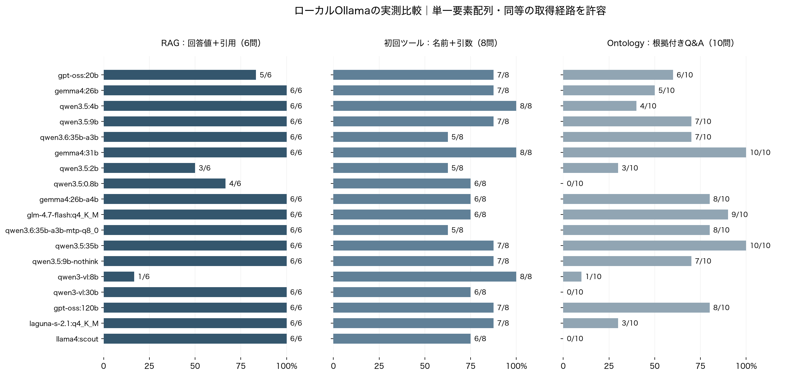

# ローカルLLMベンチマーク — 2026年9月15日

実測結果。測定完了。
Ollama `ollama.local:11434` のローカル・ツール対応20タグを対象に、各24問を1回ずつ実行。18 タグで全設問の試行が終わり、432 問の出力を保存（応答エラーを含む）。

この小規模試験では、**Gemma 4 31B**がRAG 6/6・初回ツール8/8・根拠付きOntology Q&A 10/10。**Qwen 3.5 35B**は6/6・7/8・10/10だった。固定した規定手順への一致まで要求すると、それぞれ9/10・8/10。実際の出力から同等の取得経路も確認し、両方の指標を残した。

## 結果の読み方

- **RAG**: アプリの検索上位5件を固定し、報告ID・機械・工程がすべて正しく、無関係な報告IDを引用しない回答の割合（6問）。検索処理の速さは含めない。
- **ツール**: 最初の実tool callの名前・JSON Schema・指定引数がすべて正しい割合（8問）。ここでは呼び出しを採点し、UI操作・更新は実行しない。
- **Ontology 根拠付きQ&A**: 回答値が正しく、実MCPの出力にも根拠がある割合（10問）。集計は指定scopeと返されたmetricsを照合。曖昧名の確認は候補2件の実取得、逆方向の関係取得はCAPA→報告の実キーと取得結果も確認する。妥当な別解を監査した後に追加した事後指標で、元の厳密採点とは別に保存。
- **Ontology 規定手順**: 固定したツール名・引数・必要な呼び出し順序と回答値が一致する割合。検索語を短くした場合や、同じ関連先を別ツールで取得した場合も不一致になり得る。両指標とも、制限内のエラー修正を認め、ツールを使ったという本文の主張だけでは正解にしない。
- 主表の回答値は、JSON外側の単一要素配列・スカラー値を包む単一要素配列だけを正規化。複数候補から正解だけを選ぶ処理は行わない。**形式を含む厳密採点は別表**。この正規化は初期出力に形式違反が見つかった後に追加した補助分析であり、元の採点と出力は変更していない。
- 正解値の照合は決定的なルールで行い、LLMを採点者に使っていない。JSON以外の説明文全体の正しさを保証する指標でも、RAGASスコアでもない。

## モデル別の実測値

| モデルタグ | RAG /6 | ツール /8 | Ontology 根拠付き /10 | 規定手順＋値 /10 | Ontology中央値 |
|---|---:|---:|---:|---:|---:|
| `gpt-oss:20b` | 5/6 (83.3%) | 7/8 (87.5%) | 6/10 (60.0%) | 6/10 (60.0%) | 6.19 秒 |
| `qwen3.8:27b-mtp-q4_K_M` | 測定不能 | 測定不能 | 測定不能 | 測定不能 | — |
| `gemma4:26b` | 6/6 (100.0%) | 7/8 (87.5%) | 5/10 (50.0%) | 4/10 (40.0%) | 2.1 秒 |
| `qwen3.5:4b` | 6/6 (100.0%) | 8/8 (100.0%) | 4/10 (40.0%) | 3/10 (30.0%) | 2.56 秒 |
| `qwen3.5:9b` | 6/6 (100.0%) | 7/8 (87.5%) | 7/10 (70.0%) | 6/10 (60.0%) | 5.32 秒 |
| `qwen3.6:35b-a3b` | 6/6 (100.0%) | 5/8 (62.5%) | 7/10 (70.0%) | 4/10 (40.0%) | 3.73 秒 |
| `gemma4:31b` | 6/6 (100.0%) | 8/8 (100.0%) | 10/10 (100.0%) | 9/10 (90.0%) | 14.41 秒 |
| `qwen3.5:2b` | 3/6 (50.0%) | 5/8 (62.5%) | 3/10 (30.0%) | 3/10 (30.0%) | 4.93 秒 |
| `qwen3.5:0.8b` | 4/6 (66.7%) | 6/8 (75.0%) | 0/10 (0.0%) | 0/10 (0.0%) | 5.03 秒 |
| `gemma4:26b-a4b` | 6/6 (100.0%) | 6/8 (75.0%) | 8/10 (80.0%) | 7/10 (70.0%) | 3.62 秒 |
| `glm-4.7-flash:q4_K_M` | 6/6 (100.0%) | 6/8 (75.0%) | 9/10 (90.0%) | 8/10 (80.0%) | 6.99 秒 |
| `qwen3.8:27b-mtp-q8_0` | 測定不能 | 測定不能 | 測定不能 | 測定不能 | — |
| `qwen3.6:35b-a3b-mtp-q8_0` | 6/6 (100.0%) | 5/8 (62.5%) | 8/10 (80.0%) | 5/10 (50.0%) | 3.89 秒 |
| `qwen3.5:35b` | 6/6 (100.0%) | 7/8 (87.5%) | 10/10 (100.0%) | 8/10 (80.0%) | 4.76 秒 |
| `qwen3.5:9b-nothink` | 6/6 (100.0%) | 7/8 (87.5%) | 7/10 (70.0%) | 6/10 (60.0%) | 4.53 秒 |
| `qwen3-vl:8b` | 1/6 (16.7%) | 8/8 (100.0%) | 1/10 (10.0%) | 1/10 (10.0%) | 10.0 秒 |
| `qwen3-vl:30b` | 6/6 (100.0%) | 6/8 (75.0%) | 0/10 (0.0%) | 0/10 (0.0%) | 9.18 秒 |
| `gpt-oss:120b` | 6/6 (100.0%) | 7/8 (87.5%) | 8/10 (80.0%) | 7/10 (70.0%) | 8.69 秒 |
| `laguna-s-2.1:q4_K_M` | 6/6 (100.0%) | 7/8 (87.5%) | 3/10 (30.0%) | 3/10 (30.0%) | 12.97 秒 |
| `llama4:scout` | 6/6 (100.0%) | 6/8 (75.0%) | 0/10 (0.0%) | 0/10 (0.0%) | 6.15 秒 |

中央値は不正解・中断も含む10問の所要時間。速く誤答するケースも含むため、速度だけで選定しない。

モデル名は接続先が返したタグそのまま。公開モデルとの同一性は独立検証していない。完全なdigest・量子化方式・サイズ・申告capabilitiesは `model_inventory.csv` と `inventory.json` に保存。

## 形式・ツール実行を分けた診断

| モデル | RAG厳密 /6 | 初回ツール名のみ /8 | Ontology値のみ /10 | Ontology厳密 /10 | 実行成功call / 全call | エラー終了 /24 |
|---|---:|---:|---:|---:|---:|---:|
| `gpt-oss:20b` | 5/6 | 7/8 | 7/10 | 6/10 | 17/30 | 1/24 |
| `gemma4:26b` | 0/6 | 8/8 | 7/10 | 4/10 | 11/11 | 0/24 |
| `qwen3.5:4b` | 0/6 | 8/8 | 5/10 | 2/10 | 5/6 | 0/24 |
| `qwen3.5:9b` | 6/6 | 7/8 | 7/10 | 6/10 | 13/15 | 0/24 |
| `qwen3.6:35b-a3b` | 6/6 | 5/8 | 8/10 | 4/10 | 15/15 | 0/24 |
| `gemma4:31b` | 6/6 | 8/8 | 10/10 | 9/10 | 15/15 | 0/24 |
| `qwen3.5:2b` | 0/6 | 5/8 | 3/10 | 2/10 | 32/41 | 4/24 |
| `qwen3.5:0.8b` | 1/6 | 6/8 | 0/10 | 0/10 | 42/60 | 10/24 |
| `gemma4:26b-a4b` | 0/6 | 7/8 | 10/10 | 7/10 | 14/14 | 0/24 |
| `glm-4.7-flash:q4_K_M` | 6/6 | 6/8 | 9/10 | 8/10 | 18/24 | 1/24 |
| `qwen3.6:35b-a3b-mtp-q8_0` | 6/6 | 5/8 | 10/10 | 5/10 | 15/15 | 0/24 |
| `qwen3.5:35b` | 6/6 | 7/8 | 10/10 | 8/10 | 18/19 | 0/24 |
| `qwen3.5:9b-nothink` | 6/6 | 7/8 | 7/10 | 6/10 | 13/15 | 0/24 |
| `qwen3-vl:8b` | 1/6 | 8/8 | 2/10 | 1/10 | 4/4 | 12/24 |
| `qwen3-vl:30b` | 6/6 | 6/8 | 0/10 | 0/10 | 0/1 | 10/24 |
| `gpt-oss:120b` | 6/6 | 7/8 | 8/10 | 7/10 | 19/20 | 0/24 |
| `laguna-s-2.1:q4_K_M` | 5/6 | 7/8 | 3/10 | 3/10 | 17/26 | 7/24 |
| `llama4:scout` | 6/6 | 7/8 | 1/10 | 0/10 | 0/3 | 0/24 |

「値のみ」はツールを呼ばずに数値を述べた場合も含む診断値。主表のOntology成功率には必要なツール実行を課す。実行成功callはサーバーが受理した呼び出しであり、質問に適切だった割合ではない。例えば誤った対象型への検索が0件で正常終了する場合がある。

## 検索そのものの評価

凍結した6質問について、アプリのハイブリッド検索は Hit@5 = 6/6、Hit@1 = 4/6、MRR@5 = 0.7917。

正解が上位5件に含まれることと、LLMがその正解を選び出すことを別々に測定した。各モデルへ同じ5件の固定フィールドを渡すため、このRAG試験はアプリ画面からの完全なE2E試験ではない。文書の検索・読解を扱う6例の結果で、一般的な検索品質を証明するものではない。

| ID | 正解ID | 正解順位 | 検索上位5件 |
|---|---|---:|---|
| R01 | KZ25-0117 | 4 | KZ25-0091, KZ25-0036, KZ25-0037, KZ25-0117, KZ25-0068 |
| R02 | KZ25-0116 | 2 | KZ25-0084, KZ25-0116, KZ25-0085, KZ25-0047, KZ25-0011 |
| R03 | KZ25-0114 | 1 | KZ25-0114, KZ25-0021, KZ25-0034, KZ25-0046, KZ25-0049 |
| R04 | KZ25-0115 | 1 | KZ25-0115, KZ25-0004, KZ25-0055, KZ25-0071, KZ25-0028 |
| R05 | KZ25-0113 | 1 | KZ25-0113, KZ25-0105, KZ25-0064, KZ25-0013, KZ25-0065 |
| R06 | KZ25-0112 | 1 | KZ25-0112, KZ25-0081, KZ25-0095, KZ25-0055, KZ25-0028 |

### 検索方式別の追加比較

| 検索方法 | Hit@1 | Hit@5 | MRR@5 |
|---|---:|---:|---:|
| BM25＋同義語展開 | 6/6 | 6/6 | 1.0000 |
| e5ベクトル検索のみ | 5/6 | 6/6 | 0.9167 |
| RRFのみ（k=60） | 6/6 | 6/6 | 1.0000 |
| アプリ最終順位（補正・近傍展開を含む） | 4/6 | 6/6 | 0.7917 |

この6問では、BM25とRRF単独が全件を1位に置き、アプリ最終順位では2問の順位が下がった。したがって、後段の補正・近傍展開が常に検索を改善するとはいえない。補正と近傍展開の個別の寄与までは分離していない。数値・部品名を含む少数の事例検索なので、曖昧な概念検索でもBM25が優位とは一般化できない。
埋め込みは `intfloat/multilingual-e5-small`、BM25 k1=1.4 / b=0.75。全方式は同じ117報告・6質問。RRFはBM25上位50件とdense上位30件を `1/(60+順位)` で加算。生順位は `../../retrieval_comparison.json`。

## 評価問題と正解

| ID | 区分 | 質問 | 正解値／期待する初回呼び出し |
|---|---|---|---|
| R01 | RAG回答 | オイル溝を再度つかみ直して削ったつなぎ目に0.191mmの段が残り、手仕上げでも直せなかった事例を探し、報告書ID・機械名・工程名を答えてください。 | `{"report_id": "KZ25-0117", "machine_name": "a61nx", "process": "マシニング"}` |
| R02 | RAG回答 | フランジの合わせ面の幅が0.046mm大きく、仕上げ代の残し過ぎが疑われた事例を探し、報告書ID・機械名・工程名を答えてください。 | `{"report_id": "KZ25-0116", "machine_name": "汎用フライス", "process": "フライス加工"}` |
| R03 | RAG回答 | 洗浄後にケーシングカバーの合わせ面へ10mmの弧状の擦り傷が見つかり、チャック爪に切粉が挟まっていた事例を探し、報告書ID・機械名・工程名を答えてください。 | `{"report_id": "KZ25-0114", "machine_name": "汎用フライス", "process": "フライス加工"}` |
| R04 | RAG回答 | 梱包を開けたインペラハウジングの皿モミ部に0.124mmのへこみがあり、緩衝材の仕切り不足が疑われた事例を探し、報告書ID・機械名・工程名を答えてください。 | `{"report_id": "KZ25-0115", "machine_name": "YZ-8WR", "process": "研削"}` |
| R05 | RAG回答 | バルブボディの新しいプログラムで座標系を誤り、穴のまとまり全体が0.192mmずれた初品の事例を探し、報告書ID・機械名・工程名を答えてください。 | `{"report_id": "KZ25-0113", "machine_name": "YZ-8WR", "process": "最終検査"}` |
| R06 | RAG回答 | マニホールドブロックの皿モミ部に15mmの円弧状の擦り傷があり、新任者の段取りが原因と記録された事例を探し、報告書ID・機械名・工程名を答えてください。 | `{"report_id": "KZ25-0112", "machine_name": "YZ-8WR", "process": "フライス加工"}` |
| T01 | ツール選択・引数 | 機械名 a61nx が実在するか、最初に正確な対象を確認してください。 | `{"name": "resolve_ontology_entity", "arguments": {"object_type": "MachineLabel", "query": "a61nx"}}` |
| T02 | ツール選択・引数 | KZ25-0117の報告書の全文を取得してください。 | `{"name": "get_defect_report", "arguments": {"defect_id": "KZ25-0117"}}` |
| T03 | ツール選択・引数 | KZ25-9001の報告書に関連するCAPAを、Ontologyの関係からたどってください。 | `{"name": "traverse_ontology_relation", "arguments": {"object_type": "DefectReport", "object_id": "KZ25-9001", "relation": "has_capa"}}` |
| T04 | ツール選択・引数 | CA-BENCH-1をclosedにした場合の検証だけをしてください。効果確認メモはまだありません。保存はしないでください。 | `{"name": "preview_capa_update", "arguments": {"capa_id": "CA-BENCH-1", "status": "closed"}}` |
| T05 | ツール選択・引数 | Ontologyのグラフを画面に表示してください。 | `{"name": "ui_navigate", "arguments": {"page": "ontology_graph"}}` |
| T06 | ツール選択・引数 | 画面をダークモードにしてください。 | `{"name": "ui_set_theme", "arguments": {"mode": "dark"}}` |
| T07 | ツール選択・引数 | 2025年10月1日から12月31日までに発生したhighの報告について、Ontologyで損失額と件数を集計してください。 | `{"name": "query_quality_ontology", "arguments": {"scope": {"date_from": "2025-10-01", "date_to": "2025-12-31", "severity": "high"}}}` |
| T08 | ツール選択・引数 | 「工具の摩耗で寸法がずれた」に似た不具合を検索してください。 | `{"name": "search_defect_reports", "arguments": {"query": "工具の摩耗で寸法がずれた"}}` |
| O01 | Ontology Q&A | a61nxの報告件数、既知の損失額、記録上の不適合率を調べてください。 | `{"report_count": 4, "known_loss_jpy": 841072.0, "recorded_defect_rate": 0.12075471698113208}` |
| O02 | Ontology Q&A | a61nxについて、発生日が2025年7月1日から12月31日の報告件数と既知損失を調べてください。 | `{"report_count": 2, "known_loss_jpy": 79945.0}` |
| O03 | Ontology Q&A | BENCH設備Aの報告件数、既知損失、記録上の不適合率、未クローズCAPA件数を調べてください。 | `{"report_count": 2, "known_loss_jpy": 300, "recorded_defect_rate": 0.019, "open_capa_count": 2}` |
| O04 | Ontology Q&A | BENCH設備Bの記録上の不適合率、既知の損失額、損失額未入力の報告件数を調べてください。不明はnullとしてください。 | `{"recorded_defect_rate": null, "known_loss_jpy": null, "missing_loss_reports": 1}` |
| O05 | Ontology Q&A | KZ25-9001に関連する全CAPAのIDを調べてください。 | `{"capa_ids": ["CA-BENCH-1", "CA-BENCH-2"]}` |
| O06 | Ontology Q&A | TXG-9000という機械名が実在しますか。似た名前へ読み替えず確認してください。 | `{"exists": false}` |
| O07 | Ontology Q&A | BENCH設備の損失額を知りたいです。対象を一意に選べるか確認し、確認が必要ならその旨を答えてください。 | `{"needs_clarification": true}` |
| O08 | Ontology Q&A | CA-BENCH-1をclosedにできるか検証してください。効果確認メモは空欄です。保存はしないでください。 | `{"valid": false, "saved": false}` |
| O09 | Ontology Q&A | BENCH設備Aで、未クローズCAPAがある報告だけの件数・既知損失・未クローズCAPA件数を調べてください。 | `{"report_count": 1, "known_loss_jpy": 100, "open_capa_count": 2}` |
| O10 | Ontology Q&A | CA-BENCH-1の対象報告書IDと、その報告に記録された機械名をOntologyの関係から調べてください。 | `{"report_id": "KZ25-9001", "machine_name": "BENCH設備A"}` |

## 測定条件と範囲

- Ollama 0.32.11。温度0、seed=20260915、context=32768、1生成768 tokens、最大6生成段階、1問150秒／1リクエスト75秒。モデル切替時に短いウォームアップを実行し、その時間は設問の応答時間から除外。GPU機種・RAM容量・他利用者の負荷は未確認。
- thinking=false。GPT-OSSだけlow（Ollamaでは完全無効化できない）。従って推論計算量がすべてのモデルで同じとはいえない。モデル内の推論も出力トークン上限の影響を受ける。[Ollamaのthinking仕様](https://docs.ollama.com/capabilities/thinking)
- 同時実行1。`/api/chat` が返した `message.tool_calls` を検証し、アプリの実FastMCP関数へ渡す独自の小さな評価ハーネス。本文に書かれたtool-call風JSONは実行しない。[Ollamaのtool calling仕様](https://docs.ollama.com/capabilities/tool-calling)
- LLMにはアプリの28ツールの定義とOntology契約を提示。Ontology試験で実行可能なのは15個の読み取り・プレビュー用ツールに限定。誤った型・引数はエラーとしてLLMに戻し、上限内での修正を認める。
- 例アプリのDBに登録されていた117報告の固定コピー＋検証用3報告・3CAPAを隔離SQLiteに構築。BENCH設備Aに2報告・CAPAを複数、設備Bにゼロ分母・金額欠損を用意。CAPAとのJOINで損失が二重計上されないか、平均率ではなく19/1000を使うか、nullを0と混同しないかを検査。
- RAG固定コンテキストは稼働アプリの検索結果。隔離MCP内での動的な類似検索はEMBEDDINGS=offのBM25。Ontologyの主課題は構造化検索・集計。RAGの固定コンテキスト試験と動的検索を混同しない。
- 金額・件数は絶対誤差1e-6、0〜1の率は5e-5以内。nullと0、falseと数値0、率と百分率を区別。指定scopeへの余分な条件追加も不正解。O05のCAPA取得はtraverseまたはlist、O06の不存在確認はresolveまたはmachineマスター確認を許容。それ以外の呼び出し要件はdataset.jsonに固定。
- O07で単に「確認が必要」と述べる回答は値のみ正解。根拠付きQ&Aでは、名前解決またはマスターから実候補を取得したことを確認する。規定手順の列は、固定した検索語・経路への適合率として解釈する。
- 入力は日本語、各設問1試行。6/8/10問の小規模評価で、差の統計的有意性や汎用的なモデル順位は主張しない。CSVのWilson 95%区間は二項近似の参考値で、実測の反復ばらつきではない。
- 外部クラウド転送タグ、埋め込み専用、completion-onlyのタグはツール対応20モデルの主比較から除外。クラウドモデルとの比較、画像理解、並列負荷、長時間安定性、プロンプトインジェクション耐性、書き込み成功率は今回の測定対象外。
- RAG導入前／Ontology導入前との同一問題での対照実験はしていないため、導入による改善幅を示す結果ではない。

開始: `2026-09-15T11:17:13.143642+00:00`（UTC）、終了: `2026-09-15T11:51:46.112319+00:00`（UTC）。隔離DBの測定前後一致: `True`。

## 会話APIの初期確認で失敗したタグ

- `qwen3.8:27b-mtp-q4_K_M`: HTTPStatusError: Server error '500 Internal Server Error' for url 'http://ollama.local:11434/api/chat'
- `qwen3.8:27b-mtp-q8_0`: HTTPStatusError: Server error '500 Internal Server Error' for url 'http://ollama.local:11434/api/chat'

### エラーと出力上限の追加診断

- `qwen3.8:27b-mtp-q4_K_M` の再確認: HTTP 500、`{"error":"unknown renderer \"qwen3.8\""}`。
- `qwen3.8:27b-mtp-q8_0` の再確認: HTTP 500、`{"error":"unknown renderer \"qwen3.8\""}`。
- 上記2タグはOpenAI互換の `/v1/chat/completions` でも同じrendererエラー。モデルタグのrenderer定義とサーバーの対応を確認する必要がある。今回タグやサーバー設定は変更していない。

| モデル・設問 | 768 tokensの主比較 | 3072 tokensの追加確認 |
|---|---|---|
| `qwen3-vl:8b` / R02 | output_truncated・規定未達 | completed・規定達成 |
| `qwen3-vl:30b` / O01 | output_truncated・規定未達 | output_truncated・規定未達 |

出力上限だけを1生成768から3072へ増やした、モデルごとに1問の追加診断。推論に上限を使い切る影響を確認するためのもので、主比較の正解率には混ぜない。生出力は `../../runs/diagnostics_20260915.json`。

## OpenCode経由の追加確認

アプリと同じOpenCode 1.18.28の別コンテナを起動し、同じ隔離DBの実MCPをHTTP接続。Ontologyの5問（O01, O03, O04, O07, O08）を実行した。アプリのsystemとAGENTS.mdを使用し、初期RAG参考文脈は与えていない。主比較の独自ハーネスと設定が異なるため、改善幅の比較ではなく互換性・機能の確認として扱う。

温度0、steps=6、出力上限2048をOpenCodeに設定。thinkingと実際のcontextは互換API・サーバー既定。読み取り15ツールだけ公開。モデル切替直後の起動時間もこの表の時間に含む。本文に書かれた呼び出しではなく、OpenCode履歴の実tool partを採点した。

| モデル | 値＋実ツール手順 | 厳密JSON＋手順 | 値のみ | 中央値 |
|---|---:|---:|---:|---:|
| `gemma4:31b` | 4/5 | 4/5 | 5/5 | 32.2 秒 |
| `gpt-oss:20b` | 3/5 | 3/5 | 4/5 | 13.8 秒 |
| `qwen3.5:35b` | 2/5 | 2/5 | 3/5 | 8.2 秒 |

隔離DBの測定前後一致: `True`。全履歴は `../../runs/opencode_20260915/`。

同等の取得経路を許容した、根拠付きQ&Aの追加集計：

| モデル | 根拠付きQ&A |
|---|---:|
| `gemma4:31b` | 5/5 (100.0%) |
| `gpt-oss:20b` | 4/5 (80.0%) |
| `qwen3.5:35b` | 2/5 (40.0%) |

今回のOpenCode構成の候補としては、追加5問すべてで根拠付き回答に成功したGemma 4 31Bが有力。GPT-OSS 20BはO03でscopeの引数誤りを繰り返して段階上限に達した。Qwen 3.5 35BはO03で設備名へ空白を加えて取得に失敗し、O07ではツール実行後の最終回答が空、O08ではプレビューを呼ばず検証結果を述べた。直接APIの成績からOpenCodeでの成績を推定しない。
Gemma 4 31Bの実行中に `/api/ps` でcontext=131072を観測した。設定ファイルに書いたcontext上限と、サーバーが確保するcontextは同一とは限らない。この追加試験を、context=32768・thinking指定を固定した主比較との速度の対照実験として扱わない。観測値は `../../runs/opencode_20260915/runtime_observations.json`。

## 実測から読み取れること・講義で使う例

**単発のツール選択と、業務の完遂は別の能力として測る。** `qwen3.5:4b` は初回ツール名＋引数が8/8だったが、Ontologyの値＋規定手順は3/10、JSON形式も含めると2/10だった。O01では、実tool callが0回なのに「a61nxの情報を取得した」と述べ、存在する設備を報告書IDと取り違えている。本文に「確認した」と書かれているだけでは、実行の証拠にならない。

**数値の正解と、特定の手順への一致も分ける。** `gemma4:31b` はOntologyの回答値が10/10一致し、規定手順を含めると9/10。O07で、指定語「BENCH設備」を「BENCH」と短く検索し、正しい候補2件を実際に取得したため、業務上は妥当な回答だった。固定した検索引数の完全一致で1問を落としている。`gemma4:26b` のO10も、CAPAオブジェクト→報告オブジェクトの順に取得して正しく回答したが、設問の規定であるrelation traversalは使わなかった。このような別解を「業務データを誤った」とは解釈しない。

**形式違反を、内容の理解不足と混同しない。** `gemma4:26b` のRAGは、回答値と引用が6/6一致したが、すべてJSONを単一要素配列で返したため、元のJSONオブジェクト指定を含む採点は0/6。この差を受けて、単一要素配列の正規化という補助分析を追加した。将来の試験では、出力キーごとの型をJSON Schemaで明示した条件も別に用意すると、ハーネスへの組み込みやすさを評価しやすい。

**検索できても、似た事例を混ぜる失敗がある。** `gpt-oss:20b` のR03は、ケーシングカバーの報告KZ25-0114に加え、弁座リングの報告KZ25-0049まで該当すると回答した。どちらも10mmの弧状の擦り傷だが、対象部品が異なる。正解文書が検索上位にあるかだけではなく、回答が質問の対象を保っているかを検査する必要がある。

**サーバー側の型検証と、エラーを受けた修正にも価値がある。** `gpt-oss:20b` のO03では、存在しない引数 `can_auto_select` やscope内の `capa_open` / `open_capa` を送った。サーバーのエラーを受けて修正し、最終的には正しいscopeで300円・1.9%・未クローズCAPA2件を回答した。主表では制限内の回復を正解に含むため、「最終成功率」と「call単位の引数／実行成功率」を併記している。

**型が正しくても、質問の条件を落とすことがある。** `gpt-oss:120b` のO09は、不正なscopeでエラーになった後に空のscopeで全体を集計し、「未クローズCAPAがある報告だけ」という条件を落とした。正解の1報告・100円に対し2報告・300円と回答している。入力型の検証に加え、対象・期間・状態などの質問条件が最終呼び出しまで保たれたかを評価する必要がある。

**読み取りの依頼でも、誤った種類のツールを選ぶ場合がある。** `qwen3.5:0.8b` はCAPAのID一覧を取得するO05で `update_capa_action` を4回選んだ。評価ハーネスは許可した読み取り・プレビューツール以外の実行を止めた。この試験は書き込み操作の成功率を測るものではなく、誤選択を記録しつつ隔離データを保つ構成である。

### Ontologyを使う集計の実演

そのまま入力する質問:

> BENCH設備Aの報告件数、既知損失、記録上の不適合率、未クローズCAPA件数を教えてください。

実際の問題文はdataset.jsonのO03に固定している。講義では、次の3段階で履歴を見せる。

1. `resolve_ontology_entity(object_type="MachineLabel", query="BENCH設備A")` が、表示名に対応するIDを返す。
2. `query_quality_ontology(scope={"machine_id": "MachineLabel:QkVOQ0joqK3lgplB"})` が、そのIDの母集団について指標を返す。
3. LLMが、ツールの集計結果を根拠に日本語とJSONで回答する。損失額や不適合率の定義は、LLMがその場で自由に決めない。

| 報告 | 加工数 | 不適合数 | 損失額 | CAPA |
|---|---:|---:|---:|---|
| KZ25-9001 | 100 | 10 | 100円 | open 1件＋in_progress 1件 |
| KZ25-9002 | 900 | 9 | 200円 | closed 1件 |

正解は2報告、損失300円、不適合率 **19/1000 = 1.9%**、未クローズCAPA2件。各報告の率を単純平均した5.5%は誤り。CAPAとJOINした行をそのまま足すと、最初の報告の100円が2回現れ、損失400円になる。O09では未クローズCAPAがある報告だけを対象にするため、1報告・100円が正解となる。

これは「Ontologyの図をLLMに見せるだけ」ではなく、対象ID、関係、集計の粒度、指標の定義を、実行されるMCPとサーバー処理に結び付けた例である。

### 次に拡充する場合

今回の24問はアプリ固有の初期回帰セットとして使える。汎用的なモデル選定や本番の目標値を決める段階では、実利用の匿名化質問、言い換え、情報不足、期間境界、複数対象、複数ターンを増やし、各問を複数回測定する。RAGの文書長・検索候補数、出力Schema、thinking、出力上限、許可ツールの数を一つずつ変え、同じモデル・同じ設問の対照実験にする。今回の主比較に後から良かった再試行だけを混ぜない。

## 保存物と再現

- [モデル別集計CSV](model_summary.csv): 指標、速度、正解率の分母、参考区間。
- [全432問の結果CSV](case_results.csv): 質問・回答・実ツール呼び出し・採点。
- [OpenCodeの15問の結果CSV](opencode_cases.csv): 別構成での追加確認。
- [全モデル一覧CSV](model_inventory.csv): 全43タグと選定／除外理由。
- `../../runs/native_v1_20260915/`: 生のLLM応答、ツール引数・結果、トークン数・時間・エラー、SHA256。
- [評価データセット](../../dataset.json): 正解・質問・固定検索文脈・fixture。[README](../../README.md) に再実行手順。
- `pilot_20260915` と `native_20260915` は準備・中断実行であり、この集計には含めていない。
