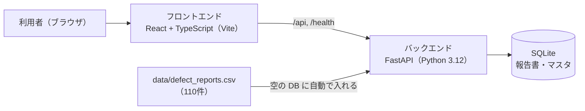

# DefectReport AI — 要件定義書

> 仕様書 v1.1（第2回の終わり(確かめて直した版)）。前の版から変わったところは `変更点.md`。

本書は、製造業の不適合報告書（不良報告書）を扱う Web アプリ **DefectReport AI** の要件を定義する。講座（全6回）の第2回から第6回で、同じアプリを回ごとに育てる。本書の各版は、その回の時点のアプリの姿を書く（版と回の対応は §10）。

関連文書:
- `00_帳票の調査.md` — 元の帳票（Excel 110件）の様式・項目とセル・表記の揺れ・欠損・件数
- `02_機能仕様書.md` — 機能ごとの画面・操作の流れ・入出力・エラー時の動き、ユースケース
- `03_データモデル設計書.md` — 表と列の定義（正本）、用語表と関係図
- `04_API設計書.md` — REST と SSE の入出力（正本）
- `05_UI設計書.md` — 画面一覧・画面遷移・各画面の状態
- `07_試験・運用仕様書.md` — 受け入れ条件（AC）と確かめ方

---

## 1. 背景

製造業の品質保証（QA）の現場では、不良や不具合が起きるたびに不適合報告書（NCR: Non-Conformance Report）を作る。報告書には、発生日・客先・工程・機械・作業者・部品・数量・不具合の内容・原因・対策・損失の費用など、品質改善に直結する情報がある。しかし、次の課題がある。

| # | 課題 | 具体的な状況 |
|---|---|---|
| 1 | 報告書が Excel のまま埋もれている | 1件1ファイルの帳票が個人のフォルダやファイルサーバーに散らばり、横断して集計・検索できない |
| 2 | データにする手間 | 集計するには誰かが Excel から転記する必要があり、手間がかかり、写し間違いも起きる |
| 3 | 過去の事例を活かせない | 「同じ機械で似た不良が前にあったか」を調べる手段がなく、人の記憶に頼っている |
| 4 | 原因の分析（4M）が人によって違う | Man／Machine／Material／Method のどれが原因かの分類と改善の案が、担当者の経験でばらつく |
| 5 | 経営層が全体の傾向をつかめない | 不良率の推移、損失の金額、機械や工程の偏り、再発の兆しが見えず、判断が遅れる |

「帳票 → データ → 知見 → 判断」の流れが途中で切れている。本アプリは、この流れを段階的につなぐ。

---

## 2. 目的

DefectReport AI は、この版で次のことを実現する。

1. **報告書をデータにして探せるようにする** — 帳票（Excel）110件の内容を DB に入れ、一覧と詳細で、条件を組み合わせて探せるようにする。

講座の目的としては、受講者がこのアプリを題材に「仕様書を先に書く → AI（Claude Code）に作らせる → 確かめる → 見つかった穴を仕様書に戻す」流れを、回ごとに繰り返して身につけることにある。

---

## 3. 対象ユーザー

本アプリはログインを持たない（演習用）。次の3つの利用者像を想定する。画面は利用者像で制限しない。

| 利用者像 | 立場 | 主な関心 | この版で主に使う機能 |
|---|---|---|---|
| 品質保証担当（QA） | 品質保証部門 | 不良の原因の究明、過去の事例の調査、対策の立案 | 報告書の一覧（絞り込み）・詳細 |
| 経営者・管理者 | 工場長・経営層 | 全体の傾向、損失の金額、リスクの早い把握 | 報告書の一覧（期間・機械で絞り込み） |
| 現場担当 | 製造・検査 | 起きた不良を早く記録する | 報告書の一覧・詳細（記録は帳票の Excel で行う） |

---

## 4. システム全体像

手元の PC で、フロントエンドとバックエンドを別々に起動して使う。

技術スタック:

| 層 | 技術 |
|---|---|
| フロントエンド | React 19 + TypeScript（Vite）・MUI・React Router。絞り込みの状態は URL クエリに持つ |
| バックエンド | FastAPI（Python 3.12）・SQLAlchemy・Pydantic |
| データ | SQLite（`DATABASE_URL` を設定すれば別の RDB。表は同じ） |
| 実行 | 手元の PC（Python の venv ＋ npm）。backend はポート 8000、frontend は 5173（`/api` と `/health` を 8000 へ転送） |

---

## 5. 機能要件（FR）

要件は `FR-<グループ>-<番号>` で識別する。入出力の正確な形は `04_API設計書.md` に書く。

### 5.1 共通（FR-SYS）

| ID | 要件 | 対応 API |
|---|---|---|
| FR-SYS-01 | `GET /health` で稼働状態（`status`）と報告書の件数（`reports`）を返す | `GET /health` |
| FR-SYS-02 | 起動したとき報告書の表が空なら、模擬データ（`data/defect_reports.csv`、110件）を自動で入れる（シード）。続けて、マスタが空ならマスタを作る（FR-MA-01） | （サーバー） |

### 5.2 報告書（FR-CR）

| ID | 要件 | 対応 API |
|---|---|---|
| FR-CR-01 | 報告書の一覧を表示できる。キーワード（報告書番号・部品番号・部品名・不具合内容の部分一致）・状態・重大度・機械・工程・4M・期間（発生日）で絞り込み、並べ替え（既定は発生日の新しい順）、ページ送り（既定50件・最大500件）ができる | `GET /api/reports` |
| FR-CR-03 | 報告書の詳細を表示できる。全項目と不良率 `defect_rate`（不適合数 ÷ 加工数）を出す。無い番号は 404 | `GET /api/reports/{defect_id}` |

一覧の決まり:
- 絞り込みの条件は AND で組み合わせる（OR にしない）。
- 期間は発生日を date 型で比べ、両端の日を含む。形の不正な日付（例 `2025-13-01`）や `date_from` > `date_to` は 422 と理由を返す。**例アプリには未実装**（例アプリは形の不正な日付を無視して絞り込まず、`date_from` > `date_to` は 200 で0件を返す）。
- 該当が0件のときは「0件」を表示する（空白にしない）。
- 読み込みに失敗したときは、表と件数を消し、原因と「再試行」を出す。0件の表示と区別する。**例アプリには未実装**（例アプリは原因を出すが、表と「条件に一致する報告書がありません」も残り、「再試行」は無い）。
- 絞り込みの選択肢（機械・工程）は、画面に書き込まずマスタ（FR-MA-01）から作る。

### 5.3 マスタ（FR-MA）

絞り込みの選択肢は、DB のマスタ（`masters` 表）に持つ。種類は客先（customer）・工程（process）・機械（machine）・作業者（operator）・現象（phenomenon）・要因（factor）の6つ。重大度・状態・4M は決まった値なのでマスタにしない。

| ID | 要件 | 対応 API |
|---|---|---|
| FR-MA-01 | マスタ6種を持ち、種類ごとに返す（各値の使用件数つき）。初回の起動で、取り込んだデータの値から作る。用語は用語表（`03_データモデル設計書.md`）を正本にする | `GET /api/masters` |

---

## 6. 業務の決まり

要件と画面が、同じ数え方をするための決まり。用語は `03_データモデル設計書.md` の用語表に合わせる。

- 「報告1件」と「不良品1個」を分ける。件数の単位は「件」、不適合数・加工数の単位は「個」。
- 期間は発生日（`occurrence_date`）で数え、両端の日を含む（報告日では数えない）。
- 報告書1件の不良率 `defect_rate` は 不適合数 ÷ 加工数。加工数が0なら null（画面は「—」）。

---

## 7. 非機能要件（NFR）

| ID | 分類 | 要件 |
|---|---|---|
| NFR-01 | 動作環境 | 受講者のノート PC で動くこと。外部のサービスを使わない |
| NFR-05 | データの規模 | 模擬データ110件（KZ25-0001〜KZ25-0110、発生日 2025-04-07〜2026-03-15）を前提とする。一覧は既定50件・最大500件 |
| NFR-06 | 再現性 | 模擬データは乱数を固定して生成する（`data/generate_mock_data.py`）。受け入れ条件の期待値は、この CSV から数えた値にする |
| NFR-08 | 読みやすさ | AI が作ったコードを受講者が読んで直せるよう、簡単な構成と名前にする。過度な抽象化をしない |
| NFR-09 | 移植性 | SQLite とローカルのファイルだけで動き、専用のサーバーを要らない。GPU は要らない |
| NFR-10 | 言語 | 画面とデータは日本語 |
| NFR-13 | 画面の幅 | PC の画面（幅 1280px 以上）を前提とする |

---

## 8. 受け入れ条件（AC）

受け入れ条件の全体（操作・期待値・確かめ方）は `07_試験・運用仕様書.md` に、版ごとの番号（`AC-v10-01` など）で書く。ここには要件ごとの主な期待値を書く。期待値は元データ（`data/defect_reports.csv`、110件）から数えた値にする。

期待値は元データから数えて書く。計画や AI が示した数字は、元データで検算してから使う。「例アプリには未実装」と書いた条件は、完成形の例アプリでも満たしていない（演習で直す対象）。

| 要件 | 主な期待値 | `07` の番号 |
|---|---|---|
| FR-SYS-01・02 | 空の DB で起動すると `/health` の `reports=110` | AC-v10-01 |
| FR-CR-01 | 機械 a61nx は3件（KZ25-0019・KZ25-0043・KZ25-0056）。2025年9月は7件（KZ25-0042〜KZ25-0048）。a61nx かつ 2025年9月は KZ25-0043 の1件だけ（AND で絞る）。a61nx かつ 2025年10月は0件で、画面は0件を表示する | AC-v10-03〜06 |
| FR-CR-03 | KZ25-0043：発生日 2025-09-13、客先 翠峰重工業、工程 マシニング、機械 a61nx、部品 補機マウントリブ、加工数12・不適合数3、`defect_rate=0.25`（画面 25.00%）、現象 表面キズ、損失合計 60,581円。KZ25-9999 は 404 | AC-v10-07・08 |
| FR-CR-01（期間） | `date_from=2025-13-01` と `date_from` > `date_to` は 422 と理由（**例アプリには未実装**。例アプリは前者が200で110件、後者が200で0件）。`date_from=date_to=2025-09-17` は2件（両端の日を含む） | AC-v11-01〜03 |
| FR-CR-01（失敗の表示） | 読み込みに失敗したら表と件数を消し、原因と「再試行」を出す（**例アプリには未実装**） | AC-v11-04 |
| FR-MA-01 | 6種を返し、データの値がすべて入る（客先10・工程8・機械10・作業者29・現象12・要因10） | AC-v11-05 |

---

## 9. スコープ外（本アプリでは実装しない）

| 項目 | 扱い |
|---|---|
| 認証・認可（ログイン、ロール） | ローカルの演習用のため実装しない |
| 承認のワークフロー（報告書の申請・承認・差し戻し） | 状態は `open`／`in_progress`／`completed` の3つだけ |
| 多言語 | 日本語だけ |
| 本番への配置（クラウド、Kubernetes、CI/CD） | 手元の PC で動かすところまで |
| 通知・メールの送信・帳票の PDF 出力 | 対象外 |

---

## 10. 講座の回と仕様書の版

仕様書は1つの正本から、講座の回ごとに版を書き出す。x.0 はその回で足すことを先に書いた版、x.1 は作って確かめ、見つかった穴を戻した版（x.1 で新しい機能は足さない）。

| 版 | 講座 | その版の中身 | 主に足した要件 |
|---|---|---|---|
| v0.1 | 第1回 | 目的メモ（`作りたいアプリ.md`。困りごと・使う人・データ・最初にできること）。本書の外に置く | — |
| v1.0 | 第2回 前半 | 帳票の Excel（110件）を調べて書いた最初の仕様書。作る前 | FR-SYS-01・02、FR-CR-01・03、NFR-01・05・06・08・09・10・13（AC-v10-*） |
| v1.1 | 第2回 終わり | 土台を作って確かめ、見つかった穴を戻した版 | 期間の 422、0件と失敗の区別、FR-MA-01（AC-v11-*） |
