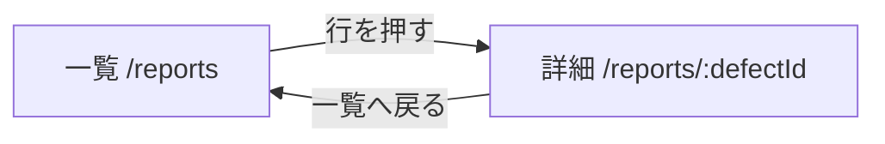

# DefectReport AI — 機能仕様書

> 仕様書 v1.1（第2回の終わり(確かめて直した版)）。前の版から変わったところは `変更点.md`。

本書は、機能ごとの画面・操作の流れ・入出力・エラー時の動きと、代表的なユースケースを定める。要件の番号（FR-・NFR-）は `01_要件定義書.md`、受け入れ条件の番号（AC-）は `07_試験・運用仕様書.md`、API の正確な入出力は `04_API設計書.md`、列の定義は `03_データモデル設計書.md`、画面の配置は `05_UI設計書.md` を正とする。

機能一覧:

| # | 機能 | 主な画面 | 中核の API |
|---|---|---|---|
| F2 | 報告書の一覧・詳細 | 一覧（`/reports`）・詳細（`/reports/:defectId`） | `/api/reports` |
| F7 | マスタ（選択肢） | 一覧の絞り込み | `GET /api/masters` |

---

## F2. 報告書の一覧・詳細

### 画面と操作の流れ

- **一覧（`/reports`）**：キーワード（報告書番号・部品番号・部品名・不具合内容）と絞り込み（状態・重大度・機械・工程・4M・期間）で探し、並べ替えとページ送り（1ページ 10・25・50件、既定25）をする。行を押すと詳細へ移る。
  - 絞り込み・並べ替えの状態は URL クエリに持つ。同じ URL を開けば同じ一覧になる。
  - 列：報告書ID・発生日・部品名・現象・機械・重要度・ステータス・不良率（小数2桁の %）。
  - 並べ替え：新しい順（既定）・古い順・損失額が大きい順・不良数が多い順（API の `sort=-defect_count`）。例アプリは API の並べ替えの対象に不適合数が無く、「不良数が多い順」が新しい順と同じになる（例アプリの既知の問題）。
  - 読込中は「読み込み中…」、0件は「条件に一致する報告書がありません」を出す。失敗したときは表と件数を消し、原因と「再試行」を出して、0件の表示と分ける（**例アプリには未実装**。例アプリは理由の下に表と「条件に一致する報告書がありません」も出し、「再試行」は無い）。
  - 機械・工程の選択肢はマスタ（`GET /api/masters`、F7）から作る。
- **詳細（`/reports/:defectId`）**：全項目を「基本情報」「不具合内容」「原因・4M分析」「対策」「費用」に分けて出し、不良率（小数2桁の %）を出す。値の無い項目は「—」。

### 入出力

- 一覧：`GET /api/reports?q=&status=&severity=&machine=&process=&category_4m=&date_from=&date_to=&limit=&offset=&sort=` → `{"total": int, "items": [Report]}`。`limit` 既定50・最大500、`sort` 既定 `-occurrence_date`（先頭の `-` で降順。対象は発生日・報告日・報告書番号・重大度・登録日時・損失合計・不適合数）。
- 詳細：`GET /api/reports/{defect_id}` → Report（全列＋`defect_rate`）。

### 入力の決まりとエラー時の動き

| 項目・状況 | 決まり | 違反・失敗のとき |
|---|---|---|
| 存在しない番号の詳細 | — | 404（「報告書が見つかりません」）。画面は理由を出す |
| 期間（`date_from`・`date_to`） | 発生日を date 型で比べ、両端の日を含む | 形の不正な日付や `date_from` > `date_to` は 422 と理由。**例アプリには未実装**（形の不正な日付は無視し、逆向きの期間は0件） |
| 該当0件 | — | 「条件に一致する報告書がありません」（エラーにしない） |
| 不良率 `defect_rate` | サーバーで計算（不適合数 ÷ 加工数）。保存しない | 加工数が0なら null、画面は「—」 |

---

## F7. マスタ（選択肢）

絞り込みの選択肢を、DB のマスタに持つ。種類は客先（customer）・工程（process）・機械（machine）・作業者（operator）・現象（phenomenon）・要因（factor）の6つ。重大度・状態・4M は決まった値なのでマスタにしない。

### 作り方と使い方

- 初回の起動で、報告書のシードのあとにマスタが空なら、データの値（種類ごとの DISTINCT）から作る。データの値は 客先10・工程8・機械10・作業者29・現象12・要因10。
- 一覧の絞り込み（機械・工程）の選択肢は `GET /api/masters` から作る。

### 入出力

- 全種類：`GET /api/masters` → `{"customer": [Master], "process": [Master], …}`。Master は `{id, category, name, sort_order, is_active, usage_count}`。並びは `sort_order`、次に名前。

---

## ユースケース

### UC-1. 品質保証担当：条件で報告書を探す

> QA の担当者は、機械 a61nx で2025年9月に出た不良を確かめたい。

1. 一覧（`/reports`）で、機械に「a61nx」、期間に 2025-09-01〜2025-09-30 を入れる。URL は `/reports?machine=a61nx&date_from=2025-09-01&date_to=2025-09-30` になる。
2. KZ25-0043 の1件だけが出る（機械 a61nx は全部で3件、2025年9月は全部で7件。AND で絞る）。
3. 行を押して詳細を開く。部品は補機マウントリブ、現象は表面キズ、加工数12・不適合数3 で不良率 25.00%、損失合計は ¥60,581。
4. 期間を 2025-10-01〜2025-10-31 に変えると0件になり、「条件に一致する報告書がありません」が出る。

**要件**：FR-CR-01・03（AC-v10-03〜07）。
