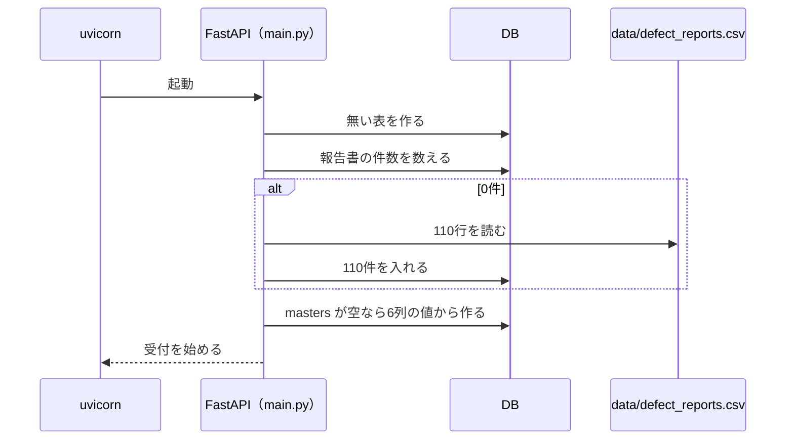

# DefectReport AI — API設計書

> 仕様書 v1.1（第2回の終わり(確かめて直した版)）。前の版から変わったところは `変更点.md`。

FastAPI のバックエンド（`app/backend`、ポート 8000）が出す REST API を定める。
開発のときは、画面（Vite、ポート 5173）が `/api` と `/health` をバックエンドへ中継する。
応答は JSON（SSE を除く）。項目名は `03_データモデル設計書.md` の列名と同じにする。

## 1. 共通の決まり

- 認証：なし（手元の PC で動かす演習用）。
- 日付：`YYYY-MM-DD`。期間の引数（`date_from`・`date_to`）は発生日（`occurrence_date`）で絞り、両端の日を含む。
- 期間の引数が日付として読めないとき、`date_from` が `date_to` より後のときは、422 と理由を返す。形は FastAPI 標準（`detail` の配列で、どの引数がなぜ違うかを書く）とし、画面が日本語に直して出す。
  - 日付として読めないとき：FastAPI（Pydantic）が返す標準の要素（例 `{"type": "date_from_datetime_parsing", "loc": ["query", "date_from"], "msg": "…", "input": "2025-13-01"}`）。
  - `date_from` が `date_to` より後のとき：`{"detail": [{"type": "date_range", "loc": ["query", "date_from"], "msg": "date_from is after date_to", "input": "2025-10-01"}]}`。
- 誤りの応答は `{"detail": "理由"}`（日本語）。入力の形の誤り（型・必須・範囲）は FastAPI 標準の 422 で返す。
- 0件は誤りではない。`{"total": 0, "items": []}` を 200 で返す。

### 1.1 状態コード

| コード | 意味 | 主な場面 |
|---|---|---|
| 200 | 成功 | 201・204 以外の成功 |
| 404 | 見つからない | 報告書 |
| 422 | 入力の形・値が違う | `limit`・`offset` の範囲外、期間の日付 |

### 1.2 環境変数

| 変数 | 既定 | 意味 |
|---|---|---|
| `DB_PATH` | `app/backend/data/defect_reports.db` | SQLite のファイル |
| `DATA_CSV` | `data/defect_reports.csv` | 空の DB に入れる模擬データ |

## 2. エンドポイントの一覧

| 分類 | メソッドとパス | 内容 |
|---|---|---|
| 状態 | `GET /health` | 状態と報告書の件数 |
| 報告書 | `GET /api/reports` | 一覧（絞り込み・並べ替え・ページ送り） |
| 報告書 | `GET /api/reports/{defect_id}` | 詳細 |
| マスタ | `GET /api/masters` | 6種類の選択肢 |

- エンドポイントは4本で、すべて読み出し。報告書の登録・更新・削除は持たない。

## 3. 起動とヘルスチェック

### 3.1 起動時の処理



- CSV の値は列ごとに型を直して入れる（整数・小数・日付・真偽。真偽は `true`・`1`・`有`・`yes` を真とする）。
- 詳しくは `03_データモデル設計書.md` の「起動時の処理」。

### 3.2 GET /health

応答（110件のとき）：

```json
{"status": "ok", "reports": 110}
```

| 項目 | 意味 |
|---|---|
| `status` | 動いていれば `ok` |
| `reports` | 報告書の件数（空の DB に入れたあとは110） |

## 4. 報告書 — /api/reports

Report（報告書1件）は、`defect_reports` の全列と派生値 `defect_rate`（不適合数 ÷ 加工数。加工数が0なら null）を持つ。

### 4.1 GET /api/reports（一覧）

| 引数 | 既定 | 意味 |
|---|---|---|
| `q` | | `defect_id`・`part_number`・`part_name`・`defect_description` の部分一致 |
| `status` | | 状態の完全一致（`open`・`in_progress`・`completed`） |
| `severity` | | 重大度の完全一致 |
| `machine` | | `machine_name` の完全一致 |
| `process` | | 工程の完全一致 |
| `category_4m` | | `Man`・`Machine`・`Material`・`Method` |
| `date_from`・`date_to` | | 発生日の範囲（両端を含む） |
| `limit` | 50 | 1〜500（範囲外は 422） |
| `offset` | 0 | 0以上 |
| `sort` | `-occurrence_date` | `occurrence_date`・`report_date`・`defect_id`・`severity`・`created_at`・`total_cost`・`defect_count`。先頭に `-` で降順。ほかの名前は `occurrence_date` として扱う（`-` の向きは残す） |

- 応答：`{"total": 条件に合う件数, "items": [Report]}`。条件はすべて AND で組む（OR にしない）。
- 並べ替えの決まり：
  - `severity` は重さの順（low < medium < high < critical）で並べる。`-severity` は critical が先頭。
  - 並べ替えの値が同じ報告書どうしは `defect_id` で並べ、向きは `sort` と同じにする（例：既定の並びで、同じ発生日の KZ25-0109 は KZ25-0108 より前）。
- 例：`machine=a61nx&date_from=2025-09-01&date_to=2025-09-30` は `total` 1（KZ25-0043）。同じ機械で2025年10月は `total` 0。
- 画面の絞り込みの選択肢は `GET /api/masters`（5.1）から作る。

### 4.2 GET /api/reports/{defect_id}（詳細）

- 応答：Report。無ければ 404 `{"detail": "報告書が見つかりません"}`。
- 例：KZ25-0043 は `machine_name` が a61nx、`production_count` 12、`defect_count` 3、`defect_rate` 0.25。

## 5. マスタ — /api/masters

種類（`category`）は `customer`・`process`・`machine`・`operator`・`phenomenon`・`factor` の6つ。重大度・状態・4M は決まった値なので含めない。

Master（選択肢1つ）＝ `{"id", "category", "name", "sort_order", "is_active", "usage_count"}`。`usage_count` は報告書でその値を使っている件数。

### 5.1 GET /api/masters

- 応答：`{"customer": [Master], "process": [...], "machine": [...], "operator": [...], "phenomenon": [...], "factor": [...]}`。各種類の中は `sort_order`、`name` の順。
- 110件では 客先10・工程8・機械10・作業者29・現象12・要因10 の79件を返す。
