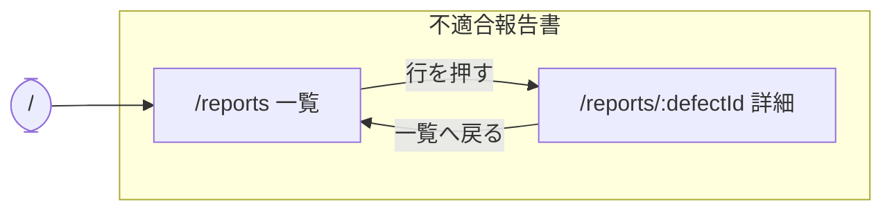

# DefectReport AI — UI設計書

> 仕様書 v1.1（第2回の終わり(確かめて直した版)）。前の版から変わったところは `変更点.md`。

本書は画面の構成・レイアウト・遷移・配色・部品の決まりを定める。API の入出力は `04_API設計書.md`、項目の定義は `03_データモデル設計書.md`、要件の番号（FR-・NFR-）は `01_要件定義書.md` に従う。

---

## 1. 前提と技術

- React 19 + TypeScript（Vite）、MUI、React Router。1つの画面に1つのルートを割り当てる
- 画面の文字はすべて日本語（NFR-10）。重大度・状態・4M はコード値で受け取り、画面で日本語に直す

| 項目 | コード値 → 画面の表示 |
|---|---|
| 重大度（severity） | critical＝重大、high＝高、medium＝中、low＝低（用語表 `03` §3.4 と同じ） |
| 状態（status） | open＝未対応、in_progress＝対応中、completed＝完了 |
| 4M（category_4m） | Man＝人、Machine＝機械、Material＝材料、Method＝方法。空は「未分類」 |

- API は相対パス（`/api/…`・`/health`）で呼ぶ。開発では Vite のプロキシが backend（ポート 8000）へ渡す
- 絞り込みの状態は URL クエリ（useSearchParams）に持つ。再読込やリンクの共有で同じ条件が開く
- 入力中の値などは各画面の中に持つ（過度な抽象化をしない。NFR-08）

---

## 2. 全体の枠

### 2.1 レイアウト

左にメニュー（サイドバー、幅 264px、暗色）、右にメイン。メニューの上端にアプリ名と状態のバッジを置く。

```
┌──────────────────┬───────────────────────────────────────────────┐
│ DefectReport AI  │                                               │
│ [110件]          │  メイン（ルートで切り替える）                 │
│                  │                                               │
│ 不適合報告書     │                                               │
│  ・一覧          │                                               │
│                  │                                               │
└──────────────────┴───────────────────────────────────────────────┘
```

- メインの本文は最大幅 1400px で中央に置く

### 2.2 メニュー

見出し（利用者のまとまり）ごとに項目を並べる。

```
不適合報告書
  ・一覧                 /reports
```

- 開いている項目は、左端のアクセント色の縦線と文字色で示す
- 詳細（`/reports/:defectId`）はメニューに出さず、一覧から開く
- `/` と、どれにも当たらないパスは `/reports` へ送る

状態のバッジ（`GET /health` を開いたときに1回読む）：

| 出すもの | 表示の例 |
|---|---|
| 件数 | `110件` |

- backend につながらないときは「バックエンド未接続」をアクセント色（注意）で出す

### 2.3 画面の幅

- PC（1人1台のノート PC）で使う。幅 1280px 以上で崩れないこと

---

## 3. 画面一覧

| # | 画面 | パス | メニュー | 主な API |
|---|---|---|---|---|
| S1 | 報告書 一覧 | `/reports` | 不適合報告書 › 一覧 | `GET /api/reports`、`GET /api/masters`（選択肢） |
| S2 | 報告書 詳細 | `/reports/:defectId` | （一覧から開く） | `GET /api/reports/{defect_id}` |

- 画面は2つ（S1・S2）

---

## 4. 画面ごとの設計

### S1 報告書 一覧（`/reports`）

報告書を絞り込み・並べ替え・ページ送りして探す（FR-CR-01）。行を押すと詳細へ移る。

```
┌──────────────────────────────────────────────────────────────────────────────┐
│ 不適合報告書 一覧                                                            │
├──────────────────────────────────────────────────────────────────────────────┤
│ [キーワード（報告書ID・部品名・部品番号・不具合内容）                      ] │
│ ステータス▼ 重要度▼ 機械▼ 工程▼ 4M▼ 並び順▼                                  │
│ 期間 [開始日]〜[終了日]                                                      │
├──────────────────────────────────────────────────────────────────────────────┤
│ 報告書ID   発生日      部品名              現象        機械     重要度 状態  │
│ KZ25-0110  2026-03-15  ギヤケース          表面キズ    GENOS…   中     完了  │
│ KZ25-0109  2026-03-10  インペラハウジング  ひずみ変形  YZ-8WR   高     完了  │
│ KZ25-0108  2026-03-10  ロータシャフト      穴位置ずれ  YZ-8WR   中     完了  │
│ …                                                                            │
├──────────────────────────────────────────────────────────────────────────────┤
│                                 表示件数 25▼   1–25（全110件）   ◀  ▶        │
└──────────────────────────────────────────────────────────────────────────────┘
```

- 表の列：報告書ID・発生日・部品名・現象・機械・重要度（色つきのチップ）・ステータス（色つきのチップ）・不良率（小数2桁の %）。不良率は API の `defect_rate` をそのまま出す
- キーワードは入力が止まって 300ms たってから URL に書く。ほかの絞り込みは選んだときに書く。条件が変わったら1ページ目に戻す
- 並び順：新しい順（既定、`-occurrence_date`）・古い順（`occurrence_date`）・損失額が大きい順（`-total_cost`）・不良数が多い順（`-defect_count`）
- ページ送り：1ページ 10・25・50 件（既定25）。ページと表示件数も URL クエリに持つ
- 絞り込みはすべて AND（例：機械 a61nx かつ 期間 2025-09-01〜2025-09-30 → KZ25-0043 の1件だけ。期間を 2025-10-01〜2025-10-31 にすると0件の表示）
- 状態・重要度・4M の選択肢は固定の語彙。機械・工程の選択肢は `GET /api/masters` から作る（用語表と同じ値。画面に候補を書かない）
- 期間は発生日で絞り、両端を含む。開始日が終了日より後など、API が 422 を返したときは理由を出す（§5）

URL クエリ：

| キー | 意味 | 例 |
|---|---|---|
| `q` | キーワード | `q=補機` |
| `status`・`severity` | 状態・重大度（コード値） | `status=open` |
| `machine`・`process` | 機械・工程（マスタの表記） | `machine=a61nx` |
| `category_4m` | 4M | `category_4m=Man` |
| `date_from`・`date_to` | 期間（YYYY-MM-DD、両端を含む） | `date_from=2025-09-01&date_to=2025-09-30` |
| `sort` | 並び順 | `sort=-total_cost` |
| `page` | ページ（1から。既定1） | `page=5` |
| `per_page` | 表示件数（10・25・50。既定25） | `per_page=25` |

### S2 報告書 詳細（`/reports/:defectId`）

1件の全項目を読む（FR-CR-03）。不良率（`defect_rate`）を出す。

```
┌──────────────────────────────────────────────────────────────────────┐
│ ← 一覧へ戻る                                                         │
│ KZ25-0043                                                            │
│ 補機マウントリブ · 表面キズ                                          │
├─ 基本情報 ───────────────────────────────────────────────────────────┤
│ 報告書ID  KZ25-0043             客先      翠峰重工業                 │
│ 発生日    2025-09-13            報告日    2025-09-24                 │
│ 発見者名  祢津                  部品番号  KRS-A58-5211-D             │
│ 部品名称  補機マウントリブ                                           │
├─ 不具合内容 ─────────────────────────────────────────────────────────┤
│ 発生工程  マシニング            使用機械  a61nx                      │
│ 作業者名  荻原                  現象分類  表面キズ                   │
│ 加工数    12                    不適合数  3                          │
│ 不良率    25.00%                重要度    [中]                       │
│ 不具合内容  補機マウントリブの位置決めダボ穴に長さ約3mmの線状キズ…   │
│ 良品状態    機能面・意匠面に目視で判別できる線状・点状の傷が無い…    │
├─ 原因・4M分析 ───────────────────────────────────────────────────────┤
│ 原因      配属間もない作業者が単独で段取りを行い、基準面の当たり…    │
│ 要因      習熟不足              4M分類    人 (Man)                   │
│ 再発案件  いいえ                手順書    あり                       │
├─ 対策 ───────────────────────────────────────────────────────────────┤
│ ステータス  [完了]                                                   │
│ 対策  新任者の単独段取りを解禁する前に、技能評価チェックリスト…      │
│ 備考  客先へ経緯を報告済み。代替品を特急で製作し納期内に納入した。   │
├─ 費用 ───────────────────────────────────────────────────────────────┤
│ 材料費 ¥20,179   社内加工費 ¥40,402   外注加工費 ¥0   その他費用 ¥0  │
│ 合計損失: ¥60,581                                                    │
└──────────────────────────────────────────────────────────────────────┘
```

- 「基本情報」「不具合内容」「原因・4M分析」「対策」「費用」の5つの区切りで、ラベルと値を2列に並べる。値が無い項目は「—」
- 金額は「¥」と3桁区切り、不良率は小数2桁の %
- 「一覧へ戻る」で `/reports` へ戻る
- 見つからない番号（404）は、理由（「報告書が見つかりません」）を出す

---

## 5. 画面の状態（読込中・0件・失敗）

どの画面も、読込中・0件・失敗を別の表示にする。

| 状態 | 表示 |
|---|---|
| 読込中 | 中央に回るしるしと「読み込み中…」 |
| 0件 | 表の下に「条件に一致する報告書がありません」と、件数「0」を出す（空白にしない） |
| 失敗 | 表と件数を消し、原因（API の `detail`、つながらないときは通信の失敗）と「再試行」を出す。「0件」とは混ぜない |
| 入力の誤り（422） | 期間の形の誤りや開始日 > 終了日は、API が返した理由を日本語で出す |

- 検索結果がないことと、検索できなかったことを同じ表示で隠さない
- 詳細は、失敗したら原因だけを出す

---

## 6. 画面遷移図

実線は人の操作。メニューによる移動は描かない。



---

## 7. 配色とテーマ

テーマは「CNCコックピット」：艶消しのグラファイトの面に、アンバー1色を差す計器盤。実装は `theme.ts`（`createAppTheme(mode)`）が正で、色は MUI の palette（`app`・`sidebar`・`chart`）に集め、各部品は `useTheme()` で読む。色を部品に直書きしない。

- 純黒を避け、面は base → paper → elevated の順に等しい明度差で重ねる
- 彩度の高い色はアクセントのアンバー1色だけ
- カードは影ではなく1px の罫線（hairline）で区切る
- 重大度・状態は色だけに頼らず、ラベル付きのチップにする
- 角の丸み `shape.borderRadius` は 10

この版のテーマは夜版（ダーク）の1つだけ。

| トークン | 値 |
|---|---|
| app.base / paper / elevated | `#0E1116` / `#161B22` / `#1D242E` |
| app.hairline（罫線） | `#2A3340` |
| text primary / secondary / disabled | `#E8EDF4` / `#94A3B4` / `#5B6878` |
| primary（アクセント、アンバー）/ hover | `#FFA028` / `#FFB44D` |
| secondary（シアン） | `#009DC2` |
| sidebar.bg | `#0A0D11` |
| severity critical / high / medium / low | `#FF5C5C` / `#FF9F45` / `#FFD166` / `#6EE7A0` |
| status open / in_progress / completed | `#FF9F45` / `#4CC3E8` / `#34D399` |

- MUI への割り当て：primary＝アンバー、secondary＝シアン、error＝severity.critical、warning＝severity.high、info＝status.in_progress、success＝status.completed、divider＝hairline

---

## 8. 部品の決まり

- 部品は MUI。枠は `Box`・`Stack`、メニューは `Drawer` と `List`（`components/Layout.tsx`）、一覧は `Table`、入力は `TextField`・`Select`、バッジは `Chip`
- 画面の見出しは `PageHeader`（題・補足・右側のボタン）
- 状態の表示は `StateViews`（`Loading`・`EmptyState`・`ErrorState`）の3つだけを使う（§5）
- 重大度・状態のチップは `SeverityChip`・`StatusChip`（`components/Chips.tsx`）
