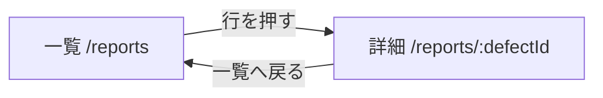
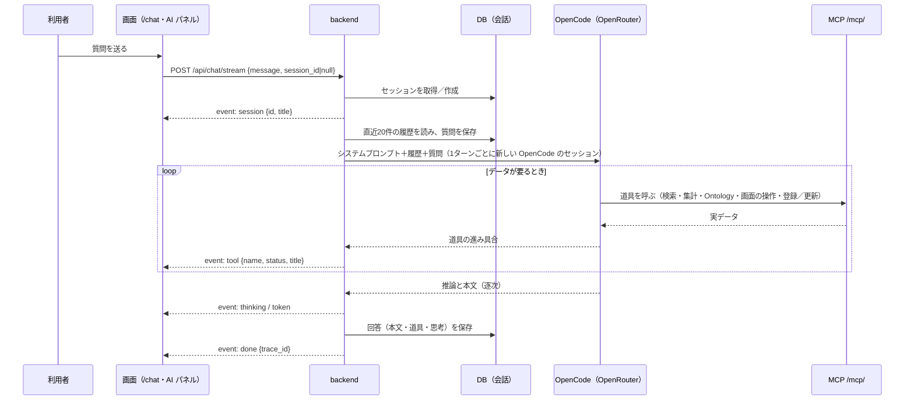

# DefectReport AI — 機能仕様書

> 仕様書 v2.1（第3回の終わり）。前の版から変わったところは `変更点.md`。

本書は、機能ごとの画面・操作の流れ・入出力・エラー時の動きと、代表的なユースケースを定める。要件の番号（FR-・NFR-）は `01_要件定義書.md`、受け入れ条件の番号（AC-）は `07_試験・運用仕様書.md`、API の正確な入出力は `04_API設計書.md`、列の定義は `03_データモデル設計書.md`、画面の配置は `05_UI設計書.md` を正とする。

機能一覧:

| # | 機能 | 主な画面 | 中核の API |
|---|---|---|---|
| F2 | 報告書の一覧・詳細 | 一覧（`/reports`）・詳細（`/reports/:defectId`） | `/api/reports` |
| F3 | AI アシスタント | AI チャット（`/chat`）・全ページの AI パネル | `/api/chat/*`、`/mcp/`、`/api/ui/events` |
| F7 | マスタ（選択肢） | 一覧の絞り込み | `GET /api/masters` |

---

## F2. 報告書の一覧・詳細

### 画面と操作の流れ

- **一覧（`/reports`）**：キーワード（報告書番号・部品番号・部品名・不具合内容）と絞り込み（状態・重大度・機械・工程・客先・担当者・現象・4M・期間）で探し、並べ替えとページ送り（1ページ 10・25・50件、既定25）をする。行を押すと詳細へ移る。
  - 絞り込み・並べ替えの状態は URL クエリに持つ。同じ URL を開けば同じ一覧になる。
  - 列：報告書ID・発生日・部品名・現象・機械・重要度・ステータス・不良率（小数2桁の %）。
  - 並べ替え：新しい順（既定）・古い順・損失額が大きい順・不良数が多い順。「不良数が多い順」は API の並べ替えの対象に不適合数が無く、例アプリでは新しい順と同じになる（例アプリの既知の問題）。
  - 読込中は「読み込み中…」、0件は「条件に一致する報告書がありません」を出す。失敗したときは表と件数を消し、原因と「再試行」を出して、0件の表示と分ける（**例アプリには未実装**。例アプリは理由の下に表と「条件に一致する報告書がありません」も出し、「再試行」は無い）。
  - 機械・工程・客先・担当者・現象の選択肢はマスタ（`GET /api/masters`、F7）から作る。
- **詳細（`/reports/:defectId`）**：全項目を「基本情報」「不具合内容」「原因・4M分析」「対策」「費用」に分けて出し、不良率（小数2桁の %）を出す。値の無い項目は「—」。

### 入出力

- 一覧：`GET /api/reports?q=&status=&severity=&machine=&process=&customer=&operator=&phenomenon=&category_4m=&date_from=&date_to=&limit=&offset=&sort=` → `{"total": int, "items": [Report]}`。`limit` 既定50・最大500、`sort` 既定 `-occurrence_date`（先頭の `-` で降順。対象は発生日・報告日・報告書番号・重大度・登録日時・損失合計）。
- 詳細：`GET /api/reports/{defect_id}` → Report（全列＋`defect_rate`）。

### 入力の決まりとエラー時の動き

| 項目・状況 | 決まり | 違反・失敗のとき |
|---|---|---|
| 存在しない番号の詳細 | — | 404（「報告書が見つかりません」）。画面は理由を出す |
| 期間（`date_from`・`date_to`） | 発生日を date 型で比べ、両端の日を含む | 形の不正な日付や `date_from` > `date_to` は 422 と理由。**例アプリには未実装**（形の不正な日付は無視し、逆向きの期間は0件） |
| 該当0件 | — | 「条件に一致する報告書がありません」（エラーにしない） |
| 不良率 `defect_rate` | サーバーで計算（不適合数 ÷ 加工数）。保存しない | 加工数が0なら null、画面は「—」 |

---

## F3. AI アシスタント

### 画面と操作の流れ

AI チャット（`/chat`）と、全ページに置く AI パネルで使う。パネルは同じ部品の小さい版で、閉じても画面を移っても消えない（AI が画面を動かしても、会話と逐次表示が切れない）。`/chat` では左に会話の一覧、右に対話を出す。

> 第3回は独立したページ `/chat` だけを作る。AI パネル・画面の操作（WebMCP）・書き込み・業務 Ontology は**第3回では作らない（後の回）**。道具は読み取りの5本だけ（`01_要件定義書.md` §10.1）。

- 質問を送ると、道具の実行（名前と状態）・思考（折りたたみ）・本文を届いた順に出す。本文は Markdown（react-markdown・remark-gfm）で出し、本文の報告書番号（`KZ25-XXXX`・`[KZ25-XXXX]`）は詳細へのリンクにする。
- 回答が届いているあいだは送信を止める。失敗は入力欄の上に理由を出す。
- 画面上部の状態表示に、件数と AI の設定（「AI: OpenCode」か「AI 未設定」）を出す。

### 入出力

- 入力：`POST /api/chat/stream`、body `{"message": str, "session_id": int | null}`。`session_id` が null なら新しいセッションを作る（題は質問の先頭30文字）。履歴はサーバーが DB から直近20件を読む（ブラウザは送らない）。
- 出力（SSE）：`session`（`{id, title}`、先頭）→ `thinking`（`{text}`）／`tool`（`{name, status, title}`、`status` は pending・running・completed・error）／`token`（`{text}`）→ `done`（`{trace_id}`。Langfuse が無ければ null）。失敗は `error`（`{detail}`）。
- AI への指示（`app/opencode/AGENTS.md` とシステムプロンプト）：そのターンで道具から取った値だけで答える／存在しない番号を作らない（似た名前に読み替えない）／していない操作を「しました」と言わない／空の応答やエラーを成功にしない。OpenCode に元からあるコーディング用の道具（bash・edit など）は使わせない。

### 道具（MCP）

FastAPI に同居する MCP サーバー（`/mcp/`、名前 `defect-reports`）の道具を、OpenCode が自分で選んで呼ぶ。道具は DB を直接読み、報告書の登録・更新は REST と同じ処理（`services/report_service.py`）を通る。

| 種類 | 道具 |
|---|---|
| 読み取り | `list_defect_reports`（条件で絞り込み、完全一致）・`search_defect_reports`（内容の検索）・`get_defect_report`・`get_statistics`・`list_masters` |
| 書き込み | `create_defect_report`・`update_defect_report`（はっきり頼まれたときだけ）。**第3回では作らない（後の回）** |
| 画面の操作 | `ui_navigate`・`ui_open_report`・`ui_set_theme`。**第3回では作らない（後の回）** |
| 業務 Ontology | `get_ontology_definition`・`resolve_ontology_entity`・`get_ontology_object`・`traverse_ontology_relation`・`query_quality_ontology`。**第3回では作らない（後の回）** |

- 合計15本。`search_defect_reports` はこの版ではキーワードの検索。第3回で作るのは読み取りの5本だけ。
- OpenCode 上の道具の名前は `defect-reports_<道具の名前>`。道具を変えたら opencode を起動し直す（道具の一覧は起動のときに読む）。
- 引数と返り値は `06_AI設計書.md` に書く。

### 対話での登録・更新

> **第3回では作らない（後の回）**。第3回の AI は報告書を読むだけで、登録・更新を頼まれたら「この版ではできない」と答える。

- 登録：例「次の内容で報告書を登録して：発生日…、機械 a61nx…」→ `create_defect_report`（番号は自動、状態は `open` に固定）。実行したら振った番号を答える。
- 更新：例「KZ25-0099 を completed にして」→ `update_defect_report`（状態・重大度・対策・原因・要因・4M・備考・良品状態の8項目だけ）。実行したら変えた項目を答える。
- 画面のスイッチは作らない。「はっきり頼んだときだけ」は AGENTS.md と道具の説明で守り、書き込みの道具が呼ばれたことは画面の道具の表示と DB の記録で確かめる。

### 画面の操作（WebMCP）

> **第3回では作らない（後の回）**。

- AI の `ui_*` は、backend の `GET /api/ui/events`（SSE。`event: ui`、`data: {action, path, reason}`。15秒ごとに接続を保つ空の行）に操作を流す。画面の `UiControlBridge` がこれを受けて React Router で移動し、「AIアシスタントが画面を操作しました: …」と知らせる。
- 移動できるのはアプリの中のパスだけ。操作は画面の移動と表示だけで、データは変えない。テーマ（ライト・ダーク）はブラウザ（localStorage）に残す。
- 画面の状態の正本は URL クエリ。人が絞り込んだ一覧を AI が読み、AI が開いた一覧を人がそのまま続けて操作できる。
- ブラウザが接続していないときは、道具が「ブラウザ画面が接続されていません(アプリを開いてもらってください)」を返す。AI はそれを成功と言わない。
- 画面を操作したと答える前に、必ず `ui_*` を呼ぶ。前のターンで同じ操作をしていても、毎回呼ぶ（ターンごとに独立）。

### 業務 Ontology の使い方

> **第3回では作らない（後の回）**。第3回は、名前の正しい表記を `list_masters` で確かめる。

- 用語表を機械が読める形にした `app/backend/ontology/quality.json`（対象・関係・指標・制約）を、チャットのシステムプロンプトにも渡す。
- 機械・工程・客先の名前は `resolve_ontology_entity` で実データの ID に解決する。候補を自分で選べないとき（`can_auto_select=false`）は、利用者に確かめる。
- 条件別の件数・不適合数・記録上の不適合率・損失は `query_quality_ontology` で、サーバーが全件を数える。記録上の不適合率は報告書に記録されたロットの率で、工場全体の不良率と呼ばない。

### 会話（セッション）の操作

| 操作 | 画面 | API |
|---|---|---|
| 新しいチャット | 「＋ 新しいチャット」。次の送信で `session_id=null` を送る | `POST /api/chat/stream` |
| 一覧 | `/chat` の左の列（パネルは「履歴」メニュー。パネルは**第3回では作らない（後の回）**）。更新の新しい順に、題とメッセージ数 | `GET /api/chat/sessions` |
| 復元 | 一覧から選ぶと、発言と回答（道具の記録・思考も）を戻す。以後は同じ `session_id` で続ける | `GET /api/chat/sessions/{id}` |
| 削除 | 確認してから消す（メッセージも消す）→ 204 | `DELETE /api/chat/sessions/{id}` |

### エラー時の動き

| 状況 | 動き |
|---|---|
| AI の設定が無い（`OPENCODE_URL` が無い、`/health` の `chat_backend="none"`） | `session` のあと `error`（「AIバックエンドが設定されていません(OPENCODE_URL / OPENROUTER_API_KEY)」）。質問は保存する |
| モデルのエラー（OpenCode の `info.error`、セッションのエラー） | `error` で理由を出す |
| 空の応答 | 完了したメッセージから本文を回収し、それでも空なら `error`（「OpenCodeが空応答を返しました(モデル未応答)。もう一度お試しください」）。空の回答を成功として保存しない |
| 残高切れ（OpenRouter の 402） | モデルのエラーか空の応答として `error` で理由を出す（道具が実行されないまま終わる） |
| 出力の上限で切れた（`finish_reason=length`） | 成功にせず `error` で理由を出す。**例アプリには未実装**（例アプリは途中までの本文を成功として保存する。出力の上限は `opencode.json` で 8,000） |
| 通信が途中で切れた | 届いた分を出したまま、理由を出す |
| 書き込みをはっきり頼まれていない | 読んで答えるだけで、登録・更新はしない（第3回は書き込みの道具が無いので、頼まれてもしない） |
| ブラウザが接続していない状態で画面の操作を頼まれた | 道具が失敗を返し、AI は操作できなかったと答える（画面の操作は**第3回では作らない（後の回）**） |

---

## F7. マスタ（選択肢）

絞り込みの選択肢を、DB のマスタに持つ。種類は客先（customer）・工程（process）・機械（machine）・作業者（operator）・現象（phenomenon）・要因（factor）の6つ。重大度・状態・4M は決まった値なのでマスタにしない。

### 作り方と使い方

- 初回の起動で、報告書のシードのあとにマスタが空なら、データの値（種類ごとの DISTINCT）から作る。データの値は 客先10・工程8・機械10・作業者29・現象12・要因10。
- 一覧の絞り込み（機械・工程）の選択肢は `GET /api/masters` から作る。
- AI は `list_masters` で正確な表記を確かめる（有効な値だけ）。

### 入出力

- 全種類：`GET /api/masters` → `{"customer": [Master], "process": [Master], …}`。Master は `{id, category, name, sort_order, is_active, usage_count}`。並びは `sort_order`、次に名前。

---

## ユースケース

### UC-1. 品質保証担当：条件で報告書を探す

> QA の担当者は、機械 a61nx で2025年9月に出た不良を確かめたい。

1. 一覧（`/reports`）で、機械に「a61nx」、期間に 2025-09-01〜2025-09-30 を入れる。URL は `/reports?machine=a61nx&date_from=2025-09-01&date_to=2025-09-30` になる。
2. KZ25-0043 の1件だけが出る（機械 a61nx は全部で3件、2025年9月は全部で7件。AND で絞る）。
3. 行を押して詳細を開く。部品は補機マウントリブ、現象は表面キズ、加工数12・不適合数3 で不良率 25.00%、損失合計は ¥60,581。
4. 期間を 2025-10-01〜2025-10-31 に変えると0件になり、「条件に一致する報告書がありません」が出る。

**要件**：FR-CR-01・03（AC-v10-03〜07）。

### UC-2. 品質保証担当：AI アシスタントに聞いて調べる

> QA の担当者は、汎用フライスのバリ残りが続いている気がしている。件数と、これまでの対策を知りたい。

1. AI パネル（第3回は `/chat`）で「汎用フライスのバリ残りは何件？これまでの対策は？」と聞く。
2. AI は `list_defect_reports`（機械「汎用フライス」、現象「バリ残り」）を呼ぶ。道具は7件（KZ25-0024・0035・0050・0073・0094・0096・0099）を返し、AI は「7件」と答える。
3. 対策を述べるために、AI は `get_defect_report` で報告書を読み、そのターンで取った値だけで答える。
4. 「KZ25-0099 を開いて」と頼むと、AI は `ui_open_report` を呼び、画面が `/reports/KZ25-0099` に移る。会話はパネルに残る（画面の操作とパネルは**第3回では作らない（後の回）**。第3回は回答の本文の報告書番号のリンクで詳細を開く）。
5. 再読込しても、会話は一覧に残っていて開き直せる。

**要件**：FR-CH-01・02・06・09・10（AC-v20-01〜04・14）。
