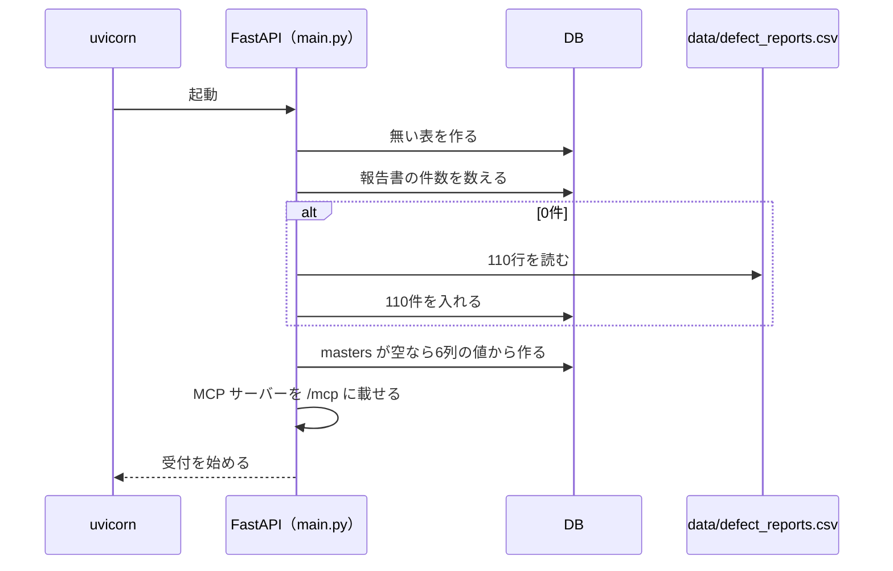
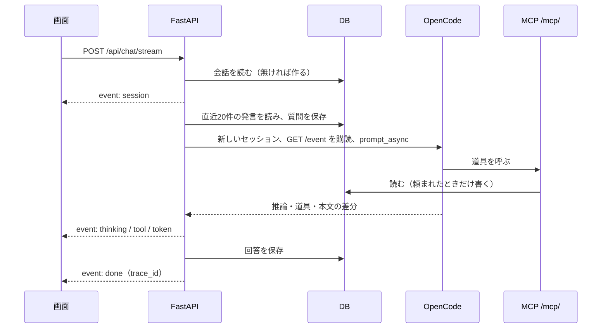

# DefectReport AI — API設計書

> 仕様書 v2.1（第3回の終わり）。前の版から変わったところは `変更点.md`。

FastAPI のバックエンド（`app/backend`、ポート 8000）が出す REST API と、同じプロセスに載せた MCP サーバー（`/mcp/`）を定める。
開発のときは、画面（Vite、ポート 5173）が `/api` と `/health` をバックエンドへ中継する。
第3回からは Docker Compose でも動かす（§3.3）。ポートの番号はコンテナの中の番号で、PC の外に出す番号は環境で読み替える（この演習の PC は API 8120・画面 5220・OpenCode 4120）。
応答は JSON（SSE を除く）。項目名は `03_データモデル設計書.md` の列名と同じにする。AI の指示と道具の使い分けは `06_AI設計書.md` に書く。

## 1. 共通の決まり

- 認証：なし（手元の PC で動かす演習用）。
- 日付：`YYYY-MM-DD`。期間の引数（`date_from`・`date_to`）は発生日（`occurrence_date`）で絞り、両端の日を含む。
- 期間の引数が日付として読めないとき、`date_from` が `date_to` より後のときは、422 と理由を返す。形は FastAPI 標準（`detail` の配列で、どの引数がなぜ違うかを書く）とし、画面が日本語に直して出す。
- 誤りの応答は `{"detail": "理由"}`（日本語）。入力の形の誤り（型・必須・範囲）は FastAPI 標準の 422 で返す。
- 0件は誤りではない。`{"total": 0, "items": []}` を 200 で返す。

### 1.1 状態コード

| コード | 意味 | 主な場面 |
|---|---|---|
| 200 | 成功 | 201・204 以外の成功 |
| 204 | 消した（本文なし） | 会話の削除 |
| 404 | 見つからない | 報告書・会話 |
| 422 | 入力の形・値が違う | `limit` などの範囲外、必須の抜け、期間の日付 |
| 503 | AI が設定されていない | 非ストリーミングのチャット |
| 502 | AI（OpenCode・モデル）が失敗した | 非ストリーミングのチャット（試験用） |

### 1.2 環境変数

| 変数 | 既定 | 意味 |
|---|---|---|
| `DB_PATH` | `app/backend/data/defect_reports.db` | SQLite のファイル |
| `DATA_CSV` | `data/defect_reports.csv` | 空の DB に入れる模擬データ |
| `OPENROUTER_API_KEY` | — | 必須のキー（1本だけ）。OpenCode が OpenRouter を呼ぶのに使う |
| `OPENCODE_URL` | 空（チャットは使えない） | OpenCode サーバー（`opencode serve`）の URL |
| `OPENCODE_MODEL` | `anthropic/claude-sonnet-4.5` | 使うモデル。`ollama/<モデル名>` のように接続先の名前を先頭に書くと、接続先もそれに切り替わる（ローカル LLM は任意） |
| `OPENCODE_PROVIDER` | `openrouter` | 接続先 |
| `LANGFUSE_HOST`・`LANGFUSE_PUBLIC_KEY`・`LANGFUSE_SECRET_KEY` | 空（記録しない） | Langfuse の接続先とキー。Langfuse への送信は**第3回では作らない（後の回）** |
| `OLLAMA_BASE_URL` | — | （OpenCode が読む）ローカル LLM（Ollama）の URL。`/v1` は付けない。例：この演習の PC では `http://localhost:11435`、コンテナからは `http://host.docker.internal:11435` |
| `DEFECT_REPORTS_MCP_URL` | — | （OpenCode が読む）MCP の URL。`opencode.json` の `mcp.defect-reports.url` に入る |
| `API_TARGET` | `http://localhost:8120` | （画面の Vite が読む）`/api` と `/health` の転送先 |
| `WEB_PORT` | `5220` | （画面の Vite が読む）開発サーバーのポート |

Docker Compose での値（§3.3）：

| 変数 | サービス | 値 |
|---|---|---|
| `DB_PATH` | backend | `/var/lib/defectreport/defect_reports.db`（名前付きボリューム `db`） |
| `DATA_CSV` | backend | `/data/defect_reports.csv`（`data/defect_reports.csv` を読み取り専用で載せる） |
| `OPENCODE_URL` | backend | `http://opencode:4096` |
| `OPENCODE_MODEL` | backend | `ollama/gemma4:26b` |
| `OLLAMA_BASE_URL` | opencode | `http://host.docker.internal:11435` |
| `DEFECT_REPORTS_MCP_URL` | opencode | `http://backend:8000/mcp/` |
| `API_TARGET`・`WEB_PORT` | frontend | `http://backend:8000`・`5173` |

キーは `.env` に置き、画面のコードや応答に出さない。

### 1.3 AI や埋め込みが無いときの動き

| 無いもの | 動き |
|---|---|
| OpenCode（`OPENCODE_URL` が無い） | チャットは `error` イベントで理由を返す（非ストリーミングは 503）。`/health` の `chat_backend` が `none` |
| Langfuse | 記録せずに動く。`done` の `trace_id` は null |

## 2. エンドポイントの一覧

| 分類 | メソッドとパス | 内容 |
|---|---|---|
| 状態 | `GET /health` | 状態と報告書の件数 |
| 報告書 | `GET /api/reports` | 一覧（絞り込み・並べ替え・ページ送り） |
| 報告書 | `GET /api/reports/{defect_id}` | 詳細 |
| マスタ | `GET /api/masters` | 6種類の選択肢 |
| AI アシスタント | `POST /api/chat/stream` | 回答を SSE で逐次返す |
| AI アシスタント | `POST /api/chat` | 回答をまとめて返す（試験用） |
| AI アシスタント | `GET /api/chat/sessions` | 会話の一覧 |
| AI アシスタント | `GET /api/chat/sessions/{session_id}` | 会話の中身 |
| AI アシスタント | `DELETE /api/chat/sessions/{session_id}` | 会話の削除 |
| 画面の操作 | `GET /api/ui/events` | AI の画面操作を画面へ届ける SSE。**第3回では作らない（後の回）** |
| MCP | `/mcp/` | MCP サーバー（道具15本。第3回は読み取りの5本） |

- 報告書を登録・更新・削除する REST は持たない。AI アシスタントの書き込みは MCP の道具（8.3）で行う（書き込みの道具は**第3回では作らない（後の回）**）。

## 3. 起動とヘルスチェック

### 3.1 起動時の処理



- CSV の値は列ごとに型を直して入れる（整数・小数・日付・真偽。真偽は `true`・`1`・`有`・`yes` を真とする）。
- 詳しくは `03_データモデル設計書.md` の「起動時の処理」。

### 3.2 GET /health

応答（110件のとき）：

```json
{"status": "ok", "reports": 110, "chat_backend": "opencode"}
```

| 項目 | 意味 |
|---|---|
| `status` | 動いていれば `ok` |
| `reports` | 報告書の件数（空の DB に入れたあとは110） |
| `chat_backend` | `opencode`（`OPENCODE_URL` がある）か `none`（チャットは使えない） |

### 3.3 Docker Compose での起動（第3回から）

Compose のファイルはリポジトリの直下の `compose.yaml`、プロジェクト名は `lesson03`。

| サービス | 作り方 | コンテナの中のポート | 外に出すポート（この演習の PC） | 待つもの |
|---|---|---|---|---|
| `backend` | `app/backend/Dockerfile`（Python 3.12、uv で入れる）。`uvicorn main:app --host 0.0.0.0 --port 8000` | 8000 | 8120 | — |
| `opencode` | `app/opencode/Dockerfile`（Node.js 22、npm の `opencode-ai` を 1.19.0 に固定）。`opencode serve --hostname 0.0.0.0 --port 4096` | 4096 | 4120 | backend の healthcheck（`/health`）が通るまで |
| `frontend` | `app/frontend/Dockerfile`（Node.js 22）。`vite --host 0.0.0.0`（`WEB_PORT=5173`） | 5173 | 5220 | backend |

- 外に出すポートは `127.0.0.1` だけで待つ（同じネットワークのほかの PC からは見えない）。
- DB は名前付きボリューム `db` に置く。`docker compose down` でコンテナを消しても DB は残る。`docker compose down -v` はボリュームごと DB を消すので使わない。
- 模擬データの CSV（`data/defect_reports.csv`）は読み取り専用（`:ro`）で載せる。
- OpenCode は起動したときに MCP の道具の一覧を読む。そのため backend が `/health` に答えてから起動する。道具を変えたら `docker compose restart opencode` で読み直させる。
- キーなどの秘密の値は `.env`（git に入れない）に置き、`env_file` で渡す。`.env` が無くても起動できる。
- venv ＋ npm で起動する形（v1.1）も残す。このときの MCP の URL は `http://localhost:8120/mcp/`、OpenCode を手元で動かすときの URL は `http://localhost:4120`。

## 4. 報告書 — /api/reports

Report（報告書1件）は、`defect_reports` の全列と派生値 `defect_rate`（不適合数 ÷ 加工数。加工数が0なら null）を持つ。

### 4.1 GET /api/reports（一覧）

| 引数 | 既定 | 意味 |
|---|---|---|
| `q` | | `defect_id`・`part_number`・`part_name`・`defect_description` の部分一致 |
| `status` | | 状態の完全一致（`open`・`in_progress`・`completed`） |
| `severity` | | 重大度の完全一致 |
| `machine` | | `machine_name` の完全一致 |
| `process` | | 工程の完全一致 |
| `customer` | | 客先の完全一致 |
| `operator` | | `operator_name` の完全一致 |
| `phenomenon` | | 現象の完全一致 |
| `category_4m` | | `Man`・`Machine`・`Material`・`Method` |
| `date_from`・`date_to` | | 発生日の範囲（両端を含む） |
| `limit` | 50 | 1〜500（範囲外は 422） |
| `offset` | 0 | 0以上 |
| `sort` | `-occurrence_date` | `occurrence_date`・`report_date`・`defect_id`・`severity`・`created_at`・`total_cost`。先頭に `-` で降順。ほかの名前は `occurrence_date` として扱う |

- 応答：`{"total": 条件に合う件数, "items": [Report]}`。条件はすべて AND で組む（OR にしない）。
- 例：`machine=a61nx&date_from=2025-09-01&date_to=2025-09-30` は `total` 1（KZ25-0043）。同じ機械で2025年10月は `total` 0。
- 画面の絞り込みの選択肢は `GET /api/masters`（5.1）から作る。

### 4.2 GET /api/reports/{defect_id}（詳細）

- 応答：Report。無ければ 404 `{"detail": "報告書が見つかりません"}`。
- 例：KZ25-0043 は `machine_name` が a61nx、`production_count` 12、`defect_count` 3、`defect_rate` 0.25。

## 5. マスタ — /api/masters

種類（`category`）は `customer`・`process`・`machine`・`operator`・`phenomenon`・`factor` の6つ。重大度・状態・4M は決まった値なので含めない。

Master（選択肢1つ）＝ `{"id", "category", "name", "sort_order", "is_active", "usage_count"}`。`usage_count` は報告書でその値を使っている件数。

### 5.1 GET /api/masters

- 応答：`{"customer": [Master], "process": [...], "machine": [...], "operator": [...], "phenomenon": [...], "factor": [...]}`。各種類の中は `sort_order`、`name` の順。
- 110件では 客先10・工程8・機械10・作業者29・現象12・要因10 の79件を返す。

## 6. AI アシスタント — /api/chat

### 6.1 POST /api/chat/stream

- 本文：`{"message": str, "session_id": int | null}`。`session_id` が null か、その会話が無ければ新しい会話を作る（題名は質問の先頭30文字）。`history` は受け取っても使わない（履歴はサーバーが DB から読む）。
- 応答：SSE（`text/event-stream`）。1つのイベントは `event: 名前` と `data: JSON` の組。

| event | data | 出る時 |
|---|---|---|
| `session` | `{"id": int, "title": str}` | 最初に1回 |
| `thinking` | `{"text": str}` | 推論の文の差分 |
| `tool` | `{"name": str, "status": str, "title": str}`（`status` は `pending`・`running`・`completed`・`error`、`title` は null もある） | 道具の状態が変わるたび |
| `token` | `{"text": str}` | 回答の本文の差分 |
| `done` | `{"trace_id": str}`（Langfuse が無ければ null） | 成功で終わった |
| `error` | `{"detail": str}` | 失敗で終わった |

- 順番：`session` → `thinking`・`tool`・`token`（まざって何回でも） → `done` か `error` のどちらか1つ。
- `done` の `trace_id` で、画面の回答と Langfuse のトレースを照合する（1問1トレース）。
- 回答の本文は Markdown（箇条書き・太字・表）。報告書は `[KZ25-XXXX]` の形で示し、画面はリンクにする。



- OpenCode のセッションは1問ごとに作って捨てる。会話の正本は DB（`chat_sessions`・`chat_messages`）。
- 直近20件の発言は、質問を保存する前に読む（同じ質問を二重に入れない）。
- プロンプトは、システムプロンプト・これまでの会話・質問をまとめた1つの文にする。
- チャットでは OpenCode に元からある道具（bash・edit・write・patch・read・glob・grep・list・webfetch・todowrite・todoread・task。1.19.0 では bash・read・glob・grep・edit・write・task・webfetch・todowrite・websearch・skill・apply_patch・question）を切り、MCP の `defect-reports` の道具だけを使わせる。
- OpenCode の `GET /event` は全セッションの出来事を流すため、自分の sessionID のものだけを読む。本文と推論の差分（`message.part.delta`）を `token`・`thinking` に、道具の部品（`message.part.updated`）を `tool` に変え、`session.idle` で終わる。差分が取れなかったときは、終わったメッセージから本文をまとめて取り、`token` を1回送る。
- 回答は、本文・使った道具（名前ごとの最後の状態）・推論の文を保存する。

### 6.2 失敗の扱い

- `OPENCODE_URL` が無ければ、`error` イベント `{"detail": "AIバックエンドが設定されていません(OPENCODE_URL / OPENROUTER_API_KEY)"}` で終わる。
- 失敗しても質問（user の発言）は保存する。失敗した回答は保存しない。
- 途中の例外は `error` イベントの `detail` に理由を入れて返す。HTTP の状態は 200 のまま（SSE を始めたあとのため）。
- 空の応答は成功にしない。`error` イベント `{"detail": "OpenCodeが空応答を返しました(モデル未応答)。もう一度お試しください"}` で終わる。
- モデルの誤り（OpenRouter の残高切れ 402 など）は、OpenCode が HTTP 200 のまま応答の `info.error` に入れて返す。これを見て `error` イベント（`OpenCode/モデルエラー: …`）にする。
- 出力が上限で切れた応答（finish_reason=length）も成功にしない。OpenCode 1.19.0 では、`error.name` が `MessageOutputLengthError`、または回答の `info.finish` が `length` で届く。`error` イベント（`OpenCode/モデルエラー: 出力が上限で切れました（finish=length）`）にし、途中までの本文は保存しない。

### 6.3 会話の保存 — /api/chat/sessions（FR-CH-09）

| メソッドとパス | 応答 |
|---|---|
| `GET /api/chat/sessions` | `[{"id", "title", "created_at", "updated_at", "message_count"}]`。更新の新しい順 |
| `GET /api/chat/sessions/{session_id}` | `{"session": {…同上}, "messages": [{"id", "role", "content", "tools", "thinking", "created_at"}]}`。無ければ 404 |
| `DELETE /api/chat/sessions/{session_id}` | 204（発言も消す）。無ければ 404 |

### 6.4 POST /api/chat（試験用）

- 本文は 6.1 と同じ。回答をまとめて返す：`{"answer": str, "session_id": int}`。
- `OPENCODE_URL` が無ければ 503。会話は 6.1 と同じく保存する。
- AI の失敗（6.2 の `error` になる場合）は 502 と `{"detail": 理由}`（理由は 6.2 と同じ文）。

## 7. 画面の操作 — /api/ui

> **第3回では作らない（後の回）**。

AI の道具（8.4）が出した画面操作を、画面（`UiControlBridge`）へ届ける。画面の状態の正本は URL クエリで、人の操作と AI の操作が同じ URL を見る。

### 7.1 GET /api/ui/events（SSE）

- 接続するとまずコメント行 `: connected` を送る。操作が15秒無ければコメント行 `: ping` を送る（接続を保つため）。
- 操作は `event: ui` で送る。つながっているすべての画面に同じものを送る（一人で使う手元のアプリのため）。

| action | data | 使う道具 |
|---|---|---|
| `navigate` | `{"action": "navigate", "path": "/reports?machine=a61nx", "reason": str}` | `ui_navigate`・`ui_open_report` |
| `command` | `{"action": "command", "name": "set_theme", "params": {"mode": "dark"}, "reason": str}` | `ui_set_theme` |

- 画面が1つもつながっていなければ、道具は `{"ok": false, "error": "ブラウザ画面が接続されていません(アプリを開いてもらってください)"}` を返す。このとき AI は「画面を操作した」と答えない。
- 画面の操作はデータを変えない（下書きの入力や編集の保存は利用者が行う）。

## 8. MCP サーバー — /mcp/

- 道具は15本（読み取り5・書き込み2・画面の操作3・業務 Ontology 5）。第3回で作るのは読み取りの5本（8.2）だけ。8.3〜8.5 は**第3回では作らない（後の回）**。

### 8.1 接続

- FastAPI と同じプロセスに FastMCP（Streamable HTTP）を載せる（`main.py` で `app.mount("/mcp", mcp_app)`）。サーバーの名前は `defect-reports`。
- OpenCode は `opencode.json` の `mcp.defect-reports`（`{"type": "remote", "url": "<backend の URL>/mcp/", "enabled": true}`）でつなぐ。URL は環境変数 `DEFECT_REPORTS_MCP_URL` で渡す（Compose では `http://backend:8000/mcp/`）。OpenCode から見た道具の名前は `defect-reports_<道具の名前>`。
- 道具は DB を直接読む（自分の REST を HTTP で呼ばない）。絞り込み・1件の取得は REST と同じ処理（`services/report_service.py`）を使う。登録・更新も同じ処理を使う（書き込みは**第3回では作らない（後の回）**）。
- 道具の説明（docstring）に「いつ使うか」と引数の例を書く。
- 業務 Ontology の定義は、資源 `ontology://quality/definition`（JSON）としても読める（**第3回では作らない（後の回）**）。

### 8.2 読み取り

| 道具 | 使いどころ | 主な引数 | 返り値 |
|---|---|---|---|
| `list_defect_reports` | 条件がはっきりした絞り込み | `machine`・`process`・`customer`・`operator`・`phenomenon`・`severity`・`status`・`category_4m`・`date_from`・`date_to`・`q`、`limit`（既定20、最大100）・`offset`・`sort`（既定 `-occurrence_date`） | `{"total", "items": [要約＋defect_rate]}`。値は完全一致。件数は `total` で数える |
| `search_defect_reports` | 内容があいまいな検索（キーワード） | `query`、`top_k`（既定5）、`machine`・`process`（後から絞る） | `[{defect_id, part_name, machine_name, process, phenomenon, snippet, score}]`。不具合内容・原因・対策・部品名・現象の部分一致で、語の出てくる回数の合計を `score` にする（`06_AI設計書.md` §1.5） |
| `get_defect_report` | 1件の全項目 | `defect_id` | 全列＋`defect_rate`（小数4桁）。無ければ `{"error": "KZ25-9999 は見つかりません"}` |
| `get_statistics` | 全体・期間の集計 | `date_from`・`date_to`（省略で全期間） | 件数・不適合数・加工数・不良率・損失などの KPI、月次、現象のパレート、機械・作業者・工程・客先別、4M 別、重大度別 |
| `list_masters` | 名前の正しい表記の確認 | `category`（省略で6種類すべて） | `{種類: [{"name", "usage_count"}]}`（有効な値だけ） |

返り値の細部（第3回で決めた形）：

- `list_defect_reports` の要約の項目：`defect_id`・`occurrence_date`・`customer`・`process`・`machine_name`・`operator_name`・`part_name`・`phenomenon`・`severity`・`status`・`production_count`・`defect_count`・`defect_rate`・`total_cost`。`limit` は1〜100（範囲外は道具の誤り）。
- `list_defect_reports`・`get_statistics` の期間が日付として読めないとき、`date_from` が `date_to` より後のときは `{"error": "理由"}` を返す（0件の成功にしない）。
- `search_defect_reports` の `snippet` は、語が最初に一致した項目の文の先頭80文字。`score` が同じなら報告書番号の新しい順。1語も一致しなければ `[]`。
- `get_statistics` の返り値：`{"period": {"date_from", "date_to"}, "kpi": {"total_reports", "defect_units", "production_units", "defect_rate", "total_loss"}, "monthly": [{"month": "YYYY-MM", "reports", "defect_units"}], "phenomenon_pareto": [{"name", "count", "ratio", "cumulative_ratio"}], "by_machine"・"by_operator"・"by_process"・"by_customer"・"by_category_4m"・"by_severity": [{"name", "count", "defect_units", "total_loss"}]}`。`defect_rate` は 不適合数の合計 ÷ 加工数の合計（小数4桁）。`ratio` も小数4桁。並びは件数の多い順、同じなら名前の順。110件では `kpi` は 110件・1,829個・10,460個・`total_loss` 36445731。

### 8.3 書き込み（FR-CH-08）

> **第3回では作らない（後の回）**。

利用者が「登録して」「更新して」とはっきり頼んだときだけ使う（画面にスイッチは作らず、AI への指示と道具の説明で守る）。呼ばれたことは、画面の道具の表示と DB の記録（`tools_json`）で確かめる。

| 道具 | 主な引数 | 動き |
|---|---|---|
| `create_defect_report` | 必須：`occurrence_date`・`customer`・`process`・`machine_name`・`operator_name`・`part_number`・`part_name`・`production_count`・`defect_count`・`defect_description`・`phenomenon`・`severity`。任意：`discoverer`・`good_condition`・`cause`・`factor`・`category_4m`・`countermeasure`・`notes` | 番号を自動で付け、`status` は `open` に固定して登録する。`{"created": true, "defect_id": "KZ25-0111"}`、失敗は `{"created": false, "error"}` |
| `update_defect_report` | `defect_id` と、`status`・`severity`・`countermeasure`・`cause`・`factor`・`category_4m`・`notes`・`good_condition` | 渡した項目だけを変える（変えられるのはこの8項目だけ）。`{"updated": true, "defect_id", "changed": [...]}` |

- 報告書を削除する道具は作らない。

### 8.4 画面の操作（WebMCP）

> **第3回では作らない（後の回）**。

| 道具 | 使いどころ | 主な引数 |
|---|---|---|
| `ui_navigate` | 画面を移る・表示の条件を変える | `page`、ページごとの条件（下の表） |
| `ui_open_report` | 報告書の詳細を開く | `defect_id` |
| `ui_set_theme` | ライト／ダークの切り替え | `mode`（`dark`・`light`） |

| `page` | 開く画面 | 使える条件 |
|---|---|---|
| `reports` | `/reports` | `q`・`machine`・`severity`・`status`・`process`・`customer`・`operator`・`phenomenon`・`category_4m`・`sort`・`date_from`・`date_to` |
| `chat` | `/chat` | — |

- 知らない `page` は `{"ok": false, "error": "未知のページ: …"}`。ページに無い条件は黙って捨てる。
- 成功は `{"ok": true, "path", "receivers"}`（`receivers` は届いた画面の数）。

### 8.5 業務 Ontology

> **第3回では作らない（後の回）**。

`ontology/quality.json`（`03_データモデル設計書.md` の「業務 Ontology」）を読む道具。どれも読み取りだけ（`readOnlyHint`）。LLM に SQL を書かせず、定義した関係を DB の実際の値にあてはめる。

| 道具 | 使いどころ | 主な引数 |
|---|---|---|
| `get_ontology_definition` | 対象・関係・指標の意味を確かめる | なし |
| `resolve_ontology_entity` | 機械名・工程・客先の名前を ID に直す | `object_type`（`MachineLabel`・`Process`・`Customer`・`DefectReport`）、`query`、`limit`（既定20） |
| `get_ontology_object` | 型と ID で対象・属性・出典を取る | `object_type`、`object_id` |
| `traverse_ontology_relation` | 定義した関係をたどる（例：機械から報告書へ `reports`） | `object_type`、`object_id`、`relation`、`limit`（既定20）、`offset` |
| `query_quality_ontology` | 条件別の件数・不適合数・率・損失を数える | `scope`（`defect_id`・`machine_id`・`process_id`・`customer_id`・`date_from`・`date_to`・`status`・`severity`）、`group_by`（`MachineLabel`・`Process`・`Customer`）、`limit`（既定20）、`offset` |

- `resolve_ontology_entity` は `match`（`exact`・`normalized`・`candidate`・`none`）と `can_auto_select` を返す。`can_auto_select` が false なら、候補を勝手に選ばず利用者に確かめる。例：`MachineLabel` の `a61nx` は `exact`、ID は `MachineLabel:YTYxbng`。
- `query_quality_ontology` の `metrics` は条件に合う全件の集計（`report_count`・`defect_units`・`recorded_production_units`・`recorded_defect_rate`・`known_loss_jpy`・`missing_loss_reports`・`invalid_quantity_reports`）。`objects` はそのページの根拠の例で、例の数を総数として答えない。110件全体では `report_count` 110・`defect_units` 1829・`recorded_production_units` 10460。
- 期間や対象を解決できないとき（知らない ID、`date_from` > `date_to` など）は、範囲を黙って広げず、誤り（MCP では `isError`）と理由を返す。空の成功にしない。
- 結果には `provenance`（Ontology の版・取得した時刻・出典）を付ける。

### 8.6 道具の使い方の決まり

- 報告書の値や中身を述べるときは、そのターンで道具から取った値だけを使う（前のターンの結果や会話の履歴から組み立て直さない）。
- 存在しない報告書番号を作らない。`get_defect_report` が `error` を返したら「無い」と答える（例：KZ25-9999）。
- 機械名・客先名などは、まず `resolve_ontology_entity`（または `list_masters`）で正しい表記を確かめる。似た名前に読み替えない（第3回は `list_masters` で確かめる）。
- 条件別の件数・損失は `query_quality_ontology`（第3回は `get_statistics`）、絞り込みの一覧は `list_defect_reports` を使う。0件なら「該当なし」と答え、利用者が付けた条件を黙って外さない。
- 画面を操作した・開いた・切り替えたと答える前に、必ずその `ui_*` を呼ぶ。前のターンで同じ操作をしていても、毎回呼ぶ（毎ターン独立）。道具が `ok: false` を返したら、操作したと答えない（画面の操作は**第3回では作らない（後の回）**。第3回の AI は画面を操作できないと答える）。
