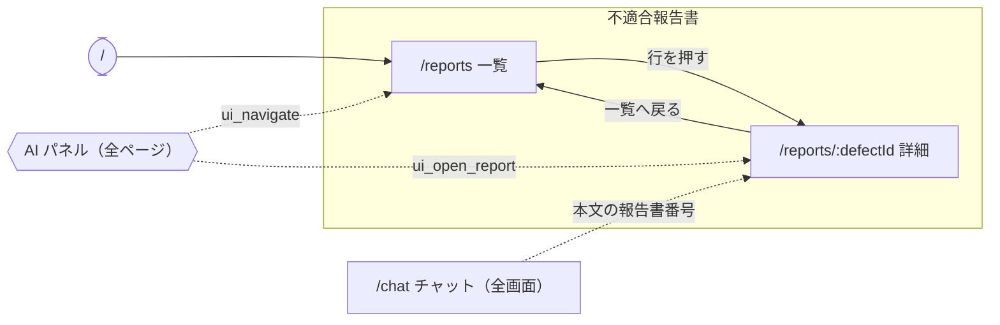

# DefectReport AI — UI設計書

> 仕様書 v2.1（第3回の終わり）。前の版から変わったところは `変更点.md`。

本書は画面の構成・レイアウト・遷移・配色・部品の決まりを定める。API の入出力は `04_API設計書.md`、項目の定義は `03_データモデル設計書.md`、要件の番号（FR-・NFR-）は `01_要件定義書.md` に従う。
AI アシスタントの中身（道具・プロンプト・ガードレール）は `06_AI設計書.md` に書く。

---

## 1. 前提と技術

- React 19 + TypeScript（Vite）、MUI、React Router。1つの画面に1つのルートを割り当てる
- チャットの本文は react-markdown と remark-gfm で表示する（表・箇条書き・太字）
- 画面の文字はすべて日本語（NFR-10）。重大度・状態・4M はコード値で受け取り、画面で日本語に直す

| 項目 | コード値 → 画面の表示 |
|---|---|
| 重大度（severity） | critical＝緊急、high＝高、medium＝中、low＝低 |
| 状態（status） | open＝未対応、in_progress＝対応中、completed＝完了 |
| 4M（category_4m） | Man＝人、Machine＝機械、Material＝材料、Method＝方法。空は「未分類」 |

- API は相対パス（`/api/…`・`/health`）で呼ぶ。開発では Vite のプロキシが backend（ポート 8000）へ渡す
- **状態の正本は URL クエリ**。人の操作も AI の画面操作（`ui_navigate`）も同じ URL クエリを書き、画面は URL を見てデータを取り直す。AI が開いた条件を、人がそのまま直して使える
- 例外はテーマ（ライト／ダーク）と AI パネルの開閉で、ブラウザ（localStorage）に持つ（テーマの切替と AI パネルは**第3回では作らない（後の回）**。第3回の画面はダークだけ）
- 入力中の値などは各画面の中に持ち、画面をまたぐ値（テーマ・AI パネル）だけを上位に持つ（過度な抽象化をしない。NFR-08）

---

## 2. 全体の枠

### 2.1 レイアウト

左からメニュー（サイドバー、幅 264px、暗色）、AI パネル、メインの3列。AI パネルは閉じると幅0になり、メインが広がる（§2.4）。第3回は AI パネルを作らず、メニューとメインの2列（AI パネルは**第3回では作らない（後の回）**）。

```
┌──────────────────┬──────────────────────┬──────────────────────────┐
│ DefectReport AI  │ AIアシスタント [≪]   │                          │
│ [状態のバッジ]   │                      │  メイン                  │
│                  │  会話                │  （ルートで切り替える）  │
│ メニュー（§2.2） │  （道具の実行・本文）│                          │
│                  │                      │                          │
│                  │ [質問を入力  ][送信] │                          │
│ ──────────────── │                      │                          │
│ [テーマ切替]     │                      │                          │
└──────────────────┴──────────────────────┴──────────────────────────┘
```

- メインの本文は最大幅 1400px で中央に置く
- AI が画面を操作したときは、画面の下に「AIアシスタントが画面を操作しました: …」と4秒出す（利用者に操作を知らせる）。**第3回では作らない（後の回）**

### 2.2 メニュー

見出し（利用者のまとまり）ごとに項目を並べる。

```
不適合報告書
  ・一覧                 /reports
AI
  ・アシスタント         （AI パネルを開閉する。表示中／閉じています）
  ・チャット(全画面)     /chat
```

- 第3回の「AI」の見出しには「チャット(全画面)」（`/chat`）だけを置く。「アシスタント」（AI パネルの開閉）は**第3回では作らない（後の回）**
- 開いている項目は、左端のアクセント色の縦線と文字色で示す
- 詳細（`/reports/:defectId`）はメニューに出さず、一覧から開く
- `/` と、どれにも当たらないパスは `/reports` へ送る
- メニューの下端に、テーマの切替ボタン（☀／🌙）を置く（**第3回では作らない（後の回）**）

状態のバッジ（`GET /health` を開いたときに1回読む）：

| 出すもの | 表示の例 |
|---|---|
| 件数・AI の状態 | `110件 · AI: OpenCode` |

- AI の状態は `chat_backend` から作る（`opencode` → 「AI: OpenCode」、`none` → 「AI 未設定」）
- backend につながらないときは「バックエンド未接続」を出す。これと「AI 未設定」はアクセント色（注意）で出す

### 2.3 画面の幅

- PC（1人1台のノート PC）で使う。幅 1280px 以上で崩れないこと

### 2.4 AI パネル

> **第3回では作らない（後の回）**。

- 全ページに置く常駐のパネル。中身は `/chat` と同じ部品（ChatPanel）で、会話は同じ DB に保存される
- 閉じても、画面を移っても、パネルを消さない（アンマウントしない）。AI が回答の途中で画面を動かしても、会話と逐次表示が切れない
- `/chat` を開いているときはパネルを隠す（同じ会話を二重に出さない）
- 開閉はメニューの「アシスタント」と、パネル見出しの「≪（パネルをたたむ）」。開閉の状態はブラウザに残す（`chatPanelOpen`）。初めて開くときは幅 1200px 以上なら開き、それ未満なら閉じる
- 幅は 400px
- 見出しは「AIアシスタント」と、新しいチャット・履歴（会話の一覧をメニューで出す）・たたむの3つのボタン

---

## 3. 画面一覧

| # | 画面 | パス | メニュー | 主な API |
|---|---|---|---|---|
| S1 | 報告書 一覧 | `/reports` | 不適合報告書 › 一覧 | `GET /api/reports`、`GET /api/masters`（選択肢） |
| S2 | 報告書 詳細 | `/reports/:defectId` | （一覧から開く） | `GET /api/reports/{defect_id}` |
| S3 | AI チャット（全画面） | `/chat` | AI › チャット(全画面) | `POST /api/chat/stream`、`GET /api/chat/sessions`、`GET`・`DELETE /api/chat/sessions/{id}` |
| — | AI パネル | 全ページ（`/chat` を除く） | AI › アシスタント | S3 と同じ。画面の操作は `GET /api/ui/events`（SSE）。**第3回では作らない（後の回）** |

- 画面は3つ（S1〜S3）と、全ページに常駐する AI パネル

---

## 4. 画面ごとの設計

### S1 報告書 一覧（`/reports`）

報告書を絞り込み・並べ替え・ページ送りして探す（FR-CR-01）。行を押すと詳細へ移る。

```
┌──────────────────────────────────────────────────────────────────────────────┐
│ 不適合報告書 一覧                                                            │
├──────────────────────────────────────────────────────────────────────────────┤
│ [キーワード（報告書ID・部品名・部品番号・不具合内容）                      ] │
│ ステータス▼ 重要度▼ 機械▼ 工程▼ 客先▼ 担当者▼ 現象▼ 4M▼ 並び順▼              │
│ 期間 [開始日]〜[終了日]                                                      │
├──────────────────────────────────────────────────────────────────────────────┤
│ 報告書ID   発生日      部品名              現象        機械     重要度 状態  │
│ KZ25-0110  2026-03-15  ギヤケース          表面キズ    GENOS…   中     完了  │
│ KZ25-0109  2026-03-10  インペラハウジング  ひずみ変形  YZ-8WR   高     完了  │
│ KZ25-0108  2026-03-10  ロータシャフト      穴位置ずれ  YZ-8WR   中     完了  │
│ …                                                                            │
├──────────────────────────────────────────────────────────────────────────────┤
│                                 表示件数 25▼   1–25（全110件）   ◀  ▶        │
└──────────────────────────────────────────────────────────────────────────────┘
```

- 表の列：報告書ID・発生日・部品名・現象・機械・重要度（色つきのチップ）・ステータス（色つきのチップ）・不良率（小数2桁の %）。不良率は API の `defect_rate` をそのまま出す
- キーワードは入力が止まって 300ms たってから URL に書く。ほかの絞り込みは選んだときに書く。条件が変わったら1ページ目に戻す
- 並び順：新しい順（既定、`-occurrence_date`）・古い順・損失額が大きい順・不良数が多い順
- ページ送り：1ページ 10・25・50 件（既定25）
- 絞り込みはすべて AND（例：機械 a61nx かつ 期間 2025-09-01〜2025-09-30 → KZ25-0043 の1件だけ。期間を 2025-10-01〜2025-10-31 にすると0件の表示）
- 絞り込みの項目は、ステータス・重要度・機械・工程・客先・担当者・現象・4M・並び順と期間（AI の `ui_navigate` で渡せる条件と同じ）
- 状態・重要度・4M の選択肢は固定の語彙。機械・工程・客先・担当者・現象の選択肢は `GET /api/masters` から作る（用語表と同じ値。画面に候補を書かない）
- 期間は発生日で絞り、両端を含む。開始日が終了日より後など、API が 422 を返したときは理由を出す（§5）

URL クエリ：

| キー | 意味 | 例 |
|---|---|---|
| `q` | キーワード | `q=補機` |
| `status`・`severity` | 状態・重大度（コード値） | `status=open` |
| `machine`・`process` | 機械・工程（マスタの表記） | `machine=a61nx` |
| `customer`・`operator`・`phenomenon` | 客先・担当者・現象 | `phenomenon=表面キズ` |
| `category_4m` | 4M | `category_4m=Man` |
| `date_from`・`date_to` | 期間（YYYY-MM-DD、両端を含む） | `date_from=2025-09-01&date_to=2025-09-30` |
| `sort` | 並び順 | `sort=-total_cost` |

### S2 報告書 詳細（`/reports/:defectId`）

1件の全項目を読む（FR-CR-03）。不良率（`defect_rate`）を出す。

```
┌──────────────────────────────────────────────────────────────────────┐
│ ← 一覧へ戻る                                                         │
│ KZ25-0043                                                            │
│ 補機マウントリブ · 表面キズ                                          │
├─ 基本情報 ───────────────────────────────────────────────────────────┤
│ 報告書ID  KZ25-0043             客先      翠峰重工業                 │
│ 発生日    2025-09-13            報告日    2025-09-24                 │
│ 発見者名  祢津                  部品番号  KRS-A58-5211-D             │
│ 部品名称  補機マウントリブ                                           │
├─ 不具合内容 ─────────────────────────────────────────────────────────┤
│ 発生工程  マシニング            使用機械  a61nx                      │
│ 作業者名  荻原                  現象分類  表面キズ                   │
│ 加工数    12                    不適合数  3                          │
│ 不良率    25.00%                重要度    [中]                       │
│ 不具合内容  補機マウントリブの位置決めダボ穴に長さ約3mmの線状キズ…   │
│ 良品状態    機能面・意匠面に目視で判別できる線状・点状の傷が無い…    │
├─ 原因・4M分析 ───────────────────────────────────────────────────────┤
│ 原因      配属間もない作業者が単独で段取りを行い、基準面の当たり…    │
│ 要因      習熟不足              4M分類    人 (Man)                   │
│ 再発案件  いいえ                手順書    あり                       │
├─ 対策 ───────────────────────────────────────────────────────────────┤
│ ステータス  [完了]                                                   │
│ 対策  新任者の単独段取りを解禁する前に、技能評価チェックリスト…      │
│ 備考  客先へ経緯を報告済み。代替品を特急で製作し納期内に納入した。   │
├─ 費用 ───────────────────────────────────────────────────────────────┤
│ 材料費 ¥20,179   社内加工費 ¥40,402   外注加工費 ¥0   その他費用 ¥0  │
│ 合計損失: ¥60,581                                                    │
└──────────────────────────────────────────────────────────────────────┘
```

- 「基本情報」「不具合内容」「原因・4M分析」「対策」「費用」の5つの区切りで、ラベルと値を2列に並べる。値が無い項目は「—」
- 金額は「¥」と3桁区切り、不良率は小数2桁の %
- 「一覧へ戻る」で `/reports` へ戻る
- 見つからない番号（404）は、理由（「報告書が見つかりません」）を出す

### S3 AI チャット（`/chat`）と AI パネル

報告書を根拠に答える AI と話す（FR-CH-01・02・06・09）。`/chat` は全画面、AI パネルは同じ部品の小さい版（第3回は独立したページ `/chat` だけ。AI パネルは**第3回では作らない（後の回）**）。

```
┌─────────────────────┬────────────────────────────────────────────────────┐
│ [＋ 新しいチャット] │ AIチャット                                         │
├─────────────────────┼────────────────────────────────────────────────────┤
│ KZ25-0043 の内容…   │  あなた: KZ25-0043 の内容を教えて                  │
│   9/27 · 2件  [削除]│  ▸ 考えています…（折りたたみ）                     │
│ 表面キズは何件？    │  ✔ get_defect_report                               │
│   9/27 · 2件        │  AI: KZ25-0043 は 2025-09-13 に a61nx で…          │
│ …                   ├────────────────────────────────────────────────────┤
│                     │ [質問を入力(Enterで送信)                 ] [送信]  │
└─────────────────────┴────────────────────────────────────────────────────┘
```

- 左の列（`/chat` だけ）：「＋ 新しいチャット」と会話の一覧（題名・更新日・メッセージ数、新しい順）。選ぶと右に会話を戻す（保存した道具の記録と思考も戻す）。行にマウスを載せると削除のボタンが出て、確認してから消す。AI パネルでは同じ一覧を「履歴」メニューで出す（パネルは**第3回では作らない（後の回）**）
- 右の列：ユーザーの発言と AI の回答を交互に出す。回答は SSE で届いた順に書き足す
- 回答の上に、道具の実行を1行ずつ出す（道具の名前は `defect-reports_` の接頭辞を外して出す。実行中・完了・失敗の印と、道具が返した題名）
- 思考（thinking）は折りたたんで出す。本文が届く前は最後の1行を見せる
- 回答の本文は Markdown で出す。本文の報告書番号（`KZ25-XXXX`・`[KZ25-XXXX]`）は詳細へのリンクにする
- 何も話していないとき：「質問を入力してください」と、押すとそのまま聞ける質問の例を出す
- Enter で送る、Shift+Enter で改行。回答が届いているあいだは入力と送信を止める
- 失敗（`error` イベント・通信の失敗）は、入力欄の上に理由を出す。AI の設定が無いとき（`chat_backend` が `none`）は、送ると「AIバックエンドが設定されていません」と出る。空の応答も成功にせず理由を出す
- 再読込しても会話が残る（会話はサーバーの DB が正本。ブラウザは履歴を送らない）

---

## 5. 画面の状態（読込中・0件・失敗）

どの画面も、読込中・0件・失敗を別の表示にする。

| 状態 | 表示 |
|---|---|
| 読込中 | 中央に回るしるしと「読み込み中…」 |
| 0件 | 表の下に「条件に一致する報告書がありません」と、件数「0」を出す（空白にしない） |
| 失敗 | 表と件数を消し、原因（API の `detail`、つながらないときは通信の失敗）と「再試行」を出す。「0件」とは混ぜない |
| 入力の誤り（422） | 期間の形の誤りや開始日 > 終了日は、API が返した理由を日本語で出す |

- 検索結果がないことと、検索できなかったことを同じ表示で隠さない
- 詳細は、失敗したら原因だけを出す

---

## 6. 画面遷移図

実線は人の操作、点線は AI の画面操作（`ui_*`）とチャットの中のリンク。メニューからはどの画面にも移れるので、メニューによる移動は描かない。



- AI パネルと `ui_*` による遷移（点線の PANEL から出る2本）は**第3回では作らない（後の回）**。第3回は `/chat` の本文の報告書番号のリンクで詳細へ移る

- `ui_navigate` はページと表示条件を URL クエリで渡す。移れるページは画面一覧にあるものだけ（アプリの外や未知のパスへは移らない）

---

## 7. 配色とテーマ

テーマは「CNCコックピット」：艶消しのグラファイトの面に、アンバー1色を差す計器盤。実装は `theme.ts`（`createAppTheme(mode)`）が正で、色は MUI の palette（`app`・`sidebar`・`chart`）に集め、各部品は `useTheme()` で読む。色を部品に直書きしない。

- 純黒を避け、面は base → paper → elevated の順に等しい明度差で重ねる
- 彩度の高い色はアクセントのアンバー1色だけ
- カードは影ではなく1px の罫線（hairline）で区切る
- 重大度・状態は色だけに頼らず、ラベル付きのチップにする
- 角の丸み `shape.borderRadius` は 10

ライト（昼版）とダーク（夜版）を切り替える（切替は**第3回では作らない（後の回）**。第3回はダーク（夜版）だけ）。

- 切替はメニュー下端のボタン。AI の `ui_set_theme`（dark／light）でも切り替わる
- 初めのモード：ブラウザに残した値（localStorage `theme-mode`）→ OS の設定が light ならライト → どちらも無ければダーク。切り替えたらブラウザに残す
- サイドバーは両方のモードで暗色（共通の見た目「操作盤」）

| トークン | ライト（昼） | ダーク（夜） |
|---|---|---|
| app.base / paper / elevated | `#F5F6F8` / `#FFFFFF` / `#EDEFF2` | `#0E1116` / `#161B22` / `#1D242E` |
| app.hairline（罫線） | `#DCE0E6` | `#2A3340` |
| text primary / secondary / disabled | `#1A222E` / `#5B6878` / `#9AA6B4` | `#E8EDF4` / `#94A3B4` / `#5B6878` |
| primary（アクセント、アンバー）/ hover | `#E58A17` / `#C97710` | `#FFA028` / `#FFB44D` |
| secondary（シアン） | `#0089AD` | `#009DC2` |
| sidebar.bg（両方とも暗色） | `#141922` | `#0A0D11` |
| severity critical / high / medium / low | `#BE1B24` / `#9A3412` / `#854D0E` / `#166534` | `#FF5C5C` / `#FF9F45` / `#FFD166` / `#6EE7A0` |
| status open / in_progress / completed | `#9A3412` / `#0369A1` / `#166534` | `#FF9F45` / `#4CC3E8` / `#34D399` |

- ライトの重大度・状態の色は、白い面の小さなチップの字でも WCAG AA（4.5:1）を満たす濃さにする

- MUI への割り当て：primary＝アンバー、secondary＝シアン、error＝severity.critical、warning＝severity.high、info＝status.in_progress、success＝status.completed、divider＝hairline

---

## 8. 部品の決まり

- 部品は MUI。枠は `Box`・`Stack`、メニューは `Drawer` と `List`（`components/Layout.tsx`）、一覧は `Table`、入力は `TextField`・`Select`、バッジは `Chip`
- 画面の見出しは `PageHeader`（題・補足・右側のボタン）
- 状態の表示は `StateViews`（`Loading`・`EmptyState`・`ErrorState`）の3つだけを使う（§5）
- 重大度・状態のチップは `SeverityChip`・`StatusChip`（`components/Chips.tsx`）
- チャットは `ChatPanel`（`/chat` と AI パネルで共通。第3回は `/chat` だけで使う）、本文は `MarkdownMessage`
- 画面の操作は `UiControlBridge`（アプリ全体に1つ。**第3回では作らない（後の回）**）。`GET /api/ui/events` を購読し、AI からの遷移とテーマの切替を行う。ブラウザが WebMCP（`navigator.modelContext`）を持つときは、同じ遷移をページの道具としても登録する
