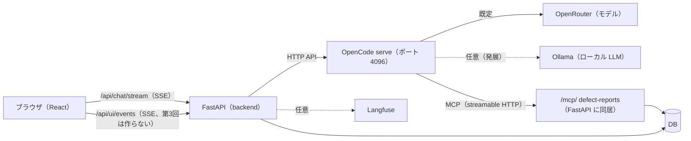
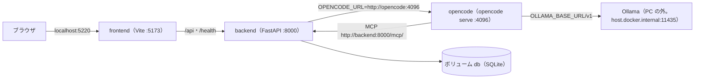
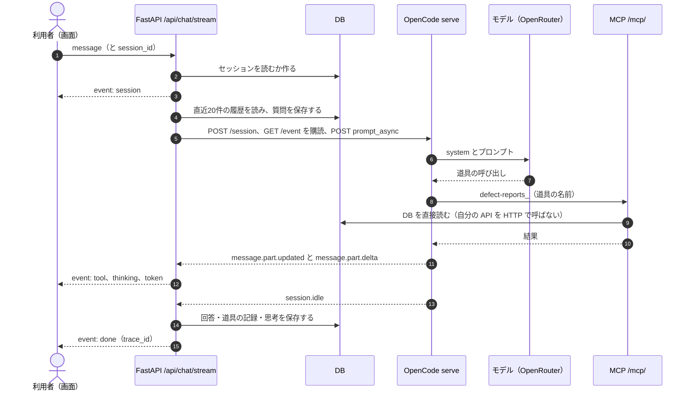
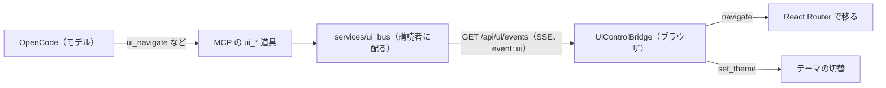

# DefectReport AI — AI設計書

> 仕様書 v2.1（第3回の終わり）。前の版から変わったところは `変更点.md`。

本書は AI を使うところの設計（接続先・道具・プロンプト・ガードレール・構造化出力・観測）を定める。項目の定義は `03_データモデル設計書.md`、API は `04_API設計書.md`、画面は `05_UI設計書.md` に従う。

| 使うところ | 中身 | 本書の節 |
|---|---|---|
| チャット（AI アシスタント） | 報告書を根拠に答える。道具（MCP）で DB を読み、画面も操作する | §1〜§5 |

> 第3回は「簡易的な AI アシスタント」を作る：道具は読み取りの5本、独立したページ `/chat`、OpenCode とローカル LLM（Ollama）、Docker Compose。書き込み・画面の操作・業務 Ontology・構造化出力・Langfuse への送信は**第3回では作らない（後の回）**（`01_要件定義書.md` §10.1）。

---

## 0. 共通：AI の構成

### 0.1 全体の構成



- LLM は backend が OpenCode を通して呼ぶ。ブラウザは LLM にも OpenCode にも直接つながない（API キーはサーバーの `.env` だけに置き、ブラウザのコードに入れない）
- AI 関係のコードは `app/backend/services/` に置く（`opencode_client.py`・`mcp_server.py`・`ontology_mcp.py`・`ui_control.py`・`telemetry.py` など。`ontology_mcp.py`・`ui_control.py` は**第3回では作らない（後の回）**）。OpenCode の設定は `app/opencode/`（`opencode.json`・`AGENTS.md`）

### 0.1.1 Docker Compose での構成（第3回から）



- 3つのサービス（`backend`・`frontend`・`opencode`）を `compose.yaml`（プロジェクト名 `lesson03`）で動かす。ポートや起動の順は `04_API設計書.md` §3.3
- `opencode` は `app/opencode/Dockerfile` で作る。npm の `opencode-ai` を **1.19.0** に固定して入れ、作業フォルダ（`/workspace`）に `opencode.json`・`AGENTS.md` を置く。OpenCode の設定や記録はコンテナの中に置き、PC のホームのフォルダに書かない
- venv ＋ npm で動かすとき（v1.1 の形）も、OpenCode は同じイメージのコンテナで動かせる（MCP の URL を `http://host.docker.internal:8120/mcp/` にする）

### 0.2 OpenCode serve（HTTP API）

OpenCode をヘッドレス（`opencode serve --hostname 0.0.0.0 --port 4096`）で動かし、その HTTP API を backend（`services/opencode_client.py`）から呼ぶ。接続先は環境変数 `OPENCODE_URL`。

| API | 使いどころ |
|---|---|
| `POST /session` | 1ターンに1つ作る |
| `GET /event`（SSE） | 全セッションの出来事が流れるので、自分の sessionID だけを見る。プロンプトを送る前に購読を始める（取りこぼさない） |
| `POST /session/{id}/prompt_async` | チャットのプロンプトを送る。結果は `/event` で受ける |
| `POST /session/{id}/message` | 待って全文を受ける（非ストリーミングの確認用） |
| `GET /session/{id}/message` | 逐次の差分が取れなかったときに、完了した回答を取り直す |
| `DELETE /session/{id}` | 使い終わったセッションを消す（失敗しても無視する） |
| `GET /global/health` | 疎通の確認 |

- 1ターンごとに OpenCode の新しいセッションを作り、終わったら消す。会話の正本は自前の DB（`chat_sessions`・`chat_messages`）で、履歴は backend がプロンプトに入れる（§1.3）
- OpenCode に最初からあるコーディング用の道具（bash・edit・write・patch・read・glob・grep・list・webfetch・todowrite・todoread・task）は、チャットでは要求ごとに `tools` で切り、MCP の道具（`defect-reports_*`）だけを使わせる
  - 第3回で固定した版（1.19.0）の道具の名前は `GET /experimental/tool/ids` で確かめた：bash・read・glob・grep・edit・write・task・webfetch・todowrite・websearch・skill・apply_patch・question（と内部用の invalid）。`question`（利用者に聞き返す道具）はヘッドレスでは答える人がいないので必ず切る。版を変えたら名前を確かめ直す
- モデルの呼び出しの失敗は、HTTP 200 のまま応答の `info.error`（逐次では `message.updated` の `error`、`session.error`）に入る。backend はこれを見て失敗にする（§3.4）
  - 1.19.0 の `error` は `{name, data}` の形（`APIError`（`data.message`・`data.statusCode`）・`UnknownError`・`ProviderAuthError`・`MessageOutputLengthError`（出力の上限で切れた）など）。出力の上限で切れたことは、`error.name` が `MessageOutputLengthError` か、回答の `info.finish` が `length` で見分ける
- MCP の道具の一覧は OpenCode が起動したときに読む。道具を変えたら OpenCode を起動し直す
- OpenCode は作業フォルダの `AGENTS.md` を常設の指示として読む（§3）

### 0.3 接続先（LLM）

- **この演習の環境（第3回）**：OpenRouter のキーは置かず、ローカル LLM（Ollama）の `gemma4:26b` を使う。`.env`（または Compose）で `OPENCODE_MODEL=ollama/gemma4:26b`、`OLLAMA_BASE_URL=http://host.docker.internal:11435`（コンテナから。PC からは `http://localhost:11435`）。`opencode.json` には provider `ollama` だけを置き、OpenCode に最初からある `opencode` プロバイダ（無料のモデル）は使わない（切る）。セッションの題などを作る小さいモデル（`small_model`）も `ollama/gemma4:26b` にして、ほかの接続先を呼ばせない。出力の上限は 8,000 トークン
- **OpenRouter（既定）**：必須のキーは `OPENROUTER_API_KEY` の1本（NFR-02）。モデルは `OPENCODE_MODEL`（既定 `anthropic/claude-sonnet-4.5`、OpenRouter のモデル名）、プロバイダは `OPENCODE_PROVIDER`（既定 `openrouter`）。モデルはコードに書かず、`.env` で替える。`opencode.json` に置くモデルは `anthropic/claude-sonnet-4.5`・`openai/gpt-4o-mini`・`google/gemini-2.5-flash`
- **ローカル LLM（Ollama、任意・発展）**：既定の `opencode.json` には入れない。使うときは provider `ollama`（`@ai-sdk/openai-compatible`、`baseURL` は `{env:OLLAMA_BASE_URL}/v1`、道具を呼べる `tool_call: true` のモデル）を足し、`.env` に `OLLAMA_BASE_URL=http://<Ollama のホスト>:11434` と `OPENCODE_MODEL=ollama/<モデル>` を書いて OpenCode を作り直す。接続先はファイルに書かず、環境変数で渡す。`OPENCODE_MODEL` が `ollama/` で始まれば、backend はプロバイダを `ollama` と読む

どの経路を使うかの判定：

| 用途 | 判定 | 返す値 |
|---|---|---|
| チャット | `routers/chat.py` の `chat_backend()` | `opencode`（`OPENCODE_URL` がある）／`none` |

- `GET /health` の `chat_backend` でチャットの AI の有無が分かる。画面はこれで「AI 未設定」を出す

### 0.4 AI が無いとき（縮退）

| 用途 | AI が無いときの動き |
|---|---|
| チャット | 送ると `error` イベント（「AIバックエンドが設定されていません(OPENCODE_URL / OPENROUTER_API_KEY)」）。質問は保存する |
| 観測（Langfuse） | 設定が無い・つながらないときは送らない。本体は止めない |

---

## 1. チャット（報告書を根拠に答える）

報告書を根拠に答える（FR-CH-01）。回答は SSE で逐次出す（FR-CH-02）。履歴はサーバーが DB から読む（FR-CH-06）。書き込みは利用者がはっきり頼んだときだけ（FR-CH-08）。会話はセッションで保存・復元・削除できる（FR-CH-09）。

### 1.1 流れ



### 1.2 SSE のイベント

| イベント | 中身 | いつ |
|---|---|---|
| `session` | `{id, title}` | 最初に1回 |
| `thinking` | `{text}`（推論の差分） | 逐次 |
| `tool` | `{name, status, title}`（status は pending・running・completed・error） | 道具の状態が変わるたび |
| `token` | `{text}`（本文の差分） | 逐次 |
| `done` | `{trace_id}`（Langfuse が無ければ null） | 最後に1回 |
| `error` | `{detail}` | 失敗したとき（done の代わり） |

- `/event` の `message.part.delta`（field＝text）は、part の種類で振り分ける（reasoning → thinking、それ以外 → token）。`message.part.updated` の tool part は、状態が変わったときだけ `tool` にする
- 差分が1つも取れなかったときは、`GET /session/{id}/message` から完了した回答を取り直して `token` を1回送る

### 1.3 履歴と会話の保存

- 会話の正本は DB（`chat_sessions`・`chat_messages`）。ブラウザは履歴を送らず、`session_id` だけを送る
- 新しい会話の題は、最初の質問の先頭30文字
- 履歴は、今の質問を保存する前に DB から直近20件を読む（二重に数えない）
- 質問は失敗したときも保存する。回答は本文・道具の記録（名前・状態・題）・思考を保存する
- 会話を開き直すと、保存した道具の記録と思考も戻す

### 1.4 プロンプトの組み立て

OpenCode は1問1答なので、backend が文脈・履歴・質問を1つの本文に畳み込む。

```
# これまでの会話
ユーザー: …
アシスタント: …

# 質問
…
```

system（`routers/chat.py` の `_OPENCODE_SYSTEM`）は4つの節と、業務 Ontology の文脈でできている。

| 節 | 中身 |
|---|---|
| データ | 報告書の項目（defect_id・発生日・客先・工程・機械・作業者・部品・加工数と不適合数・不具合内容・現象・原因・対策・4M・重要度・状態・費用） |
| 道具の選び方 | 固有名詞の表記を確かめる（`resolve_ontology_entity`。別名の機械に読み替えない。第3回は `list_masters`） → 条件が明確なら一覧、内容が曖昧なら検索 → 深掘りは1件取得 → 集計は集計の道具（条件別は `query_quality_ontology`、全体は `get_statistics`。第3回は `get_statistics` と `list_defect_reports` の `total`）。同じ道具を同じ引数で繰り返さない（多くは2〜3回で足りる） |
| 書き込み | 「登録して」「更新して」とはっきり頼まれたときだけ。実行後は defect_id と変えた内容を報告する（第3回は書き込みの道具が無いので「この版ではできない」と答える） |
| 回答の決まり | 結論を先に、根拠（件数・例・傾向）を後に。データに無いことは「データからは確認できない」と言う |
| 業務 Ontology | `ontology/quality.json` から作る対象・関係・指標（式と単位）・制約と、Ontology の道具の使い方（§2.5）。**第3回では作らない（後の回）** |

### 1.5 検索

- `search_defect_reports` はキーワード検索：質問を空白で分けた語のどれかを、不具合内容・原因・対策・部品名・現象に部分一致（LIKE）で探し、語の出てくる回数で並べて上位を返す
- 条件が明確な質問（機械・工程・期間など）は、検索ではなく `list_defect_reports`（完全一致）で引く

---

## 2. 道具（MCP）

### 2.1 MCP サーバー

- FastMCP で作り、FastAPI に同居させる（`services/mcp_server.py` の `mcp.http_app(path="/")` を `/mcp` に載せる。URL は `/mcp/`、streamable HTTP）。サーバーの名前は `defect-reports`
- OpenCode は `opencode.json` の `mcp.defect-reports`（type: remote、backend の `/mcp/`）でつなぐ。OpenCode から見た道具の名前は `defect-reports_<名前>`
- 道具は DB を直接読む（自分の REST API を HTTP で呼ばない）。絞り込み・1件の取得は REST と同じ処理（`services/report_service.py`）を使う。登録・更新も同じ処理を使う（書き込みは**第3回では作らない（後の回）**）
- 各道具の説明（docstring）に「いつ使うか」・引数の例・0件のときの動き方を書く（道具を選ぶ正しさが上がる）
- サーバーの `instructions` に、推奨の順（表記を確かめる → 一覧か検索 → 1件取得／集計）、完全一致と0件の扱い、書き込みは明示の依頼だけ、画面の操作の決まりを書く（第3回は読み取りの決まりだけ）
- 道具の結果には作業者・発見者などの名前も含める（架空データのため。作業者別の質問に答えるのに要る。実データでは運用の前に決める）

### 2.2 道具の一覧と本数

- 道具は15本（読み取り5・書き込み2・画面の操作3・業務 Ontology 5）。第3回で作るのは読み取りの5本だけ。書き込み・画面の操作・業務 Ontology の10本は**第3回では作らない（後の回）**

| 区分 | 道具 | いつ使うか |
|---|---|---|
| 読み取り | `list_defect_reports` | 条件が明確な絞り込み（機械・工程・客先・期間・重大度・状態・現象など）。完全一致。`{total, items}` を返す。0件なら条件を1つ外すか表記を確かめる（利用者の条件を黙って外した答えはしない） |
| 読み取り | `search_defect_reports` | 内容が曖昧な類似事例探し（「〜のような不良」）。この版はキーワード検索（§1.5） |
| 読み取り | `get_defect_report` | 番号（KZ25-XXXX）で1件の全項目。無い番号は「見つかりません」を返す |
| 読み取り | `get_statistics` | 集計（件数・不適合数・現象別・機械別・月別など。期間を指定できる） |
| 読み取り | `list_masters` | 6種（客先・工程・機械・作業者・現象・要因）の正確な表記と使用件数 |
| 書き込み | `create_defect_report` | 報告書の新規登録。はっきり頼まれたときだけ。番号は自動採番、状態は open に固定 |
| 書き込み | `update_defect_report` | 報告書の部分更新。はっきり頼まれたときだけ。変えられるのは8項目（§2.3） |
| 画面の操作 | `ui_navigate` | ページと表示条件を画面に出す（§2.4） |
| 画面の操作 | `ui_open_report` | 報告書の詳細を開く（移るだけで、内容は返さない） |
| 画面の操作 | `ui_set_theme` | ライト／ダークを切り替える |
| 業務 Ontology | `get_ontology_definition` | 対象・関係・指標の式・制約を取る |
| 業務 Ontology | `resolve_ontology_entity` | 機械名・工程・客先の名前を実データの ID に解決する |
| 業務 Ontology | `get_ontology_object` | 型と ID で対象の属性と出典を取る |
| 業務 Ontology | `traverse_ontology_relation` | 決めた関係を実データのキーでたどる |
| 業務 Ontology | `query_quality_ontology` | 条件（機械・工程・客先・期間・状態）別の件数・記録上の不適合率・損失をサーバーで集計する |

### 2.3 書き込みの道具

> **第3回では作らない（後の回）**。

- 書き込みは利用者がはっきり頼んだとき（「登録して」「更新して」「〜にして」）だけ。画面に許可のスイッチは作らず、AGENTS.md・system・道具の説明で守る。書き込みの道具が呼ばれたことは、画面の道具の表示と DB の記録で確かめられる
- `create_defect_report`：必須は発生日・客先・工程・機械・作業者・部品番号・部品名・加工数・不適合数・不具合内容・現象・重大度。番号は自動採番、状態は open に固定。返すのは `{created, defect_id}` か `{created: false, error}`
- `update_defect_report`：変えられるのは status・severity・countermeasure・cause・factor・category_4m・notes・good_condition の8項目だけ。渡した項目だけを変え、`{updated, defect_id, changed}` を返す
- 報告書の削除は道具にしない（AI からは消せない）

### 2.4 画面を操作する道具（WebMCP）

> **第3回では作らない（後の回）**。

AI が画面を操作できるようにする。人の操作と AI の操作は同じ URL クエリを見る（状態の正本は URL。テーマだけはブラウザに持つ）。



- 画面の操作はデータを変えない（画面を移る・表示の条件を変える・テーマを切り替えるだけ）
- 移れるのはアプリの中の決まったパスだけ（先頭が `/` で、画面一覧にあるもの）。知らないページ名は `{ok: false, error}` で返す
- ブラウザがつながっていなければ `{ok: false, error: "ブラウザ画面が接続されていません(アプリを開いてもらってください)"}` を返す。AI はこれを成功と言わない
- 画面は操作されたことを知らせる（「AIアシスタントが画面を操作しました: …」）
- SSE は15秒ごとに keep-alive を送る

`ui_navigate` のページと、渡せる表示条件（それ以外の条件は黙って捨てる）：

| page | 開く画面 | 表示条件 |
|---|---|---|
| `reports` | `/reports` | `q`・`machine`・`severity`・`status`・`process`・`customer`・`operator`・`phenomenon`・`category_4m`・`sort`・`date_from`・`date_to` |
| `chat` | `/chat` | — |

- 例：「a61nx の報告書を損失額の大きい順で一覧にして」→ `ui_navigate(page="reports", machine="a61nx", sort="-total_cost")`。機械などの表記は先に確かめる
- ブラウザが WebMCP（`navigator.modelContext`）を持つときは、画面の移動をページの道具（`defectreport-navigate`）としても登録する。持たないブラウザでは何もしない

### 2.5 業務 Ontology の道具

> **第3回では作らない（後の回）**。業務 Ontology は第4回で扱う。

用語表を機械が読める形にした `app/backend/ontology/quality.json` を、道具で読む（道具は読み取りだけ）。MCP は接続の口で、意味の定義や業務の処理を道具の中に写さない（`services/ontology.py` と同じ処理を呼ぶ）。

| 中身 | 値 |
|---|---|
| 対象 | DefectReport（報告書）・MachineLabel（報告に記録された機械名）・Process（工程）・Customer（客先） |
| 関係 | `recorded_on`（報告書→機械名）・`in_process`（→工程）・`for_customer`（→客先） |
| 指標 | `report_count`（件）・`defect_units`（個）・`recorded_production_units`（個）・`recorded_defect_rate`・`known_loss_jpy`（円） |
| 制約 | 機械の個体・工場・ロット・正常品を含む母集団・因果関係は元データに無いので、推論で補わない。取得した時点の DB を読む |

- 機械名・工程・客先は、まず `resolve_ontology_entity` で ID に解決する。`can_auto_select=false` なら候補を勝手に選ばず、利用者に確かめる
- 条件別の件数・損失は `query_quality_ontology`（期間と ID を含む scope を渡す）。返す `metrics` は該当する全報告の集計で、`objects` はそのページの根拠の例。例の数を総数として答えない
- 記録上の加工数は報告に書かれた範囲だけ。工場全体の不良率に読み替えない（`quality`・`provenance` を確かめる）
- 類似は因果ではない。検索で候補を見つけ、報告書の番号で Ontology の対象と関係を確かめる
- 期間や対象を解決できないときは、範囲を黙って広げずに失敗と理由を返す（空の成功にしない）
- 定義は system に入れて渡す（§1.4）。MCP の Resource（`ontology://quality/definition`）もあるが、自動で読まれる前提にはしない

---

## 3. AGENTS.md とガードレール

### 3.1 指示の置き場所

| 置き場所 | 中身 |
|---|---|
| `app/opencode/AGENTS.md` | OpenCode がプロジェクトの常設の指示として読む。道具の使い方・書き込みの決まり・Ontology の使い方・出力の決まり・画面の操作の決まり（第3回は読み取りの道具の使い方・出力の決まりと、「書き込み・画面の操作はこの版ではできない」こと） |
| system（`routers/chat.py`） | 毎回の要求に付ける。データの説明・道具の選び方・書き込み・回答の決まりと、Ontology の文脈（§1.4） |
| MCP の `instructions` と各道具の説明 | 道具を選ぶ場面で読まれる。いつ使うか・引数の例・0件のときの動き方（§2.1） |

- 3か所に同じ決まりを書き、どれか1つが読まれなくても守られるようにする。決まりを変えたら3か所をそろえる

### 3.2 ガードレール

- そのターンで道具から取った値だけで答える。記憶や推測で件数・傾向を言わない
- 存在しない報告書番号や機械名を作らない。似た名前の実在するものに読み替えない（まず「該当は存在しません」と言い、候補を出すにとどめる）
- 絞り込みは完全一致。0件なら「該当なし」と伝え、利用者が決めた条件を黙って外さない
- 件数・集計は集計の道具で数える（例：「表面キズは何件？」→ 38件）
- 実行していない操作を「しました」と言わない
- 空の応答やエラーを成功として扱わない
- 書き込みは、はっきり頼まれたときだけ。実行したら defect_id と変えた内容を報告する
- 同じ道具を同じ引数で繰り返し呼ばない
- **毎ターン独立**：報告書の値・件数・内容を言うときは、そのターンで道具を呼んで得た結果だけを使う。前のターンの結果や会話の履歴から組み立て直さない（それは捏造になる）。道具を1回も呼ばずに報告書の中身を語らない
- 件数は集計の道具（`get_statistics`・`list_defect_reports` の `total`）で数える。`list_masters` の `usage_count` は表記を確かめるためのもので、件数の答えに使わない（第3回の確認で、`usage_count` で「38件」と答えた例があった）
- **画面を操作したと答える前に、必ず `ui_*` を呼ぶ**。前のターンで同じ操作をしていても、そのターンで呼び直す（`ui_*` は何度呼んでも安全）。会話が長くなっても、直前に似た操作をした後こそ省かない

画面の操作の対応表（迷ったらこれに従う。画面の操作は**第3回では作らない（後の回）**。第3回の AI は、画面の操作を頼まれたら「この版ではできない」と答え、本文に報告書番号を書いて利用者がリンクで開けるようにする。下の表の最後の行（件数・集計）は第3回も守る）：

| 依頼 | 呼ぶ道具 |
|---|---|
| 「KZ25-XXXX を開いて／見せて」 | `ui_open_report`。内容（客先・日付など）を1項目でも言うなら `get_defect_report` も呼ぶ（`ui_open_report` は移るだけで内容を返さない） |
| 「〜の一覧を出して／絞って／並び替えて」 | `ui_navigate(page="reports", …)`。チャットに箇条書きで並べず、画面に出す |
| 「ダーク／ライトにして」 | `ui_set_theme` |
| 件数・集計を答える | `get_statistics` か `list_defect_reports` を必ず呼ぶ |

- 純粋な質問（「何件？」「原因は？」）はチャットで答え、必要なら画面に出すことを提案する

### 3.3 受け入れ条件（チャット）

| 質問 | 期待する動き |
|---|---|
| 「KZ25-0043 の内容を教えて」 | `get_defect_report` が呼ばれ、回答に機械 a61nx が入る |
| 「KZ25-9999 を教えて」 | 道具で確かめたうえで、無いと答える（番号や内容を作らない） |
| 「表面キズは何件？」 | 集計の道具で数え、38件と答える |
| 会話のあとに再読込 | 会話が残る（DB から戻る） |

- 違反の例（存在しない番号、道具を使わずに件数を答える、画面を操作したと偽る）も先に用意して試す
- 確かめ方は3つに分ける：LLM を差し替えた pytest（道具を直接呼ぶ・SSE のイベントの順と保存）、画面、実際の LLM

### 3.4 エラーを成功にしない

- モデルのエラー（`info.error`、`message.updated` の error、`session.error`）は例外にし、`error` イベント（`{detail}`）で理由を出す。done は送らない
- 差分が取れず、完了した回答を取り直しても本文が空なら、「OpenCodeが空応答を返しました(モデル未応答)。もう一度お試しください」で失敗にする（空の成功にしない）
- 残高切れ（402）はモデルのエラーとして届くので、`error` イベントで理由を出す。出力の上限で切れた回答（finish_reason＝length）も成功にしない
- 失敗したときも、質問と trace は残す（trace には error を入れる）

---

## 4. 構造化出力

> **第3回では作らない（後の回）**。第3回は、元データの110件が数量の決まり（§4.3）を満たすことだけを確かめる。

### 4.1 考え方

- AI の出力を JSON Schema で決めた形で受け取り、コードで扱う
- 検査を2つに分ける：**形の検査**（型・必須・余計な項目が無い）と、**業務ルールの検査**（数量の関係など）。形が合っていても業務ルールに反することがある
- 読めない値は null にする（0 や空文字で埋めない）。null と 0 を区別する
- 選べる値が決まっている項目（重大度・4M）は、プロンプトでコード値に直させ、受け取ったあとサーバーで確かめる

### 4.2 報告書の項目のスキーマ

帳票の文章から報告書の項目を取り出す形（`services/llm.py` の `_extraction_schema()`）。全項目を null 可にし、`required` に全項目、`additionalProperties: false`。enum は使わない。

```python
def _extraction_schema():
    def s(*types):               # どの項目も null 可
        return {"type": [*types, "null"]}
    props = {
        "occurrence_date": s("string"), "report_date": s("string"),
        "customer": s("string"), "discoverer": s("string"),
        "process": s("string"), "machine_name": s("string"), "operator_name": s("string"),
        "part_number": s("string"), "part_name": s("string"),
        "production_count": s("integer"), "defect_count": s("integer"),
        "defect_description": s("string"), "good_condition": s("string"),
        "phenomenon": s("string"), "cause": s("string"), "factor": s("string"),
        "severity": s("string"), "countermeasure": s("string"),
        "material_cost": s("number"), "processing_cost": s("number"),
        "outsourcing_cost": s("number"), "other_cost": s("number"),
        "is_recurrence": s("boolean"), "has_procedure": s("boolean"), "notes": s("string"),
    }
    return {"type": "object", "properties": props,
            "required": list(props.keys()), "additionalProperties": False}
```

### 4.3 業務ルールの検査

- 数量の決まり：**0 ≦ 不適合数 ≦ 加工数**。構造化出力の結果をこの決まりで確かめ、反していれば警告にする（値は勝手に直さない）
- 例：加工数100・不適合数5 は正しい。100個中100個、100個中0個も正しい。加工数10・不適合数25 は反する

---

## 5. 観測（Langfuse）

### 5.1 1問1トレース

- Langfuse への送信は**第3回では作らない（後の回）**。第3回は `services/telemetry.py` が「設定が無いので記録しない」だけを持ち、`done` の `trace_id` は null。`LANGFUSE_*` が無くてもチャットが動くことを確かめる
- `LANGFUSE_HOST`・`LANGFUSE_PUBLIC_KEY`・`LANGFUSE_SECRET_KEY` があるときだけ送る。設定が無い・SDK が無い・つながらないときは何もしない（本体を止めない。`services/telemetry.py`）
- チャット1問＝1トレース（名前 `chat`）。`done` イベントで `trace_id` を画面に返し、画面の回答とトレースを照合できるようにする
- トレースには質問・道具の呼び出し・回答を残す
- トレースの入力（input）に質問を、使ったトークンを必ず残す（input が空、usage が0 のトレースを作らない）

---

## まとめ：使うところとエンジン

| 使うところ | エンジン | 呼び方 | 構造化 | 逐次 |
|---|---|---|---|---|
| チャット | OpenCode（OpenRouter が既定） | `opencode_client.stream`（prompt_async と /event）＋ MCP の道具 | — | ○（token・thinking・tool） |

- MCP の道具は15本（第3回は読み取りの5本）
- 第3回のチャットは OpenCode ＋ ローカル LLM（Ollama の `gemma4:26b`）。Docker Compose で動かす（§0.1.1）
